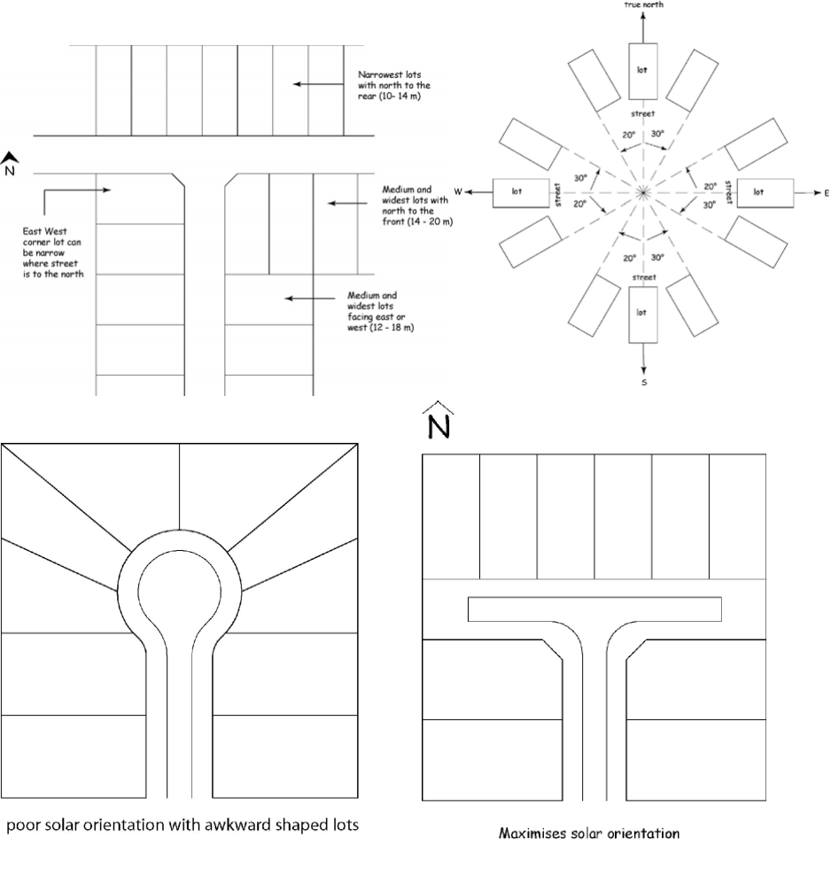

## 5. Subdivision

This section provides comprehensive guidelines for the preparation and submission of development applications for the subdivision of land, where such a land use is permissible under the provisions of the Gilgandra LEP 2011. The aim of this section is to ensure subdivision occurs in a manner that supports the intention of the zone in which it is proposed and achieves good urban structure outcomes.

### 5.1 General requirements for subdivision

#### 5.1.1 Lot size

a. The minimum subdivision allotment size requirement for a particular parcel of land shall be in accordance with the provisions of the Gilgandra LEP 2011 and the accompanying Lot Size Map, relevant to the subject land.

#### 5.1.2 Topography and landform

a. The topography and landform of the site must be taken into consideration as part of the design of the subdivision layout, in order to optimise solar access opportunities and maximise views to key natural features.

b. The topography and landform of a locality are important place-making elements and hence, roads should be designed to respond to such features.

#### 5.1.3 Solar access

a. Aspect is a major factor in designing the layout of a subdivision.

b. Roads running generally east – west are preferred since they provide for lots with north-south aspect, which caters for optimum solar access to dwellings and private open space. Lots with a main north-south axis (20ºW to 30°E) provide the best flexibility for the siting of future dwellings and also reduce potential overshadowing problems.

c. Lots with a main east-west axis (ie roads running north-south) should be widened, in order to ensure satisfactory solar access opportunities into living rooms of future dwellings and rear private open space areas and to help prevent overshadowing of dwellings and private open space on adjoining lots.

d. Lots with a NW – SE or NE – SW axis are less favourable and may need to be specifically designed or larger than normal to allow for the siting of a dwelling which is not directly parallel to the boundaries.

e. Lots should be rectangular shaped rather than irregular shaped, wherever practicable, in order to maximise solar access opportunities. Lots on the southern side of any road should have a greater frontage to the road, to allow improved solar orientation for the future dwelling.

f. Wherever possible, an access way to a rear battle-axe lot should be located on the southern side of an allotment, in order to minimise any potential overshadowing of future adjoining dwellings.

Figure 5-1 Solar Access Orientation

> [Picture on page 20: a picture, saved as a picture (images/gilgandra-development-control-plan-2011-page-20-2.gif, 150 dpi).]

#### 5.1.4 Battleaxe lots

a. The minimum lot width for a battle-axe allotment shall be 20 metres. The 20 metre minimum lot width requirement for battle axe lots is set at 7.5 metres from the end of the battle axe handle (ie within the main building portion of the site).

b. A maximum of two (2) battle-axe allotments will be permitted behind an allotment which has direct frontage to a dedicated public road in the proposed subdivision. Under no circumstances will Council favourably consider any subdivision proposal involving a series of battle-axe lots, one behind each other.

c. All battle-axe allotments must have direct access to a dedicated public road, through the provision of an access handle attached to each battle-axe lot or via a shared access corridor (ie maximum of two

(2) lots may share a common access corridor).

d. The minimum access corridor width for a battle axe allotment shall be 6 metres with a minimum road pavement width of 3 metres for the entire length of the access handle.

#### 5.1.5 Road and access

a. The design features of local roads should encourage responsible driver behaviour and restrain traffic volumes and speed.

b. The orientation and placement of the movement system should make best use of:

i. opportunities for connectivity,

ii. the existing streetscape,

iii. the location of existing and proposed activity centres ,

iv. the natural topography and vegetation,

v. opportunities for views and vistas,

vi. natural drainage and open space system,

vii. The design features of each road should convey its primary function.

c. The road reserve width should be sufficient to cater for all road functions, including parked vehicles; safe and efficient movement of all users; and the location, construction and maintenance of public utilities.

d. The alignment and geometry of roads identified for bus routes should allow for efficient movement of buses and provision of accessible transport stops.

e. The carriageway width of roads identified as bus routes should allow for movement of buses unimpeded by parked cars and safely accommodate cyclists.

f. Where cul-de-sacs/dead end streets are incorporated into the road design:

i. they should serve no more than 10 lots

ii. The end of the cul-de-sac should be clearly visible from the cross-street.

g. Consideration should be given to on-street parking and the design vehicle.

#### 5.1.6 Landscaping

a. Subdivision involving new road construction shall include street tree planting of suitable species.

b. Landscape plans shall be provided for all dual use drainage reserves to enhance recreational opportunities and visual amenity without compromising drainage function.

#### 5.1.7 Vegetation

a. The design shall accommodate the retention of any significant trees and vegetation.

b. Degraded areas are to be rehabilitated as part of the subdivision.

c. Watercourses and drainage lines to be retained as part of the subdivision scheme are to be stabilised and revegetated with appropriate native species.

d. Environmentally sensitive areas are to be preserved and enhanced with appropriate native vegetation where necessary.

#### 5.1.8 Bushfire

a. Any proposed residential subdivision upon land classified as bush fire prone land is an Integrated Development Application under section 91 of the Environmental Planning and Assessment Act 1979 since the formal concurrence is required from the NSW Rural Fire Service , pursuant to section 100B of the Rural Fires Act 1997. New residential subdivisions in bush fire hazard prone lands will generally need to be designed in accordance with the Planning for Bushfire Protection Guidelines or applicable documents.

#### 5.1.9 Cut, fill and earthworks

a. Site works are to be planned to allow topsoil to be stripped, stockpiled and reused on the site.

b. Filling and levelling shall not adversely affect adjoining land.

#### 5.1.10 Services

a. Essential services are to be provided to each lot where services are provided, including the delivery of:

i. a satisfactory supply of water

ii. electricity

iii. communications

iv. the sustainable management of sewage.

b. Adequate buffers are to be maintained between utilities and houses to protect residential amenity and health.

c. Council will generally require copies of detailed construction plans, approved by the respective utility provider, to be submitted before a construction certificate will be issued for subdivision work.

#### 5.1.11 Buffers

a. Buffers are to be provided, when necessary, between the proposed lots and existing noise generators or receivers.

b. Buffers are to be provided, when necessary, to protect visual amenity.

c. Landscape plans are to include the appropriate treatment of buffer areas.

#### 5.1.12 Rural residential subdivision

a. Subdivision design should not result in the fragmentation of viable lots utilised for agricultural, intensive agricultural or other rural related activities.

b. The width to depth ratio of allotments should not exceed 1:4. If lots are too elongated, land uses in rural or rural-residential areas may be restricted (e.g. the shape of long lots may preclude the establishment of farm dams.)

c. Subdivision design should minimise clearing of vegetation.

d. Access to the development site should be at a grade less steep than 1 in 5 and minimise the need for earthworks.

e. Servicing should be carried out along the access corridor and not require clearing of a separate corridor.

f. Subdivision plans should indicate the level of services to be provided and how those services will be supplied for each lot.

g. Council requires that a site and context analysis be undertaken for the land and shall include information clarifying the presence of adjacent or nearby agricultural activities and any potential off-site impacts that may have on potential development within the proposed subdivision.

### 5.2 Residential subdivision

a. A range and mix of Lot sizes are produced, suiting a variety of needs and with areas and dimensions that:

i. Use land efficiently and are adaptable.

ii. Protect ecological, scenic, social and heritage features.

iii. Address site constraints, such as slope, flooding and bushfire risk, among others.

iv. Retain significant features of the site, such as trees or views.

v. Result in a street and lot layout arrangement that facilitates energy efficient building, siting and design.

b. The subdivision layout should be designed to integrate with the surrounding neighbourhoods and natural environment. Road systems should respond and address natural waterways, open space and ecological corridors to complement and enhance existing streetscapes and landscapes, and provide for shared use of public facilities by adjoining communities.

c. Street lighting systems are to be provided for roads and intersections as well as pedestrian crossing and traffic calming device locations in accordance with AS / NZS 1158 Road Lighting.

d. Access ways should have a minimum sealed width of 6.0 metres.

e. Access ways should not serve more than five lots.

f. Streets are to be designed to allow on street car parking.

g. Streets and lots are to be located so that residential dwellings are not subjected to unacceptable traffic noise.

h. Streets are to be designed to cater for service vehicles.

i. Where site topography prevents discharge of storm water directly to the street gutter or a Council controlled pipe system, inter allotment drainage shall be provided to accept run off from all existing or future impervious areas on the subject land. The design and construction of the inter allotment drainage system should be in accordance with the requirements of Australian Rainfall and Runoff

j. In the case of a major residential subdivision, a staging plan will be required which shows the proposed staging program. Additionally, the Statement of Environmental Effects shall provide a detailed outline of the proposed staging program, including the proposed total number of lots within each relevant stage

### 5.3 Industrial subdivision

a. Lots should be generally rectangular in shape.

b. The design of the subdivision should allow for the largest vehicles anticipated requiring access to the subdivision, which will typically be semi-trailers and B-Double trucks.

c. Lot size should be such to allow trucks to manoeuvre on-site without reversing onto or off the lot.

d. Industrial lots shall have a minimum street frontage of 25m and an area not less than that specified in Gilgandra LEP 2011.

e. The subdivision layout facilitates the integration of industrial development into their surrounds ensuring minimum impact on the amenity of adjacent and nearby areas and providing for reasonable buffers between any existing or potentially incompatible land uses.

f. Council recognises that lot sizes for the different types of industrial subdivision will vary according to functional purpose. In considering an application for subdivision, Council will have regard to the following factors:

i. If the subdivision involves the creation of a significant number of lots then provision should be made for a variety of lot sizes;

ii. The size of lots should provide sufficient space to accommodate the industrial operations and buildings envisaged, make allowance for possible future expansion and allow the site to function properly and efficiently in terms of development requirements. These requirements may relate to factors such as safe ingress and egress, vehicular movement within the curtilage of the site, parking, deliveries, storage and bin areas, boundary setback requirements and landscaped areas; and

iii. The overall pattern of lot sizes in the locality and the type of industrial activity characteristic of the locality in which the subdivision is located.

g. Battle-axe lots may be acceptable for light and service industries which are not serviced by larger vehicles. Details such as the shape of the effective lot area, the need for truncation in the lot and the width of the access handle will be determined on a case by case basis.

h. Vehicular access from allotments to a public road are capable with complying with the provisions of

AS2890.1 Parking Facilities – Off Street Car parking and the RTA’s Guidelines for Traffic Generating Development.

i. Direct vehicular access to major roads from within individual lots is avoided.

### 5.4 Subdivision plan information requirements

The Subdivision Plan should include a level of supporting information appropriate to the size of the subdivision proposed. The subdivision application must provide plans containing the following information:

a. A North point.

b. A date and drawing number of the plan.

c. The name of the person / company who prepared the plan.

d. The real property description of the land.

e. A site location plan.

f. A site area and dimensions of existing and proposed lots.

g. Contours of the site showing topography of the land..

h. Trees and vegetation to be retained on site and clearly identify areas to be cleared.

i. Site constraints eg; flooding and bushfire, that may limit the land’s subdividable area

j. A Statement of Environmental Effects which addresses the proposal’s relationship with relevant environmental planning instruments (including any relevant State Environmental Planning Policy, State Code, relevant LEP etc) and this DCP.
