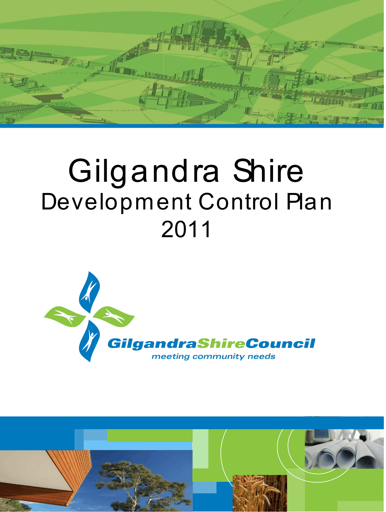

# Gilgandra Development Control Plan 2011

> This chapter is split into 27 section file(s), one per numbered heading, in the order they appear in the PDF.

Source PDF: [gilgandra-dcp-2011-july-2012-version2.pdf](gilgandra-dcp-2011-july-2012-version2.pdf)

> [Picture on page 1: a picture, saved as a picture (images/gilgandra-development-control-plan-2011-page-1-1.gif, 150 dpi).]

### Gilgandra Shire

### Development Control Plan

### 2011

> The PDF's contents list (page numbers of the printed document) is not repeated here - see Sections below.

<!-- sections -->
## Sections

1. [1 Introduction](01-1-introduction.md)
2. [2 Submitting an Application](02-2-submitting-an-application.md)
3. [3 Notification](03-3-notification.md)
4. [4 Site and Context Analysis](04-4-site-and-context-analysis.md)
5. [5 Subdivision](05-5-subdivision.md)
6. [6 Rural Zones](06-6-rural-zones.md)
7. [7 Residential Development](07-7-residential-development.md)
8. [8 Business Development](08-8-business-development.md)
9. [9 Enterprise Corridor](09-9-enterprise-corridor.md)
10. [10 Industrial Development](10-10-industrial-development.md)
11. [11 Indigenous Heritage](11-11-indigenous-heritage.md)
12. [12 Non - Indigenous Heritage](12-12-non-indigenous-heritage.md)
13. [13 Bed and Breakfast / Farm Stay Accommodation](13-13-bed-and-breakfast-farm-stay.md)
14. [14 Car Parking](14-14-car-parking.md)
15. [15 Advertising](15-15-advertising.md)
16. [16 Child Care Centres](16-16-child-care-centres.md)
17. [17 Aerodrome](17-17-aerodrome.md)
18. [18 Brothels (Sex Services)](18-18-brothels-sex-services.md)
19. [19 Telecommunication Facilities](19-19-telecommunication-facilities.md)
20. [20 Street Trading](20-20-street-trading.md)
21. [21 Environmental Hazards](21-21-environmental-hazards.md)
22. [22 Waste Minimisation and Management](22-22-waste-minimisation-and-management.md)
23. [23 On Site Sewage Management](23-23-on-site-sewage-management.md)
24. [24 Utility Services, Water and Roads](24-24-utility-services-water-and-roads.md)
25. [25 Erosion and Sediment Control](25-25-erosion-and-sediment-control.md)
26. [26 Stormwater Management](26-26-stormwater-management.md)
27. [27 Preservation of Trees or Vegetation](27-27-preservation-of-trees-or-vegetation.md)
