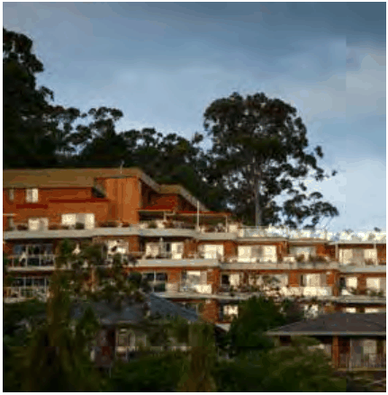
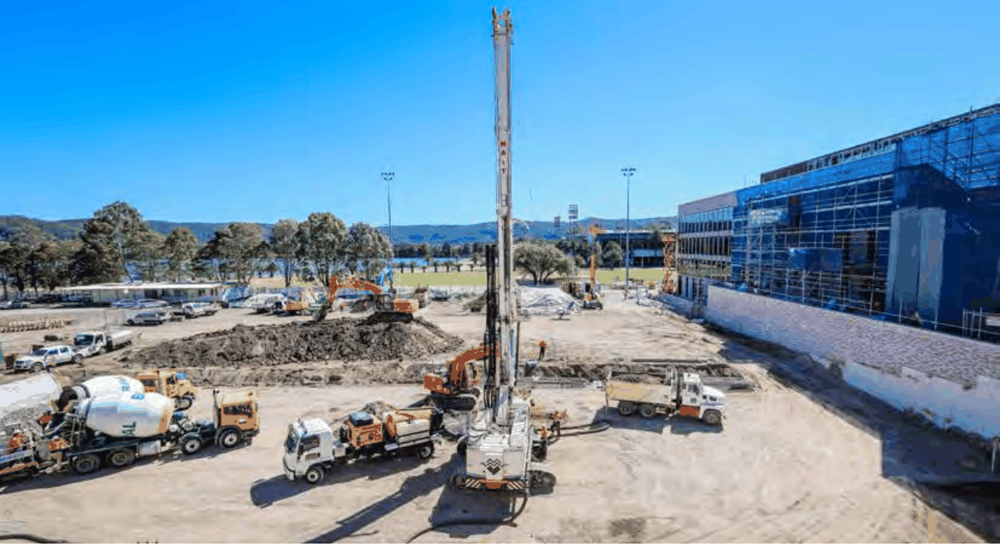

### 1.2 Relevant Planning Authority

The relevant planning authority is the Planning Secretary of the NSW Department of Planning and Environment.

Introduction 1

> [Picture on page 7: a picture, saved as a picture (images/gosford-city-centre-page-7-12.gif, 150 dpi).]

Image:  Apartments in the City South (photo by Salty Dingo)

### Assessment and Determination Authority

### 1.3

In Gosford City Centre, the assessment and determination framework is specified within State Environmental Planning Policy (Gosford City Centre) 2018 (Clause 1.6) and State Environmental Planning Policy (State and Regional Development) 2011 (Schedule 2). A summary of this framework is provided below:

Pathway

Capital

Investment Value

Greater than

$75 million

State Significant Development under the State Environmental Planning Policy (State and Regional Development) 2011

Part 4 of the Environmental Planning and Assessment Act 1979

Greater than,

or equal to, $10

million - $75

million

Less than $10

million

Part 4 of the Environmental Planning and Assessment Act 1979

Assessment

Department of Planning and Environment

Department of Planning and Environment

Central Coast Council

Determination

Minister (or delegate) OR

Independent Planning

Commission, if the council or more than 25 submitters object, or if the applicant discloses a political donation

Minister (or delegate) OR

Independent Planning

Commission, if the capital investment value is more than $40 million and the Council objects

Central Coast Council, except where the JRPP is the determination authority

> [Picture on page 8: a picture, saved as a picture (images/gosford-city-centre-page-8-1.gif, 150 dpi).]

Image:  St Hilliers building site in the City South (photo by Salty Dingo)
