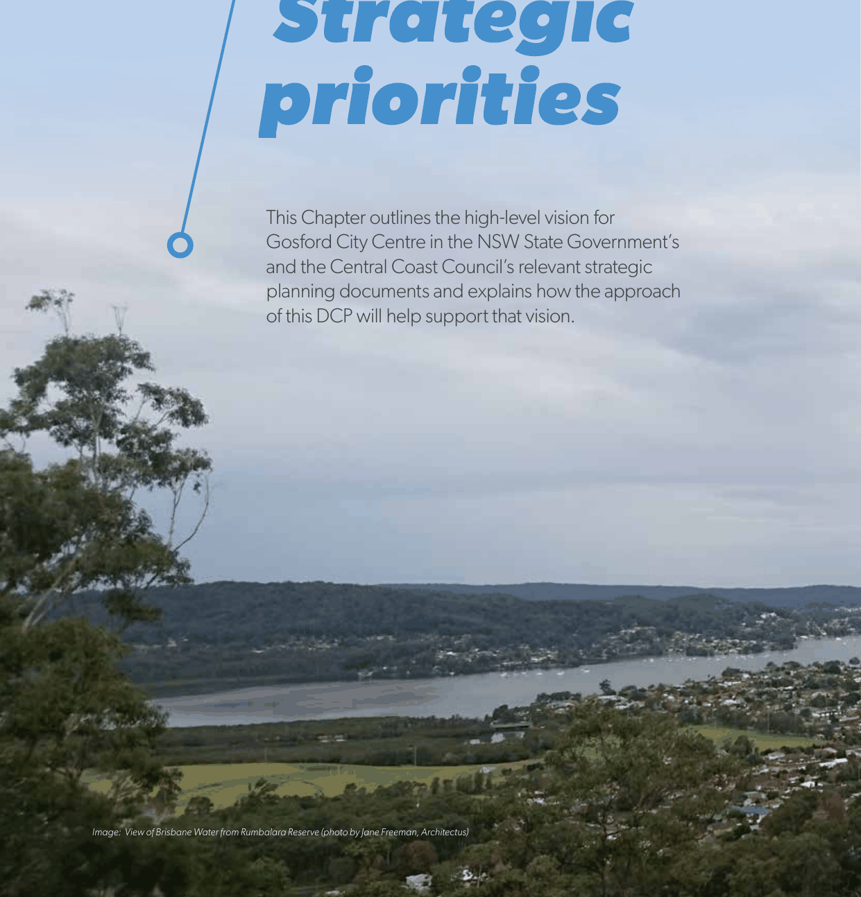
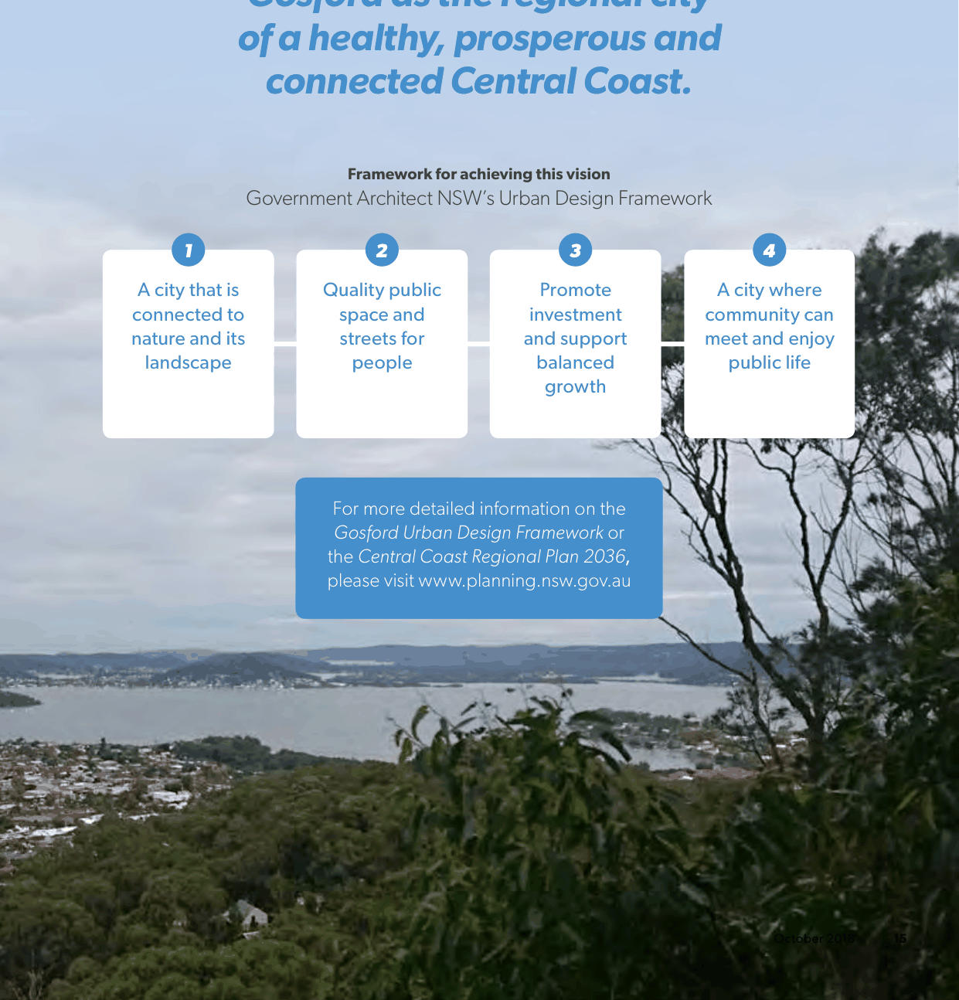

### 1.11 Variations to DCP controls

Variation of any control in this Plan may be acceptable where an application demonstrates its conformity with the objectives that are specified by this Plan, or where design excellence has been satisfactorily demonstrated. Any variation to the controls must be supported by a written statement demonstrating how the objectives of each relevant chapter of the DCP are fully satisfied. Where, in the opinion of the assessment and determining authority, an application satisfies the objectives set out in this plan or a design review panel reviews and supports a development, the authority may grant consent to the application notwithstanding that one or more of the controls are not complied with.

#### Schedule of amendments

From time to time, the DCP will be amended. The table outlining the Schedule of Amendments in Appendix C records the amendments that have taken place and their status at the time of printing.

### 2

> [Picture on page 14: a picture, saved as a picture (images/gosford-city-centre-page-14-2.gif, 150 dpi).]
> Words printed on the picture (title and legend, copied from the PDF):
> Image:  View of Brisbane Water from Rumbalara Reserve (photo by Jane Freeman, Architectus)

### Strategic

### priorities

This Chapter outlines the high-level vision for Gosford City Centre in the NSW State Government’s and the Central Coast Council’s relevant strategic

### planning documents and explains how the approach of this DCP will help support that vision.

Strategic priorities 2

#### The vision for Gosford

#### NSW Government’s Central Coast Regional Plan 2036

> [Picture on page 15: a picture, saved as a picture (images/gosford-city-centre-page-15-4.gif, 150 dpi).]

### Gosford as the regional city

of a healthy, prosperous and

### connected Central Coast.

#### Framework for achieving this vision

#### Government Architect NSW’s Urban Design Framework

#### 1

A city that is connected to

#### nature and its landscape

#### 2

Quality public space and streets for

#### people

#### 3

#### Promote investment and support balanced growth

#### 4

#### A city where community can meet and enjoy public life

For more detailed information on the

Gosford Urban Design Framework or

the Central Coast Regional Plan 2036,

#### please visit www.planning.nsw.gov.au
