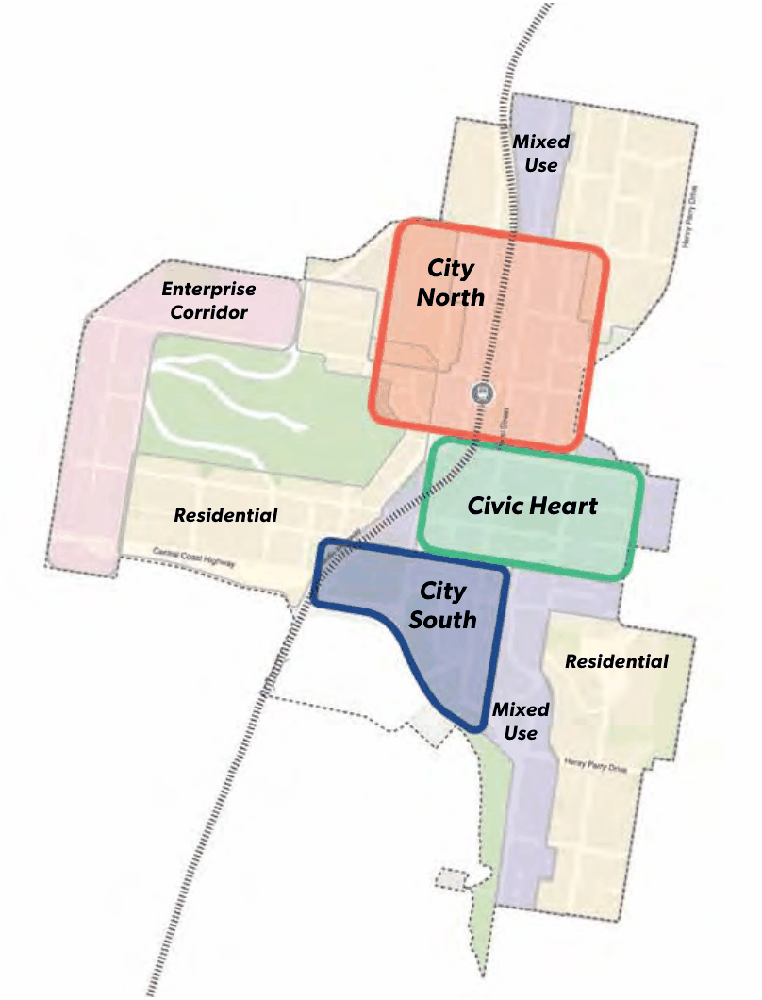
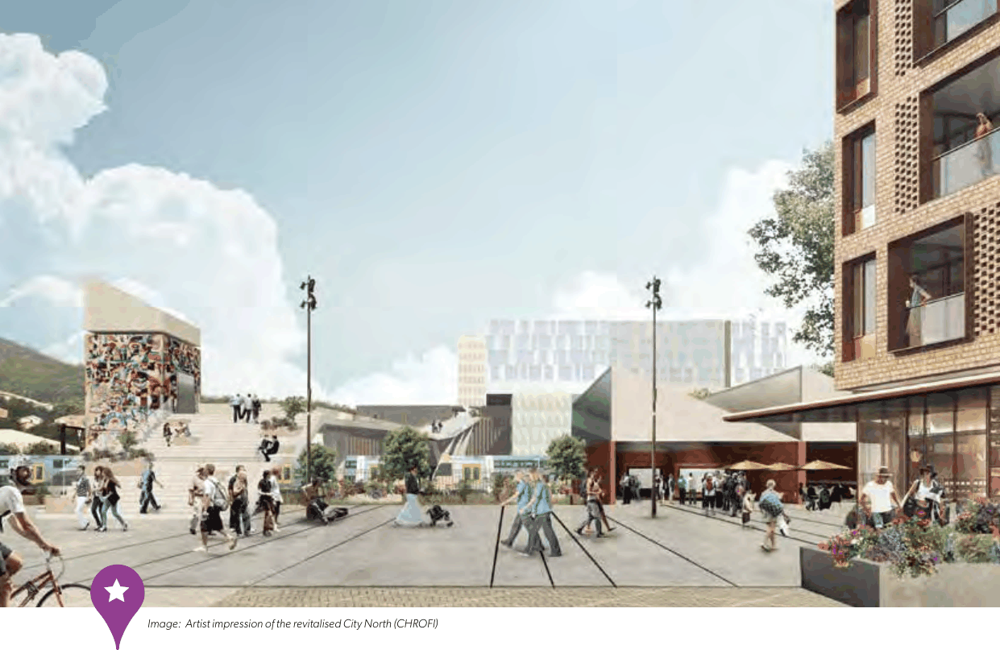

### 3.1 Character areas

#### Enterprise Corridor

#### Residential

Figure 1.  Character Areas

Places and character 3

> [Picture on page 19: a picture, saved as a picture (images/gosford-city-centre-page-19-7.gif, 150 dpi).]
> Words printed on the picture (title and legend, copied from the PDF):
> Use
> Use

#### Mixed

#### City North

#### Civic Heart

#### City South

#### Residential Mixed

> [Picture on page 20: a picture, saved as a picture (images/gosford-city-centre-page-20-1.gif, 150 dpi).]
> Words printed on the picture (title and legend, copied from the PDF):
> Image:  Artist impression of the revitalised City North (CHROFI)
