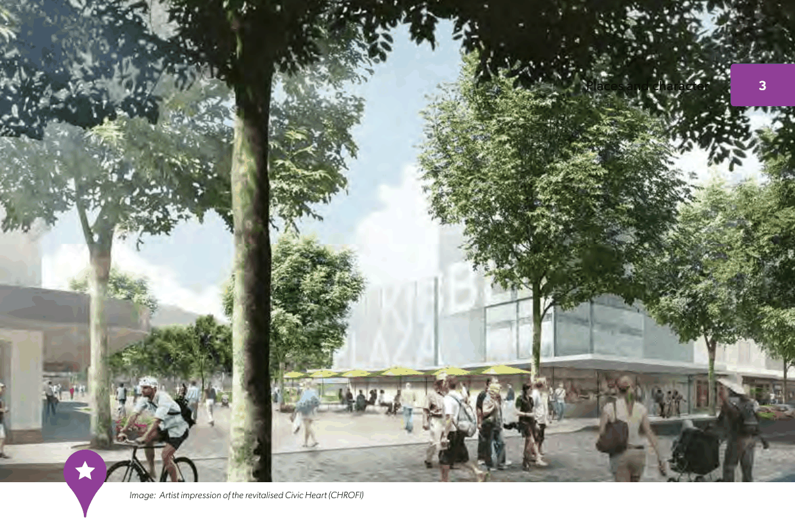

### 3.2 City North

#### Objectives

1

Promote health and education uses to support the creation of an innovation precinct.

2

Connect the hospital to the city with improved active transport connections.

3

Improve permeability and provide new pedestrian links across the rail corridor. 4 Increase public open space, to provide green relief, connect with the surrounding bushland, and provide a sense of identity for the north.

5

Provide a range of housing types to support a diverse and varied population, including key workers, students, young professionals and aged care.

#### Character

City North includes a range of important regional services, including education and health facilities, as well as significant open space and recreational assets. The hospital is a major investment in the future of Gosford. Connecting the hospital back into the city, with new connections over the rail corridor, is critical to promote the co-location of uses, enhance activation and revitalise the area.

Future development should leverage off the existing health and education assets, delivering a diverse range of health and employment uses that will strengthen the role of Gosford as a regional city. Future development should deliver a range of housing types including affordable housing, and support a diverse range of households, including families, students and workers, within walking distance of the city centre.

Future development should be supported by new pedestrian connections, improved walkability and an attractive public domain.

> [Picture on page 21: a picture, saved as a picture (images/gosford-city-centre-page-21-1.gif, 150 dpi).]
> Words printed on the picture (title and legend, copied from the PDF):
> Image:  Artist impression of the revitalised Civic Heart (CHROFI)
> Places and character 93
