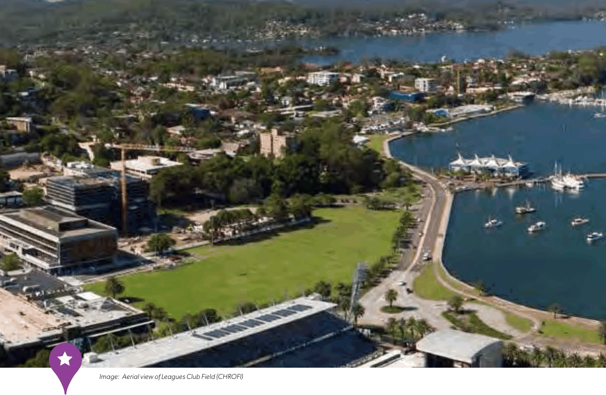

### 3.3 Civic Heart

#### Objectives

1

Protect view corridors to Presidents Hill  and Rumbalara Reserve.

2

Ensure excellent solar access and amenity to Kibble Park.

3

Protect and promote the fine grain retail of Mann Street to facilitate an active and functional city spine.

4

Ensure active and defined street frontages and frontages to all park edges.

5

Promote a diversity of built form and high quality mixed use developments.

6

Promote new commercial development in the core for job growth and to protect Gosford’s role as a regional city and associated regional functions.

#### Character

Geographically in the centre of the city, the Civic Heart focuses around Kibble Park. Kibble Park is a central meeting place that brings the character of the bushland into the city.

Mann Street is the primary spine that connects to the City North and City South precincts. Characterised by a fine grain streetscape, future development should maintain the fine grain character along Mann Street. Many important regional functions are also located in this precinct, including the proposed new regional library, local courts and government services. The focus of this area is to create a centrally located, attractive and connected open space and town square. Future development should allow for flexible uses including community events and markets, protect key views to Presidents Hill and Rumbalara Reserve, and maintain sunlight to public spaces. Active uses will be focused along Mann Street, and surround Kibble Park providing a diversity of uses that attract people at all times of the day.

> [Picture on page 22: a picture, saved as a picture (images/gosford-city-centre-page-22-1.gif, 150 dpi).]
> Words printed on the picture (title and legend, copied from the PDF):
> Image:  Aerial view of Leagues Club Field (CHROFI)
