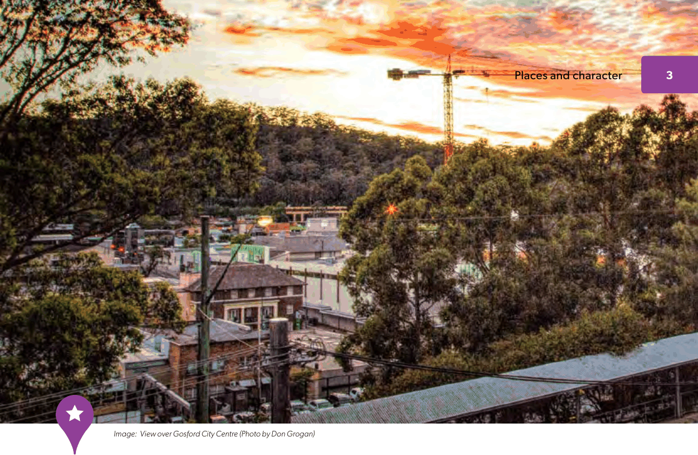

### 3.4 City South

#### Objectives

1

Maintain strong visual connections  and views to Presidents Hill and Rumbalara Reserve.

2

Continue the established city grid from the Civic Heart and Mann Street through City South.

3 Provide improved connections to the waterfront.

4

Promote a diversity of uses and attractors to accommodate a range of uses at all times of the day and week.

5

Maintain views from the stadium and Leagues Club Field to the water. 6

Conserve significant local heritage buildings and landscapes which contribute to the character of the City South.

#### Character

City South is a key arrival point for visitors to the Central Coast, and with important regional attractors, including the Stadium, Olympic Swimming Pool and the Leagues Club, City South is a major draw for people from the wider region.

There is a strong visual connection to Presidents Hill and Rumbalara Reserve, which creates a unique identity, framed by the surrounding landscape and Brisbane Water. The connection to its landscape setting forms an important part of City South’s local character and views to the water and the hills should be prioritised. The City South has a strong cultural and environmental heritage link relating to buildings, structures, landscapes and tree plantings.

There is a growing local population of workers and residents in this part of the city. There is the opportunity to enliven City South at more times of the day, for locals, regional visitors and tourists. Building on the existing regional attractors to create a diversity of uses, will attract people at all times of the day, and week. Improved connections from City South will better connect Gosford’s city centre to the water’s edge. City South will become more than just an arrival destination, it will be a place to spend time.

> [Picture on page 23: a picture, saved as a picture (images/gosford-city-centre-page-23-1.gif, 150 dpi).]
> Words printed on the picture (title and legend, copied from the PDF):
> Image:  View over Gosford City Centre (Photo by Don Grogan)
> Places and character 93
