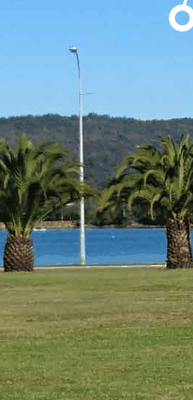

### 3.5 Other areas

#### Objectives

1

Encourage a mix of uses including employment, residential, recreation and retail that support the commercial core.

2

Provide a diversity of housing, including higher density residential development in the city fringe to support the viability of the city centre and encourage 24-hour use of the city’s amenities.

3

Facilitate tourism and increased residential development along the waterfront.

4

Provide a mix of lower scale employment uses in the enterprise corridor zone to encourage employment generating opportunities that complement the commercial core.

5

Built form in the city fringe areas is to maintain the prominence of Presidents Hill and views to Brisbane Water.

#### Character

The city fringe areas allow a range of uses including residential, employment, light industrial and retail to support the city centre.

The mixed use areas in the north provide opportunities for significant urban renewal through new retail and residential developments. The mixed use zone extends to the south along the edge of the waterfront to facilitate tourism and denser residential development. The enterprise corridor allows a mix of employment generating uses to complement those in the commercial

core. Located to the west of Presidents Hill, built form is to remain relatively low to maintain the prominence of Presidents Hill and views to Brisbane Water. The residential areas within the city fringe will provide for a diverse range of housing to accommodate an additional 10,000 residents over the next 25 years. New development will consist of medium to high density residential apartments to encourage increased housing within walking distance of the city centre.

### 4

> [Picture on page 24: a picture, saved as a picture (images/gosford-city-centre-page-24-2.gif, 150 dpi).]

### Public spaces

The public domain and pedestrian environment provides people with their primary experience of, and interface with, the city. This environment needs to be active, safe,

#### functional and accessible to all.

This Chapter provides guidance  on the public domain, including the pedestrian network, new open spaces and the requirements for solar access and views to protect the

#### amenity of existing and new public spaces.

Image:  Leagues Club Field (Photo by CHROFI)

Public spaces 94
