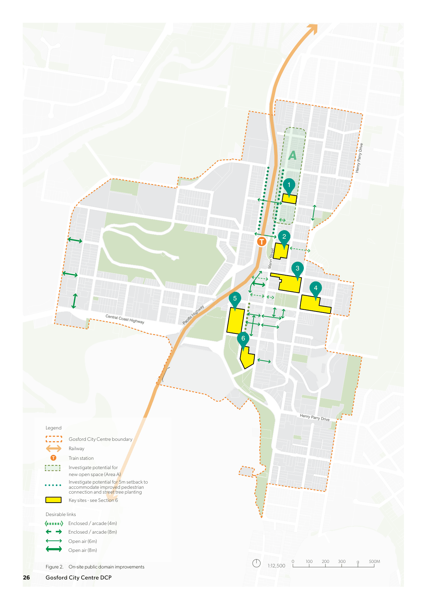

### 4.1 Pedestrian network

#### Gosford City Centre’s streets, lanes, arcades, through site links and public open spaces should

#### form an integrated pedestrian network providing choice of routes and accessibility for all people.

#### Successful pedestrian networks encourage a healthy lifestyle and enable an active pedestrian life

> [Picture on page 25: a picture, saved as a picture (images/gosford-city-centre-page-25-6.gif, 150 dpi).]

#### in the City Centre.

#### Objectives

A Provide high pedestrian comfort for pedestrian amenity and safety. B Retain and enhance existing through site links. C Retain and develop lanes as useful and interesting pedestrian connections as well as for service access.

#### Controls

1\.	 Existing publicly and privately owned links are to be retained.

2\.	 Where possible, existing dead end streets and lanes are to be extended through to the next street as redevelopment occurs to provide pedestrian links.

Image:  Pedestrian crossing at Gosford Station (photo by Salty Dingo)

3\.	 Open air links for pedestrians are to be provided as shown in Figure 2. These shall:

g.	 provide public access at all business trading

a.	 be open to the air and publicly accessible.

b.	 have a minimum width of 6m clear of all

times

h.	 where practical, have access to natural light for at

obstructions unless otherwise noted.

c.	 connect with existing and proposed through block

least 30% of their length

i.	 where air conditioned, have clear glazed entry doors comprising at least 50% of the entrance

j.	 have signage at street entries indicating public

lanes, shared zones, arcades and pedestrian ways and opposite other through site links.

d.	 	have active frontages or a street address.

e.	 	be clear and direct through-ways for pedestrians.

f.	 	have signage at street entries indicating public accessibility and the street to which the through site link connects.

4\.	 Arcades are to be provided as shown in Figure 2. These shall:

accessibility and the street to which the through site link connects

5\.	 Investigate a potential 5m setback for pedestrian access and street tree planting along the western side of Mann Street between Burns Place and Etna Street (this could be linked to increased height on medium and larger sites).

a.	 have a minimum width as shown in Figure 2, clear of all obstructions (including columns, stairs, escalators)

b.	 have a minimum clear floor to ceiling height of

6\.	 Reference should be made to relevant guidelines in Austroads Guides, Australian Standards, NSW Government Planning Guidelines for Walking and Cycling and NSW Roads and Maritime Services technical directions.

6m for 8m wide links and 3m for 4m links (and 6m is desirable), however they can also be provided as open air links if desired

c.	 provide direct visibility from street to street

d.	 connect to existing footpaths and pedestrian crossings where possible

e.	 have active frontages for their length

f.	 be clear and direct throughways for pedestrians

> [Picture on page 26: a map, saved as a picture (images/gosford-city-centre-page-26-1.gif, 150 dpi); the street names and other small labels are on the picture.]
> Words printed on the picture (title and legend, copied from the PDF):
> Central Coast Highway
> Gosford City Centre boundary
> T Train station
> Investigate potential for
> new open space (Area A)
> Investigate potential for 5m setback to
> accommodate improved pedestrian
> connection and street tree planting
> Key sites - see Section 6
> Enclosed / arcade (4m)
> Enclosed / arcade (8m)
> Open air (6m)
> Open air (8m)
> Henry Parry Drive
> 0 100 200 300
> Henry Parry Drive

Figure 2.  On-site public domain improvements

### A

Public spaces 94
