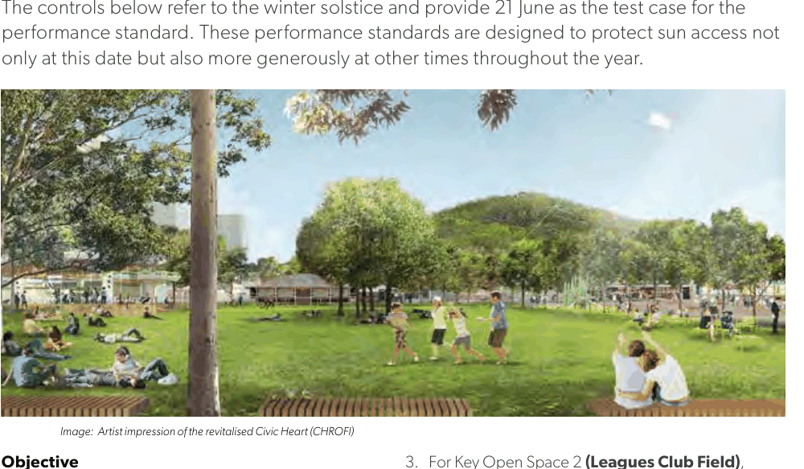
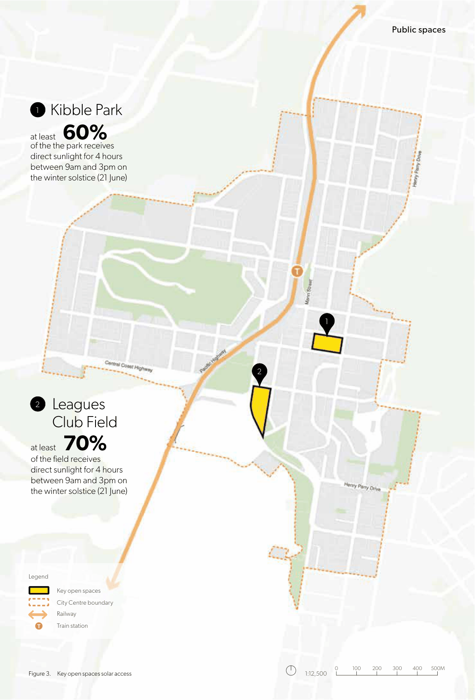

### 4.2 Public open space

Public open spaces provide for a wide variety of opportunities for recreational, social and cultural activities, making a city with accessible parks and open spaces attractive, safe and liveable to its

#### residents, workers and visitors.

> [Picture on page 27: a picture, saved as a picture (images/gosford-city-centre-page-27-6.gif, 150 dpi).]

Image:  Rotary Park (photo by Salty Dingo)

#### Objectives

A Provide accessible and safe high quality open spaces.

B Retain and enhance existing public open spaces, especially Kibble Park, the Leagues Club Field and the waterfront.

C Provide new public open space in renewal areas, especially north of the train station and west of the rail line.

D New open spaces are required in the city to support a growing population and to ensure residents are in walking distance of quality open space. The preferred mechanism for the delivery of these parks is for a park to be delivered as part of a large master planned site, where open space can be delivered in exchange for additional floor space and/or building height. For this to occur, the determining authority must be satisfied with the design and location of the park.

#### Controls

1\.	 Public open space is to be characterised by excellence of design, high quality materials and a high standard of finish appropriate to a regional City Centre.

2\.	 As identified in Figure 2, development proposals in the City North area, adjacent to the Railway line, must investigate the potential for a 5m setback to accommodate improved pedestrian connection and street tree planting.

3\.	 Within Area A (as identified in Figure 2), a new open space greater than 2000sqm that allows for informal active recreation is desired.

4\.	 This new public open space should:

a.	 connect with existing and proposed links in the pedestrian network.

b.	 consist of primarily soft landscaping and provide deep soil zones.

c.	 be publicly accessible and provide passive recreation for pedestrians.

### Solar access to key public spaces

### 4.3

#### Good solar access is a key contributor to the amenity of public spaces, particularly during

#### winter. The GCC SEPP provides percentage based solar access controls to better protect sun

#### access to key public open spaces. The controls provide a quantifiable development control

#### which acts to minimise cumulative impacts of neighbouring development on these spaces.

> [Picture on page 28: a picture, saved as a picture (images/gosford-city-centre-page-28-7.gif, 150 dpi).]
> Words printed on the picture (title and legend, copied from the PDF):
> View 3: Kibble Park from Henry Parry Drive
> GOSFORD PLACE REPORT 1
> Kibble Park: The Civic Heart
> Image:  Artist impression of the revitalised Civic Heart (CHROFI)
> 22

The controls below refer to the winter solstice and provide 21 June as the test case for the

#### performance standard. These performance standards are designed to protect sun access not

#### only at this date but also more generously at other times throughout the year.

#### Objective

A To allow sufficient sunlight access to new and existing key public spaces, such as Kibble Park, William Street Plaza and Leagues Club Field, particularly well used parts of these spaces, at all times of the year.

#### Controls

1\.	 For Key Open Space 1 (Kibble Park), buildings must be designed to ensure at least 60% of the park receives 4 hours of direct sunlight between 9am and 3pm on the winter solstice (21 June). Without limiting the above, it is preferred that Kibble Park receives 70% of direct sunlight for 4 hours during that time if it can be achieved through good design. Note – This performance standard is contiguous hours, and is cumulative between developments.

2\.	 For William Street Plaza (adjacent to and west of Kibble Park),  buildings should be designed (where possible) to limit overshadowing of this key public space which connects pedestrians from Mann Street to Kibble Park.

3\.	 For Key Open Space 2 (Leagues Club Field), buildings must be designed to ensure at least 70% of the field receives 4 hours of direct sunlight between 9am and 3pm on the winter solstice (21 June). Note – This performance standard is contiguous hours, and is cumulative between developments.

4\.	 Solar access exceeding the minimum provisions should be provided if it can be achieved through good design.

5\.	 For other existing public open spaces, such as Burns Park, Memorial Park and Gosford Rotary Park (Poppy Park), including Gosford City Park, buildings must be designed to ensure that at least 50% of the open space receives a minimum of 4 hours of sunlight between 9am and 3pm on 21 June.

6\.	 For any new public spaces, buildings are to be designed to ensure that at least 50% (minimum) or 70% (preferred) of the open space provided receives a minimum of 4 hours of sunlight between 9am and 3pm on the winter solstice (21 June).

> [Picture on page 29: a map, saved as a picture (images/gosford-city-centre-page-29-1.gif, 150 dpi); the street names and other small labels are on the picture.]
> Words printed on the picture (title and legend, copied from the PDF):
> Key open spaces
> City Centre boundary
> 0 100 200 300 500M

Figure 3.  Key open spaces solar access

### Kibble Park

### at least    60%

of the the park receives direct sunlight for 4 hours between 9am and 3pm on the winter solstice (21 June)

### Leagues

### Club Field

### at least    70%

of the field receives direct sunlight for 4 hours between 9am and 3pm on the winter solstice (21 June)
