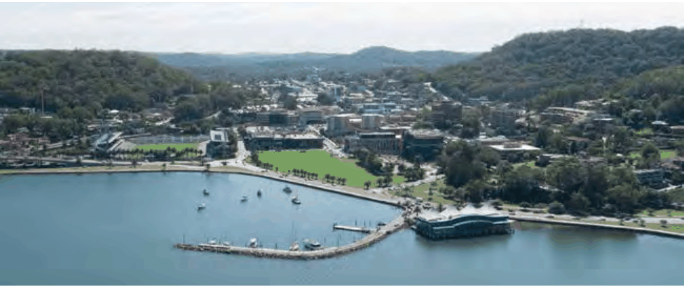
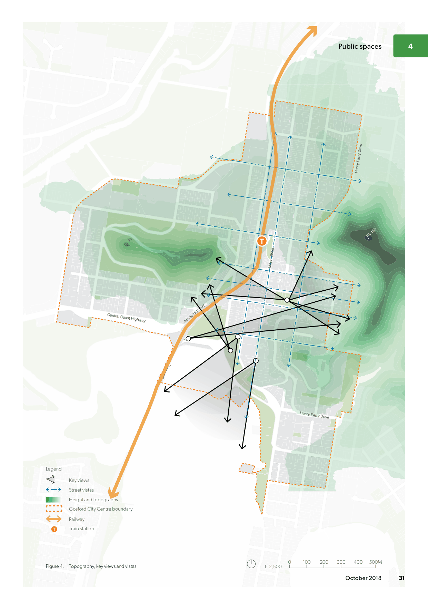

### 4.4 Views and vistas

#### The character of Gosford is strongly defined by significant views, particularly to Brisbane

Water and the ridgelines of Rumbalara Reserve and Presidents Hill. Significant views should be maintained, especially from public spaces. Vistas are views along streets that are framed by street wall buildings.

> [Picture on page 30: a picture, saved as a picture (images/gosford-city-centre-page-30-6.gif, 150 dpi).]

Image:  Aerial photo of Gosford (photo by Bravo Dron)

#### Objectives

A Enhance Gosford’s unique identity and sense of place that is created by the current significant views and vistas, particularly those identified in Figure 4. B Protect Gosford’s character of visual openness with the surrounding landscape. C Maintain and enhance significant view corridors from public spaces and streets to Brisbane Water and the identified view corridors which afford views of the ridgelines of Rumbalara Reserve and Presidents Hill.

D Open up new significant views, where possible.

#### Controls

1\.	 The floorplates of buildings above street frontage heights should be designed in accordance with the slender tower provisions in Chapter 5 of this DCP.

2\.	 Key views (identified in Figure 4) are those existing views of the ridgelines of Presidents Hill, Rumbalara Reserve and views of Brisbane Water from important locations, including the centre of Kibble Park, Leagues Club Field and Brian McGowan Bridge.

3\.	 Other key views critical to the heritage significance of heritage items and places should be protected (for example views from the Memorial Park over to Brisbane Water and the waterfront, and views from the Cenotaph to the rising sun in the east).

4\.	 Street vistas (identified in Figure 4) are those existing long distance street vistas that allow vision of the surrounding bushland and/or water views. To protect street vistas, development adjoining street vistas should comply with street wall and tower setback controls (identified in Chapter 5 Built form) to maximise preservation of long distance street vistas. Compliance with this control must be demonstrated in any development application for sites adjoining identified street vistas through view analysis. Specifically, the analysis should demonstrate that the proposed built form has been designed to minimise its impact on these views.

> [Picture on page 31: a map, saved as a picture (images/gosford-city-centre-page-31-1.gif, 150 dpi); the street names and other small labels are on the picture.]
> Words printed on the picture (title and legend, copied from the PDF):
> Central Coast Highway
> Height and topography
> Gosford City Centre boundary
> Henry Parry Drive
> Henry Parry Drive

Figure 4.  Topography, key views and vistas
