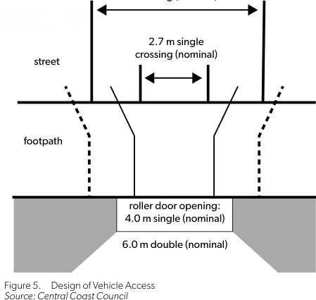

### 4.5 Footpath crossings and pedestrian overpasses and underpasses

#### 4.5.1 Vehicle Footpath Crossings

Vehicle crossings over footpaths can disrupt pedestrian movement and threaten safety. The design of vehicle access to buildings also influences the quality of the public domain.

Overly wide and high vehicle access points detract from the streetscape and the active use of street frontages. The design and location of vehicle access to developments should minimise both conflicts between pedestrians and vehicles on footpaths, particularly along pedestrian priority places, and visual intrusion and disruption of streetscape continuity. Design of driveways and vehicle access is to be in accordance with the provisions of Section 7.3.

#### Objectives

A	 To make vehicle access to buildings more compatible with pedestrian movements. B	 Reduce the impact of vehicular access on the public domain.

#### Controls

Location of Vehicle Access

1\.	 One vehicle access point only (including the access for service vehicles and parking for non-residential uses within mixed use developments) will be generally permitted.

2\.	 Where practicable, vehicle access is to be from lanes and minor streets rather than primary street fronts or streets with major pedestrian activity.

3\.	 Where practicable, adjoining buildings are to share or amalgamate vehicle access points. Internal on-site signal equipment is to be used to allow shared access. Where appropriate, new buildings should provide vehicle access points so that they are capable of shared access at a later date.

4\.	 Vehicle access may not be required or may be denied to some heritage buildings.

Design of vehicle access

5\.	 Wherever practicable, vehicle access is to be a single lane crossing with a maximum width of 2.7 metres over the footpath, and perpendicular to the kerb alignment. In exceptional circumstances, a double lane crossing with a maximum width of 5.4 metres may be permitted for safety reasons (refer to Figure 5).

6\.	 Vehicle access ramps parallel to the street frontage will not be permitted.

7\.	 Ensure vehicle entry points are integrated into building design.

8\.	 Doors to vehicle access points are to be roller shutters or tilting doors fitted behind the building facade.

9\.	 Vehicle entries are to have high quality finishes to walls and ceilings as well as high standard detailing. No service ducts or pipes are to be visible from the street.

5.4 m double

crossing (nominal)

> [Picture on page 32: a picture, saved as a picture (images/gosford-city-centre-page-32-61.gif, 150 dpi).]
> Words printed on the picture (title and legend, copied from the PDF):
> 2.7 m single
> crossing (nominal)
> street
> footpath
> roller door opening:
> 4.0 m single (nominal)
> 6.0 m double (nominal)
> Source: Central Coast Council

Figure 5.  Design of Vehicle Access

Porte Cocheres

10\.	Porte cocheres are not favoured and may only be permitted for hotels subject to urban design, streetscape, heritage and pedestrian amenity considerations.

11\.	 Where practicable, porte cocheres are to be internal to the building with one combined vehicle entry and exit point, or one entry and one exit point on two different frontages of the development.

12\.	In exceptional circumstances for buildings with one street frontage only, an indented porte cochere with separate entry and exit points across the footpath may be permitted, as long as it is constructed entirely at the footpath level and provides an active frontage at its perimeter.
