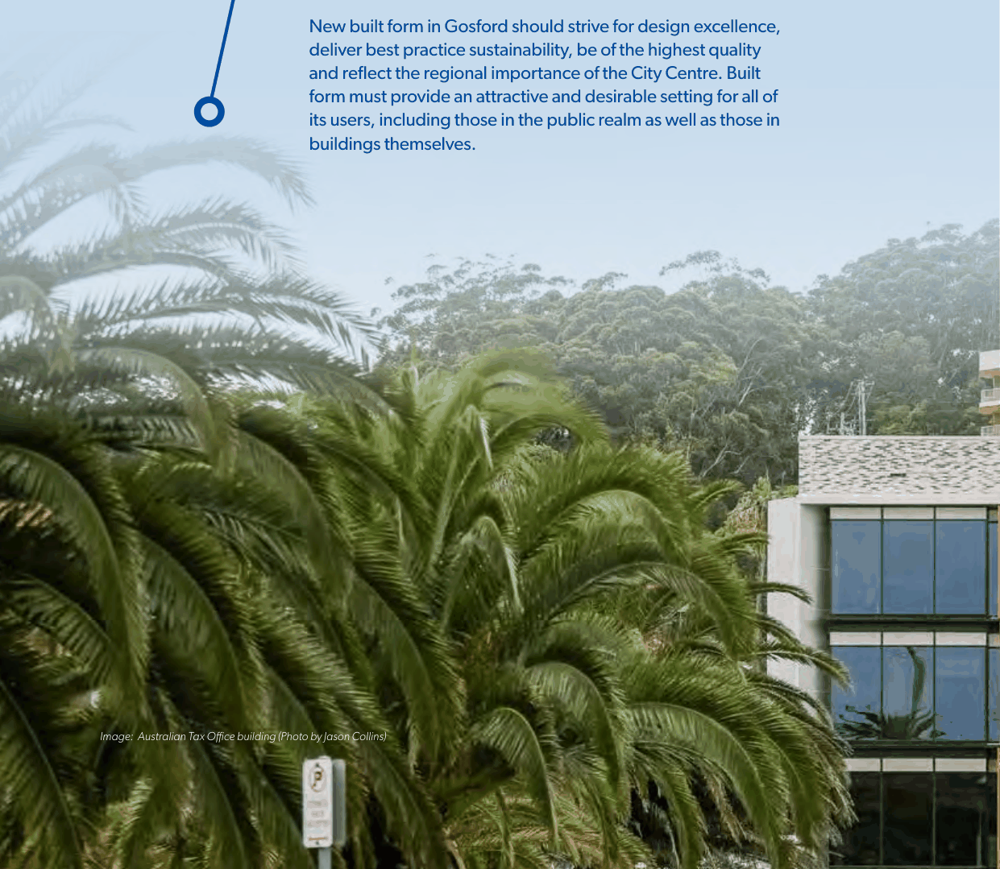
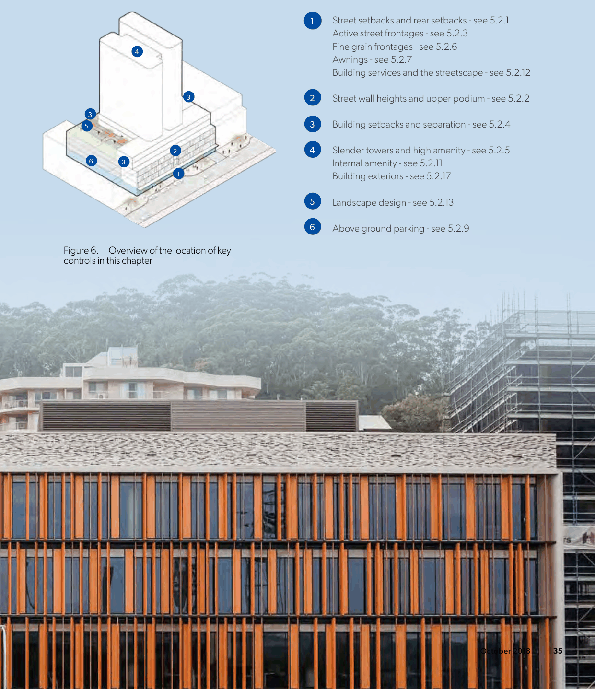

#### 4.5.2	 Pedestrian Overpasses and Underpasses

Streets represent important components of the public domain and provide the best potential amenity and safety when activated by pedestrians. Streets offer sky exposure, sunlight and air, a sense of orientation and direct access to the main frontages of buildings. Generally, pedestrians should be encouraged to use the street level to enhance and contribute to street life, to promote activity and interest, and to maximise safety and security of the public domain. Gosford’s climate does not warrant pedestrian isolation from the street, and any conflicts between pedestrians and vehicles are to be resolved at the street level.

Pedestrian overpasses are discouraged on Mann Street as they have a negative impact on the streetscape quality and on views and vistas along streets. New pedestrian underpasses will only be considered where they would directly connect to major transport nodes such as the railway station to the City, or substantially improve pedestrian safety and access.

#### Objectives

A	 To promote pedestrian activation of streets and public places.

B	 To promote ‘safer by design’ and crime prevention principles.

C	 To encourage pedestrian circulation at street level. D	 To protect views and vistas along streets.

Public spaces 4

#### Controls

1\.	 New overpasses over streets are discouraged, including on land adjoining or fronting Mann Street (or over Mann Street), bounded by Etna Street and Vaughan Avenue. In exceptional circumstances, new overpasses over service lanes may be considered subject to assessment of impacts on safety and crime prevention, streetscape amenity, activation of the public domain and the benefits of connectivity.

2\.	 Underpasses may be considered where they:

a.	 would substantially improve pedestrian safety and accessibility;

b.	 incorporate active uses, particularly at entry and exit points;

c.	 have a minimum width of 4.5 metres clear of all fixed obstructions and a minimum ceiling height of 4 metres; and

d.	 would directly connect major transport nodes such as the railway station to the City, or substantially improve pedestrian safety and access.

### 5

### Built form

Building form and character refers to the individual elements of building design that collectively contribute to the character and appearance of the built environment.

> [Picture on page 34: a picture, saved as a picture (images/gosford-city-centre-page-34-6.gif, 150 dpi).]
> Words printed on the picture (title and legend, copied from the PDF):
> New built form in Gosford should strive for design excellence,
> deliver best practice sustainability, be of the highest quality
> and reflect the regional importance of the City Centre. Built
> form must provide an attractive and desirable setting for all of
> its users, including those in the public realm as well as those in
> buildings themselves.
> Image:  Australian Tax Office building (Photo by Jason Collins)

### Built form

Built form 5

> [Picture on page 35: a picture, saved as a picture (images/gosford-city-centre-page-35-2.gif, 150 dpi).]
> Words printed on the picture (title and legend, copied from the PDF):
> 4
> 3
> 3
> 5
> 2
> 6 3
> 1
> controls in this chapter

Figure 6.  Overview of the location of key

1 Street setbacks and rear setbacks - see 5.2.1 Active street frontages - see 5.2.3 Fine grain frontages - see 5.2.6

Awnings - see 5.2.7

Building services and the streetscape - see 5.2.12

2 Street wall heights and upper podium - see 5.2.2

3 Building setbacks and separation - see 5.2.4

4 Slender towers and high amenity - see 5.2.5 Internal amenity - see 5.2.11

Building exteriors - see 5.2.17

5 Landscape design - see 5.2.13

6 Above ground parking - see 5.2.9
