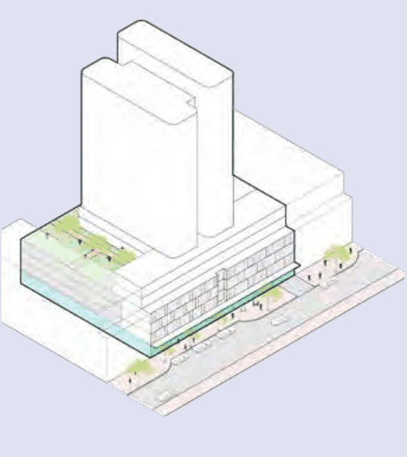
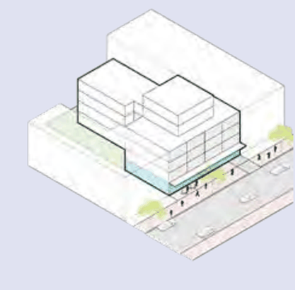
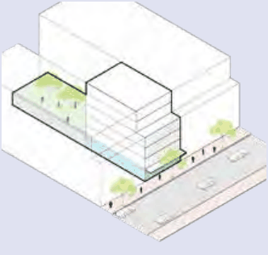
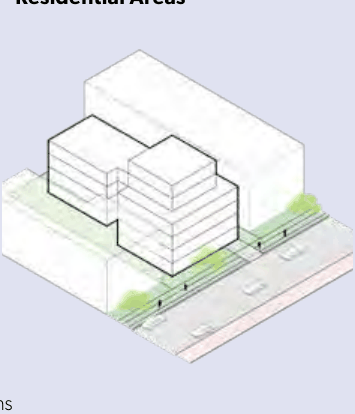
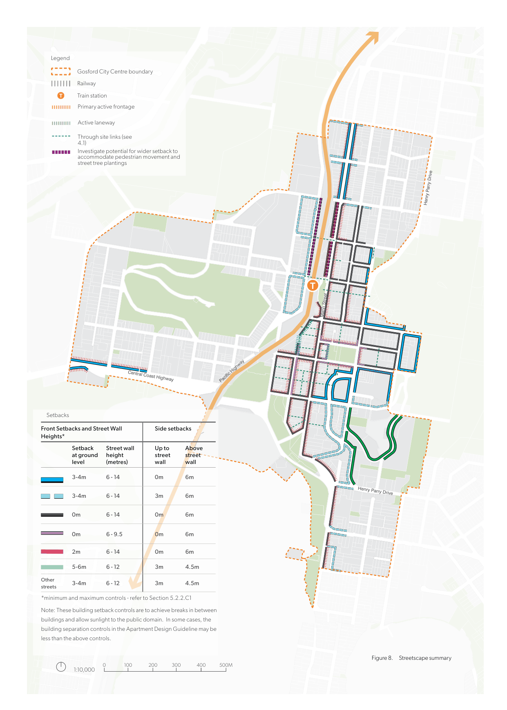

### 5.2 Built form provisions

### 5.1 Site sizes and design excellence

This chapter sets out the preferred building typologies across the affected zones. Figure 7 opposite describes key setback controls across Gosford and is reference in the specific controls over the following pages.

The GCC SEPP sets out provisions for large, medium and small sites relating to implementation of the LEP controls. The medium site and large site provisions apply only to B zones, including B3 Commercial Core,

B4 Mixed Use and B6 Enterprise Corridor (Refer to Clause 8.4 in GCC SEPP).

#### Site Provisions Height and FSR Clause 4.6

#### Exception

HOB Map

#### Small Site

<2800sqm; or

Refer to clause 8.4 of the GCC SEPP

Applies

FSR (2:1 - 4:1)

<36m primary street frontage

#### Medium Site

\> = 2800 and <

HOB Map

5600sqm; or > = 36m

FSR Map

Variations to HOB permitted subject to design excellence including review by a design review panel (refer to clause 8.4 of GCC SEPP).

Excluded from Height and FSR, however may be applied to site criteria

primary street frontage

HOB Map

#### Large Site

\> = 5600sqm

FSR Map

Variations to HOB and FSR permitted subject to design excellence including review by a design review panel (refer to clause 8.4 of GCC SEPP).

Excluded from Height and FSR, however may be applied to site criteria

Built form 5

#### Illustration of typical anticipated development forms

The development forms identified below are an illustration of anticipated and desirable development forms across Gosford City Centre.

Medium-large sites in the

#### Commercial Core

> [Picture on page 37: a picture, saved as a picture (images/gosford-city-centre-page-37-7.gif, 150 dpi).]

#### Outer centre - active uses

> [Picture on page 37: a picture, saved as a picture (images/gosford-city-centre-page-37-9.gif, 150 dpi).]

#### Small sites in the Commercial Core

> [Picture on page 37: a picture, saved as a picture (images/gosford-city-centre-page-37-12.gif, 150 dpi).]

Legend

Retail

Parking

Residential or

commercial

> [Picture on page 37: a picture, saved as a picture (images/gosford-city-centre-page-37-18.gif, 150 dpi).]

#### Residential Areas

Figure 7.  Illustration of anticipated and desirable development forms

> [Picture on page 38: a picture, saved as a picture (images/gosford-city-centre-page-38-1.gif, 150 dpi).]
> Words printed on the picture (title and legend, copied from the PDF):
> Legend
> Gosford City Centre boundary
> Railway
> T Train station
> Primary active frontage
> Active laneway
> Through site links (see
> 4.1)
> Investigate potential for wider setback to
> accommodate pedestrian movement and
> street tree plantings
> Henry Parry Drive
> T
> Mann Street
> Central Coast Highway
> Pacific Highway
> Setbacks
> Side setbacks
> Front Setbacks and Street Wall
> Heights*
> Setback
> at ground
> level
> Street wall
> height
> (metres)
> Up to
> street
> wall
> Above
> street
> wall
> 3-4m 6 - 14 0m 6m
> Henry Parry Drive
> 3-4m 6 - 14 3m 6m
> 0m 6 - 14 0m 6m
> 0m 6 - 9.5 0m 6m
> 2m 6 - 14 0m 6m
> 5-6m 6 - 12 3m 4.5m
> Other
> streets
> 3-4m 6 - 12 3m 4.5m
> \*minimum and maximum controls - refer to Section 5.2.2.C1
> Note: These building setback controls are to achieve breaks in between
> buildings and allow sunlight to the public domain.  In some cases, the
> building separation controls in the Apartment Design Guideline may be
> less than the above controls.
> 1:10,000
> 0 100 200 300 400 500M

Figure 8.  Streetscape summary
