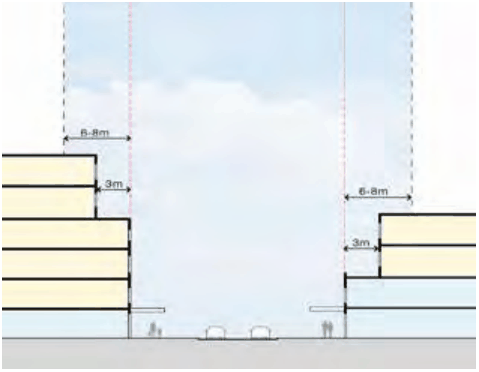
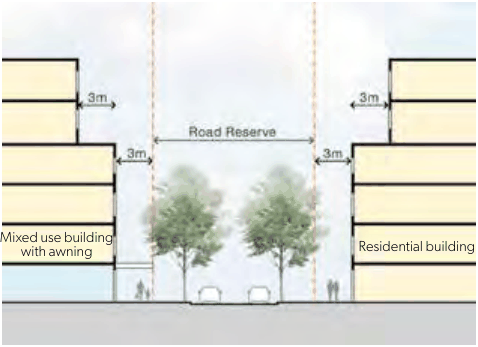

#### 5.2.2	 Street wall heights and upper podium

The street wall is the part of the building that directly addresses the street, from the ground level up to the first setback from the street boundary. The upper podium refers to one to two storeys set back from the street wall which may have reduced side setbacks as compared to a tower (see section 5.2.5).

#### Objectives

A	 Achieve comfortable street environments for pedestrians in terms of daylight, scale, sense of enclosure and wind mitigation as well as a healthy environment for street trees. B	 Reinforce the intrinsic character and scale of existing and heritage buildings in Gosford City Centre whilst also enable flexibility in contemporary building design. C	 Protect solar access to key streets and public spaces. D	 Encourage a strong architectural expression. E	 Provide for views of the hillsides from key locations. F	 Achieve a consistent and strong building line where desirable for urban design and streetscape reasons.

#### Controls

1\.	 The street frontage height of buildings must comply with the minimum and maximum heights above mean ground level on the street front as shown in Figure 8.

2\.	 All built form above the street wall height should be set back a minimum of 3m from the building line of the street wall frontage. This may include:

a.	 an ‘upper podium’ of up to 2 storeys/7m (in height) and side setbacks should be provided consistent with the Apartment Design Guide; and

b.	 a tower element above this, which is to be consistent with the controls in Section 5.2.5 of this document.

3\.	 For development fronting Mann Street, a building’s street wall must:

a.	 not be greater than 3 storeys at the building street frontage to Mann Street to maintain its existing scale, character and relative human scale, and to access to direct sunlight (refer clause 8.2 in GCC SEPP). Note - This control relates only to the ground level street wall at the building street frontage to Mann Street, and does not relate to any street wall of an upper podium that fronts Mann Street, and is set back from the (ground level) street wall.

b.	 comply with the height in metres as shown in Figure 8.

> [Picture on page 40: a picture, saved as a picture (images/gosford-city-centre-page-40-50.gif, 150 dpi).]

Typical Street Section - 0m street setback locations

> [Picture on page 40: a picture, saved as a picture (images/gosford-city-centre-page-40-52.gif, 150 dpi).]
> Words printed on the picture (title and legend, copied from the PDF):
> Mixed use building
> with awning
> Residential building

Typical Street Section - 3m street setback locations
