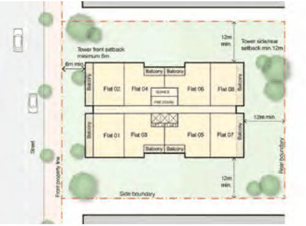
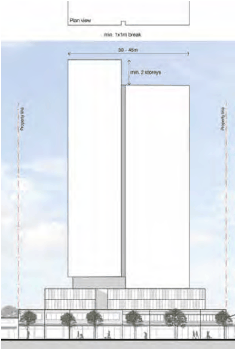

#### 5.2.5	 Slender towers with high amenity

Note: for the purpose of the controls below ‘tower’ refers to the part of the building above the podium’s street wall and above the upper podium (see section 5.2.2)

#### Objectives

A	 Achieve high amenity for the public domain including access to sun light and views. B	 Allow for view sharing and view corridors. C	 Achieve an attractive city skyline which is sympathetic to the topography and context. D	 Allow for high internal amenity to development, including natural light and ventilation E	 Mitigate potential adverse impacts that tall and bulky buildings might have on the public domain F	 Reduce the apparent bulk and scale of buildings by breaking up expanses of building wall with modulation of form and articulation of facades. G	 Provide viable and useable floor space.

#### Controls

1\.	 For development within the B zones (B3, B4 and B6), the maximum floorplate size for towers is:

a.	 750sqm GFA for residential uses, serviced apartments and hotels.

b.	 1500sqm GFA for commercial uses (office space). Note - This maximum floor plate control applies only to towers, and not to podium level development.

2\.	 In other zones, the maximum GFA of a tower level is 20% of the total GFA and up to 500sqm GFA max.

3\.	 The maximum building length for towers in any direction is 45m.

4\.	 All tower forms must be set back a minimum 8m from the street wall frontage, however reductions may be accepted (from 8m to 6m) on some sites where it is demonstrated that this control would compromise the ability to design the podium or tower appropriately.

5\.	 All building frontages for a tower with a length over 30m should be:

a.	 expressed as two vertical forms

b.	 include a clear ‘break’ of minimum 1m width and 1m depth

c.	 include a stepped height difference of minimum two storeys

6\.	 Tower heights should be varied. Where two towers are provided on one site, their height above ground level should have a minimum of 15% variation between each tower (e.g. with three towers, the tallest should be minimum 30% taller than the shortest).

7\.	 For sites with more than one tower, separation between buildings should be considered in accordance with the specified distances for each component use, as if there is a boundary between them.

Built form 5

> [Picture on page 43: a picture, saved as a picture (images/gosford-city-centre-page-43-18.gif, 150 dpi).]

Typical residential tower floor plan - approx. 750sqm GFA (NTS)

> [Picture on page 43: a picture, saved as a picture (images/gosford-city-centre-page-43-20.gif, 150 dpi).]

Diagram showing breaking down of bulk on long tower facades
