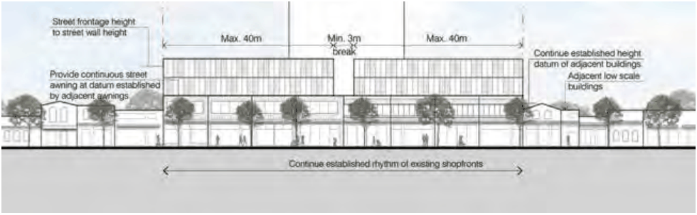
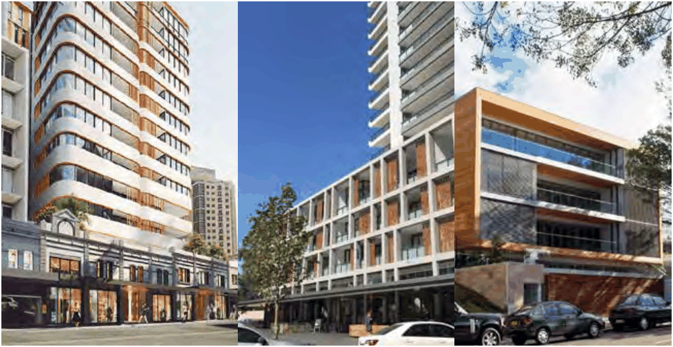

#### 5.2.6	 Fine grain frontages

‘Fine grain’ refers to a street frontage’s frequency and diversity of different activities, shop frontages and entries.

#### Objectives:

A	 Ensure that development responds to the human scale. B	 To provide a high quality and diverse retail environment for Gosford.

C	 To respond to the character and grain of existing buildings at street level (even when taller buildings are provided).

D	 Provide a variety of architectural character. E	 Ensure that the scale, modulation and facade articulation of development responds to its context.

#### Controls

1\.	 The maximum continuous street frontage length of an individual podium (below street wall height) is 40m. Where a podium form exceeds this length it will be visually broken into two or more podium forms. This is described in Figure 9. Each of these forms will:

a.	 not exceed 40m in length with a preferred length of less than 30m.

b.	 be separated from other podium forms by full height breaks of a minimum of 3m (note: separation requirements within the Apartment Design Guide will apply in addition to this where relevant). These breaks should extend to the top of the street wall however may not extend to ground level to ensure continuity of active frontages.

c.	 be designed to relate to the pattern of vertical circulation cores where possible.

d.	 have its own architectural character which establishes ‘fine grain’ (through massing, articulation, composition of building elements, material use and details for different building elements, etc.) so that the street block presents as a group of buildings rather than a single building.

2\.	 	Each podium form (below street wall height) is to be articulated into smaller elements at a scale or grain. This is described in Figure 9. Each of these forms should respond to:

a.	 the established height datum of adjacent buildings, particularly where the street wall height proposed significantly exceeds this.

b.	 the established rhythm of building frontages within the area (the lot pattern) of between 5 and 20 metres.

c.	 the use of the building and the various components of the building.

d.	 the location of the building, or that part of the building relative to pedestrian or outdoor recreation activity.

e.	 the details and building elements including building entries, ground floor, lower floors, top floor and roof.

Built form 5

> [Picture on page 45: a picture, saved as a picture (images/gosford-city-centre-page-45-2.gif, 150 dpi).]

Figure 9.  Typical elevation showing fine grain principles for a larger site (NTS)

> [Picture on page 45: a picture, saved as a picture (images/gosford-city-centre-page-45-4.gif, 150 dpi).]

Examples of appropriate street wall responses - left to right: 362 Oxford St (SJB Architects), Rhodes Sydney, Rose Bay Apartments (FJMT Architects)
