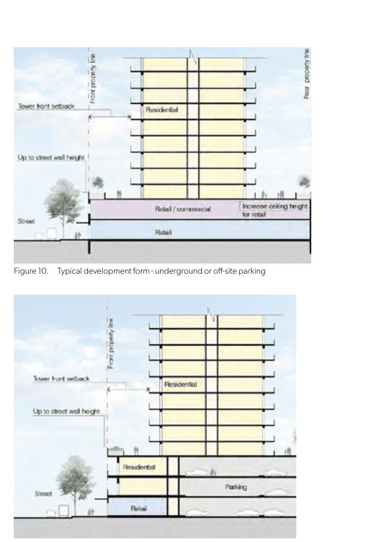

#### 5.2.9	 Above ground parking Objectives

A	 To ensure excellent streetscape activation B	 To minimise the visual impact of parking C	 To ensure excellent amenity, activation and use in building areas that have a visual relationship to the street

D	 To provide adequate space for parking and manoeuvring of vehicles (including service vehicles and bicycles)

E	 To aid in viability where it is understood that due to the high water table, excavation on some sites may become difficult

F	 To provide flexibility for future changes in need and use

#### Controls

1\.	 Car parking is to be provided wholly underground unless the determining authority is satisfied unique site conditions prevent achievement of parking in basements. The determining authority may require the provision of a supporting report (for example, a geotechnical report), prepared by an appropriately qualified professional as information to accompany a development application to the determining authority.

2\.	 On-site car parking provided at or above ground level is to have a minimum floor to floor height of over 3.5m so it can be adapted to another use in the future.

Built form 5

3\.	 On-site parking is to be accommodated underground, or otherwise fully integrated into the design of the building as illustrated in Figures 10 and 11. Where integration is not achieved, car-parking areas will count towards gross floor area for the purposes of calculating Floor Space Ratio.

4\.	 Any on site above ground parking should be ‘sleeved’ by a minimum 8m depth activation (commercial or residential use) facing any street as illustrated in Figure 11.

> [Picture on page 47: a picture, saved as a picture (images/gosford-city-centre-page-47-55.gif, 150 dpi).]

Figure 10.  Typical development form - underground or off-site parking

Figure 11.  Typical development form - sleeved parking
