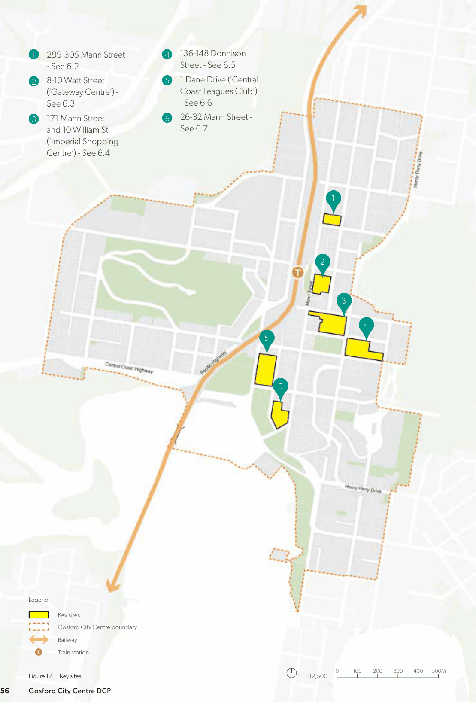

### 6.1 Introduction

This chapter includes objectives and controls for each of the sites identified on Figure 12 Key Sites.

This chapter provides design principles for each key site that describe the considerations and intended outcomes to complement the objectives and controls set out in other chapters of this plan.

The guidance presented in this chapter will inform applicants, the City of Gosford Design Advisory Panel members, and assessing and determining authorities in understanding the desired urban design outcomes for key sites in Gosford City Centre.

The assessment and determination authority must take into account the advice of the City of Gosford Design Advisory Panel (for development using clause 8.4 of the GCC SEPP) on how the proposed development addresses each of the principles and controls for key sites set out in this chapter.

Other medium or large sites in Gosford may require masterplanning, in addition to those identified in this Chapter, where the proposal seeks exceptions to height and/or floorspace pursuant to clause 8.4(3) and 8.4(4) of the GCC SEPP.

#### Objectives

A To provide excellent urban design and amenity outcomes for key sites in Gosford City Centre. B To protect solar access to key open spaces.

C

To protect key views and street vistas from the public domain.

D To advocate a master planning process for development of key sites.

#### Controls

1\.	 All Key Sites are required to undergo site master planning, to ensure quality urban design and amenity outcomes for Gosford City Centre.

2\.	 All Key Sites described in this chapter must develop in accordance with the principles set out for each site over the following pages. Any departure from these principles must be clearly justified by the applicant and may be considered where the advice from the City of Gosford Design Advisory Panel supports the deviation. Notwithstanding, the outcome of such an application will be considered by the assessing and determining authority.

3\.	 All sites will also be required to address the general controls in chapter 3 (Places and Character), chapter 4 (Public spaces), chapter 5 (Built form), chapter 7 (Access and Parking), chapter 8 (Environmental Management), as well as SEPP65 and the Apartment Design Guide, and any other relevant control as required by this DCP.

> [Picture on page 56: a map, saved as a picture (images/gosford-city-centre-page-56-1.gif, 150 dpi); the street names and other small labels are on the picture.]
> Words printed on the picture (title and legend, copied from the PDF):
> 1 299-305 Mann Street
> - See 6.2
> 2 8-10 Watt Street
> (‘Gateway Centre’) -
> 3 171 Mann Street
> and 10 William St
> Centre’) - See 6.4
> Gosford City Centre boundary
> T Train station
> 4 136-148 Donnison
> Street - See 6.5
> Coast Leagues Club’)
> - See 6.6
> 0 100 200 300 500M

Figure 12.  Key sites

5 1 Dane Drive (‘Central

6 26-32 Mann Street -
