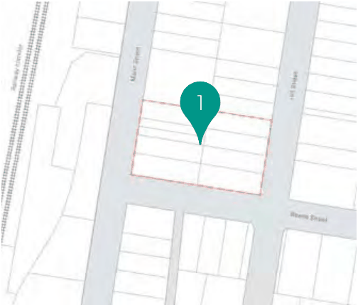

### 6.2 Key Site 1 299-305 Mann Street (former Mitre 10 site)

#### Principles

1\.	 This is a key site due to its size and proximity to Gosford Railway Station and offers significant and unique urban renewal opportunities afforded by its heritage significance. Accordingly, this site must be subject to a master planning process to ensure holistic consideration of urban design issues.

2\.	 Any re-development of the site is to include heritage studies to explore opportunities to incorporate heritage elements within the design of the development. Should re-development result in demolition, all options should be explored prior to demolition, including retention (or partial retention) of the front facade or part of the front façade.

3\.	 Any re-development should also provide a significant new public open space integrated on site, as the site has the potential for both significant development opportunities and a significant new public open space in the City North. Any new public open space provided on site must:

a.	 be located on Mann Street and span the entire street frontage;

b.	 be publicly accessible 24 hours a day;

c.	 include deep soil planting with large trees;

d.	 be designed by a suitably qualified landscape Architect;

e.	 be designed to the satisfaction of the assessing and determining authority;

f.	 be designed to maximise solar access;

g.	 include a heritage interpretation and public art strategy that reflects the heritage significance of part of the site.

4\.	 Any development that integrates a significant new public open space in accordance with Principle 2 and 3, and reflects the heritage significance of the site, may be considered for opportunities to gain additional height.

Key Sites 6

> [Picture on page 57: a picture, saved as a picture (images/gosford-city-centre-page-57-42.gif, 150 dpi).]

### 1

Site plan: 299-305 Mann Street

5\.	 Any tall buildings or towers on site must be appropriately located (for example, on the eastern part of the site), to minimise view loss and overshadowing to the public domain. Any development exceeding the height or floorspace ratio controls must demonstrate design testing and consideration of impacts of the additional height, including impacts on key views, street vistas, amenity, and solar access.

6\.	 Where new significant open space is provided on-site, consideration may be given to off-site parking solutions.

7\.	 Any on-site parking should be located below ground level, and without affecting the potential for deep soil in any significant new open space provided.

8\.	 Where above ground parking is provided, it must be sleeved parking that is fully integrated into the design of the building so that impacts on the public domain and streetscape are minimised.
