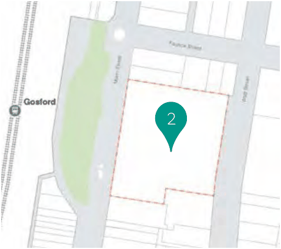

### 6.3 Key Site 2 8-16 Watt Street (Gateway Centre)

#### Principles

> [Picture on page 58: a picture, saved as a picture (images/gosford-city-centre-page-58-5.gif, 150 dpi).]

#### 2

1\.	 This is a key site due to its size and proximity to Gosford Railway Station and as it offers significant urban renewal opportunities. Accordingly, this site must be subject to a master planning process to ensure holistic consideration of urban design issues.

2\.	 A new through site link from Watt Street to Mann Street is desirable in order to connect pedestrians, east and west, across the city.

3\.	 Taller buildings may be appropriate on this site, subject to design testing to determine the optimum location of towers and the new through site link being delivered.

4\.	 The through site link should be:

Site  plan: 8-16 Watt Street

a.	 designed as an internal arcade, at a minimum width of 4.5metres;

b.	 designed to be two storeys in height (having a minimum floor to ceiling height of 8 metres) to ensure that the space is inviting and encourages use by the public;

c.	 publicly accessible 24 hours a day; and

d.	 aligned with the existing sandstone archway in Burns Place.

5\.	 The appropriate height for development of this site will be determined through the master planning process, which must include design testing and consideration of impacts on views and overshadowing. In particular, the master planning process should test options to achieve glimpses of Rumbalara Reserve from Burns Park. The master planning process will also need to consider the building’s potential impacts to the heritage listed Burns Park, including the fountain, spaces and layout and the cultural plantings.

6\.	 It is desirable to provide end of trip facilities in the City North place area, in close proximity to the railway station.

7\.	 Where public domain improvements are provided on

-site, consideration may be given to additional height.
