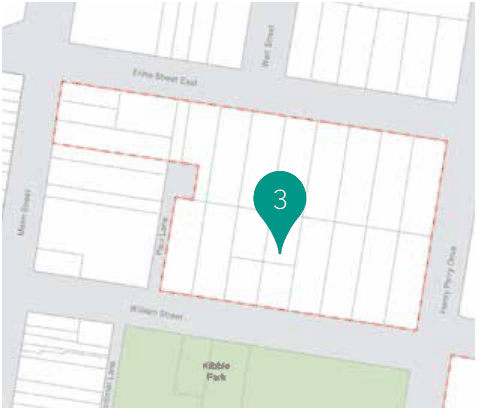

### 6.4 Key Site 3

## 171 Mann Street and 12 and

## 36 William Street (Imperial Shopping Centre)

#### Principles

1\.	 This is a key site due to its size, location and address to key public spaces, including Kibble Park and Mann Street and because it offers important urban renewal opportunities in the Civic Heart of Gosford City. Accordingly, this site must be subject to a master planning process to ensure holistic consideration of site specific urban design issues.

2\.	 Any development must protect and maximise solar access to Kibble Park and protect key views and street vistas.

3\.	 A north-south through site link is a priority for this site. The through site link should:

a.	 be designed as an internal arcade, at a minimum width of 8 metres and be a minimum of two storeys in height (achieving a minimum floor to ceiling height of 8 metres) to ensure that the space is inviting and encourages use by the public;

b.	 be designed to align visually with Watt Street and to promote easy north-south pedestrian access through the site;

c.	 be a direct link through the site.

4\.	 It is desirable for the through site link to be 12m in height, to achieve an inviting pedestrian connection for public use.

5\.	 The Kibble Park/William Street frontage is the primary frontage to the site.  It should be activated with multiple shop entries. Other edges of the site should be activated as much as possible and minimise blank facades. Refer to the Active Frontage controls in Chapter 5.

6\.	 New development on the part of the site that adjoins Mann Street must comply with the Built form controls provided in Chapter 4 of this DCP and may achieve a similar scale to the recent development to the south of

Key Sites 6

> [Picture on page 59: a picture, saved as a picture (images/gosford-city-centre-page-59-42.gif, 150 dpi).]

#### 3

Site  plan: 171 Mann Street and 12 and 36 William Street

the site facing Mann Street.

7\.	 Any tall buildings or towers on site must be appropriately located (for example towards the northern part of the site). Any tall buildings must demonstrate design excellence and testing to show it limits impacts on Key Views, Street Vistas and Key Open Space 1 (Kibble Park). Taller buildings should be designed as slender towers, and should comply with Chapter 5 of this DCP.
