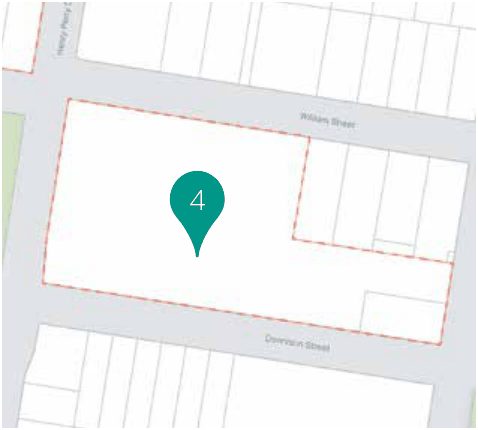
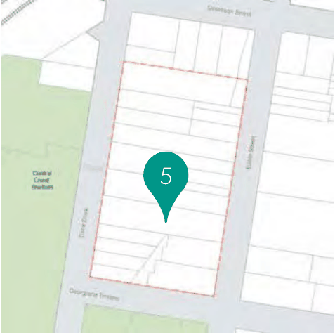

### 6.5 Key Site 4 136-148 Donnison Street (former Market Town)

#### Principles

> [Picture on page 60: a picture, saved as a picture (images/gosford-city-centre-page-60-5.gif, 150 dpi).]

#### 4

1\.	 This is a key site due to its size, location and address to key public spaces, including Kibble Park and  Henry Parry Drive. The site also offers important urban renewal opportunities in the Civic Heart of Gosford City facing Kibble Park. Accordingly, this site must be subject to a master planning process to ensure holistic consideration of site specific urban design issues.

2\.	 Any development must protect and maximise solar access to Kibble Park and protect key views and street vistas. Development on the western and north-western part of the site should be lower in height to maximise solar access to Kibble Park.

Site plan: 136-148 Donnison Street

3\.	 Maximising solar access to Kibble Park and views from Kibble Park to Rumbalara Reserve are priorities for development of this site. Taller buildings may be appropriate for this site, subject to design testing to determine the optimum location. The preferred location of taller buildings on this site is to the southern and eastern part of the site to minimise overshadowing impacts to Kibble Park.

4\.	 North-south through site links should be provided to improve pedestrian connectivity and to break up the length of the street block.

5\.	 The appropriate height for development of this site will be determined through a master planning process, which is to include design testing and consideration of impacts on views and overshadowing.

6\.	 An active frontage is required on two street frontages. Retail or commercial uses are appropriate fronting Henry Parry Drive while multiple lobby and residential entries (maisonettes) should have adequate street address to, and contribute positive design outcomes for, Donnison Street.

Key Sites 6

> [Picture on page 61: a picture, saved as a picture (images/gosford-city-centre-page-61-2.gif, 150 dpi).]
