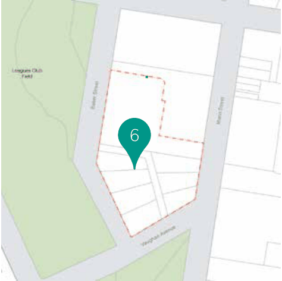
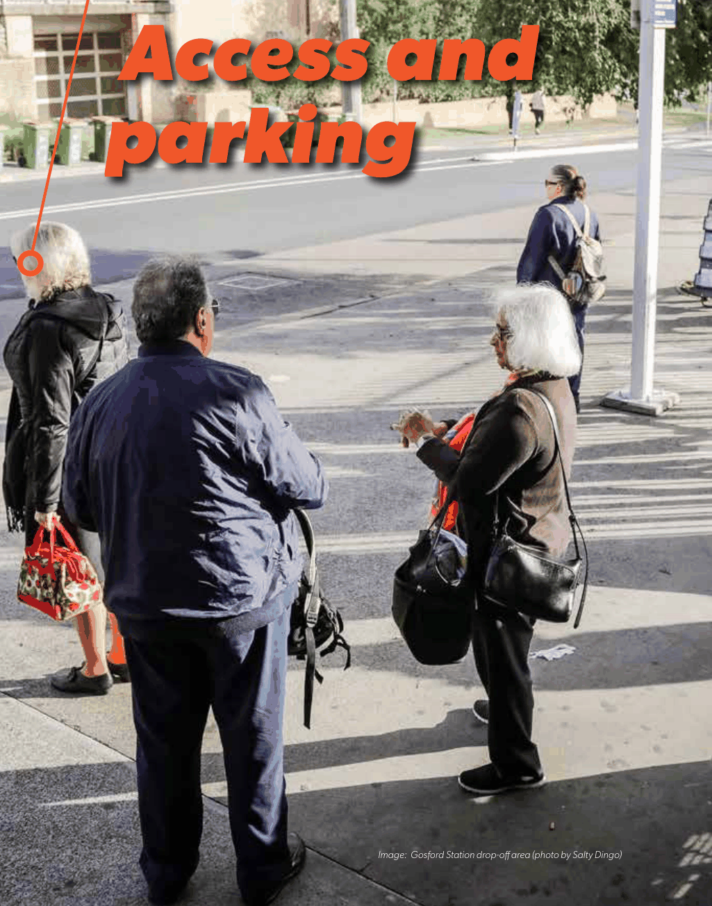
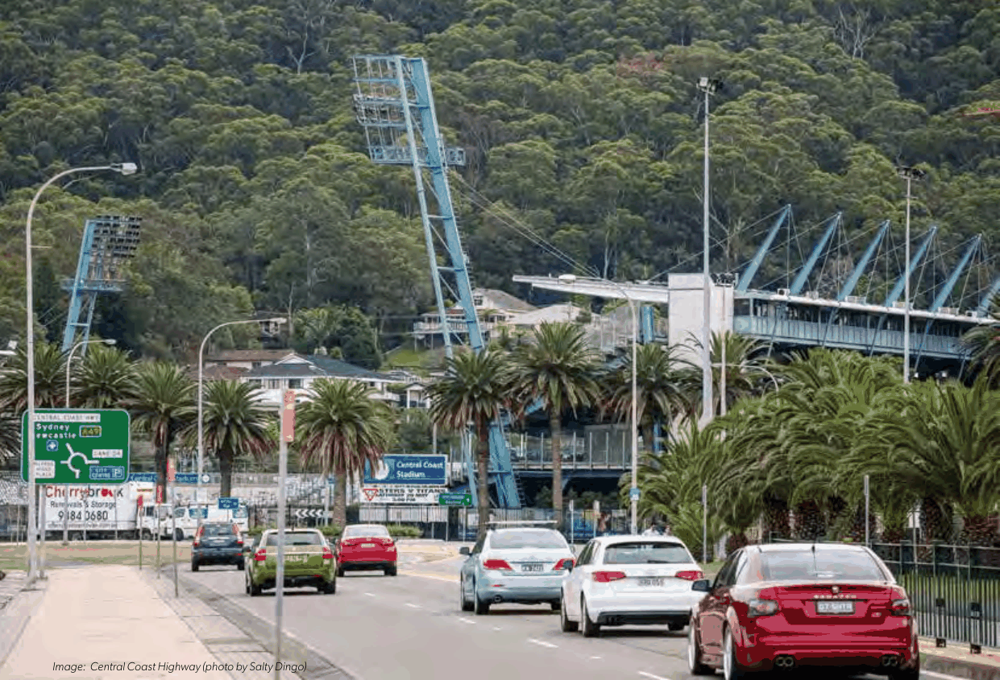

### 6.7 Key Site 6

### 26 - 32 Mann Street

#### Principles

> [Picture on page 62: a picture, saved as a picture (images/gosford-city-centre-page-62-4.gif, 150 dpi).]

### 6

1\.	 This is a key site due to its size, location and address to key public spaces, including the Leagues Club Field and Brisbane Water. The site also offers important urban renewal opportunities in the City South and adjoins Baker Street, Mann Street and Leagues Club Field. Accordingly, this site must be subject to a master planning process to ensure holistic consideration of site specific urban design issues.

2\.	 The provision of visual connections and pedestrian links between Mann Street and Baker Street (to Leagues Club Field) are priorities for development of this site.

Site plan: 26 - 32 Mann Street

3\.	 Publicly accessible podium open space above Baker Street, at the level of Mann Street and overlooking the waterfront should be considered and integrated into development of the site.

4\.	 The appropriate height for development of this site will be determined through a master planning process, which is to include design testing and consideration of impacts on views and overshadowing. In particular, the master planning process should test options to maximise views between street level on Mann Street through to the park and the water.  The development must comply with the view, slender towers, and solar access provisions contained in this DCP. The development must also take into account the potential impacts on existing heritage items in the vicinity of this site including Gosford War Memorial Park, Rotary Park (Poppy Park), and other nearby heritage items.

5\.	 Baker Street (extension) is a desired pedestrian boulevard (emergency vehicle access only).

6\.	 Vehicular access to the site and servicing should be provided from Vaughan Avenue and not from either Mann Street or the Baker Street extension, which are two of the most important active street frontages in Gosford.

7\.	 Any development must consider any future plans for the adjoining public spaces and investigate the conversion of the western section of Vaughan Avenue (beyond Baker Street to the Waterfront) to a shared way to improve pedestrian connectivity between the two adjacent public open spaces.

### 7

> [Picture on page 63: a picture, saved as a picture (images/gosford-city-centre-page-63-2.gif, 150 dpi).]
> Words printed on the picture (title and legend, copied from the PDF):
> Image:  Gosford Station drop-off area (photo by Salty Dingo)

Access and

### parking

### 07

### Access and parking

> [Picture on page 64: a picture, saved as a picture (images/gosford-city-centre-page-64-1.gif, 150 dpi).]
> Words printed on the picture (title and legend, copied from the PDF):
> Image:  Central Coast Highway (photo by Salty Dingo)
