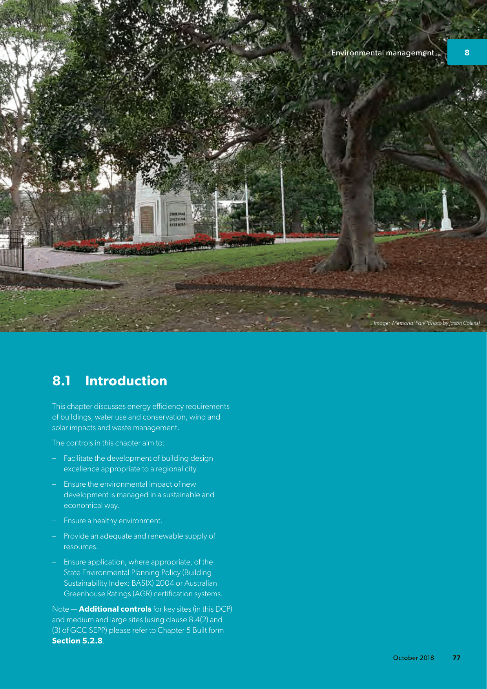

### 7.5 Site Facilities and Services

#### Objectives

#### Waste (garbage) storage and collection - General (all development)

A	 To ensure that site facilities (such as clothes drying

1\.	 All development is to accommodate waste handling and storage on-site.

2\.	 Access for waste collection and storage is preferred from rear lanes, side streets or rights of ways.

areas, mail boxes, recycling and garbage disposal units/areas, screens, lighting, storage areas, air conditioning units and communication structures) are effectively integrated into the development and are unobtrusive.

3\.	 Waste storage areas are to be designed to:

B	 To ensure that site services and facilities are

a.	 ensure adequate driveway access and

adequate for the nature and quantum of development.

manoeuvrability for any required service vehicles,

C	 To establish appropriate access and location

b.	 be located so as not to create any adverse

requirements for servicing. D	 To ensure service requirements do not have adverse amenity impacts.

noise impacts on the existing developments or sensitive noise receptors such as habitable rooms of residential developments, and

c.	 be screened from the public way and adjacent

#### Controls

development that may overlook the area.

#### Mailboxes

1\.	 Provide mail boxes for residential building and/or commercial tenancies in one accessible location adjacent to the main entrance to the development.

4\.	 The storage facility must be well lit, easily accessible and on level grade for movement of bins, free of obstructions that may restrict movement and servicing of bins or containers and designed to minimise noise impacts.

2\.	 They should be integrated into a wall where possible and be constructed of materials consistent with the appearance of the building.

#### Location requirements for waste storage areas and access:

3\.	 Mail boxes shall be secure and large enough to accommodate articles such as newspapers.

1\.	 Where waste volumes require a common collection, storage and handling area, this is to be located:

a.	 for residential flat buildings, enclosed within a

Communication structures, air conditioners and service vents

basement or enclosed carpark,

b.	 for multi-unit housing, at ground behind the

1\.	 Locate satellite dish and telecommunication antennae, air conditioning units, ventilation stacks and any ancillary structures:

main building setback and façade, or within a basement or enclosed carpark, and

a.	 away from the street frontage,

c.	 for commercial, retail and other development,

b.	 integrated into the roof-scape design and in a position where such facilities will not become a skyline feature at the top of any building, and

on-site in basements or at ground level within discrete service areas not visible from main street frontages.

c.	 adequately setback from the perimeter wall or roof edge of buildings.

2\.	 Where above ground garbage collection is prohibitive or impractical due to limited street frontage, or would create an unsafe environment, an on-site basement storage area must be provided.

2\.	 A master antenna must be provided for residential apartment buildings. This antenna shall be sited to minimise its visibility from surrounding public areas.

Access and parking 7

3\.	 Where a waste vehicle is required to enter the site, access and circulation areas shall be designed to accommodate a vehicle with the following specification:

| Vehicle length | 10.5m |
|---|---|
| Vehicle height | 4.0m |
| Ramp width | 4m |
| Turning circle | AUSROADS template for HRV, R=12.5m, speed 5kph |
| Minimum truck loading | 23 tonne |

Any access route for waste collection vehicles and operators is subject a Section 88B Instrument under the Conveyancing Act for right of access being provided prior to an occupational certificate being issued.

#### Service docks and loading / unloading areas

1\.	 Provide adequate space within any new development for the loading and unloading of service/delivery vehicles.

2\.	 Preferably locate service access off rear lanes, side streets or rights of way.

3\.	 Screen all service doors and loading docks from street frontages and from active overlooking from existing developments.

4\.	 Design circulation and access in accordance with AS 2890.1.

#### Fire service and emergency vehicles

1\.	 For developments where a fire brigade vehicle is required to enter the site, vehicular access, egress and manoeuvring must be provided to, from and on the site in accordance with the NSW Fire Brigades Code of Practice - Building Construction - NSWFB Vehicle Requirements.

2\.	 Generally provision must be made for NSW Fire Brigade vehicles to enter and leave the site in a forward direction where:

a.	 NSW Fire Brigade cannot park their vehicles within the road reserve due to the distance of hydrants from the building or restricted vehicular access to hydrants, or

b.	 otherwise required by the NSW Fire Brigades Code of Practice - Building Construction NSWFB Vehicle Requirements.

### 8

### Environmental

### management

> [Picture on page 76: a picture, saved as a picture (images/gosford-city-centre-page-76-4.gif, 150 dpi).]

### Environmental management

Source: Salty Dingo

> [Picture on page 77: a picture, saved as a picture (images/gosford-city-centre-page-77-1.gif, 150 dpi).]
> Words printed on the picture (title and legend, copied from the PDF):
> Environmental management 8
> Image:  Memorial Park (photo by Jason Collins)
> resources.
