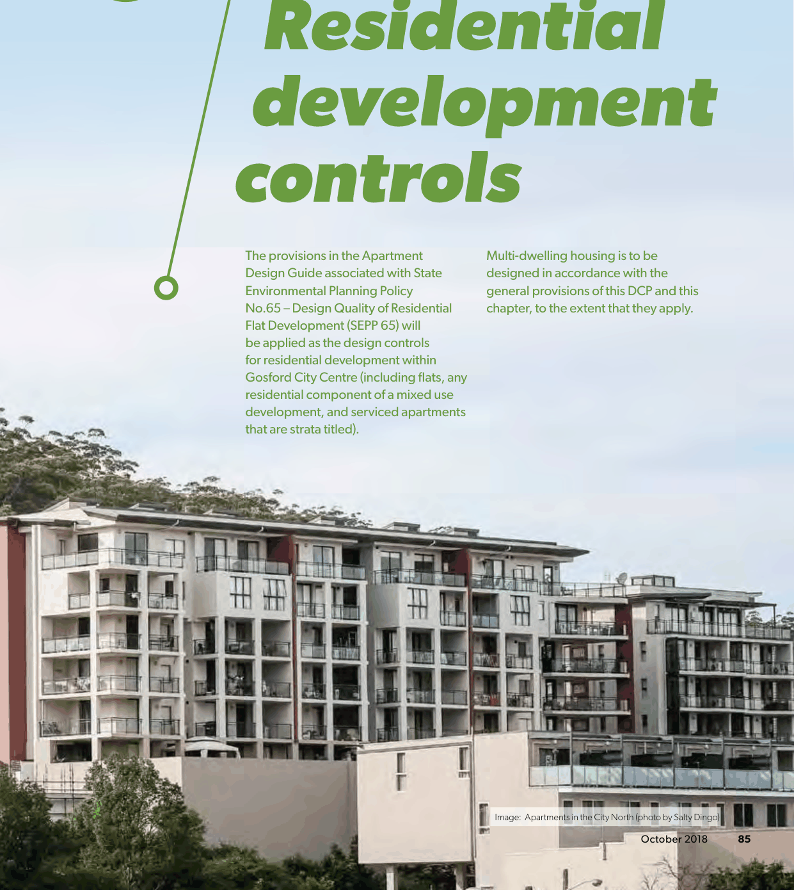

### 8.7 Noise and Vibration

Effective management of noise and vibration in a city centre environment depends upon addressing the following factors:

–– Consideration of the siting of the proposed development and potential external sources of noise and vibration (e.g. location on an arterial road or adjacent the railway).

–– Building design and layout, to address internal and external sources of noise and vibration.

–– Construction and engineering techniques.

–– Building materials, acoustic shielding and insulation.

–– Operational management, (e.g. hotels, night clubs).

#### Objectives

A	 To ensure development is designed so noise and vibration from new businesses, light industrial and leisure/cultural/entertainment venues and other noise generating activities do not unacceptably affect the amenity of nearby residential and other noise or vibration sensitive uses. B	 To ensure development is designed and constructed so that noise and vibration impacts from existing neighbouring activities do not unreasonably compromise the amenity of occupants of the proposed development.

C	 To ensure noise and vibration impacts between different uses and occupancies within a development provide reasonable amenity to all occupants of the development.

#### Controls

1\.	 Development should be designed to minimise the potential for offensive noise.

2\.	 Where a proposed development includes an activity which may generate unreasonable noise or which may be affected by an existing noise source, an acoustic study is to be undertaken to establish noise levels and provide a mitigation strategy, demonstrating the measures to be taken to effectively mitigate noise.

3\.	 Noise sensitive developments, such as dwellings, should be designed to reasonably protect the proposed development from noise sources such as arterial roads, railway lines, sporting complexes and entertainment venues.

4\.	 Noise buffering should not be provided by high fences, garages or blank walls to public streets. Where screening by these or similar methods is the only practical solution, the screen should be no greater than 50% of the street frontage. Such screening should have visual interest and retain some surveillance from the building behind the screen’s entries, windows or balconies, when practical.

5\.	 Where proposed noise sensitive development may be affected by existing noise, the development should be designed to incorporate adequate shielding from those noise sources.

6\.	 Entertainment venues, hotels, clubs, cinemas and the like, either licensed or unlicensed, should prepare a plan of management including provisions to:

a.	 Ensure patrons enter and leave the premises in a quiet and orderly manner whenever the premises are open to the public.

b.	 Manage noise levels within the premises to prevent an unreasonable effect on the amenity of the locality.

7\.	 Commercial, light industrial and retail developments; or mixed use developments, should have suitably located and designed goods delivery and garbage collection areas, vehicle entry and exits, and other noise sources, so that amenity of residents both within the development and in nearby buildings is reasonably protected.

8\.	 Home based businesses should not generate unreasonable levels of noise beyond their property boundary.

9\.	 When a development consent is granted and includes conditions of consent requiring monitoring of noise levels and setting of acoustic performance standards, provision should be made to test actual noise levels after the development is occupied and when noise generating activities commence; and for corrective acoustic treatment to be applied if necessary.

Environmental management 8

Image:  Gosford Railway Station

> [Picture on page 84: a picture, saved as a picture (images/gosford-city-centre-page-84-1.gif, 150 dpi).]

### esidential Development Controls

### 9

> [Picture on page 85: a picture, saved as a picture (images/gosford-city-centre-page-85-2.gif, 150 dpi).]
> Words printed on the picture (title and legend, copied from the PDF):
> Image:  Apartments in the City North (photo by Salty Dingo)

### Residential

### development

### controls

Multi-dwelling housing is to be designed in accordance with the general provisions of this DCP and this chapter, to the extent that they apply.

The provisions in the Apartment Design Guide associated with State Environmental Planning Policy No.65 – Design Quality of Residential Flat Development (SEPP 65) will be applied as the design controls for residential development within Gosford City Centre (including flats, any residential component of a mixed use development, and serviced apartments that are strata titled).
