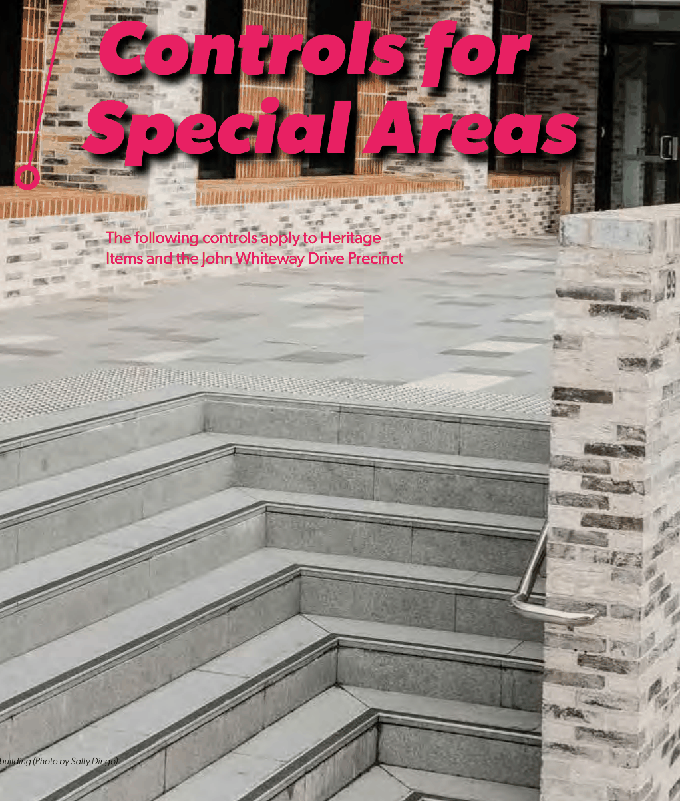

### 9.3 Multi-Dwelling Housing

Multi-dwelling housing generally refers to townhouse development forms that do not fall under the requirements of State Environmental Planning Policy No 65 and Apartment Design  Guide. Where this is the case, the following provisions apply.

#### Objectives

A	 To ensure development positively contributes to and actively addresses the streetscape. B	 To ensure development contributes to a well framed streetscape.

C	 To clearly define semi-private, private and communal spaces, and to ensure no left over spaces with ambiguous ownership.

Residential Development Controls 89

D	 To ensure adequate levels of privacy for new and existing residents.

E	 To ensure adequate levels of solar access to private open spaces and principle living rooms within the development, and to existing dwellings. F	 To provide quality, usable private and communal open spaces for residents.

G	 To maximise deep soil and open space for mature tree planting, water percolation and residential amenity.

H	 To minimise the physical and visual dominance of car parking, garaging and vehicular circulation.

#### Controls

Form and Streetscape

1\.	 Development is to maximise the number of dwellings that directly front the street. Dwellings  are to face existing streets rather than to new internal access way/roads.

2\.	 Buildings addressing the street are to have a minimum height of 2 storeys.

3\.	 Parts of development towards the rear of the site should be more modest in scale to limit the impact on adjoining properties.

4\.	 Where possible, maintain the existing orientation and pattern of dwelling ‘fronts’ and ‘backs’. Generally dwellings ‘fronts’ should face other ‘fronts’ and ‘backs’ should face other backs.

5\.	 Utilise the site so that any private, public and communal spaces are clearly defined with a clear sense of ownership.

6\.	 Despite the controls in Section 5.2.1 multi-dwelling housing of 2 storeys or under (or a row of attached dwellings) are to have minimum side separation distance to another dwelling of 2.5m. This is to be increased to 3m separation when involving 3 storey development. These minimum separation distances between dwellings are only permitted between non-habitable rooms and do not include balconies or terraces.

Privacy

1\.	 Privacy measures such as screens, landscaping and fencing should be provided between private open spaces at ground level. Fencing between dwellings is to be a maximum height of 1.8m. Any fencing that faces onto the public domain is to meet the requirements of Section 5.2.13 Front Fences.

2\.	 A minimum separation distance between directly opposing second level or higher rear windows (within the private domain) to primary living areas and bedrooms of 12m applies.

3\.	 Use landscaping to provide a visual buffer between new and existing dwellings. Solar Access

1\.	 Dwellings within the development site and adjoining properties are to receive a minimum of 3 hours sunlight to principal living rooms and to at least 50% of the private open space between 9am and 3pm on 21st June. Where existing development currently receives less sunlight than this requirement, this should not be unreasonably reduced. Shadow diagrams will be required with the development application in order to demonstrate compliance. Private Open Space

1\.	 Provide each dwelling with private open space in the form of a courtyard garden, balcony, terrace and/or a roof garden, to at least one of the following standards:

a.	 ground-level area totalling 40m2 (with one part at the side or rear and adjacent to a living room or kitchen) having a minimum contiguous area of 25m2 with a minimum width of 5m, or

b.	 a balcony or terrace adjacent to a living room or kitchen of the dwelling, having a minimum area of 10m2 with a minimum depth of 2.5m.

Communal Open Space

1\.	 Retain, where possible, existing mature trees in communal open space.

2\.	 Communal open space should be readily accessible to all dwellings in the development.

3\.	 Communal open space should receive a minimum of 3 hours of sunlight between 9am and 3pm to a least 50% of the space on 21st June.

4\.	 Communal open space is to consist of at least 50% deep soil, have a minimum dimension of 6m in any direction, contain landscaping, seating and barbecue areas.

5\.	 Dwellings are to be designed so that they overlook and provide informal surveillance of communal open spaces. Any threshold treatments between

private and communal space is not to exceed 1.2m in height.

Parking and Driveways

1\.	 Small centralised and landscaped carparking courts that reduce the amount of space occupied by driveways, garages and approaches to garages are preferred over individual garages.

2\.	 Avoid long, straight and unrelieved driveways that are visually dominant by:

a.	 varying the alignment of driveways to avoid a ‘gunbarrel’ effect,

b.	 setting garages back a minimum of 1m behind the predominant building line to reduce their visibility from the street, and

c.	 considering alternative site designs that avoid driveways running the length of the site.

3\.	 Minimise the impact of driveways on the streetscape by:

a.	 terminating vistas with landscaping or a dwelling, not parking areas,

b.	 using planting to soften driveway edges,

c.	 limiting driveway widths on narrow sites to single carriageway widths with passing points,

d.	 providing gates at the head of driveways to minimise the visual ‘pull’ of driveways,

e.	 ensuring that driveways, garaging and entry to carparks do not exceed 35% of the site frontage,

f.	 designing individual garages to dwellings where provided so as to be visually recessive and not occupying more than 40% of the ground floor of the associated dwelling, and

g.	 setting dwellings back a minimum of 1.5m (preferably landscaped) from shared driveways, access lanes and carparks.

Note — The controls in the Apartment Design Guide and SEPP65 also apply to residential developments. To obtain a copy of these policies, please see the Department’s website www.planning.nsw.gov.au

### 10

> [Picture on page 89: a picture, saved as a picture (images/gosford-city-centre-page-89-2.gif, 150 dpi).]

Controls for

### Special Areas

#### The following controls apply to Heritage Items and the John Whiteway Drive Precinct

#### The following controls apply to Heritage Items and the John Whiteway Drive Precinct

### 010

### Controls for Special Areas

Image:  Australian Tax Office building (Photo by Salty Dingo)
