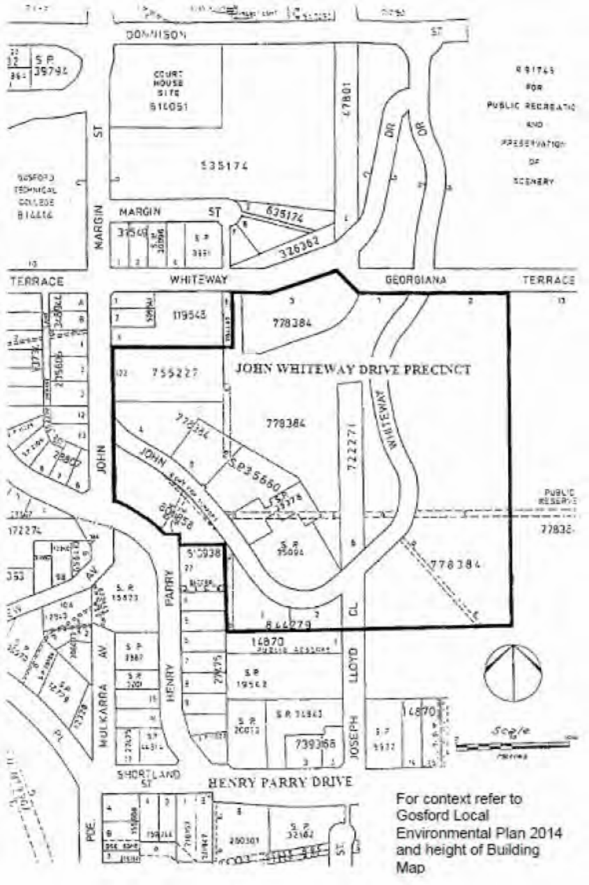
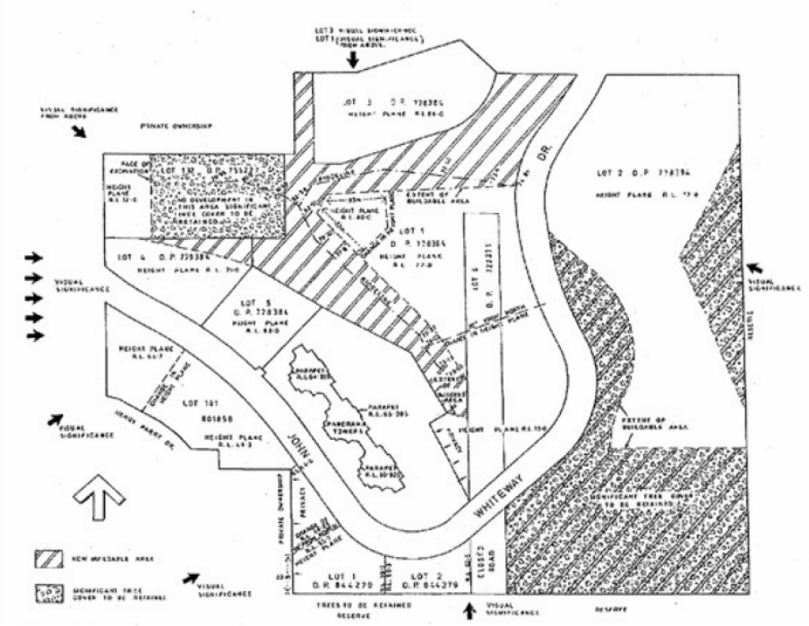
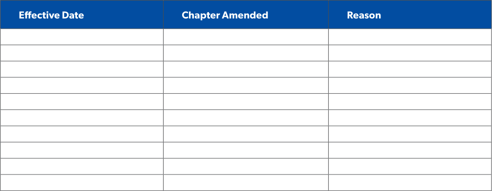

### 10.3 Special Area - John Whiteway Drive Precinct

The section applies to the land known as the Old Gosford Quarry site between Henry Parry Drive and Cappers Gully, as illustrated in Figure 13

#### Objectives

A	 To protect the western section of the ridgeline from visual encroachment by development when viewed from specified public viewing locations. B	 To provide the northern section of the ridgeline and non-ridgeline influenced properties with development controls referenced to appropriate visual impact analysis and relevant site specific constraints.

C	 To ensure that the amenity of the area is protected for existing and future residents of the locality. D	 To ensure that the land will be developed in a form and manner that the community will accept as a good example of high density residential development.

#### Definitions

For the purposes of this section of the chapter, the following definitions apply:

–– Existing Ground Level – Means the ground level at the time an application is made to Council

–– Height Plane – In relation to this DCP the height plane means the height in respect of any site expressed in metres Australian Height Datum (AHD) above which no development or structure is to be constructed;

–– Ridgeline – Is defined as the continuous formation of natural rock, excluding vegetation or tree canopy, as defined by survey spot heights (expressed in Australian Height Datum) and identified in Figure 13

#### Controls

1\. In the John Whiteway Drive Precinct, the opportunity for high-rise residential development has largely arisen as a result of the existence of building platforms created from earlier sandstone quarrying. This precinct constitutes a unique site in which standardised controls are inappropriate considering the diversity of site constraints that

Controls for Special Areas

affect various allotments. Where development proposals seek to vary numerical standards, the design principles and case for varying the control involved must be clearly documented in the development application.

2\.	 The development controls specified below seek to maximise development potential within clearly identified development parameters acknowledging the inherent biophysical constraints of the precinct as a whole and the site specific requirements of individual allotments.

> [Picture on page 94: a picture, saved as a picture (images/gosford-city-centre-page-94-1.gif, 150 dpi).]

Figure 13.  John Whiteway Drive Precinct

Figure 14.  Development Principles Plan

#### Heights of Buildings

Figure 14  is a Development Principles Plan which illustrates the building height planes and other development controls necessary for development to conform with the relevant objectives of this chapter of the DCP.

The maximum height planes proposed for each existing lot in the precinct are as follows:

Controls for Special Areas

> [Picture on page 95: a picture, saved as a picture (images/gosford-city-centre-page-95-11.gif, 150 dpi).]

| Lot 132 DP |  | 72.0m AHD |
|---|---|---|
| 755227 |  |  |
| Lot 1 DP 778384 | (NW Section) | 80.0m AHD |
| Lot 1 DP 778384 | (North Section) | 77.0m AHD |
| Lot 1 DP 778384 | (South Section) | 73.0m AHD |
| Lot 2 DP 778384 |  | 77.0m AHD |
| Lot 3 DP 778384 |  | 692.0m AHD |
| Lot 4 DP 778384 |  | 71.0m AHD |
| Lot 5 DP 778384 |  | 68.0m AHD |
| Lot 6 DP 722271 | (North Section) | 77.0m AHD |
| Lot 6 DP 722271 | (South Section) | 73.0m AHD |
| Lot 101 DP 801858 | (South end) | 49.3m AHD |
| Lot 101 DP 801858 | (North end) | 54.70m AHD |
| Lot 1 DP 844279 | (East end) Change of Height (East side) (West side) (NW end) | 59.3m AHD 55.7m AHD 46.24m AHD 44.6m AHD |
| Lot 2 DP 844279 | (East end) (West end) | 62.5m AHD 59.3m AHD |

#### Buildable Area

The buildable area of each lot is illustrated in Figure 14 and coincides with the Restriction as to User on the title of the relevant lots under the Conveyancing Act, 1919. The Restriction as to User has application only where the restriction is not inconsistent with the provisions of the relevant planning instrument.

The covenant supporting the designated buildable areas has application, as the buildable area provisions have been included in this DCP.

The function of the buildable area is to clearly define areas suitable for development, taking into consideration a wide diversity of natural and human influenced opportunities and constraints. The integrated components of ridgeline, geology and vegetation, contrast with the legacy of extractive activities and define the visually sensitive elements of the precinct. Adherence to the buildable areas and supporting development controls will ensure the visual and environmental integrity of the precinct and individual allotments will be maintained.

Development within and variations to the designated buildable area must be supported by a comprehensive geotechnical survey conducted by a qualified geotechnical engineer which assesses the stability risk posed to both the ridge, proposed development and existing development. This information is to be submitted with the development application. In particular the geotechnical report should specifically assess:

–– any unacceptable stability risk to the ridgeline posed by the development,

–– any risk to existing and approved potential development, and

–– appropriate measures to minimise this risk to both the ridgeline and the proposed development, including recommendations for acceptable setbacks.

In some cases, lots may be further excavated as a means to achieve the development potential on the land. Excavation depth shall be determined by the geotechnical assessment and subject to the

maintenance of an adequate gravity feed to Council’s storm water system.

Geotechnical engineers are advised of the existence of cracking in the quarried caves within Lots 4 and 5 DP

778384\. Verification of the extent of this cracking, and its influence upon development should be assessed in relation to ridgeline affected lots.

#### Built Form

The built form should be designed and located to provide maximum orientation of future dwellings to sunlight, views, vistas and areas of public open space.

Design should have special consideration for the scale, bulk and articulation of built form presented to the streetscape. Buildings adjacent to the public open space should be orientated to take advantage of the visual quality of the open space through views from internal and external living spaces. Where possible living areas within buildings should face the public open space.

Due to the prominence and scale of buildings on the site, building colours and materials should be sympathetic to the local background and environment of the individual sites, having regard to the sandstone cliff faces and the indigenous vegetation. Building materials should be selected to avoid reflective building finishes.

#### Subdivision

Any proposal for the re-subdivision of the existing allotments must be accompanied by a comprehensive site analysis and development concept plan detailing the justification for such development. The development concept plan should assess:

–– the maximisation of development potential,

–– containment of any adverse impacts upon the environmentally sensitive elements of the site,

–– any adverse impact upon the external visual presentation of the precinct as a whole, and

–– the utility of the buildable area involved in the proposed subdivision.

### Appendix A

> [Picture on page 97: a picture, saved as a picture (images/gosford-city-centre-page-97-2.gif, 150 dpi).]

### A

> [Picture on page 97: a picture, saved as a picture (images/gosford-city-centre-page-97-4.gif, 150 dpi).]
> Words printed on the picture (title and legend, copied from the PDF):
> A
> Appendix A 9

### Appendix A

Glossary of key terms and acronyms and list of

#### key policy documents referenced

Glossary of key terms and acronyms and list of

#### key policy documents referenced

Image:  Rotary Park (photo by Salty Dingo)

### Abbreviations and acronyms summary

| Abbreviation | Definition |
|---|---|
| ADG | Apartment Design Guide (NSW Department of Planning and Environment, July 2015) |
| CPTED | Safer By Design - Crime Prevention Though Environmental Design (NSW Police) |
| EP&A Reg 2000 | Environmental Planning and Assessment Regulation 2000 |
| FSR | Floor Space Ratio |
| GCC SEPP | State Environmental Planning Policy (Gosford City Centre) 2018 |
| Gosford LEP | Gosford Local Environmental plan 2014 |
| Gosford DCP | Gosford Development Control Plan 2013 |
| HOB | Height of Building |
| The Act or EP&A Act | Environmental Planning and Assessment Act 1979 |
| 1979 |  |
| SEPP 65 | State Environmental Planning Policy No 65—Design Quality of Residential Apartment Development |
| UDF | Urban Design Framework |
| Regional Plan | Central Coast Regional Plan 2036 |

Appendix A A

### Documents referenced

Apartment Design Guide (NSW Department of Planning and Environment, July 2015) Central Coast Regional Plan 2036 Safer By Design - Crime Prevention Though Environmental Design (NSW Police) Environmental Planning and Assessment Act 1979 Environmental Planning and Assessment Regulation 2000 Gosford City Centre Streetscape Design Guidelines 2011 (Central Coast Council) Gosford Local Environmental Plan 2014 Gosford Development Control Plan 2013 Gosford City Centre Revitalisation Proposed Delivery Mechanisms Consultation Paper May 2018 Gosford Urban Design Framework (UDF): Setting the Scene and Early Recommendations April 2018 Gosford UDF Place Report: 1 The Civic Heart April 2018 Gosford UDF Place Report: 2 City North April 2018 Gosford UDF Place Report: 3 City South April 2018 State Environmental Planning Policy (Gosford City Centre) 2018 State Environmental Planning Policy No 65—Design Quality of Residential Apartment Development Gosford Urban Design Framework (UDF) October 2018 Waste Control Guidelines (Central Coast Council) Water Cycle Management Plan (Central Coast Council)

> [Picture on page 100: a picture, saved as a picture (images/gosford-city-centre-page-100-1.gif, 150 dpi).]

### Appendix B

### B

### Appendix B

#### Notification table

#### Notification table

### Appendix B

#### B

Appendix B

| Type of Notification | Notice in Newspaper | Notice to adjoining owners | Submission period |
|---|---|---|---|
| Advertisements and Advertising Structures on land zoned residential, or on land adjoining land zoned residential | Yes | Yes | 14 days |
| Amusement Centre/Entertainment Facilities | Yes | Yes | 14 days |
| Boarding House | Yes | Yes | 21 days |
| Change of Use in Industrial and Business Zones | No | Yes | N/A |
| Child Care Centres | Yes | Yes | 21 days |
| Crematoriums/cemeteries | Yes | Yes | 14 days |
| Commercial Building within a commercial zone | No | No | N/A |
| Commercial Building Work – new or alterations and additions where adjoining land zoned residential or existing residential development | No | Yes | 14 days |
| Demolition | No | No | N/A |
| Drug Rehabilitation Facilities | Yes | Yes | 21 days |
| Dual Occupancy – including alterations and additions | Yes | Yes | 14 days |
| Dwelling houses, ancillary development or additions­ where setback, site coverage, floor space ratio and building height requirements are complied with. | No | No | N/A |
| Dwelling houses ancillary development or additions ­ where setback or site coverage or floor space ratio or building height requirements are not complied with or where in the opinion of the determining authority the proposal may have undue impact on the amenity of surrounding properties | No | Yes | 14 days |
| Educational Establishment excepting proposals in a business, industrial or special use zone | Yes | Yes | 21 days |
| Food and drink premises located on footpaths excepting proposals in a business, industrial or special use zone | Yes | Yes | 14 days |
| Funeral chapel, funeral home excepting proposals in a business, industrial or special use zone | Yes | Yes | 14 days |
| Group Home | Yes | Yes | 14 days |
| Development involving a heritage item | Yes | Yes | 14 days |
| Development within a heritage conservation area | Yes | Yes | 14 days |
| Home Industry, home business | No | Yes | 14 days |

| Type of Notification | Notice in Newspaper | Notice to adjoining owners | Submission period |
|---|---|---|---|
| Hospital if proposed on land zoned residential or land adjoining land zoned residential | Yes | Yes | 21 days |
| Hostel | Yes | Yes | 14 days |
| Industrial Building Work excepting proposals in a business or industrial zone | No | Yes | 14 days |
| Internal Fit Outs/Alterations | No | No | N/A |
| Land Subdivision– resulting in 1 to 9 lots (except where as a result of approved development) | Yes | Yes | 14 days |
| Land Subdivision– resulting in 10 or more lots (except where as a result of approved development) | Yes | Yes | 21 days |
| Non­-residential uses in residential zones | No | Yes | 14 days |
| Place of Public Worship excepting proposals in a business, industrial or special use zone | Yes | Yes | 21 days |
| Private waterfront developments (including jetties, boat ramps etc.) | No | Yes | 21 days |
| Pub | Yes | Yes | 21 days |
| Residential Flat Building/Multi Dwelling Housing – including alterations and additions | Yes | Yes | 21 days |
| Secondary Dwellings where setback and building height requirements are complied with | No | No | N/A |
| Secondary Dwellings where setback and building height requirements are not complied with | No | Yes | 14 days |
| Seniors Living | Yes | Yes | 21 days |
| Sex Services Premises & Restricted Premises | Yes | Yes | 14 days |
| Shop Top Housing | Yes | Yes | 21 days |
| Subdivision of an approved Dual Occupancy | No | No | N/A |
| Strata Subdivision of Existing Building | No | No | N/A |
| Telecommunication Facilities | Yes | Yes | 14 days |
| Tourist and visitor accommodation except in a business or special use zones | Yes | Yes | 14 days |
| All other Development | Yes* | Yes* | 0-14 days* |

\*At the discretion of the assessing authority. In some instances where a proposed land use is not mentioned in the Notification Table and/or the assessing authority is of the opinion a proposal will have little or no environmental impact, public notification will not be required.

#### C

#### Appendix C

### C

### Appendix C

#### Schedule of Amendments to this DCP

> [Picture on page 103: a picture, saved as a picture (images/gosford-city-centre-page-103-6.gif, 150 dpi).]

### 014

### Appendix C

### Schedule of Amendments

> [Picture on page 104: a picture, saved as a picture (images/gosford-city-centre-page-104-2.gif, 150 dpi).]

#### Effective Date

#### Chapter Amended

#### Reason

For more information visit planning.nsw.gov.au
