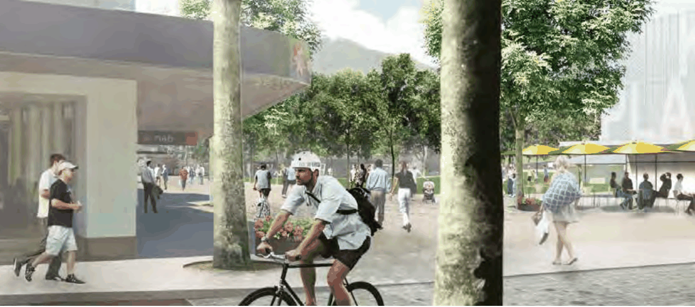
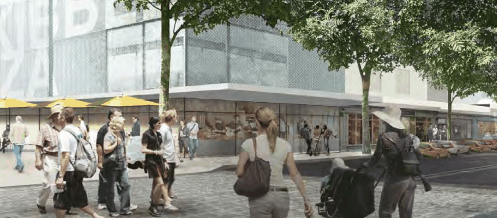

# Gosford City Centre

> This chapter is split into 65 section file(s), one per numbered heading, in the order they appear in the PDF.

Source PDF: [Gosford+City+Centre+DCP+2018.pdf](https://planfortomorrow.sharepoint.com/sites/Planfortomorrow/Shared%20Documents/00%20NSW-Planning-Resources/dcp/gosford-city-centre/gosford-city-centre/Gosford%2BCity%2BCentre%2BDCP%2B2018.pdf)

### 2018

### Gosford City Centre

### Development Control Plan

### 3

### Strategic

### priorities

Gosford City Centre Development Control Plan October 2018 © Crown Copyright 2018 NSW Government

DISCLAIMER While every reasonable effort has been made to ensure that this document is correct at the time of printing, the State of NSW, its agents and employees, disclaim any and all liability to any person in respect of anything or the consequences of anything done or omitted to be done in reliance or upon the whole or any part of this document.

Copyright Notice In keeping with the NSW Government’s commitment to encourage the availability of information, you are welcome to reproduce the material that appears in the Gosford City Centre DCP for personal in-house or non-commercial use without formal permission or charge. All other rights are reserved. If you wish to reproduce, alter, store or transmit material appearing in the Gosford City Centre DCP for any other purpose, request for formal permission should be directed to:

Gosford City Centre DCP PO Box 1148 Gosford NSW 2250

Cover Image:  Artist impression of the revitalised Civic Heart (CHROFI) Image opposite:  Gosford Hospital Redevelopment (Photo by Salty Dingo)

> [Picture on page 3, not reproduced as text; see the original PDF.]

> [Picture on page 4: a picture, saved as a picture (images/gosford-city-centre-page-4-1.gif, 150 dpi).]

Image:  Artist impression of the revitalised Civic Heart (CHROFI)

> The PDF's contents list (page numbers of the printed document) is not repeated here - see Sections below.

> [Picture on page 5: a picture, saved as a picture (images/gosford-city-centre-page-5-1.gif, 150 dpi).]
> Words printed on the picture (title and legend, copied from the PDF):
> 

| 6.6 | Key Site 5 1 Dane Drive (Central Coast Leagues Club) 61 | 9 Residential Development Controls 84 |
|---|---|---|
| 6.7 | Key Site 6 26 - 32 Mann Street 62 | 9.1  Housing Choice and Mix 86 9.2  Storage 87 |
| 7 | Access and parking 63 | 9.3  Multi-Dwelling Housing 87 |
| 7.1 | Introduction 64 | 10 Controls for Special Areas 89 |
| 7.2 | Pedestrian Access and Mobility 65 | 10.1  Heritage Items 90 |
| 7.3 | Vehicular Driveways and Manoeuvring areas 65 | 10.2  Signs on Heritage Items and Heritage Plaques 91 |
| 7.4 | On-Site Parking 66 | 10.3  Special Area - John Whiteway Drive |
| 7.5 | Site Facilities and Services 74 | Precinct 93 |
| 8 | Environmental management 76 | Appendix A 97 Glossary of key terms and acronyms |
| 8.1  8.2 | Introduction 77 Energy Efficiency and Conservation 78 | Appendix B 100 |
| 8.3 | Water Conservation 78 | Notification table |
| 8.4 | Reflectivity 79 |  |
| 8.5 | Wind Mitigation 79 | Appendix C 103 |
| 8.6 | Waste and Recycling 80 | Schedule of amendments |
| 8.7 | Noise and Vibration 82 |  |

### 1

### Introduction

Image:  Rotary Park (photo by CHROFI)

<!-- sections -->
## Sections

1. [1.1 Name of Development Control Plan](01-1-1-name-of-development-control-plan.md)
2. [1.2 Relevant Planning Authority](02-1-2-relevant-planning-authority.md)
3. [1.4 Adoption and commencement](03-1-4-adoption-and-commencement.md)
4. [1.5 Purpose of the DCP](04-1-5-purpose-of-the-dcp.md)
5. [1.6 Aims and objectives](05-1-6-aims-and-objectives.md)
6. [1.7 Relationship to other planning instruments](06-1-7-relationship-to-other-planning.md)
7. [1.8 Adoption of development controls](07-1-8-adoption-of-development-controls.md)
8. [1.9 Application of the DCP](08-1-9-application-of-the-dcp.md)
9. [1.11 Variations to DCP controls](09-1-11-variations-to-dcp-controls.md)
10. [2.1 The approach](10-2-1-the-approach.md)
11. [3.1 Character areas](11-3-1-character-areas.md)
12. [3.2 City North](12-3-2-city-north.md)
13. [3.3 Civic Heart](13-3-3-civic-heart.md)
14. [3.4 City South](14-3-4-city-south.md)
15. [3.5 Other areas](15-3-5-other-areas.md)
16. [4.1 Pedestrian network](16-4-1-pedestrian-network.md)
17. [4.2 Public open space](17-4-2-public-open-space.md)
18. [4.4 Views and vistas](18-4-4-views-and-vistas.md)
19. [4.5.1 Vehicle Footpath Crossings](19-4-5-1-vehicle-footpath-crossings.md)
20. [4.5.2 Pedestrian Overpasses and Underpasses](20-4-5-2-pedestrian-overpasses-and-underpasses.md)
21. [5.1 Site sizes and design excellence](21-5-1-site-sizes-and-design-excellence.md)
22. [5.2.1 Street setbacks and rear setbacks](22-5-2-1-street-setbacks-and-rear-setbacks.md)
23. [5.2.2 Street wall heights and upper podium](23-5-2-2-street-wall-heights-and-upper-podium.md)
24. [5.2.3 Active street frontages and street address Objectives](24-5-2-3-active-street-frontages-and-street.md)
25. [5.2.4 Building setbacks and separation Objectives](25-5-2-4-building-setbacks-and-separation.md)
26. [5.2.5 Slender towers with high amenity](26-5-2-5-slender-towers-with-high-amenity.md)
27. [5.2.6 Fine grain frontages](27-5-2-6-fine-grain-frontages.md)
28. [5.2.7 Awnings Objectives](28-5-2-7-awnings-objectives.md)
29. [5.2.8 Building sustainability and environmental performance for key sites, medium sites and large sites Objectives](29-5-2-8-building-sustainability-and.md)
30. [5.2.9 Above ground parking Objectives](30-5-2-9-above-ground-parking-objectives.md)
31. [5.2.10 Stand-alone Multi-storey Car Parks Objectives](31-5-2-10-stand-alone-multi-storey-car-parks.md)
32. [5.2.11 Internal amenity Objectives](32-5-2-11-internal-amenity-objectives.md)
33. [5.2.12 Building services and the streetscape Objectives](33-5-2-12-building-services-and-the-streetscape.md)
34. [5.2.13 Landscape design](34-5-2-13-landscape-design.md)
35. [5.2.14 Site cover and deep soil zones](35-5-2-14-site-cover-and-deep-soil-zones.md)
36. [5.2.15 Front Fences](36-5-2-15-front-fences.md)
37. [5.2.16 Safety and Security](37-5-2-16-safety-and-security.md)
38. [5.2.17 Building Exteriors](38-5-2-17-building-exteriors.md)
39. [5.2.18 Public Artworks](39-5-2-18-public-artworks.md)
40. [5.2.19 Advertising and Signage](40-5-2-19-advertising-and-signage.md)
41. [6.1 Introduction](41-6-1-introduction.md)
42. [6.2 Key Site 1 299-305 Mann Street (former Mitre 10 site)](42-6-2-key-site-1-299-305-mann-street-former.md)
43. [6.3 Key Site 2 8-16 Watt Street (Gateway Centre)](43-6-3-key-site-2-8-16-watt-street-gateway.md)
44. [36 William Street (Imperial Shopping Centre)](44-36-william-street-imperial-shopping-centre.md)
45. [6.5 Key Site 4 136-148 Donnison Street (former Market Town)](45-6-5-key-site-4-136-148-donnison-street.md)
46. [1 Dane Drive (Central Coast Leagues Club)](46-1-dane-drive-central-coast-leagues-club.md)
47. [26 - 32 Mann Street](47-26-32-mann-street.md)
48. [7.1 Introduction](48-7-1-introduction.md)
49. [7.2 Pedestrian Access and Mobility](49-7-2-pedestrian-access-and-mobility.md)
50. [7.3 Vehicular Driveways and Manoeuvring areas](50-7-3-vehicular-driveways-and-manoeuvring.md)
51. [7.4 On-Site Parking](51-7-4-on-site-parking.md)
52. [7.5 Site Facilities and Services](52-7-5-site-facilities-and-services.md)
53. [8.1 Introduction](53-8-1-introduction.md)
54. [8.2 Energy Efficiency and Conservation](54-8-2-energy-efficiency-and-conservation.md)
55. [8.3 Water Conservation](55-8-3-water-conservation.md)
56. [8.4 Reflectivity](56-8-4-reflectivity.md)
57. [8.5 Wind Mitigation](57-8-5-wind-mitigation.md)
58. [8.6 Waste and Recycling](58-8-6-waste-and-recycling.md)
59. [8.7 Noise and Vibration](59-8-7-noise-and-vibration.md)
60. [9.1 Housing Choice and Mix](60-9-1-housing-choice-and-mix.md)
61. [9.2 Storage](61-9-2-storage.md)
62. [9.3 Multi-Dwelling Housing](62-9-3-multi-dwelling-housing.md)
63. [10.1 Heritage Items](63-10-1-heritage-items.md)
64. [10.2 Signs on Heritage Items and Heritage Plaques](64-10-2-signs-on-heritage-items-and-heritage.md)
65. [10.3 Special Area - John Whiteway Drive Precinct](65-10-3-special-area-john-whiteway-drive.md)
