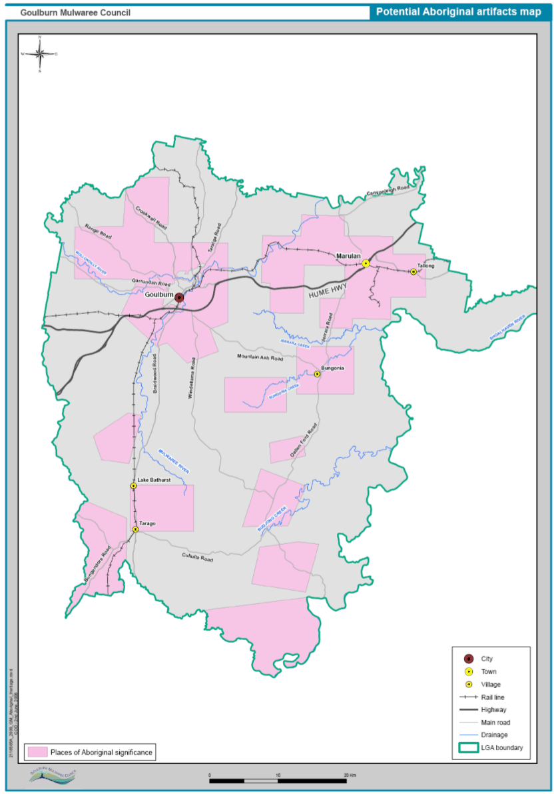

## 2. Representativeness of a place

Representativeness is a measure of the degree to which a place is characteristic of other places of its type, content, context or location. Under this criteria a place may be significant because it is very rare or because it provides a characteristic example or reference.

The principle aim of cultural resource management is the conservation of a representative sample of site types and variation from differing social and environmental contexts. Sites with inherently unique features, or which are poorly represented elsewhere in similar environment types, are considered to have relatively high cultural significance.

The cultural significance of a place can be usefully classified according to a comparative scale which combines a relative value with a geographic context. In this way a site can be of low, moderate or high significance within a local, regional or national context. This system provides a means of comparison, between and across places. However it does not necessarily imply that a place with a limited sphere of significance is of lesser value than one of greater reference.

#### Aboriginal heritage impact assessment process

The following is an outline of the process of Aboriginal heritage impact assessment.

(a) Determining if an Aboriginal heritage impact assessment is required

This determination process is described in clause 3.2.2 above.

(b) Conducting an Aboriginal heritage impact assessment

An Aboriginal heritage impact assessment must be prepared by a suitably qualified heritage practitioner or consultant. The minimum qualification generally recognised as a prerequisite for an Aboriginal heritage assessment practitioner is a tertiary level degree (or equivalent) in an Australian archaeology or cultural heritage degree. The range of specialist practitioners is considerable and can include anthropologists, stone artefact specialists, rock art specialists, materials conservators, palaeobotanists, and physical anthropologists. In general, heritage assessment based on field survey and/or excavation will require a qualified archaeologist. Assessments which involve the analysis of contemporary Aboriginal communities may also require input from an anthropologist.

Several professional organisations exist which recognise and accredit heritage consultants and other related practitioners. These are:

Australian Association of Consulting Archaeologists Inc – PO Box 214, Holme Building, University of Sydney, NSW 2006 (www.archaeology.usyd.edu.au/aacai).

Australian Institute of Professional Archaeologists Incorporated – GPO Box 5336BB, Melbourne Victoria 3001 (www.users.bigpond.com/raluebbers/AIPA).

Some consultant heritage practitioners are listed in the Yellow Pages under the categories of ‘Archaeology’ and ‘Heritage Consultants’.

The following are key components of an Aboriginal heritage impact assessment:

Identify and then consult with appropriate local Aboriginal stakeholder groups – Consultation with local and custodial Aboriginal community groups is an integral component of any Aboriginal heritage impact assessment. The status and number of stakeholder groups can change over time. The NSW Office of Environment and Heritage can provide advice regarding appropriate groups which should be consulted. Consult with relevant Council Heritage staff – Council heritage staff are potential sources of information, advice and direction, regarding community consultation, site locations and the management of heritage values. Conduct a review of previous heritage assessment work and background information (including a search of the NSW Office of Environment and Heritage Aboriginal site register)

– All relevant previous heritage assessments should be reviewed with regard to the potential issues and heritage values present within the assessment area. Sufficient background information should also be presented so that the environmental and historical context of the

area can be characterised, and any heritage places, sites and features can be effectively placed within an assessment context. Conduct an appropriate level of field inspection of the proposed development area – This usually involves comprehensive or sample survey of the development area. All field survey involves levels of sampling, however a comprehensive level of inspection would normally achieve a coverage of greater than 40% of the area subject to development impacts. The proportion of survey coverage achieved will depend on the degree of ground surface visibility available to the surveyors at the time of the investigation.

The first stage of field inspection and assessment generally involves visual inspection of the ground surface and does not include subsurface testing. In the event that an assessment concludes that an area has subsurface archaeological potential, then various forms of archaeological subsurface testing may be conducted to assess this potential. Excavation is generally conducted as a second stage of assessment, following the submission and consideration of a surface survey report. Excavation with the aim of recovering or detecting Aboriginal artefacts can only occur following the receipt of a permit or consent from the NSW Office of Environment and Heritage.

Any assessment of a study area must include consideration of any oral histories or traditions of the local Aboriginal or wider community regarding heritage place, events and values.

Identify known and potential archaeological sites and places of Aboriginal cultural heritage value – Both the known and potential cultural heritage resource of a proposed development area should be adequately described. Where ground surface conditions do not allow for an effective assessment of the subsurface potential of a deposit or landform, then predictions must be made based on oral or historical report, and regionally based predictive statements about probable site locations and content. Submit cards to NSW Office of Environment and Heritage for all previously unrecorded Aboriginal sites detected during survey – All new site recordings must be reported to the NSW Office of Environment and Heritage using standard site recording forms (provided by the NSW Office of Environment and Heritage). Assess cultural heritage significance of identified sites and places – An assessment of the heritage significance of all identified sites and places should be presented and documented. The assessment of significance is based on an established set of criteria including Aboriginal cultural and social value, scientific value, and educational value. The assessment of Aboriginal cultural significance must be contributed by appropriate members or representatives of the Aboriginal stakeholder groups.

The assessed level of heritage significance of any single or group of sites, artefacts or places will determine to a large degree, the nature and necessity of any management strategies drafted

Provide impact mitigation and management recommendations for known and potential cultural heritage values – Strategies and recommended actions should be drafted for the appropriate management of the known and potential heritage values identified in the proposed development area. Where possible strategies should seek to avoid or minimise impact to heritage values. Strategies should be developed in consultation with appropriate members or representatives of the Aboriginal stakeholder groups.

(c) Submit copies of the Aboriginal heritage impact assessment for review by

#### Council and the NSW Office of Environment and Heritage

This step provides an opportunity for stakeholder groups to comment on the conduct and findings of the assessment. Three copies are required by the NSW Office of Environment and Heritage to cover archival and review responsibilities. All survey and assessment reports which inform planning, statutory and impact assessment procedures should be subject to the review of the NSW Office of Environment and Heritage. The NSW Office of Environment and Heritage has statutory responsibility for Aboriginal sites and artefacts in NSW and requires copies of all assessments for review.

(d) Where appropriate, amend assessment report or append supplementary information in response to review comments

In the event that review comments or other feedback are received as a consequence of providing copies of the assessment to the NSW Office of Environment and Heritage, Aboriginal group(s) and Council, consideration should be given to addressing the comments in an appropriate form. This may be achieved by amending the original report or by providing an addendum of supplementary information.

A written report from the Aboriginal group or groups consulted may have been included within the original heritage impact assessment. Where this presents a response to the findings of the report, there should be no requirement to await a further response. If no comment has been received from the NSW Office of Environment and Heritage or stakeholder Aboriginal groups within a reasonable time, then the Aboriginal heritage impact assessment should be submitted to Council for their due consideration.

(e) Council assessment and determination

There are three broad categories of likely Council resolution regarding development applications or works proposals with the potential to impact heritage values:

the proposal is approved, subject to the conduct of impact mitigation strategies (which may or may not have been recommended by the Aboriginal heritage impact assessment); a decision is delayed pending the results of further assessment; or the proposal is refused.

Aboriginal Heritage Significance Areas

Council requires the preparation and submission of an Archaelogical Survey / Report for certain forms of development proposed in a place of Aboriginal Heritage Significance.

The map following defines the places of Aboriginal Heritage Significance. The matrix table that accompanies the map nominates the level of detail required by Council for development assessment purposes.

In some instances a pre-cautionary approach is nominated as the most appropriate means of protecting Aboriginal Heritage. The precautionary approach allows development to proceed without detailed field studies. In the event that artefacts are uncovered during earth/construction works, all activities must cease until all relevant approvals have been obtained for removal/destruction of the artefacts.

> [Picture on page 7: a picture, saved as a picture (images/appendix-a-criteria-for-the-assessment-of-heritage-significa-page-7-1.gif, 150 dpi).]

#### Aboriginal archaeology matrix

| Type Use Development/Land | Alterations/Additions | Awnings | Carports | Buildings Commercial/Industrial | Development Complying | Dams | 12m2) than (less Shed Domestic | Dwelling | Development Exempt | Establishment Recreational | Facility Recreational | m2) 12 than (greater Sheds Rural | Services/Infrastructure | road) new (no Subdivision | road) (new Subdivision | Tanks | Industry Extractive | Agricultural/Horticulture Intensive |
|---|---|---|---|---|---|---|---|---|---|---|---|---|---|---|---|---|---|---|
| Topography Type / Map Reference |  |  |  |  |  |  |  |  |  |  |  |  |  |  |  |  |  |  |
| Aboriginal Sensitive Land (refer to Map) | 2 | 1 | 1 | 2 | 1 | 2 | 1 | 1 A | 1 | 2 | 2 | 1 A | 2 | 2 | 3 | 1 | 3 | 2 |
| Exempt Land (refer to Map) | 1 | 1 | 1 | 1 | 1 | 1 | 1 | 1 | 1 | 1 | 1 | 1 | 1 | 1 | 1 | 1 | 1 | 1 |
| Flat Land | 1 | 1 | 1 | 2 | 1 | 2 | 1 | 1 | 1 | 2 | 2 | 1 | 1 | 2 | 2 | 1 | 3 | 2 |
| Lower slopes adjacent to water course | 1 | 1 | 1 | 2 | 1 | 2 | 1 | 2 | 1 | 2 | 2 | 1 | 2 | 2 | 2 | 1 | 3 | 2 |
| Ridge lines/Hill tops | 1 | 1 | 1 | 2 | 1 | 2 | 1 | 2 | 1 | 2 | 2 | 1 | 2 | 2 | 2 | 1 | 3 | 2 |
| Undulating hills and plains predominately vegetated Undulating hills and plains predominately grazing land | 1 1 | 1 1 | 1 1 | 2 2 | 1 1 | 2 2 | 1 1 | 2 1 | 1 1 | 2 2 | 2 2 | 1 1 | 2 2 | 2 2 | 2 2 | 1 1 | 3 3 | 2 2 |
| Water courses (within 40 metres) | 2 | 1 | 1 | 2 | 1 | 2 | 1 | 2 | 1 | 2 | 2 | 2 | 2 | 2 | 3 | 1 | 3 | 2 |

1 Precautionary Approach

2 Pejar Local Aboriginal Land Council Assessment or Archaeological Survey or Risk Assessment Report

3 Archaeological Survey

A Precautionary approach if the development is proposed within a building envelope nominated at subdivision stage.  If proposed outside an approved envelope a type 2 assessment is required.
