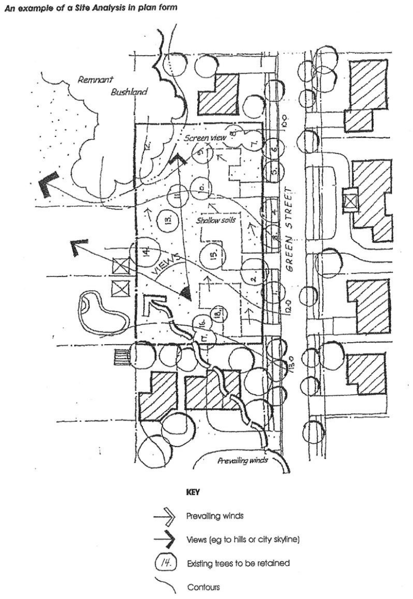
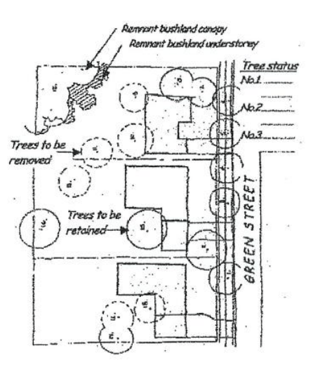
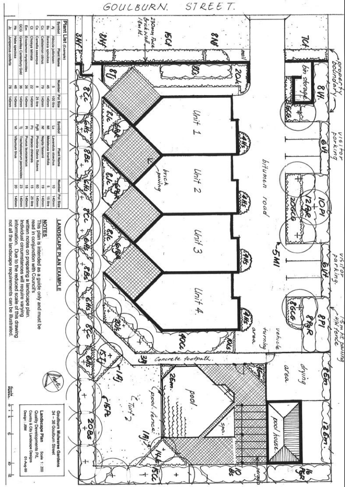

# Goulburn Mulwaree Development Control Plan 2009 - Appendix G Landscape Policy, Site Analysis and Preparing a Landscape Plan

Source PDF: [Appendix-G-Landscape-Policy-Site-analysis-Preparing-a-Landscape-Plan.pdf](https://planfortomorrow.sharepoint.com/sites/Planfortomorrow/Shared%20Documents/00%20NSW-Planning-Resources/dcp/goulburn-mulwaree-development-control-plan-2009/appendix-g-landscape-policy-site-analysis-and-preparing-a-lan/Appendix-G-Landscape-Policy-Site-analysis-Preparing-a-Landscape-Plan.pdf)

Appendix G: Landscape Policy, Site Analysis and

### Preparing a Landscape Plan Site analysis

A good understanding of the site and its surrounds is essential for a successful landscape design. A Site Analysis puts the site in its context for both the design and evaluation of the proposal. It is mandatory for all Development Applications and forms the basis for the Statement of Environmental Effects in providing evidence that the options investigated have resulted in the optimum use, rather than the maximum use, of the site.

#### What information is necessary?

The extent of the information required will be dependent on the type and scale of the proposed development, e.g. an application for two-storey house extension, a multi-unit residential development or a proposed industrial development will not necessarily require all the same information. Additional information may also be required for specific sites where there are particular opportunities and constraints caused by the characteristics of the site itself or the surrounding area.

The Site Analysis may be presented in a number of ways, depending on which method best presents site characteristics, e.g. a notated plan at a suitable scale or in text form with graphics and photographs. There also needs to be an explanatory statement.

#### Explanatory statement

It is not sufficient to prepare a Site Analysis and then ignore it during the design process.

The Site Analysis will have identified the opportunities and constraints of a particular site and the relevant surrounding area. The purpose of the site analysis is to inform the design process. Some of the information will form the basis for preparing Management Plans for vegetation, erosion and sedimentation control, stormwater and waste (refer to Appendix for more information on these Plans).

Therefore a statement must be prepared explaining how the proposed development has responded to the Site Analysis. The statement may be in written form or presented as an annotate plan. Such a statement would greatly assist the design and assessment processes, and is likely to result in a significant improvement in the quality of the development.

It will also indicate the way in which the specific requirements of this DCP are to be achieved. Different categories of development require varying levels of detail in the preparation of landscape proposals.

> [Picture on page 2: a picture, saved as a picture (images/appendix-g-landscape-policy-site-analysis-and-preparing-a-la-page-2-4.gif, 150 dpi).]

#### Information required for Site Analysis

The following list indicates the sort of information to be collected and presented in the site analysis depending upon the site and the complexity of the proposal.

#### Site Survey

Identifies the lot and its boundaries

#### Plan Information

Scale of plan at 1:100 or 1:200 (use ONLY these scales) plus bar scale

North point

Name and qualifications of person preparing the site analysis

#### Existing site features

Location and uses of any existing buildings and structures on the site showing those to be removed and retained

Location and height of walls and fences built to the boundary

Heavily shaded areas from existing structures, mature trees or dominant landform, such as rock ledges

Archaeological and heritage sites

Any easements and rights-of-ways and their restrictions

#### Services

Location of existing overhead and underground utility services (electricity, gas, telephone, water, sewer and stormwater drainage lines, inlets and collection points).

#### Use of adjacent land

Location and uses of adjacent buildings

Ridge levels and floor levels of adjacent buildings

Potential for overlooking into and from window openings in walls adjacent to the development site

Potential for shading on adjacent properties

The form and character of adjacent and nearby development, including characteristic styles e.g. style of dwellings, landscaping, scale and bulk of buildings

Street frontage features e.g. street trees, poles, kerb crossovers, bus stops

Potential sources of nuisance dust or noise (e.g. flight path, main road, railway line).

#### Landform

Topography will affect the use of the site

Show height contours at 1 metre intervals (and any relevant road benchmark) and areas of steep slope (20% or more)

Existing natural features (cliffs, rock outcrops)

Orientation of site (e.g. south-facing slope).

Soils (this forms the basis for an Erosion and Sedimentation Control Plan,

Condition – fertility, whether it has been compacted, cut or filled

Erosion problems, contamination or salinity

#### Plants

Many sites should have a tree and/or bushland survey done – this is the basis for a Vegetation Management Plan

Existing established individual or stands of trees and massed shrub planting with their height and spread, condition and common/botanical name – particularly note any trees listed as “Significant”

Existing ground levels around the base of trees

The extent and name of any weed infestation

The plants growing well or characteristic of the local area

Any ‘endangered ecological community’ on the site and nearby land – refer to Council’s State of the Environment Report

> [Picture on page 5: a picture, saved as a picture (images/appendix-g-landscape-policy-site-analysis-and-preparing-a-la-page-5-1.gif, 150 dpi).]

#### Wildlife

Any habitats on the site and nearby land

Fauna habitat possibilities e.g. niches in rockeries, ponds for frogs, habitat plants (nectar for small birds).

#### Climate

Directions of pleasant and unpleasant summer and winter winds

Windbreaks and their likely perfomance

Frost pockets

Areas of full or partial shade in winter and summer at 9am, midday and 3pm

Direction and extremity of bushfire threat

Water (this forms the basis for a Stormwater Management Plan)

Sources of water flowing on to the site and the general quality of that water

Drainage patterns on the site, areas of concentrated run-off, pounding, possible flooding

Adjoining riparian zone if within 40m of a waterway

Characteristics of the drainage system immediately downstream of the site (e.g. bushland creek or a constructed stormwater drainage channel).

#### Views

Good and unsightly views from the site

Views into the site and privacy problems

Qualities of the site that are important in the view to and from the site (e.g. major trees)

### Preparing a landscape plan

#### Introduction

When submitting a Development Application (DA) to Goulburn Mulwaree Council, you may be required to submit a Landscape Plan depending on the nature of the proposed development. Council’s aim in requiring a Landscape Plan is to enhance and protect the amenity of new and existing development areas. This will be achieved by setting reasonable standards for development including protection of the existing environment.

A Landscape Plan must contain information on a development sites existing features and the proposed development. The plan must illustrate the function and character of the development. This will include the extent of works, layout, design and the types of materials to be used. It may also address certain details of the construction methods. Council has a minimum standard of information required for an application to be considered.

For clarification of Landscape Plan requirements for a specific property, please contact Councils Planning and Community Services Department at the Civic Centre in Bourke Street or telephone (02) 4823 4454.

Reference should be made to the following Council documents where relevant:

▪ Goulburn Street Master Study

The use of qualified Landscape Architects or Horticulturalists to prepare Landscape Plans is recommended but not required by Council. The use of such professionals may assist to reduce the time taken to assess an application.

#### Landscape character

Landscape character varies according to an areas age and location. Generally, Council will be looking for proposed development to reflect elements of the surrounding landscape character.

#### Existing vegetation

Goulburn Mulwaree has a “green” heritage. Contributing to the areas character are the plants that have been planted by residents in the past and restricted areas of valuable remnant native vegetation.

To protect the character of the area Council wishes to retain as much as possible of a development sites significant existing vegetation. This includes both native and introduced species. Remnant native vegetation including grasslands, shrubs and trees is a limited, non-renewable resource. Applicants should give careful consideration to retaining existing vegetation when planning developments.

#### Landscape plan features

#### Existing Development

For the existing development a plan of the site should show:

▪ A title block containing the title of the Plan, the location/address of the property, the applicant’s name and the name of the consultants who prepared the plan (if any).

The scale shown as:

– Site plan 1:500 or 1:200

– Landscape plan 1:200 or 1:100 (including paths, planting etc.)

– Construction details 1:50 to 1:5

– Site section (as necessary)

North Point

The site boundary, fences, driveways, existing buildings, paving, retaining walls, pools and tennis courts and any other structures must be shown. Any rock outcrops or other landscape feature must also be shown.

All trees and vegetation affected by the proposed works must be accurately positioned on the plan of the site. For trees show type/species, trunk location and diameter plus eight and

an accurate spread of canopy. Show all vegetation over 3m in height or over 100mm in trunk diameter measured 1000mm above ground level. Clearly identify vegetation to be retained and that to be removed.

Water Supply, gas, electricity, stormwater (above and below ground), sewer, manholes and drainage pits etc. and easements on and adjacent to the site, including the nature strip.

Existing ground levels shown as spot heights or contours over the site may be necessary if significant changes to levels are being proposed.

#### Proposed development

For the proposed development the following must be shown:

New buildings or extensions and associated works eg. Pools, tennis courts, fences, retaining walls, steps, paving, service/utilities, lighting, signage, stormwater drainage, surface materials and finishes.

Details of the finished ground levels for the works including cut and fill areas, mounding of the site and finished levels at adjoining boundaries are required.

Proposed planting. The function and location of plantings should be shown eg. Deciduous/evergreen shade trees, windbreaks, screen plantings, shrub areas, ground covers, grass etc. Information regarding the plant species, container sizes, numbers & planting method is required.

Sections through the site may be necessary if significant level changes are being proposed. These should include existing and proposed ground lines, building elevations, retaining walls, steps, etc. and proposed planting.

Run off and erosion control measures where required by Council must be incorporated in plans and details. There may be a need to prepare a soil erosion and drainage management plan. Guidelines are available from Councils Engineering Department.

Materials and construction details including pavements, drainage, drainage falls and collection points, retaining walls, steps, fences, edging, structures (pergolas, decks etc.), lighting, signage, water points, pools, planting methods, etc.

Tree surgery details including protective fencing where required by Council.

Maintenance must be clearly specified.

Paving samples may be required to be submitted for approval when proposed for use on nature strips, etc.

#### Landscape plan example

A sample Landscape Plan is attached. This plan is intended as a guide only and must be read in conjunction with these notes. Individual circumstances will require varying information. Not all landscape requirements have been illustrated on the plan.

> [Picture on page 10: a picture, saved as a picture (images/appendix-g-landscape-policy-site-analysis-and-preparing-a-la-page-10-1.gif, 150 dpi).]
