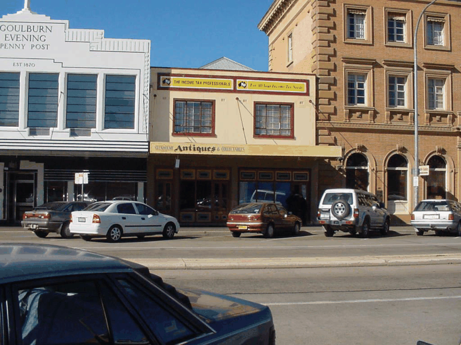

## 2. EXPECTED OUTCOMES

### 2.1 Context

The Goulburn CBD has several unique features that distinguish it from other provincial city’s commercial centres. It is dominated by a single retail mainstreet, Auburn Street., with many grand institutional buildings imposing their presence on the streetscape. The features include:

▪ A range of Heritage or Landmark Buildings such as the Post Office, former AMP Building, Goulburn Post, Town Hall, Elmslea Chambers, former Lilac Time Hall.

▪ Historic Belmore Park

▪ Two lane mainstreet with angle parking and separating median These landmark buildings are located at prominent sites within the CBD often at road intersections. Sites in the vicinity of these “landmarks” provide an opportunity, through redevelopment, to complement these buildings while making their own architectural statement.

Prominent buildings or landmarks are also located off the mainstreet at the periphery of the CBD such as cathedrals and churches, courthouse, police station and civic centre.

The CBD is a place where people will visit not only to purchase goods and services but because of the attractions and appeal of the social and physical environment. The appeal is not only the retail outlets and what they have to offer, but the design of the various buildings that will ensure the CBD is a whole and not a series of unrelated sections.

### 2.2 Strategies and Policies

▪ To manage physical change within the city through the promotion, protection, conservation of heritage items and precincts that contribute to the distinctive character, community tradition and special sense of place of the City of Goulburn.

▪ To create an appreciation and awareness of the extent and diversity of the environmental heritage of the City of Goulburn by identifying buildings, works, items, structures, relics or places which merit conservation by virtue of their particular aesthetic, archaeological, architectural, cultural, ecological, historic, landscape, natural, scientific, emotional, social or traditional significance to the City; and

▪ To achieve appropriate conservation and enhancement of heritage items and precincts identified in this plan through controls on demolition and alteration and on the form and character of new development in the proximity of such items, and by the discretionary provision of conservation incentives to protect environmental heritage.

While heritage features in the CBD are a dominant theme these are not the only features that contribute to the overall appearance and the design in the City – there is a broader perspective, which is partially implied in the Statement of Strategies and Policies. This broader perspective is reflected in the Vision Statement.

To assist with the “vision” the following broad design ideas have been established:

▪ Landmarks are identifiable features that serve as reference points or meeting places. These are desirable in Goulburn and may include memorials, fountains, public spaces, corner sites as well as feature buildings.

▪ The height of buildings should be lower than the Post Office tower to maintain its prominence as the highest building in the CBD.

▪ The built form (including street surfaces) at street level needs to maintain a human scale particularly in pedestrian locations through building scale and design.

▪ The buildings should face public spaces for passive surveillance and lighting must be provided to minimise the potential for personal risk.

▪ There is an emphasis on the retention and reuse of buildings rather than demolition and replacement.

▪ If existing multi storey buildings are to be replaced the new development should also include multiple storeys to retain the City scale and character.

> [Picture on page 5: a picture, saved as a picture (images/appendix-i-goulburn-mulwaree-good-design-statement-page-5-1.gif, 150 dpi).]
