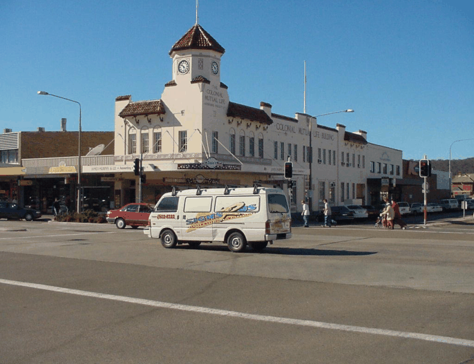
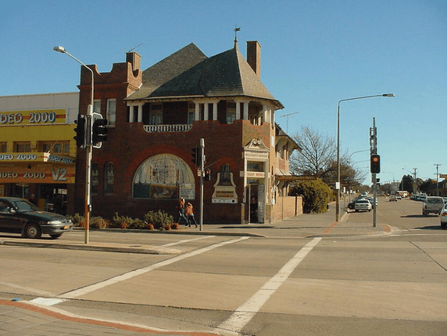

## 3. GOOD DESIGN APPROACH

### 3.1 Landmark and Heritage Sites

Landmark Sites are prominent corner sites and/or notable heritage buildings and must:

▪ Provide a positive contribution to the City’s architectural landscape.

▪ Preserve where possible any identified significant heritage features.

▪ Provide reference points for users of the CBD.

▪ The preferred design approach to dealing with landmark sites and their redevelopment is to:

▪ Ensure that the overall height is lower than the Post Office tower.

▪ Ensure they “fit in” with the heritage character of the CBD.

▪ Have human scale building design at street level and in pedestrian locations.

▪ Have weather protection provided at street level.

▪ Design buildings to face public spaces for passive surveillance.

▪ Improve lighting around the site to reduce risk to personal safety.

▪ Ensure that buildings address the rear of the site (e.g. secondary building entrance, integration of private car parking area with public spaces/parking areas).

▪ Outdoor advertising must also be reflective of the design approach

In addition to the above, if the site is a:

#### Heritage Sites

▪ The primary objective is building retention.

▪ All features of significance (identified in a Heritage Study) should be conserved or reinstated. Any inappropriate alteration should be identified for future removal or removed and the original features reconstructed as well as possible. For buildings on the State Heritage Register or Register of the National Estate reference should be made to the Statement of Significance to ensure that the important elements and features are retained.

▪ Whenever there is a choice, do whatever will improve the appearance and unity of the street. Particular consideration should be given to:

- Pitch and form of roof

- Style, size, portion and position of the openings for windows and doors

- Compatibility of material with other existing buildings in the locality

#### Landmark Sites (not listed as a heritage site)

▪ New development should be compatible with the existing visual, historical, built and landscape character of the CBD utilising design cues from the surrounding to help create linkages and unity in the streetscape. Important design cues to consider are:

- Fabric (external materials)

- Height

- Common horizontal lines (ridges, gutters, awnings, window heads, etc)

- Strong vertical lines to exaggerate the building height.

- Overall size, shape and proportion of neighbouring buildings

- Architectural features/decoration (including awnings, parapets, cornices, mouldings, openings, recesses, articulation of walls)

- Pitch and form of roof

- Style, size, portion and position of the openings for windows and doors

- Compatibility of material with other existing buildings in the locality

▪ A building design should make its own architectural statement and not mimic other buildings.

▪ A building proposal should avoid monotonous facades with little relief or detail

▪ Landmark Sites require special/additional attention with regard to street presentation. Incorporation of a landmark “feature” is appropriate to create interest and provide the building with a “recognisable” identity. For corner sites this should include or retain a “tower” element.

▪ Outdoor advertising must also be reflective of the design approach Landmark and Heritage Sites are identified in the Appendix.

> [Picture on page 7: a picture, saved as a picture (images/appendix-i-goulburn-mulwaree-good-design-statement-page-7-1.gif, 150 dpi).]

### 3.2 Non Landmark or Non Heritage Sites

Design at these sites must:

▪ Not dominate adjoining or nearby heritage buildings in the scale and massing of the new development.

▪ Provide a positive contribution to the City’s architectural landscape.

▪ Be clearly modern buildings but complement the design of nearby buildings. The preferred design approach to dealing with the redevelopment of sites not identified as landmarks or heritage sites is to:

▪ Utilise design cues from the surrounding to help create linkages and unity in the streetscape. Important design cues to consider are:

- Fabric (external materials)

- Height

- Common horizontal lines (ridges, gutters, awnings, window heads, etc)

- Strong vertical lines to exaggerate the building height.

- Overall size, shape and proportion of neighbouring buildings

- Architectural features/decoration (including awnings, parapets, cornices, mouldings, openings, recesses, articulation of walls)

- Pitch and form of roof

- Style, size, portion and position of the openings for windows and doors

- Compatibility of material with other existing buildings in the locality

▪ Make its own contemporary architectural statement and does not mimic other buildings.

▪ Avoid monotonous facades with little relief or detail

▪ Design buildings to face public spaces for passive surveillance.

▪ Provide weather protection at street level. Reinstatement of verandah and balcony forms is encouraged.

▪ Improve lighting around the site to reduce risk to personal safety.

▪ Ensure buildings address the rear of the site (eg secondary building entrance, integration of private car parking area with public spaces/parking areas)

▪ Retain buildings that, while not heritage listed, contribute to the heritage significance and character of the CBD. “Contributory” buildings from the “Goulburn Heritage Study” (1983), “Goulburn Main Street Study” (1992) and those identified by the Goulburn Heritage Group are included in Appendix.

▪ Outdoor advertising must also be reflective of the design approach Guidelines for Infill Development prepared by the NSW Heritage Office are also a useful document to assist with developing design solutions.

### 3.3 Belmore Park

This park will continue to be maintained and developed as a historic park and as a central meeting place. It also has a role to play as a venue for community events. Maintenance, management and development within the park will be undertaken in accordance with adopted Plans of Management and Landscape Master Plan.

### 3.4 Urban Landscape Design

The urban landscape design approach for the CBD is based on:

#### ▪ Formal exotic street tree planting. ▪ Formal planting areas at mid block crossing points.

▪ Pavement reconstruction at corners and mid block crossing points in Auburn Street. ▪ Public art works incorporated into streetscapes.

#### ▪ Streetscape furniture and detailing to reflect historic streetscapes.

> [Picture on page 9: a picture, saved as a picture (images/appendix-i-goulburn-mulwaree-good-design-statement-page-9-1.gif, 150 dpi).]

#### APPENDIX – List of Landmark and Heritage Sites within the CBD

Note: This list was compiled in 2005. For the up to date list of Heritage Items refer to Schedule 5 of the LEP 2009.

#### Abbreviations

RoNE Indicative Register of National Estate (Indicative Listing)

| RoNE Registered | Register of National Estate (Registered Listing) |
|---|---|
| AHC | Australian Heritage Commission |
| SHR | State Heritage Register |
| HC | NSW Heritage Council |
| NT Classified | National Trust Classified |
| NT Recorded | National Trust Recorded |
| IAS | Industrial Archaeological Site |
| RAIA | Royal Australian Architects Institute |

#### Notes on Heritage Lists

There are several lists of Heritage Lists of items and places:

#### Register of National Estate

The Register of National Estate is a list of places and items of National heritage significance. This register is compiled by the Federal Government body the Australian Heritage Commission (AHC). The register began in 1976 and has different legal status for listed places. The categories that affect Goulburn are Indicative and Registered.

An indicative status means that:

“Data provided to or obtained by the Commission has been entered in to the database and the place is at some stage in the assessment process. The Commission has not made a decision on whether the place should be entered in the Register.”

A Registered listing means:

“The place is in the Register of the National Estate. Although some places may be legally registered because they are within a larger registered area they may not necessarily posse intrinsic significance.”

Legal/Statutory Implications of Register

The Commonwealth Government is the only body whose actions are constrained as a result of listings in the Register of the National Estate.

Under Section 30 of the Australian Heritage Commission Act 1975, the Commonwealth Government is prohibited from taking any action, which would adversely affect a place in the Register, unless there are no feasible and prudent alternatives to the action.

#### State Heritage Register

The State Heritage Register is a list of places and items of State heritage significance endorsed by the NSW Heritage Council and the Minister, which came into effect on 2 April 1999.

The Register, established under the Heritage Amendment Act 1998, replaces the old system of Permanent Conservation Orders as a means of protecting items of State significance, although the process of listing and of monitoring their conservation and protection are essentially the same

Legal/Statutory Implications of Register

An item or place listed on the SHR is legally protected under the NSW Heritage Act and requires approval from the Heritage Council of NSW and/or Local Council for certain kinds of work. Listing also makes the item or places eligible for financial incentives.

#### National Trust Register

The National Trust Register maintained by the National Trust of Australia, which is one of the most comprehensive of the non-statutory registers. It was first established nearly 50 years ago and is a reference for the compilation of statutory registers, particularly local government heritage studies. It has no legal/statutory implications.

There are two (2) categories of listing; classified and recorded.

There are five (5) organisations that register heritage items.

#### Royal Australian Institute of Architects’ Register of 20th Century Buildings

This register is an important resource in assessing the heritage of our own time. It has no legal/statutory implications.

#### Art Deco Society Register

This register lists important buildings from the interwar (1918-39) period. It has no legal/statutory implications.

#### Geological Society Register

This register lists important geological sites.

#### Australian Institution of Engineers

AIE has a list of sites or objects of engineering significance. It has no legal/statutory implications.

Professional Historians Association (NSW) Register of Historic Places and Objects

This register lists sites and objects of historical significance. It has no legal/statutory implications.

| Building | Site Address | Landmark Site | Heritage Site | Complementary Building | Comments |
|---|---|---|---|---|---|
| Tattersalls Hotel | 76 Auburn Street (corner Clinton Street) | Yes | No | No |  |
| Astor Hotel/Mote l | Corner Auburn/Clint on Streets 90-100 Auburn Street 105-121 Auburn Street 110-116 Auburn Street 126-132 Auburn Street 127-131 Auburn Street 137 Auburn Street 139-153 Auburn Street 146-150 Auburn Street | Yes No No No No No No No No | No No No No No No No No No | No Yes Yes Yes Yes Yes Yes Yes Yes |  |
| Goulburn Town Hall | 163 Auburn Street 164-166 Auburn Street | Yes No | Yes No | No Yes | RoNE Registered/ NT Classified |
| Post Office | 165 Auburn Street | Yes | Yes | No | RoNE Registered/ NT Classified |

| Building | Site Address | Landmark Site | Heritage Site | Complementary Building | Comments |
|---|---|---|---|---|---|
| Former Mechanics Institute Building | 167-173 Auburn Street 174-178 Auburn Street | Yes | Yes | No Yes | NT Classified |
| Belmore Park | Auburn Street | Yes | Yes | No | RoNE Registered/ NT Classified |
| Site of former Knowlmans ’ Store | Corner Auburn/Mar ket Streets | Yes | No | No |  |
| Former Young’s Department Store | 180-186 Auburn Street | Yes | Yes | No | NT Classified/R AIA |
| Former AMP Building | 191 Auburn Street | Yes | Yes | No | RoNE Indicative/R AIA |

| Building | Site Address | Landmark Site | Heritage Site | Complementary Building | Comments |
|---|---|---|---|---|---|
| Hollis Group (commercial buildings) | 194-204 Auburn Street 197-203 Auburn Street | Yes No | Yes No | No Yes | NT Classified |
| Former CML Building | 207 Auburn Street (Corner | Yes | Yes | No | NT Classified/H C |

| Building | Site Address Clifford Street) 212-214 Auburn Street 228-232 Auburn Street 245-247 Auburn Street 253-257 Auburn Street | Landmark Site No No No No | Heritage Site No No No No | Complementary Building Yes Yes Yes Yes | Comments |
|---|---|---|---|---|---|
| Former Goulburn Permanent Building Society | 256 Auburn Street (corner Clifford Street) 264-294 Auburn Street 312 Auburn Street | Yes No No | Yes No No | No Yes Yes | RoNE Registered/ NT Classified/R AIA |
| Commercial Buildings | 314-324 Auburn Street 330-362 Auburn Street 376 Auburn Street | No No No | Yes No No | No Yes Yes | NT Recorded |

| Building | Site Address | Landmark Site | Heritage Site | Complementary Building | Comments |
|---|---|---|---|---|---|
| Commercial Buildings | 380-386 Auburn Street 396-408 Auburn Street | No No | Yes No | No Yes | NT Recorded |

| Building | Site Address | Landmark Site | Heritage Site | Complementary Building | Comments |
|---|---|---|---|---|---|
| Railway Gate House | Blackshaw Road | No | Yes | No | NT Recorded |
| Dwellings | 101 Bourke Street | No | Yes | No | NT Recorded |
| Dwellings | 167-171 Bourke Street | No | Yes | No | NT Recorded |
| Dwellings | 175-177 Bourke Street | No | Yes | No | NT Recorded |
| Dwelling | 60 Bradley Street | No | Yes | No | NT Recorded |
| Uniting Church | Clifford Street | Yes | Yes | No | NT Recorded |
| Our Lady of Mercy Convent and Chapel | Clinton Street | Yes | Yes | No | NT Classified |
| Dwelling | 110 Goldsmith Street | No | Yes | No | NT Recorded |

| Building | Site Address | Landmark Site | Heritage Site | Complementary Building | Comments |
|---|---|---|---|---|---|
| Dwellings | 62-66 Goldsmith Street | No | Yes | No | NT Recorded |
| Methodist Church | Goldsmith Street | Yes | Yes | No | NT Recorded |
| Goulburn Club | Market Street | Yes | Yes | No | NT Classified |
| Bull and Woodward Archway | Market Street | Yes | Yes | No | RoNE Registered/ NT Classified |
| Business Group | 5-19 Montague Street (excluding 13 & 15) | No | Yes | No | NT Classified |
| Existing Court House | Montague Street | Yes | Yes | No | RoNE Registered/S HR/NT Classified |
| Mulwaree Private Hotel | 158- 160Sloane Street | Yes | Yes | No | RoNE Registered/ NT Classified |
| Terraces | 168-174 Sloane Street | No | Yes | No | RoNE Registered |

| Building | Site Address | Landmark Site | Heritage Site | Complementary Building | Comments |
|---|---|---|---|---|---|
| Terraces and former shop | 176-186 Sloane Street | No | Yes | No | RoNE Registered/ NT Classified |

| Building | Site Address | Landmark Site | Heritage Site | Complementary Building | Comments |
|---|---|---|---|---|---|
| Coolavin Hotel | 188-190 Sloane Street | Yes | Yes | No | RoNE Registered/ NT Classified |
| Coffee House Palaces | 244-248 Sloane Street | No | Yes | No | SHR/NT Recorded |
| Railway Station and Station Master’s House | Sloane Street | Yes | Yes | No | RoNE Registered/S HR/NT Recorded |
| Old Court House | Sloane Street | Yes | Yes | No | RoNE Registered/ NT Classified |
| Police Station (at old Court House) | Sloane Street | Yes | Yes | No | RoNE Registered/ NT Classified |
| Railway Barracks | Sloane Street | No | Yes | No | NT Recorded |
| Existing Police Station | Sloane Street | Yes | Yes | No | AHC/NT Recorded |
| Connolly’s Old Mill and Swimming Baths | Sloane Street | Yes | Yes | No | HC/NT Recorded/IA S |
| RJ Sidney Craig Funeral Directors | Sloane Street | No | Yes | No | NT Recorded |

| Building | Site Address | Landmark Site | Heritage Site | Complementary Building | Comments |
|---|---|---|---|---|---|
| Terraces | 310-312 Sloane Street | No | Yes | No | NT Recorded |
| St Claire Museum | 318 Sloane Street | Yes | Yes | No | AHC/HC/N T Classified |
| RC Bishop’s Residence and Presbytery | 36 Verner Street | Yes | Yes | No | NT Classified/R AIA |
| St Peter and St Paul Cathedral | Corner Verner and Bourke Streets | Yes | Yes | No | NT Recorded/A HC |

### Appendix J Flood Policy

#### Introduction

This draft flood policy defines planning controls to be applied to development on flood prone land within the Goulburn Mulwaree Local Government Area. The content of this document is outlined below:

• Section 9.9.1 – Objectives

• Section 9.9.2 – What are the Flood Planning Constraint Categories

• Section 9.9.3 – How to use this Document

• Section 9.9.4 – Definitions

• Section 9.9.5 – Land Use Categories

• Section 9.9.6 – Flood Planning Controls

• Section 9.9.7 – flood Compatible materials

• Section 9.9.8 – frequently Asked Questions

• Figure J1 – Flood Planning Constraint Category Maps
