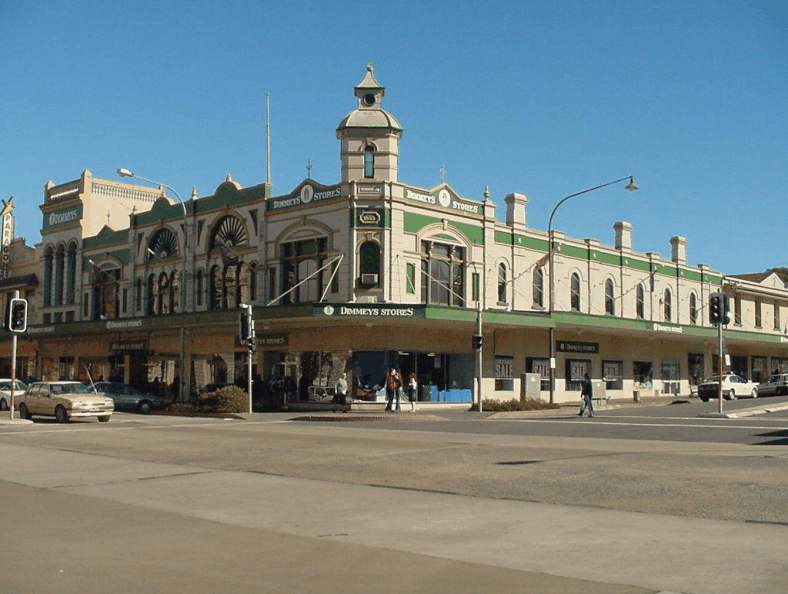

# Goulburn Mulwaree Development Control Plan 2009 - Appendix I Goulburn Mulwaree Good Design Statement

> This chapter is split into 3 section file(s), one per numbered heading, in the order they appear in the PDF.

Source PDF: [Appendix-I-Goulburn-Mulwaree-Good-Design-Statement-2005.pdf](Appendix-I-Goulburn-Mulwaree-Good-Design-Statement-2005.pdf)

### Appendix I Goulburn Mulwaree Good Design Statement 2005

> [Picture on page 1: a picture, saved as a picture (images/appendix-i-goulburn-mulwaree-good-design-statement-page-1-3.gif, 150 dpi).]

### Goulburn Mulwaree Good Design Statement

> [Picture on page 1: a picture, saved as a picture (images/appendix-i-goulburn-mulwaree-good-design-statement-page-1-5.gif, 150 dpi).]

Adopted by Council on 20 September 2005 Minute No. 05/501

Effective from 28 September 2005

#### Contents

<!-- sections -->
## Sections

1. [1 INTRODUCTION](01-introduction.md)
2. [2 EXPECTED OUTCOMES](02-expected-outcomes.md)
3. [3 GOOD DESIGN APPROACH](03-good-design-approach.md)
