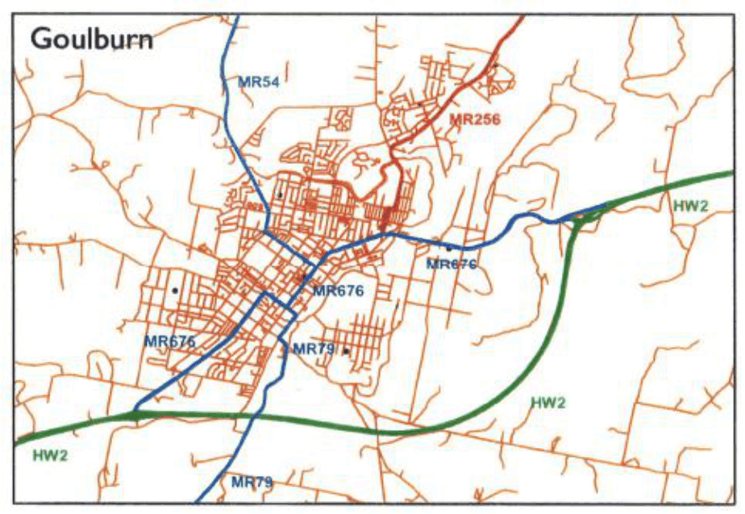
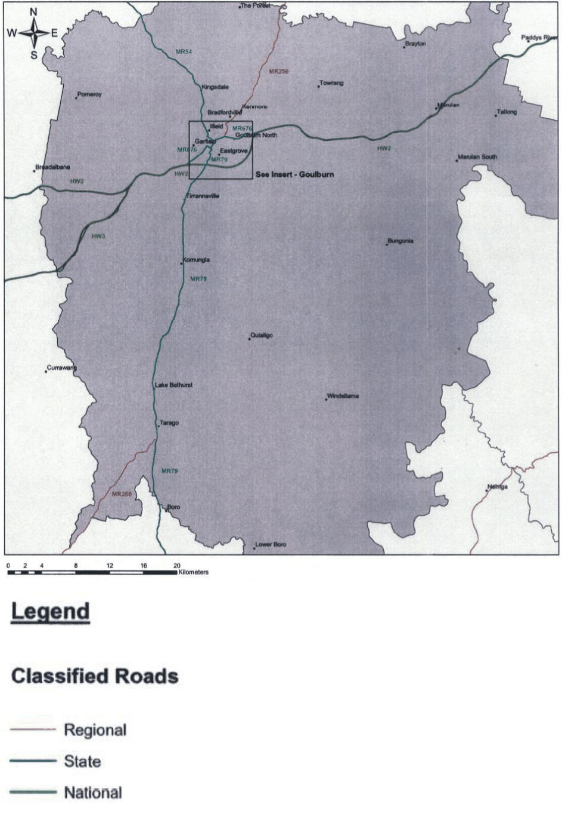

# Goulburn Mulwaree Development Control Plan 2009 - Part 1 Preliminary

Source PDF: [Part-1-Preliminary.pdf](Part-1-Preliminary.pdf)

## 1 Preliminary

### Name of this plan

This plan is known as the Goulburn Mulwaree DCP 2009. This plan has been prepared in accordance with section 72 of the Environmental Planning and Assessment Act 1979 (the EP&A Act).

### Date of adoption

This plan was originally adopted by Goulburn Mulwaree Council (Council) on Tuesday 19 August 2008 and came into operation upon the gazettal of Goulburn Mulwaree Local Environmental Plan 2009 (LEP) on 20 February 2009.

This plan is subject to amendment from time to time. Plan users should refer to the list of amendments to clause 1.9 of this plan.

### Purpose of this plan

This plan shall be used together with the LEP.

The LEP provides the legal framework by which Council’s development decisions are

made. It sets out Council's vision and seeks to implement this by way of objectives, policies, zoning tables, and zoning and heritage conservation maps.

This plan supplements the LEP by providing detailed reasoning, guidelines, controls and general information relating to the decision making process. Together these documents form the land use planning and development controls for the Goulburn Mulwaree local government area.

### Land to which this plan applies

This plan applies to all land within the Goulburn Mulwaree local government area.

### Other planning policies and instruments

This plan supports the provisions of the LEP.

This plan is to be read in conjunction with other planning instruments, Council policies, codes and specifications to specific design aspects of a proposal.

Where there is an inconsistency between this plan and any environmental planning instrument applying to the same land, the provisions of the planning instrument apply.

In addition to the above and the provisions of this Plan, in assessing development proposals, Council must consider all those matters specified in Section 79C of the EP&A Act.

### Structure of this plan

This development plan is structured in the following manner:

1\. Preliminary – this part of the plan comprises the administrative elements of this plan, including the name of this plan, the date of adoption, the purpose of this plan, the land to which this plan applies, and the relationship of this plan to other relevant planning policies and instruments.

2\. Plan objectives – identifies the objectives for development control under this plan.

3\. General development controls – identifies the controls which apply to most forms of development within the Goulburn Mulwaree local government area.

4\. Principal development controls – urban – identifies the key development controls for development within urban areas.

5\. Principal development controls – rural – identifies the key development controls for development within rural areas.

6\. Special development types – identifies specific controls for certain types of development.

7\. Engineering requirements – identifies special provisions for the consideration of engineering requirements.

8\. Site specific provisions – identifies particular controls for development within certain areas of the Goulburn Mulwaree local government area.

### Public participation

Notification and advertising requirements for developments are detailed separately in Council’s Community Participation Plan. This plan is available on Council’s website.

### Variations to controls

Council acknowledges that it is not possible for this plan to account for all possible situations and development scenarios. Consequently, the development controls under this plan have been designed to be flexible.

When circumstances warrant, Council may consent to an application which departs, to a minor extent, from the provisions of this plan. In such cases, a written submission must be lodged with the development application, outlining the variation, providing reasons why the variation is necessary or desirable, and setting out how the objectives of the particular provision are satisfied by the proposal.

Some of the relevant factors in determining whether a departure from this plan is warranted include:

(a) whether there will be any detrimental impact on the amenity of the existing and future residents

(b) whether there will be any detrimental impact on the amenity of the area

(c) the nature and size of the departure

(d) the degree of compliance with other relevant requirements

(e) the circumstances of the case, including whether the particular provision is unreasonable and/or necessary

(f) priorities identified in a site analysis of being of more importance than what is being departed from

(g) whether non-compliance will prejudice the objectives of the zone and the aims of this plan

### List of amendments

The following list details the amendments to this plan that have been effected after the original adoption of the plan (Tuesday 19 August 2008).

| Amendment No. 1 | Adopted 20 October 2009 Effective from 28 October 2009 |
|---|---|
| Amendment No. 2 | Adopted 5 June 2012 Effective 27 June 2012 |
| Amendment No. 3 | Adopted 6 October 2015 Effective 23 October 2015 |
| Amendment No. 4 | Adopted 7 June 2015 Effective 23 June 2015 |
| Amendment No. 5 | Adopted 7 August 2018 Effective 23 August 2018 |
| Amendment No. 6 | Adopted 18 December 2018 Effective 25 January 2019 |

| Amendment No. 7 | Adopted 20 August 2019 Effective 5 September 2019 |
|---|---|
| Amendment No. 8 | Adopted 5 November 2019 Effective 14 November 2019 |
| Amendment No. 9 | Adopted 7 April 2020 Effective 24 April 2020 |
| Amendment No. 10 | Adopted 19th May 2020 Effective 5th June 2020 |
| Amendment No. 11 | Adopted 22nd September 2020 Effective 16th October 2020 |
| Amendment No. 12 | Adopted 22nd September 2020 Effective 29th September 2020 |
| Amendment 13 | Adopted 15th December 2020 Effective 12th January 2021 |
| Amendment 14 | Adopted 15th December 2020 Effective 15th February 2021 |
| Amendment 15 | Adopted 6th April 2021 Effective 10th May 2021 |
| Amendment 16 | Adopted 4th May 2021 Effective 25th June 2021 |
| Amendment 17 | Adopted 5th October 2021 Effective 19th October 2021 |
| Amendment 18 | Adopted 16th August 2022 Effective 23rd September 2022 |
| Amendment 19 | Adopted 19th July 2022 Effective 29th July 2022 |
| Amendment 20 | Adopted 3rd May 2022 Effective 29th July 2022 |
| Amendment 21 | Pending |
| Amendment 22 | Adopted 17th June and 15th July 2025 Effective 18th July 2025 |
| Amendment 23 | Adopted 15th July 2025 Effective 18th July 2025 |
| Amendment 24 | Adopted 18th November 2025 Effective 17 December 2025 |
| Amendment 25 | Adopted 18 March 2025 and 28 November 2025 (Finalised by DPHI) Effective 17 December 2025 |
| Amendment 26 | 17 February 2026 (adopted by Council 2026/26). Finalised by DPHI 10 July 2026 Effective 27th July 2026 |
| Amendment 27 | 21 July 2026 (Adopted by Council) Finalised by DPHI 04 September 2026 Effective 04 September 2026 |

### Definitions

Council means the Goulburn Mulwaree Council.

equivalent standard axles (ESAs) is a reference axle load. The standard axle is a single axle with dual tyres transmitting a load of 80kN to the pavement. The number of equivalent

standard axle loads is termed the number of equivalent standard axles (ESAs). The design life of a road can also be expressed in terms of the number of ESAs it will carry.

heavy vehicle haulage development includes extractive industries, mines, forestry, saw or log processing works, waste or resource management facilities and the like. Such developments are characterised by regular movement of laden heavy vehicles (class 3 or above) associated with the dominant use of the land.

large-scale sporting or recreation activities means any sporting or recreation activity where:

(a) provision is made for 1,000 or more spectators; or

(b) substantial provisions are made for spectating facilities , such as a grandstand, and the presence of spectators forms part of the dominant use of the land

public entertainment has the same meaning as in the Act.

Note.  The term is defined as follows:

public entertainment means entertainment to which admission may ordinarily be gained by members of the public on payment of money or other consideration:

(a) whether or not some (but not all) persons are admitted free of charge, and

(b) whether or not the money or other consideration is demanded:

(i) as a charge for a meal or other refreshment before admission is granted, or

(ii) as a charge for the entertainment after admission is granted.

relic means any deposit, object or other material evidence of human habitation:

(a) that relates to the settlement of the area of Goulburn Mulwaree not being Aboriginal settlement, and

(b) that is more than 50 years old, and

(c) that is a fixture or is wholly or partly within the ground.

the Act means the Environmental Planning and Assessment Act 1979.

### Classified Roads – Goulburn Mulwaree Council

> [Picture on page 6: a picture, saved as a picture (images/part-01-preliminary-page-6-2.gif, 150 dpi).]

> [Picture on page 7: a picture, saved as a picture (images/part-01-preliminary-page-7-1.gif, 150 dpi).]
