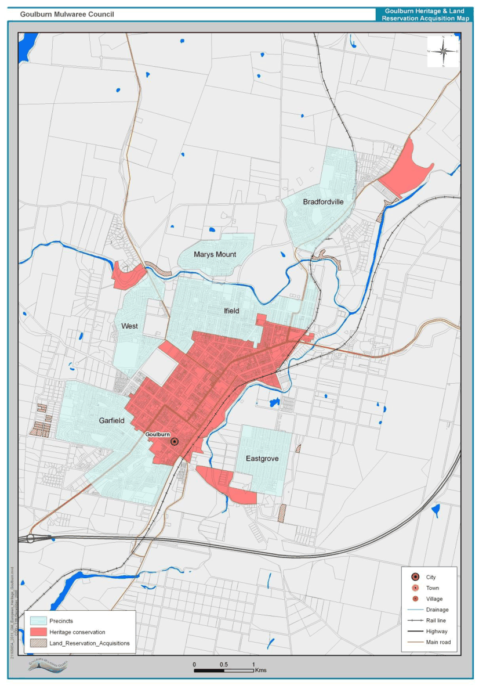
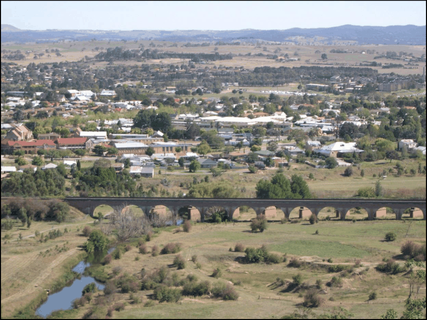
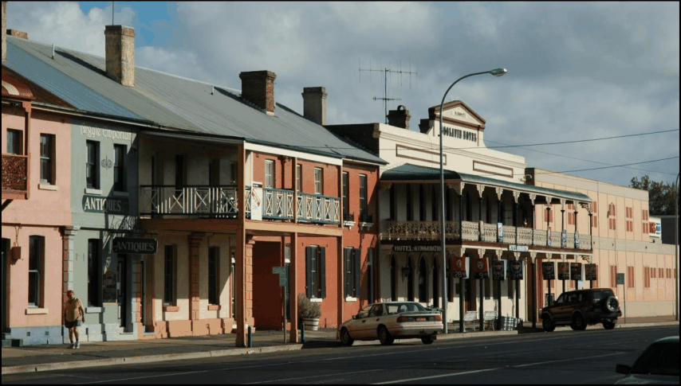
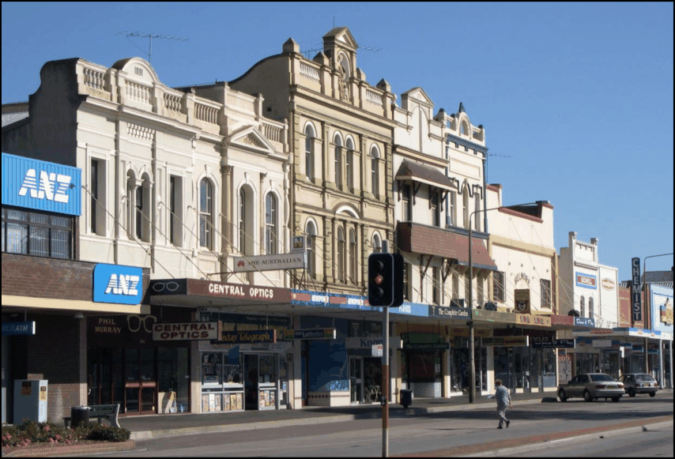

### Locality objectives – Goulburn City

Area character is given by a unique combination of the natural and physical elements of a place.  This includes both public and private domain elements: slope, block pattern, lot size and dimension, setbacks, building form and scale, street tree planting, the treatment of front gardens and the adjacency of open space areas.

#### History of development

Goulburn was named by James Meehan and ratified by Governor Lachlan Macquarie, after Henry Goulburn, Secretary of State for War and the Colonies. The Aboriginal name for Goulburn is Burbong which is a Murring/Wiradjuri word that indicates a special indigenous cultural area.

The first recorded settler in Goulburn established 'Strathallan' in 1825 (on the site of the present Police Academy) and a town was originally surveyed in 1828, although moved to the present site of the city in 1833 when Surveyor Hoddle laid it out. George Johnson purchased the first land in the area between 1839 and 1842 and became a central figure in Goulburn's development. He established a branch store with a liquor license in 1848. By 1841 Goulburn had a population of some 1,200 people, with a courthouse, police barracks, churches, hospital and a post office, and was the centre of a great sheep and farming area.

A telegraph station opened in 1862, by which time there were about 1500 residents, a blacksmith's shop, two hotels, two stores, the telegraph office and a few cottages. The town was a change station (where coach horses were changed) for Cobb & Co by 1855. A police station opened the following year and a school in 1858. Goulburn was proclaimed a town with municipal government in 1859. Royal Letters Patent issued by Queen Victoria on 14 March 1863 established the Diocese of Goulburn giving Goulburn city status and making it the first inland city. The existing St Saviour's Church became the Cathedral.

The arrival of the railway in 1869, which was opened on May 27th by the Governor Lord Belmore, along with the completion of the line from Sydney to Albury in 1893, was a boon to the city. Later branch lines were constructed to Cooma (opened in 1889) and later extended further to Nimmitabel and then to Bombala, and to Crookwell and Taralga.

Goulburn became a major railway centre with a roundhouse and engine servicing facilities and a factory which made pre-fabricated concrete components for signal boxes and station buildings.

Goulburn is a cathedral city. St Saviour's Cathedral, designed by Edmund Thomas Blacket replacing the original cathedral, was completed in 1884 with the tower being added in 1988 to commemorate the Bicentenary of Australia. Though completed in 1884, some earlier burials are in the graveyard adjacent to the Cathedral. St Saviour's is the seat of the Anglican Bishop of Canberra and Goulburn. The Church of Saints Peter and Paul is the former cathedral for the Roman Catholic Archdiocese of Canberra and Goulburn.

#### Locality characteristics

Goulburn is the primary living and employment centre for the Goulburn Mulwaree local government area. The urban structure of Goulburn reflects its historical development. The town is dominated by a commercial grid, which is surrounded by a variety of land uses, including commercial, retail, administration, tourist and accommodation. Low density residential subdivisions surround the commercial centre to the north and west.

Goulburn has natural and built boundaries, including the Main Southern Railway and the Mulwaree River to the south and east, topographical constraints to the west, and the Wollondilly River to the north. These boundaries have directed the growth of Goulburn

#### Figure 2-1: Goulburn locality precincts

> [Picture on page 4: a picture, saved as a picture (images/part-02-plan-objectives-page-4-2.gif, 150 dpi).]

toward the north near the Wollondilly River. Several significant land uses occupy areas adjacent to the Wollondilly River, including the Goulburn Gaol, the NSW Police Academy and sewage treatment facilities.

There are 6 distinctive locality character areas beyond the conservation area in central Goulburn (refer to Figure 2-1):

1\. Bradfordville: the area between Kenmore and the NSW Police College, on the Taralga Road approach

2\. Eastgrove: the area on the slopes below Memorial Road, east of the Railway line

3\. Garfield: below Combermere Street

4\. Western: broadly west of Victoria Park and Fitzroy Street

5\. Ifield: older streets abutting the existing conservation area whose block pattern springs off the line of Citizen Street, bounded by the Wollondilly River

6\. Marys Mount: the area north of the Wollondilly River below Mary’s Mount Road.

The south-west and central north precincts are closely related to the town centre and share much of the established character of the heritage conservation precincts they abut, including block pattern, setbacks, building type and style, and materials.

#### Existing character

#### Bradfordville precinct

The north east precinct has a mixture of loose/distorted grid with some curvilinear streets and cul-de-sac. The topography of the Bradfordville precinct is generally flat. The precinct has a predominantly suburban character, consistently modest in bulk and scale though mixed in age, materials and colours.

The northern portion of the precinct has a suburban fringe character, with houses backing on to fields, with wide vistas and scattered detached dwellings beyond. Typically, dwelling lots in the precinct comprise large front setbacks with low or no front fences.

Houses in this precinct are built in a mix of materials, including brick (red and blonde) with tiled roofs, and timber typically with iron roofs; generally inter-war period with some 1960s fibro, and recently constructed houses.

Dwellings comprise simple forms, either forward bay or ‘box’ cottages – generally single storey. New dwellings are interspersed across the precinct, but are generally built closer to side boundaries, some with attached garages.

There are some street trees in the precinct, ranging from small to medium in size. There are however some streets with no trees. Many streets do not include footpaths, creating a sense of the front garden flowing out to the street. Newer areas have roll kerbs.

#### Eastgrove

Set apart from the town on the eastern side of the Mulwaree River, the Eastgrove precinct lies above the flood plain and against the backdrop of the War Memorial hills. Eastgrove has a distinct physical and visual separation from the central Goulburn retail centre.

The Eastgrove precinct is characterised by a regular grid with terminating North-South streets connected by two main East-West streets (Park Road and Glenelg St). Terminating streets have a ‘cul de sac’ character that give a sense of privacy and seclusion and contribute to the ‘separate’ character of the precinct. The Eastgrove grid is laid over west-facing slope with panoramic views back towards Goulburn along East-West streets, from higher level homes, and between buildings.

On the lower slopes there are a number of significant older buildings (some in poor condition and apparently deserted), often on large lots and/or with undeveloped land around them, which add a strong historical and semi-rural character to the Eastgrove precinct.

On the higher slopes are newer dwellings, conventional in design, whose brick veneer, low-pitched tiled roofs and landscaping treatment contrast with the nature of the older parts of the neighbourhood.

#### Garfield

Set on the ‘other side’ of the ridge, and at some distance from the town centre, the Garfield precinct has a strongly suburban character that is very different from the other areas – smaller houses typically of simple ‘box’ or forward bay type in a range of colours (mostly lighter colours) predominate, with front gardens set to lawn with smaller scale edge planting and no or low front fences.

The topography of the Garfield precinct is sloping, with a mix of street widths and generally narrow lots. The character of the neighbourhood reflects historically lower average household incomes (i.e. workers’ housing) in terms of building size, simplicity (little detailing) and modesty of materials.  This has resulted in a large open space to built area ratio and gives a feeling of openness to the streets. Some large vacant/undeveloped parcels enable views through blocks; where this occurs it further enhances the openness

of the streetscape. There are many timber and some fibro cement dwellings with metal roofs in the Garfield precinct, with comparatively few in brick.

Although modest in scale and architectural detailing, there is a variety of architectural and period styles across the precinct, indicating a collection of individual dwellings built up over

time. Infill development is introducing different size, form and materials in dwelling design to the Garfield precinct. Small to medium street trees add amenity and appeal to streetscapes within the precinct.

#### Western

This precinct lies astride the hills overlooking Goulburn, with some panoramic views contributing to a strong sense of place. This precinct is generally characterised by curvilinear streets along the land contours, giving streetscapes where one side of the street is higher than the other.

1960s period development within the northern precinct is typically blond brick, ‘ranch style’, more 2 than 1 storey, with some split level resulting from the sloping terrain.  Building forms are simple and rectangular, pitch of roofs are low.

Garages tend to be integral to the dwelling structure in the western precinct, set underneath habitable space at the ground floor, and are a typical feature of the front façade. Houses are typically wider than earlier forms, across the width of the lot frontage. Front gardens have low or no fences, often feature exotic and ‘manicured’ plantings. Setbacks vary but are typically more generous than in the rectilinear streets of the older subdivisions.

#### Ifield

This precinct is characterised by a regular grid pattern with rectangular blocks and narrower streets than the town centre. East of Kinghorne Street the grid is further broken down with the introduction of rear lanes. The architecture of detached houses within the precinct span Federation to post-war periods.

Recent townhouse development in the precinct have tended to adopt a ‘gunbarrel’ lot layout and which has tended to be visually intrusive, tending to have vast expanses of hard surfaces, with minimal landscaping and high solid front fences.

Within the precinct, Kinghorne Street acts as a distinctive character boundary. South of Kinghorne Street, buildings tend to be older and larger; there is a consistent streetscape with smaller front setbacks and side setbacks; rows of houses are built to a similar ‘pattern’ (reflecting subdivision/development by the same builder); slightly more complex building

and (gable end) roof forms, particularly to Federation houses; and materials are predominantly brick and tile.

North of Kinghorne Street, towards the river, building forms are more simple and modest, somewhat more varied, and roofs tend to be hipped. The portion of the precinct between Chatsbury and Wilmot Streets is almost a sub-precinct. This portion of the precinct continues the grid and very wide streets of the town centre, which in combination with the modest housing stock creates an impression of great spaciousness. The lack of street trees in this area to break down the large scale of the streets exaggerates this effect.

Dwellings in this precinct tend to have low or no front fences, which are often brick with brick houses. The use of street trees varies. There are some mature street trees, with well landscaped and tended front gardens.

#### Marys Mount

This precinct typically comprises curvilinear streets with cul de sac. Recent development within the precinct is also distinctive because of its relative isolation from the central Goulburn urban area.

Dwellings are generally 1 to 2 storeys in height with rendered/face brick facades and tiled roofs within the precinct. The precinct is characterised by having little mature vegetation within private open space areas.

#### Desired future character

The Marys Mount precinct, located at the north of Goulburn, will provide the primary source of residential land to accommodate the future growth of Goulburn to 2020, along with extensive opportunities for infill development within the existing city as required by the NSW Department of Planning and Environment. Areas west and south west of Goulburn also present the potential to accommodate large lot residential development and provide an alternative residential choice to Marys Mount and inner city areas. Residential subdivision and infill development will be well planned and coordinated.

Heritage conservation areas shall be appropriately protected against insensitive development that adversely affects the integrity and importance of each heritage item and/or area. This plan will provide more detailed development controls to maintain the heritage character of defined areas.

Key issues for consideration for the desired future character of Goulburn are as follows:

#### Topography

Topography constrained the physical boundaries of the original settlement, to the extent that the town was laid out between two rivers, the Wollondilly and the Mulwaree, over the gentle slopes west of Mulwaree Ponds (the slope down to the south west, from the high point of Verner/Cowper Streets, is much steeper, resulting in greater commercial intensity developing north east from the civic core). The introduction of the railway line formalised the south west boundary of the town, with the result that Eastgrove ‘reads’ as a distinct settlement.  On the higher slopes of Goulburn are found the larger, grander houses, while behind the ridge and further away from the centre the character is generally of workers’ cottages.

#### Views

> [Picture on page 9: a picture, saved as a picture (images/part-02-plan-objectives-page-9-12.gif, 150 dpi).]

Long views down straight, undulating streets serve to locate the viewer, enhancing the legibility of Goulburn. The main town grid, the skewed grid north of Citizen Street, and the Eastgrove grid, are all laid out over the contours with little regard for landform.  This results in long views along undulating streets, allowing a ‘reading’ of the landscape that is specific to Goulburn.  The resulting street vistas are important character-giving elements and should be protected and enhanced where possible (for example by completing/extending

street tree planting).  The grid is broken down in the heart of town, to provide a dramatic elevated site for St Saviours Cathedral, and to create an axial relationship along Montague Street towards the river (now terminating at the Visitor Information Centre).

View terminations to landmark buildings should be protected in order to enable continuing visual appreciation of those buildings and their place in the townscape (these include St Saviours church and tower (along Montague Street and Bourke Street), the Uniting Church spire (SW along Lagoon Street) and the Nursing Home atop Mary Street (along Auburn Street). Also important as landmarks within the streetscape are the Post Office, the Catholic Cathedral, the School of Arts, War Memorial and Rocky Hill.

#### Urban structure

As identified above, Goulburn has a clear and legible urban structure.  At the heart of the town is the civic spine, anchored by St Saviours Church and Belmore Park.  The 100 feet wide streets and very large blocks have resulted in a diverse lot pattern within the town centre, with rear lanes ‘burrowing’ into the centre of some blocks and enabling a range of building types.  Very deep lots in other blocks have resulted in large open areas behind buildings, some now used for car parking, which contrast with the fine grain of the continuous retail strip frontages.

> [Picture on page 10: a picture, saved as a picture (images/part-02-plan-objectives-page-10-18.gif, 150 dpi).]

The traditional strip retail buildings, the low scale of residential buildings and the fine grain given by the diverse lot pattern create a pedestrian scale – but a scale that is offset by the very wide streets.  Along these streets, landmark buildings are highly visible.  Larger

buildings – both civic and residential – ‘claim’ the higher ground to take advantage of elevated views. These buildings are typically of good design quality as well as greater size.

#### Urban form

The main street of Goulburn is characterised by a mix of 2-3 storey retail buildings (a mix of heritage and infill), traditional corner commercial buildings, and some fine civic buildings that punctuate the streetscape. There is a sense of ‘diversity within unity’; that is, there is a coherent character given by the intensity of the town centre uses, and their active relationship to the street, but also variety in building height, of materials, façade and parapet treatment, and in building type.  The streetscape retains a certain ‘gravitas’ or grandeur, particularly around the main intersection with Montague Street.

> [Picture on page 11: a picture, saved as a picture (images/part-02-plan-objectives-page-11-11.gif, 150 dpi).]

Beyond the main street is a greater mix of building types and scales, including larger heritage buildings with a civic or community function, commercial buildings, industrial uses and individual houses.   Insertion into the town centre of the internalised mall and integrated car parking has created large areas of blank wall to side streets and the rear but has been designed to maintain the main street character.  On wide streets with little or no street tree planting and with detached houses, the grassed kerbs (with no footpaths), generous setbacks and lack of vegetation create an impression of openness in contrast to the spatial containment of the commercial centre.

A more domestic scale of building is found in the narrower streets of the residential areas outside the regular grid.  The form of buildings in these areas, and their relationship to the street and each other, is typical of suburbs of other cities: a regular streetscape rhythm of houses of similar size and form, generally with garages set to the rear and/or side, and with a direct relationship between front entry/windows to primary living rooms and the footpath. This plan aims to maintain consistent front and side setbacks, encouraging simple housing and roof forms comparable to the established building stock, and controlling the design of houses to minimise the visual impact of garages (while allowing innovation) and to keep the interface between the private and public domain, will all be important.

Height controls and the definition of height will be important in areas on slopes, especially where slopes are steep, both to protect view sharing and to minimise both apparent bulk on the street and at the rear, and also to protect the rear yards and rooms of adjacent houses from overshadowing.

#### Streetscape

On the streets that have retained complete rows of street trees, the trees unify the streetscape. This plan aims to maintain the modest bulk and scale of dwellings, and support landscaping of front setbacks, so that new development does not overwhelm the existing character – this is even more important on streets without street trees.
