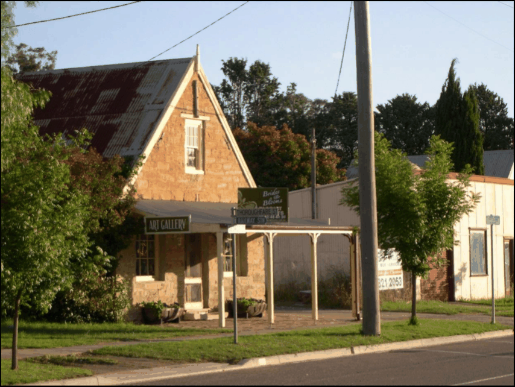
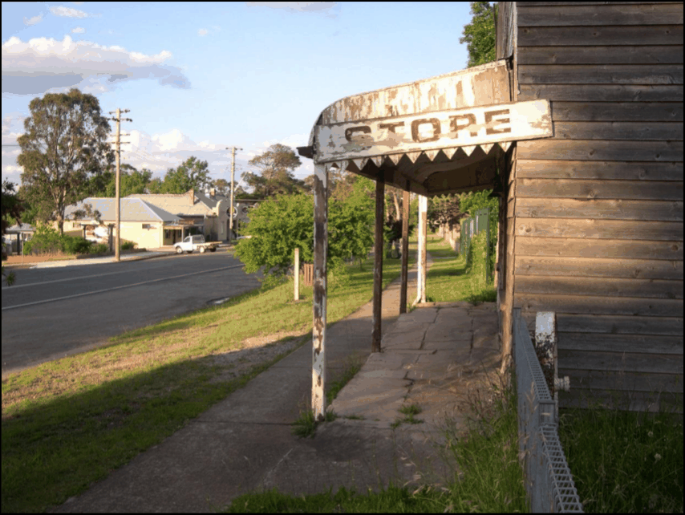

### Locality objectives – Marulan

#### History of development

Marulan was first discovered by Wilson, Price and Collins when they journeyed as far as Mt Towrang in 1798. However, the first mention of Marulan was by Charles Throsby in 1818 who was accompanied by Meehan, Wild and Hume when exploring the area around the Goulburn Plains and Lake Bathurst. Governor Macquarie came through Marulan in 1820 on a tour of inspection of the new road, which was later named Macquarie’s Track.

In 1833 Surveyor General Major Thomas Mitchell decided that the best location for a village was at the corner of Bungonia Road and the Great South Road. In 1834 Surveyor Hoddle drew up the plans and Marulan was gazetted as a village on 11 March 1835. The Woolpack Inn was one of the first establishments in Marulan, along with three church reserves, several other inns, a post office, court house as well as several houses.

In the 1860s, when the site for the Marulan Railway Station was decided upon, it was located 5km north of the existing village. A settlement emerged around the railway camp. The Marulan Railway Station was opened on 6 August 1868 by Sir Henry Parkes. This

settlement became known as Mooroowoollen. This caused much confusion with Marulan village 5km away and Mooroowoollen Post Office in the ladies’ waiting room of the Marulan Railway Station. ‘Old’ Marulan subsequently declined and the town became one in 1878.

Due to the impossibility of making a road over the deep ravines of the Shoalhaven River from Bungonia to Braidwood, the more viable option was the road to Goulburn Plains. This was the main road for mail coaches from Campbelltown, and Cobb & Co coach services, which went through to Cooma, but with the introduction of rail, these services declined.

The Hume Highway, named after the early explorer Hamilton Hume, was officially proclaimed a State Highway in 1928. The Marulan section of the highway from Mt Otway to Marulan South corner, was concreted in the 1930s. Marulan performed the role as a highway service town until the construction of the bypass in 1985.

The State Transport (Co-Ordination) Act 1931 was passed to control the weights, and other relevant details, of heavy vehicles. This was undertaken by mobile inspectors and Marulan was chosen as a suitable site. In 1958 a permanent checking station was built on the eastern side of the highway just south of the Tallong turn-off. Larger facilities were erected in 1970 on both sides of the road. With the opening of the new bypass in November 1986, new modern checking stations were built on either side of the highway. The new ‘weigh in motion’ facilities for heavy vehicles were opened in September 1996.

#### Locality characteristics

> [Picture on page 14: a picture, saved as a picture (images/part-02-plan-objectives-page-14-2.gif, 150 dpi).]

Marulan is located on the Hume Highway, approximately 160 kilometres from Sydney and 31 kilometres east of Goulburn. Although primarily residential in character, Marulan has provided the function of a highway service centre.

Marulan is also located adjacent to the Main Southern Railway, with passenger and freight services operating through between Sydney, Canberra and Melbourne. Marulan provides local community services and utilities, including a primary school, shops, a number of churches, a hotel, a police station, and bushfire and medical services. Key employment activities include several existing and proposed industrial activities, such as the Lynwood Quarry, Marulan South Quarry and the Marulan Waste Management Facility, and a number of industries located within the industrial zone. A substantial residential and industrial development proposal has been identified along Wilson Drive, east of the town.

#### Desired future character

> [Picture on page 15: a picture, saved as a picture (images/part-02-plan-objectives-page-15-2.gif, 150 dpi).]

Marulan is a key town servicing surrounding rural areas and villages in the northern portion of the Goulburn Mulwaree local government area. Marulan provides an important employment base for the local government area and will be important for the future growth of Goulburn Mulwaree. This plan seeks to reinforce the status of Marulan and support the future growth of the locality. This plan also seeks to consolidate existing and future heavy industrial uses west and south of Marulan.

This plan seeks to enable a variety of residential densities to be accommodated in Marulan. Some extension of the existing town to the north is proposed to facilitate continued growth and diversity of housing types. This plan aims to reinforce the existing character of the main street of Marulan (George Street) and the importance of the commercial precinct.
