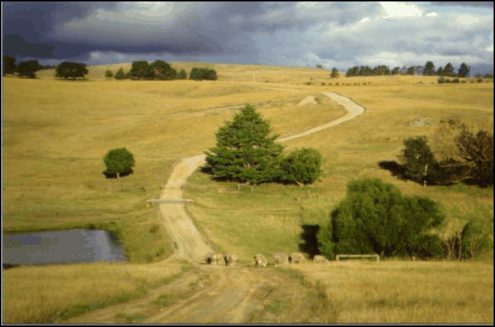

### Rural development objectives

#### Agriculture and primary produce

This plan seeks to ensure that rural living and agricultural operations will continue as key land uses across the Goulburn Mulwaree local government area. This plan aims to promote

areas suitable for agricultural operations and ensure these operations minimise potential for land use conflict, unnecessary fragmentation or the alienation of existing land uses.

Production needs differ for varying forms of agriculture - intensive operations require a reduced area in which to cultivate and maintain a viable operation. Although a market garden may be sustainable on a small allotment, much larger areas are required where a farm is primarily for grazing or other forms of dry land agriculture. Based on environmental conditions, it is likely that grazing will form the primary agricultural land use within Goulburn Mulwaree. Differing farming operations may result in a range of land use impacts and may sometimes conflict with one another where not managed appropriately.

This plan aims to restrict dwelling construction in areas where environmental sensitivities occur. This was based on an assessment of land suitability to determine the most appropriate location for rural and agricultural activities, and a detailed consideration of land capability and suitability. This plan addresses rural needs and emphasises improved access to basic services, agricultural diversification, natural resource management and the generation of employment in non-agriculture rural activities.

#### Rural landscape

> [Picture on page 16: a picture, saved as a picture (images/part-02-plan-objectives-page-16-17.gif, 150 dpi).]

This plan aims to protect the scenic values of the rural landscape and environment, and encouraging development to be unobtrusive and sympathetic to the surrounding rural

setting. Where practicable, existing vegetation is to be maintained and enhanced, so as to provide buffers and landscaped visual relief within rural areas.

The Goulburn Mulwarree Strategy has identified rural villages that require development controls and guidelines that will retain and enhance their existing character.
