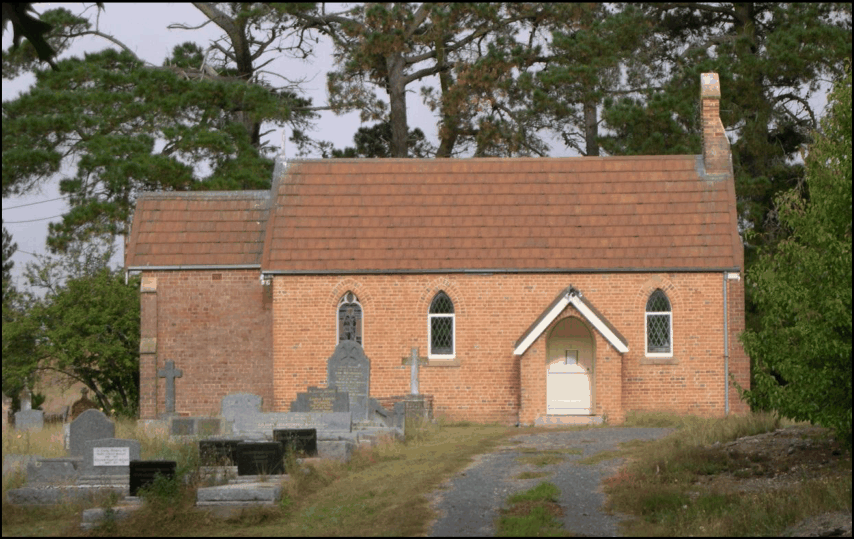
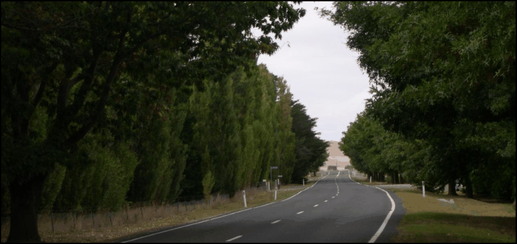
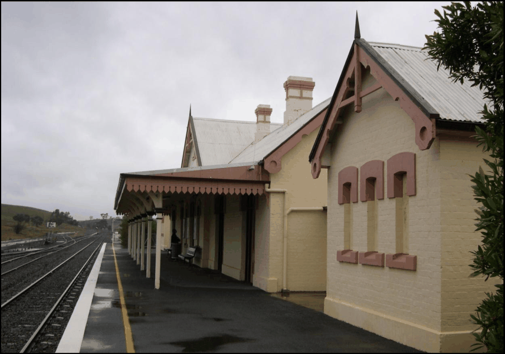

### Rural locality objectives

#### Bungonia

#### History of development

Bungonia was first settled in the early 1820s and was the most important town in the early period of settlement in the region due to its location on the road south from Sydney. As the area developed and other settlers arrived, Bungonia progressed and various small businesses were established to serve the district. However, when the route of the ‘south road’ was resurveyed in the 1830s, it bypassed Bungonia and lead to the slowing of growth in the town.

Bungonia's historical built form includes St Michael's Catholic Church, which was built over a period of nearly eight years officially opening in 1847, making it one of the oldest operating Catholic Churches in Australia.

#### Locality characteristics

Bungonia retains its village characteristics and remains a small town, with a historical built

form. The Village has a wide ranging contextual heritage and is significant for its place in pastoral expansion and development in south-eastern New South Wales from 1820.

#### Plan objectives

This plan seeks to retain the unique heritage characteristics and rural lifestyle of Bungonia, while still allowing room for economic growth. Bungonia will be able to support further growth to support some increase in land use activity without adversely affecting the rural atmosphere of the village. The plan does not seek to change the boundaries of the village or adjoining land uses.

#### Lake Bathurst

#### History of development

In 1818, Lake Bathurst was mapped by the Surveyor General, James Meehan. Meehan had been commissioned by Governor Macquarie to find a new route from inland NSW to

Jervis Bay. Lake Bathurst was named after the British Colonial Secretary at the time. In 1820, Governor Macquarie inspected Lake Bathurst and within a few years, the first land grants were made for pastoral settlement.

A village reserve was set aside at Lake Bathurst, but was not successful, as many of the large pastoral leases had their own facilities and were self sufficient. Lake Bathurst was formerly known as Tarago. At its peak, the village had two registered inns and the St. John’s Church, which was built in 1860.

> [Picture on page 18: a picture, saved as a picture (images/part-02-plan-objectives-page-18-8.gif, 150 dpi).]

The Goulburn to Queanbeyan Railway reached Lake Bathurst in 1884, with the picturesque lake attracting many people. Large rowing and sailing regattas were held. The influx of tourists declined in 1897, when the lake began to recede.

Lake Bathurst was named in 1884 when Sherwin’s Flat became Tarago. Lake Bathurst remained the rural centre of the surrounding region, with a school established in 1869. During World War II, Lake Bathurst played an important role, with an area south of the village used to store 658,000 gallons of fuel. This area was guarded by troops in a series of bunkers. Selected remnants are still evident today.

During the 1950s, water skiers and motor boat enthusiasts were attracted to Lake Bathurst, with thousands of people enjoying the area. However, in the late 1960s, Lake Bathurst’s population declined, with many farmers moving away. At this time, the school and village store closed. The goods shed and water tank located near the railway line were removed.

#### Locality characteristics

The tree-lined road, which was the original border of the village, remains today. Today, Lake Bathurst is a small village but important local history destination for tourists.

> [Picture on page 19: a picture, saved as a picture (images/part-02-plan-objectives-page-19-4.gif, 150 dpi).]

#### Plan objectives

This plan seeks to focus future development activity within Lake Bathurst east of the railway line, which offers established land uses and direct road access. Areas east of the railway line also present capacity for infill development. Limiting the growth potential of Lake Bathurst to the west of the railway line will reinforce the village centre and will restrict at grade movement across the railway line.

#### Tallong

#### History of development

In the 19th Century Tallong was known as Barber's Creek. Hamilton Hume was granted land in Tallong in the early 1820s. Tallong was once a thriving agricultural community, known particularly for its fruit orchards, especially apples and pears. At the turn of the 20th Century, Tallong had shops, pubs, hotels and a post office. It was an important refuelling stop along the Main Southern railway line.

Tallong was largely destroyed however in the Chatsbury bushfires of 1965 resulting in many residents leaving the locality and the closure of the post office and many other small businesses.

#### Locality characteristics

Tallong today is a hamlet of agrarian and trade workers, cottage industries, including stud farms, and commuters who work in the neighbouring towns of Goulburn, Moss Vale and Mittagong, or who make the commute to Sydney or Canberra. There is a railway station in the town which can take commuters to Sydney. It has significant populations of older residents and weekend residents who use the Southern Highlands as a retreat from the fast pace of city life. Tallong has a unique natural environment and proximity to Bungonia Gorge. The discovery of the Tallong Midge Orchid (Genoplesium plumosum), a small flower that grows nowhere else has brought the village to the attention of botanists and conservationists. This orchid is now a protected species.

#### Plan objectives

This plan seeks to retain Tallong’s rural lifestyle with a strong emphasis on agricultural production. The current low density will be maintained, with new development restricted to areas within the existing town boundaries, and where there is a capacity to meet infrastructure requirements.

Tallong’s natural and cultural heritage items contribute character to the village and will be preserved. Any new development therefore needs to be sympathetic to the existing character.

Industrial development in Tallong will be restricted to small scale industrial enterprises such as home industries, tourism or services relating to residents such as chemists and rural supplies.

#### Tarago

#### History of development

The village of Tarago was for many years a staging post and railhead for the Main Southern railway line, and was originally know as Sherwin’s Flats.

#### Locality characteristics

Tarago is located south of Lake Bathurst, approximately 40 kilometres south of Goulburn and 67 kilometres north-east of Canberra. The former Woodlawn Mine, located west of Tarago, is now owned by Collex Waste Management for use as a landfill and bioreactor for Sydney’s waste.

> [Picture on page 21: a picture, saved as a picture (images/part-02-plan-objectives-page-21-1.gif, 150 dpi).]

Land use in and around the historic township of Tarago is mainly residential in character, with a few community and commercial facilities to service the community. These include a school, convenience store, service station, hotel, rural fire shed, community hall, two churches, police station and railway station. Much of the surrounding land is rural in nature, except the former Woodlawn Mine site positioned on the railway line to the west of the village. Tarago is experiencing some growth pressure as an alternative to Bungendore and to a lesser extent Queanbeyan. Tarago presents an opportunity for residential development with strong employment links to Canberra.

#### Plan objectives

This plan seeks to reinforce Tarago’s character as a rural town servicing surrounding rural areas and villages. This plan also seeks to enable a variety of land uses including commercial, employment, recreational and mixed uses. This plan aims to augment the transition of existing industrial uses in Tarago to large lot residential uses.
