#### 7 and 8 are more specific and also must be considered where appropriate.

### Indigenous Heritage and Archaeology

#### Introduction

The Goulburn Mulwaree Local Government Area (LGA) is rich in Indigenous heritage and archaeology.  It is recognised as an important meeting place that was inhabited by numerous language groups.

▪ MULWAREE,

▪ WOLLONDILLY,

▪ WIRADJURI,

▪ GUNDUNGURRA,

▪ DHARROOK ▪ THARAWAL,

▪ TARLO,

▪ LACHLAN,

▪ PAJONG,

▪ PARRAMARRAGOO,

▪ COOKMAL,

▪ BURRA BURRA,

#### ▪ NGUNAWAL.

It is recognised that these peoples are the traditional owners of Goulburn Mulwaree area and play a significant and ongoing role in the history of the region.  The earliest occupation site near Goulburn Mulwaree LGA in the Australian Alps has deposits that have been radiocarbon dated to 21,000 years ago.  Most sites in the region date to 3-5,000 years ago.

This section of the DCP includes details and controls for the protection and management of the Indigenous heritage and archaeology of the Goulburn Mulwaree LGA which have been prepared in conjunction with and following consultation with the Pejar Local Aboriginal Land Council.

#### Objective

To provide for the consideration of impacts on indigenous heritage and archaeology from proposed developments within the Goulburn Mulwaree Local Government Area.

#### Background

Historical archaeology is the study of the past using physical evidence in conjunction with historical sources. It focuses on the objects used by people in the past and the places where they lived and worked. It can tell us about the way things were made and used and how people lived their daily lives.

Archaeological resources are irreplaceable. They have enormous potential to contribute to our knowledge of our history, providing information that is unavailable from other sources. It is important that archaeological resources are adequately investigated and recorded before they are likely to be disturbed.  Some sites are important for the knowledge we can gain from them. That is why we excavate and learn from them.  Some sites that are very significant to the community are kept in the ground and interpreted because they can supply evidence that we can see and touch.

Following consultation with the Pejar Local Aboriginal Land Council a generalised map of places of Aboriginal significance (Figure 3.1) was produced. This map does not preclude the need for Aboriginal heritage impact assessment for any new development in the local government area but can guide the location and landscape context of existing and future archaeological sites.

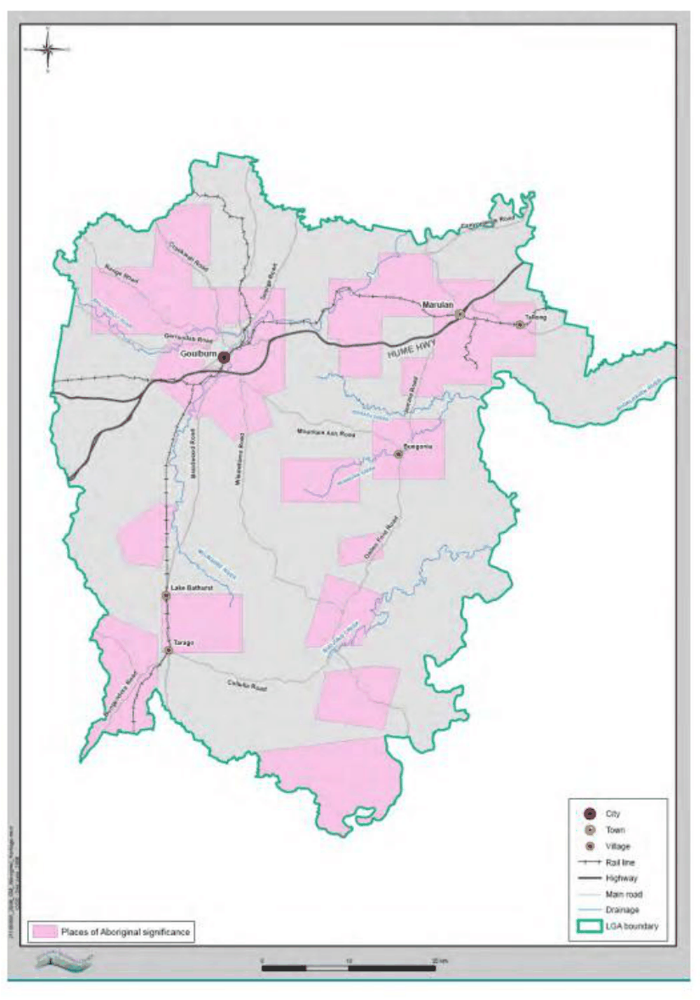

> [Picture on page 5: a picture, saved as a picture (images/part-03-general-development-controls-page-5-1.gif, 150 dpi).]

Figure 3.1:  Places of Aboriginal Significance Note: This map is to be read together with the Aboriginal Archaeology matrix found in Appendix A of this Development Control Plan. The matrix contains additional areas that may have Aboriginal Cultural significance.

#### Responsibilities

Division 9 of the NSW Heritage Act 1977 contains measures to protect archaeological resources. Proposals to excavate land in the Goulburn Mulwaree LGA require an excavation permit issued by the Heritage Council of NSW for development where it is reasonably expected that disturbance to a relic will occur.

An excavation permit is required in order to ensure that archaeological sites are excavated under proper supervision and that significant evidence of our past is not unnecessarily lost. Archaeology requires the careful excavation of evidence in the ground in order to fully understand the history and significance of the site.

The NSW Heritage Act 1977 also requires that a person who has discovered a relic must notify the Heritage Council of the discovery within a reasonable time. There are also legislative responsibilities and the need for Aboriginal Heritage Impact Permits under the National Parks and Wildlife Act 1974.

#### Relevant Documentation

The NSW Department of Environment and Heritage prepared the following documents in 2010 that are relevant to Aboriginal heritage and the assessment processes:

• Code of Practice for Archaeological Investigation of Aboriginal Objects in New South Wales (DECCW 2010b);

• Aboriginal cultural heritage consultation requirements for proponents (DECCW 2010a); and

• Due Diligence Code of Practice for the Protection of Aboriginal Objects in New South Wales (DECCW 2010c).

#### Identifying Potential for Impacts upon Aboriginal Cultural Heritage Values

A development or project has the potential to impact upon Aboriginal cultural heritage values if it involves one or more of the following:

• disturbance to the ground surface or to sediments below the ground surface, except where disturbance will be strictly limited to: o existing man-made manufactured surfaces (such as bitumen and concrete). o existing  deposits of imported land-fill or waste material.

o extremely disturbed contexts such as quarries or quarried areas (where there is no trace of the original soil and subsoil deposits or of buried former soils and subsoil deposits).

• disturbance to the roots, trunk or branches of old growth trees up to and more than 130 years old, which are native to the Goulburn Mulwaree local government area;

• impact or disturbance to the content, or immediate surrounds (up to 100 metres away) of a known or previously recorded Aboriginal site; and

• occurs within, or in close proximity to, a place of special or high Aboriginal cultural significance (such as an identified cultural landscape, an existing or former ceremonial ground, a burial ground or cemetery, a story place or mythological site, a former Aboriginal reserve or historic encampment, or an archaeological site of high significance).

If one or more of these factors apply, or are likely to apply, to a proposed development or project, then the next step is to determine if an Aboriginal due diligence and/or heritage impact assessment is required. Note:  Where reports include sensitive cultural information, they will be withheld from public exhibition.  Heritage development controls

#### Identifying the need for an Aboriginal Heritage Impact Assessment

If one or more of the factors listed in chapter 3.1.2 apply, or are likely to apply, to a proposed development or project, then the questions below should be asked to determine if an Aboriginal due diligence and/or heritage impact assessment is required in accordance with clause 5.10 of the LEP 2009. Council may determine that a development does not require and Aboriginal heritage impact assessment if the site of the development is unlikely to be of Aboriginal heritage significance despite the questions below.

A. Has the development or works area been subject to a comprehensive level of

#### Aboriginal heritage assessment within the last 5 years?

The creation of a new Aboriginal due diligence and/or heritage impact assessment would not normally be required where the area of the proposed development works occurs within the boundaries of a previously conducted Aboriginal due diligence and/or heritage impact assessment, and that assessment was comprehensive in scope, and was conducted less than five years ago.

In this circumstance, the development or works proposal would be required to address the heritage management issues identified in the existing Aboriginal due diligence and/or heritage impact assessment.

A comprehensive assessment can be identified by the following criteria:

• The Aboriginal due diligence and/or heritage impact assessment complies with the current Department of Environment and Heritage standards and guidelines for the conduct and reporting of Aboriginal assessment reports; and

• The scope of the field survey coverage and predictive analysis is acknowledged to have effectively assessed the entire study area in a comprehensive manner.

Generally, this will include investigations with 40-100% field survey coverage, and exclude investigations relying upon sample survey areas totalling less than 40% of the study area.

Any proposed development area which falls outside of a former Aboriginal due diligence and/or heritage impact assessment study area will require a new Aboriginal due diligence and/or heritage impact assessment.

A new Aboriginal due diligence and/or heritage impact assessment will need to be conducted, despite the existence of a previous Aboriginal due diligence and/or heritage impact assessment, less than 5 years old, for the same area, in the following circumstances:

• The previous Aboriginal due diligence and/or heritage impact assessment did not involve a comprehensive assessment of the study area;

• The Department of Environment and Heritage standards and guidelines under which the previous Aboriginal due diligence and/or heritage impact assessment was conducted have changed significantly and require a revision of the assessment report, and/or the re-conduct of all or a component of the fieldwork assessment;

• Aboriginal cultural heritage values which were not identified or predicted in the previous Aboriginal due diligence and/or heritage impact assessment have been identified within the development area. These may be the result of a new site discovery, or arise from new oral history or documentary research; and

• The area has been identified by an Aboriginal advisory committee, Council heritage staff, or the Department of Environment and Climate Change as requiring an Aboriginal due diligence and/or heritage impact assessment.

#### B. Does the development area include archaeologically sensitive landforms?

Where a development or works area has not been subject to comprehensive Aboriginal due diligence and/or heritage assessment within the last 5 years, the presence of archaeologically sensitive landforms will necessitate the conduct of an Aboriginal due diligence and/or heritage impact assessment.

C. Does the development area include previously identified Aboriginal sites or places of Aboriginal cultural heritage value?

Where a development or works area has not been subject to comprehensive Aboriginal due diligence and/or heritage assessment within the last 5 years, the presence of previously identified Aboriginal sites or places of Aboriginal cultural heritage value will necessitate the conduct of an Aboriginal due diligence and/or heritage impact assessment.

The presence of previously identified Aboriginal sites or places can be determined by:

• Conducting a search of the Department of Environment and Heritage Aboriginal Sites Register (Aboriginal Heritage Information Management System) or similar; and

• Checking site locations identified and mapped by any previously undertaken Aboriginal heritage study.

D. Does the development or works area include all or part of an identified Aboriginal cultural landscape?

Where a development or works area has not been subject to comprehensive Aboriginal due diligence and/or heritage assessment within the last 5 years, the presence of all or part of an identified Aboriginal cultural landscape will necessitate the conduct of an Aboriginal due diligence and/or heritage impact assessment.

E. Is the development area likely to include old-growth native trees up to and more than 130 years old?

Where a development or works area has not been subject to comprehensive Aboriginal due diligence and/or heritage assessment within the last 5 years, the presence of old-growth native trees will necessitate the conduct of an Aboriginal due diligence and/or heritage impact assessment.

Old growth native trees that may be older than 140 years old have the potential to preserve Aboriginal scars. These scars may be the result of bark or wood removal, the search for food, or other activities. Such scars are Aboriginal sites and are protected by law.

The age criterion of 140 years allows for tree germination at or before 1870, and cessation of Aboriginal tree scarring by 1900 (by which time the 1870s tree would have sufficient girth to support the harvesting of bark). The 140 years criterion is considered to be conservative, given that the removal of bark by Aborigines in the Goulburn Mulwaree LGA is likely to have ceased by the 1870s and 1880s.

The potential for suitable old growth native trees to occur (either dead or alive) within a proposed development or works area can be gauged by the following:

• a report from a suitably qualified botanist;

• an inspection or other record indicating that no tree cover, or no old-growth tree cover remains in the area; and

• a review of aerial photography.

Old growth trees typically survive within the Goulburn Mulwaree LGA as isolated or scattered shade trees in agricultural grassland, in remnant woodland, or in forest, especially in creek gullies and steep sided valleys.

#### Identifying what Level of Assessment is Required?

Initially any development identified as requiring and assessment of Aboriginal heritage significance will require an Aboriginal Due Diligence Assessment prepared under the Due Diligence Code of Practice for the Protection of Aboriginal Objects in New South Wales (DECCW 2010c) and should include the minimum consultation under the Aboriginal cultural heritage consultation requirements for proponents (DECCW 2010a).

Should the due diligence assessment reveal that the site has a high potential of having Aboriginal significance or sites then a more detailed Aboriginal heritage assessment will be required.  This assessment will require more extensive consultation under the Aboriginal cultural heritage consultation requirements for proponents (DECCW 2010a).

Should any excavation or impact on heritage sites or objects be needed an Aboriginal Heritage Impact Permit (AHIP) may be required from the Department of Environment and Heritage. Reference should be made in these cases to the Code of Practice for Archaeological Investigation of Aboriginal Objects in New South Wales (DECCW 2010b).

#### Conducting an Aboriginal Heritage Impact Assessment

An Aboriginal heritage impact assessment must be prepared by a suitably qualified heritage practitioner or consultant. The minimum qualification generally recognised as a prerequisite for an Aboriginal heritage assessment practitioner is a tertiary level degree (or equivalent) in an Australian archaeology or cultural heritage degree. The range of specialist practitioners is considerable and can include anthropologists, stone artefact specialists, rock art specialists, materials conservators, palaeobotanists, and physical anthropologists. In general, heritage

assessment based on field survey and/or excavation will require a qualified archaeologist. Assessments which involve the analysis of contemporary Aboriginal communities may also require input from an anthropologist.

Several professional organisations exist which recognise and accredit heritage consultants and other related practitioners. These are:

Australian Association of Consulting Archaeologists Inc – PO Box 214, Holme Building, University of Sydney, NSW 2006 (www.archaeology.usyd.edu.au/aacai).

Australian Institute of Professional Archaeologists Incorporated – GPO Box 5336BB, Melbourne Victoria 3001 (www.users.bigpond.com/raluebbers/AIPA).

Some consultant heritage practitioners are listed in the Yellow Pages under the categories of ‘Archaeology’ and ‘Heritage Consultants’.

The following are key components of an Aboriginal heritage impact assessment:

A. Identify and then consult with appropriate local Aboriginal stakeholder groups – Consultation with local and custodial Aboriginal community groups is an integral component of any Aboriginal heritage impact assessment. B. The status and number of stakeholder groups can change over time. The Department of Environment and Climate Change can provide advice regarding appropriate groups which should be consulted. C. Consult with relevant Council Heritage staff – Council heritage staff are potential sources of information, advice and direction, regarding community consultation, site locations and the management of heritage values. D. Conduct a review of previous heritage assessment work and background information (including a search of the Department of Environment and Climate Change Aboriginal site register) – All relevant previous heritage assessments should be reviewed with regard to the potential issues and heritage values present within the assessment area. Sufficient background information should also be presented so that the environmental and historical context of the area can be characterised, and any heritage places, sites and features can be effectively placed within an assessment context. E. Conduct an appropriate level of field inspection of the proposed development area – This usually involves comprehensive or sample survey of the development area. All field survey involves levels of sampling, however a comprehensive level of inspection would normally achieve a coverage of greater than 40% of the area subject to development impacts. The

proportion of survey coverage achieved will depend on the degree of ground surface visibility available to the surveyors at the time of the investigation. F. The first stage of field inspection and assessment generally involves visual inspection of the ground surface and does not include subsurface testing. In the event that an assessment concludes that an area has subsurface archaeological potential, then various forms of archaeological subsurface testing may be conducted to assess this potential. Excavation is generally conducted as a second stage of assessment, following the submission and consideration of a surface survey report. Excavation with the aim of recovering or detecting Aboriginal artefacts can only occur following the receipt of a permit or consent from the Department of Environment and Climate Change. G. Any assessment of a study area must include consideration of any oral histories or traditions of the local Aboriginal or wider community regarding heritage place, events and values. H. Identify known and potential archaeological sites and places of Aboriginal cultural heritage value – Both the known and potential cultural heritage resource of a proposed development area should be adequately described. Where ground surface conditions do not allow for an effective assessment of the subsurface potential of a deposit or landform, then predictions must be made based on oral or historical report, and regionally based predictive statements about probable site locations and content. I. Submit cards to NSW Department of Environment and Climate Change for all previously unrecorded Aboriginal sites detected during survey – All new site recordings must be reported to the Department of Environment and Climate Change using standard site recording forms (provided by the Department of Environment and Climate Change). J. Assess cultural heritage significance of identified sites and places – An assessment of the heritage significance of all identified sites and places should be presented and documented. The assessment of significance is based on an established set of criteria including Aboriginal cultural and social value, scientific value, and educational value. The assessment of Aboriginal cultural significance must be contributed by appropriate members or representatives of the Aboriginal stakeholder groups. K. The assessed level of heritage significance of any single or group of sites, artefacts or places will determine to a large degree, the nature and necessity of any management strategies drafted. L. Provide impact mitigation and management recommendations for known and potential cultural heritage values – Strategies and recommended actions should be drafted for the appropriate management of the known and potential heritage values identified in the proposed development area. Strategies should seek to avoid or minimise impact to heritage values. Strategies should be developed in consultation with appropriate members or representatives of the Aboriginal stakeholder groups.

#### Criteria for the Assessment of Heritage Significance of Aboriginal Sites

The Burra Charter of Australia defines cultural significance as ‘aesthetic, historic, scientific or social value for past, present and future generations’. The assessment of the cultural significance of a place is based on this definition but often varies in the precise criteria used according to the analytical discipline and the nature of the site, object or place.

In general, Aboriginal archaeological sites are assessed using five potential categories of significance:

• significance to contemporary Aboriginal people

• scientific or archaeological significance

• aesthetic value

• representativeness

• value as an educational and/or recreational resource

Many sites will be significant according to several categories and the exact criteria used will vary according to the nature and purpose of the evaluation. Cultural significance is a relative value based on variable references within social and scientific practice. The cultural significance of a place is therefore not a fixed assessment and may vary with changes in knowledge and social perceptions.

Aboriginal significance can be defined as the cultural values of a place held by and manifest within the local and wider contemporary Aboriginal community. Places of significance may be landscape features as well as archaeologically definable traces of past human activity. Aboriginal cultural significance may or may not parallel the archaeological significance of a site.

Scientific significance can be defined as the present and future research potential of the artefactual material occurring within a place or site. This is also known as archaeological significance.

There are two major criteria used in assessing scientific significance:

A. Potential of a place to provide information which is of value in scientific analysis and the resolution of potential research questions

Sites may fall into this category because they: contain undisturbed artefactual material, occur within a context which enables the testing of certain propositions, are very old or contain significant time depth, contain large artefactual assemblages or material diversity, have unusual

characteristics, are of good preservation, or are a constituent of a larger significant structure such as a site complex.

#### B. Representativeness of a place

Representativeness is a measure of the degree to which a place is characteristic of other places of its type, content, context or location. Under these criteria a place may be significant because it is very rare or because it provides a characteristic example or reference.

The principle aim of cultural resource management is the conservation of a representative sample of site types and variation from differing social and environmental contexts. Sites with inherently unique features, or which are poorly represented elsewhere in similar environment types, are considered to have relatively high cultural significance.

The cultural significance of a place can be usefully classified according to a comparative scale which combines a relative value with a geographic context. In this way a site can be of low, moderate or high significance within a local, regional or national context. This system provides a means of comparison, between and across places. However, it does not necessarily imply that a place with a limited sphere of significance is of lesser value than one of greater reference.

### European (Non-Indigenous) Heritage Conservation

#### Introduction

Goulburn Mulwaree Local Government Area (LGA) is rich in built, natural and archaeological heritage.  Goulburn City along with towns and villages spread out through the LGA have historic associations going back to first European settlement and the convict construction of the Great South Road.  In addition, Goulburn was the colony’s first inland city and has significant railway history which is reflected in the settlement patterns.

Council has an extensive schedule of statutory heritage items which are a result of detailed heritage studies dating from 1983.  Careful management is needed to ensure that the heritage significance and character of the Goulburn Mulwaree LGA is maintained for future generations.

This section of the DCP sets out policies to ensure decisions made about heritage items, streetscapes and conservation areas are well informed and properly assessed.

#### Where does this Section Apply?

This section of the DCP applies to the following land within the Goulburn Mulwaree LGA:

(i) Land upon which a heritage item or draft heritage item as listed under Schedule 5 of Goulburn Mulwaree LEP 2009 is located;

(ii) Land that is located within one of the heritage conservation areas or a draft heritage conservation area as contained within Schedule 5 and on the heritage map of Goulburn Mulwaree LEP 2009;

(iii) Land that is located adjacent to or within the vicinity of a heritage item or heritage conservation area (or within the visual catchment of a heritage site); or

(iv) Land where archaeological remains or relics have been identified

Note:  A draft heritage item or draft conservation area is one that has been included in a proposed instrument (local environmental plan or environmental planning instrument amendment) that is or has been the subject of public consultation under the Environmental Planning and Assessment Act 1979, unless the Secretary of the Department of Environment and Planning has notified Council that the making of the proposed instrument has been deferred indefinitely or has not been approved.

#### Objectives

The general objectives of this section the DCP are:

1\. To conserve and enhance the heritage significance and qualities of heritage items conservation areas and archaeological remains and relics.

2\. To ensure that alterations, additions and new infill development are sympathetic, well designed and appropriate to the values of the heritage item or streetscape context in which it is located.

3\. To preserve and maintain trees and other vegetation that contributes to the significance of heritage items and heritage conservation areas.

4\. To ensure a thorough assessment process is applied for any proposed demolition or removal of a heritage item or building located within a heritage conservation area including the archival recording of these buildings where required.

5\. To promote public awareness and education on heritage conservation.

#### Definitions

There are a number of relevant definitions included within Goulburn Mulwaree LEP 2009.  Please refer to this document for reference for the following definitions as well as a number of others that may be applicable:

• Curtilage;

• Demolish;

• Heritage conservation area;

• Heritage conservation management plan;

• Heritage impact statement;

• Heritage item;

• Heritage management document;

• Heritage map;

• Heritage significance;

• Maintenance;

• Nominated State heritage item; and

• Relic.

Other relevant definitions to assist with understanding this DCP chapter:

Contributory items generally display use of characteristic compatible forms, materials and other characteristic features that contribute to the conservation area as a whole, but to a lesser extent than highly contributory items. For a new item to be contributory it must have most of the features (materials, colours, characteristics) of contributory facades.

Heritage consists of those things we want to keep that give us a sense of the past and of our cultural identity.  It is the things we want to protect and pass on to future generations so that they too will understand what came before them (NSW Heritage Office 1999).

Highly contributory items display most of the important characteristics of the area and have a collaborative significance and their retention is essential if the character of the area is to be kept.

Uncharacteristic items display qualities that detract from the character of the area and are not be considered as a precedent for new work when assessing the merit of an application.

Non-contributory items are items that do not contribute or detract from a conservation area or streetscape.

Within the vicinity is generally the streetscape surrounding the item including the opposite side of the road, including vistas to and from the site.  In rural areas, the impact of a development could include a wider area.

#### Development Applications

The heritage information required for a development application will depend on the significance of the heritage building or site, the contribution of the existing building or site to the heritage conservation area or heritage streetscape, and the extent of changes proposed.

In addition to the general requirements for development applications, heritage items, buildings and sites within heritage conservation areas and heritage streetscapes, Council will require:

• Measured and scaled drawings of the existing building prior to modifications including elevations, clearly indicating existing walls and building elements to be retained and those proposed for demolition or alteration;

• Elevations and plans detailing architectural features such as dormer windows, balustrade style, colour, and

• Copies of these elevations and plans showing the modifications proposed; and

• A heritage impact statement and/or conservation management plan / strategy, and, as necessary, an archaeological assessment. Either should assess the impact of the proposed modifications and detail how these impacts can be either be mitigated or contributory in the context of the archaeological or conservation areas’ significance and the objectives of the DCP and clause 5:20(1) of the GMC LEP 2009.

The heritage impact statement should include appropriate assessments of significance and that more important or significant items will require more detail / assessment.  Details are included in Section 3.1.3 about what the documents should include and advice that can be provided by Council and their Heritage Advisor services.

#### Is a Development Application Required?

Clause 5.10(2) of Goulburn Mulwaree LEP 2009 specifies that other than for certain exceptions, development consent is required for:

(a) demolishing or moving any of the following or altering the exterior of any of the following (including, in the case of a building, making changes to its detail, fabric, finish or appearance):

(i) a heritage item,

(ii) an Aboriginal object,

(iii) a building, work, relic or tree within a heritage conservation area,

(b) altering a heritage item that is a building by making structural changes to its interior or by making changes to anything inside the item that is specified in Schedule 5 in relation to the item,

(c) disturbing or excavating an archaeological site while knowing, or having reasonable cause to suspect, that the disturbance or excavation will or is likely to result in a relic being discovered, exposed, moved, damaged or destroyed,

(d) disturbing or excavating an Aboriginal place of heritage significance,

(e) erecting a building on land:

(i) on which a heritage item is located or that is within a heritage conservation area, or

(ii) on which an Aboriginal object is located or that is within an Aboriginal place of heritage significance,

(f) subdividing land:

(i) on which a heritage item is located or that is within a heritage conservation area, or

(ii) on which an Aboriginal object is located or that is within an Aboriginal place of heritage significance.

#### Exceptions

Clause 5.10(3) of Goulburn Mulwaree LEP 2009 includes circumstances of where development consent is not required.  Generally, this is for works:

• That are of a minor nature or for maintenance,

• That are proposed within a cemetery or burial ground,

• That involve a tree or vegetation that Council is satisfied is a risk to human life or property, or

• That are exempt development.

#### Maintenance

Maintenance is defined in the Goulburn Mulwaree LEP 2009.  To further clarify, maintenance helps to prevent damage to a property and protect it from the effects of aging and corrosion. Maintenance includes works such as:

• Clearing and repairs to gutters and roofing to prevent deterioration;

• Ensuring fixtures are securely held in place;

• Replacing broken windows, fly screens etc.;

• General repairs to doors, gates, fences;

• Sealing gaps in walls;

• Painting previously approved painted surfaces with the same colours;

• Pest control measures.

It may include works required because of structural inadequacy or concerns about public safety but does not extend to major changes to the appearance of the building.

Maintenance does not include other works that result in changes to the external appearance of the building or the introduction of new materials, for example the replacement of corrugated steel roofing with polymer coated or uncoated zincalume roofing or painting of external surfaces in some situations.

Regular and sensible maintenance usually does not require development consent from Council. Council consent is not required for re-painting surfaces which are already painted using the same colours or using colours specified in Section 3.1.6.

Repainting in colours other than those in Section 3.1.6 or from colours established by scraping the building or structure is not regarded as maintenance and requires development consent unless otherwise exempted by Council in writing.

Colour choice is often based on fashion and can change over time.  Original colour schemes usually reflect the period of the property.  Use of traditional colours can enhance the contribution of a property to the conservation area.

Many paint suppliers have traditional colour charts that indicate suitable colours for properties from various periods.  Publications are also available that demonstrate the use of these colours.

The Council Heritage Advisor is able to provide advice on whether a colour scheme is appropriate to the historic period of the property.

#### Information Requirements

Each development proposal, whether affecting a heritage item or a contributory item within a heritage conservation area, will have its own unique considerations and issues depending on whether the proposal is for renovations and extensions to an existing building, or a new building within a conservation area or adjacent to a heritage item. Proposals for infill development should have regard to the Royal Australian Institute of Architects and NSW Heritage Office Guidelines for infill development in the historic environment (2005) and Heritage Office and Department of Urban Affairs and Planning (1996) Heritage Curtilages.

#### Demolition

The demolition of heritage items and contributory buildings or building elements within heritage conservation areas or heritage streetscapes, will not be supported in most cases, unless adequately justified to the satisfaction of Council and in accordance with the requirements below. This includes the removal of trees and vegetation.

Requirements for the retention of existing heritage items and their significant elements is based on an understanding and conservation of the heritage significance of the item. The purpose is to:

• Achieve a reasonable balance between improving amenity and meeting contemporary needs, and the protection of the heritage significance of the item.

• Maintain the setting of the heritage item including the relationship between the item and its surroundings.

• Encourage the removal of inappropriate alterations and additions, and the reinstatement of significant missing details and building features.

If demolition applications for total or partial demolition are to be considered, it must be supported by a justification for the proposed demolition which will consist of:

(a) A report from a structural engineer specialising in work on heritage buildings or structures detailing the structural condition  and including recommendations on the future viability of the structure or building; and / or

(b) A heritage impact statement and/or conservation management plan or heritage conservation strategy where applicable detailing the heritage significance of the building or structure.  If located in a heritage conservation area its contribution to the heritage conservation area; and

(c) Other professional reports where relevant, such as archaeologist or historian.

Council may engage an independent expert to review these reports.

If an application for demolition of a heritage item or a building in a heritage conservation area is made, the preparation of an archival record of the existing building and grounds (in accordance with the NSW Heritage Branch Guidelines – How to Prepare Archival Records of Heritage Items) may be required to be submitted if consent is granted.

Any infill or replacement development would need to respect the heritage value and significance of the area and comply with the other relevant requirements of Goulburn Mulwaree LEP and DCP 2009.

If demolition is required primarily on economic grounds, a statement from a quantity surveyor comparing the cost of demolition against the cost of retention should be submitted. Submitting the necessary reports or justifications does not imply that Council will agree to the proposed demolition. These requirements may be waived in the event of an emergency or for reasons of public safety.

#### Heritage Impact Statement

Heritage impact statements (or sometimes called Statements of Heritage Impact) are documents which assess the impact of any proposed development on the heritage significance of the building, site or area. The statement should include options that have been considered for the proposal and document reasons for choosing the preferred option. These should include proposals to minimise the impact of the development.

Goulburn Mulwaree LEP 2009 requires the submission of a satisfactory heritage impact statement for heritage items, land within the vicinity of a heritage item or for works within a heritage conservation area before Council grants development consent.

The heritage impact statement identifies the heritage significance of an item, place or area, the impacts of any changes being proposed and how any impacts from the changes will be mitigated.

Determining whether a property is within, or impacts upon, the setting of a heritage item is a necessary component of the site analysis of a proposal. The determination of the setting of a heritage item should consider the historical property boundaries, significant vegetation and landscaping, archaeological features, and significant views, the ‘vista’, to and from the property.

The length of a heritage impact statement will vary depending on the scale and complexity of the proposal. A brief account included in the Statement of Environmental Effects may be sufficient for minor work that will have little impact on the significance of a heritage item or heritage conservation area. A more extensive report would be required for more complex proposals or those that will have a major impact on the item. Applicants should demonstrate that consideration has been given to the conservation and heritage significance of the item or component of a heritage conservation area in accordance with Sections 3.1.8 – 3.1.15 inclusive, of the Goulburn Mulwaree DCP 2009.

When preparing a Statement of Heritage Impact, applicants should refer to the Office of Environment & Heritage, Guidelines for Statements of Heritage Impact.

#### Conservation management plan

Council may require the submission of a Heritage Conservation Management Plan (Goulburn Mulwaree LEP 2009 clause 5.10(6)) in accordance with the guidelines prepared by the Office of Environment & Heritage, for proposals for change to individually listed Heritage Items.  A Heritage Conservation Management Plan can be an important tool in caring for a heritage item. As this document will provide a guide to future care and use of the item, including any new development as it ‘sets out what is significant in a place and, consequently, what policies are appropriate to enable that significance to be retained in its future use and development’ (J S Kerr, The Conservation Plan, National Trust NSW, 2000).

Conservation management plans are comprehensive documents identifying the heritage significance of a place and should be prepared in accordance with the NSW Heritage Manual published by the NSW Heritage Office. A Conservation Management Plan must be prepared by a qualified heritage practitioner.

A Heritage Conservation Management Plan must be prepared by suitably qualified and experienced heritage practitioner:

(a) To accompany an application for approval under the Heritage Act 1977 (refer to the Office of Environment & Heritage, Local Government Heritage Guidelines Chapter 7: Determining Applications for work to Heritage Items, available on www.environment.nsw.gov.au).

(b) To support an application for site specific exemptions from Heritage Act 1977 approvals (refer to the Heritage Council of NSW Heritage Information Series: Standard Exemptions for works requiring Heritage Council Approval, available on www.heritage.nsw.gov.au).

(c) As a framework for an agreed upon management approach to a heritage item.

#### Conservation management strategy

A Heritage Conservation Management Strategy must be prepared by suitably qualified and experienced heritage practitioner:

(a) For use with items of local significance;

(b) For use with items of State significance for which no major changes or interventions are planned in the short to medium term that have the potential to materially affect the item;

(c) As an interim planning document for State Heritage Register items pending the preparation of a standard heritage conservation management plan.

#### Assistance

#### Heritage Advisor

Council offers a free heritage advisor service and can assist with preliminary advice on proposals affecting heritage items and sites within the Conservation Area.  The advisor will be able to identify if a development application is required and if one is required, which documents are required to be submitted with a development application for assessment purposes.  Contact the Council customer service centre to arrange an appointment.

All development applications received by the Council to carry out development within the Conservation Area or in relation to a heritage item will be referred to the Heritage Advisor or the Council’s heritage officer for review and advice prior to the consideration of the application.

#### Publications

• Evans, Ian, Lucas, Clive and Ian Stapleton, Colour Schemes for Old Australian Houses, Flannel Flower Press

• Evans, Ian, Lucas, Clive and Ian Stapleton, More Colour Schemes for Old Australian Houses, Flannel Flower Press

• Evans, Ian, Caring for Old Houses

• Stapleton, Ian, How to restore the old Aussie House

• Department of Planning, Getting the details right

• Department of Planning, New uses for heritage places

• Department of Planning, Design in context

• Heritage Council of NSW, New Uses for Heritage Places – Guidelines for the Adaptation of Historic Buildings and Sites

• NSW Heritage Office, A Conservation Management Plan

• Office of Environment & Heritage, Guidelines for Statements of Heritage Impact

• NSW Heritage Branch, How to Prepare Archival Records of Heritage Items

#### Local Heritage Grants

The Council Local Heritage Assistance Fund provides support for works that will help to conserve the LGAs heritage.  The fund is available to support works that will conserve existing character, restore buildings or enhance the streetscape.

### General Heritage Item and Conservation Area Controls

#### Context

#### Objectives

1\. To provide an appropriate visual setting for heritage items and buildings within heritage conservation areas.

2\. To maintain and enhance the existing heritage significance of the streetscape and the vicinity.

3\. To ensure that new development respects the established patterns in the streetscape and is sympathetic to the context.

#### Controls

A. The side and front setbacks are to be typical of the spacing of buildings both from each other and from the street, such that the rhythm of buildings in the streetscape is retained (Figure 3.1). Current front and side setbacks should be maintained where there is no established set back with nearby buildings. B. Except as allowed by “car parking” and “fences” in Sections 3.3.1.2 and 3.3.1.3 below, no new structures should be built forward of the established street building line. C. An adequate curtilage including landscaping, fencing and any significant trees, are to be retained. D. The established landscape character of the locality including height of canopy and density of boundary landscape plantings should be retained in any new development. E. Development in the vicinity of a Heritage Item should respect the visual curtilage of that Item and protection of views to and from the item. F. New developments must respect the existing significance of the streetscape and the vicinity. G. Use design elements that exist in the streetscape to guide the design of new structures. H. Ensure scale and size of development is compatible with neighbouring development and the streetscape generally.

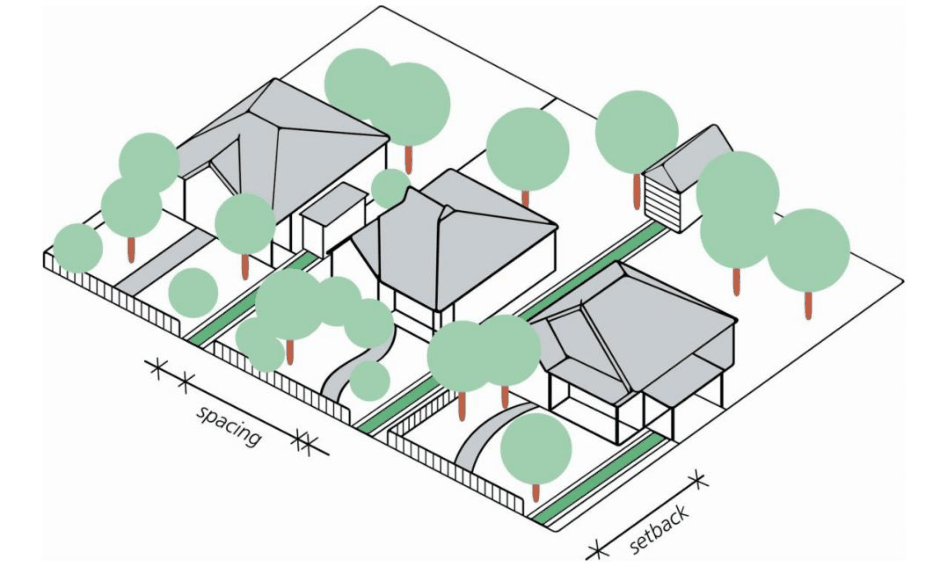

> [Picture on page 25: a picture, saved as a picture (images/part-03-general-development-controls-page-25-1.gif, 150 dpi).]

Figure 3.2:  Respect context – established patterns of setbacks, dwelling spacing, landscape character, parking and fencing

#### Alterations and Additions

#### Objectives

1\. Protect heritage significance by minimising impacts on the significant elements of heritage items.

2\. Encourage alterations and additions which are sympathetic to the building’s significant features and which will not compromise heritage significance.

3\. Ensure that materials, alterations and additions respect the scale, form and massing of the existing building.

#### Controls

A. Avoid changes to the front elevation - locate new work to the rear of, or behind the original building section. B. Design new work to respect the scale, form, massing and style of the existing building, and not visually dominate the original building. C. The original roof line or characteristic roof elements are to remain identifiable and not be dwarfed by the new works. D. Retain chimneys and significant roof elements such as gables and finials where present.

E. Ensure that the new work is recognisable as new, “blending in” with the original building without unnecessarily mimicking or copying F. Complement the details and materials of the original roof including ridge height and slopes without compromising the ability to interpret the original form. G. New materials are to be compatible with the existing finishes.  Materials can differentiate new work from original building sections where appropriate, for example by the use of weatherboards where the original building is brick or by the use of “transitional” materials between old and new. H. Retain front verandahs.  Reinstating verandahs, and removing intrusive changes is encouraged, particularly where there is physical and/ or historic evidence.

#### Adaptation of Heritage Buildings or Sites

Adaptation of heritage buildings or sites (or also known as adaptive reuse) can provide the necessary viability for the continued use and maintenance of heritage buildings or sites.

Accommodating a new use should involve minimal change to significant fabric in order to protect heritage significance. Elements or artefacts from the original use (where present) may be required to be retained to assist interpretation.  The Heritage Council of NSW has a publication New Uses for Heritage Places – Guidelines for the Adaptation of Historic Buildings and Sites that will be of assistance when considering adaptive reuse of heritage buildings.

#### Objectives

1\. To encourage heritage items to be used for new purposes that will retain their heritage significance.

2\. To encourage alternative uses where the heritage significance of the item is not compromised.

3\. To avoid only retaining the façade.

#### Controls

A. The adaptive reuse of a heritage item should minimise alterations or interference with significant fabric.  The changes are to enable the continued interpretation of the original use. B. Ensure that new services are sympathetically installed especially where upgrading is required to satisfy fire or BCA requirements. C. Adaptive reuse for public/commercial purposes should consider opening up the interior of the building to promote multiple viewpoints for interpretation.

#### Change of Use

#### Objectives

1\. To recognize that the form and character of Heritage Conservation Areas are influenced and affected by the use of individual sites within the Heritage Conservation Area.

2\. To preserve the form, character and function of Heritage Conservation Areas.

3\. To ensure that changes of use in Heritage Conservation Areas do not create incompatibility or conflicts with their heritage character or values.

#### Controls

A. Proposals seeking consent for change of use within a Heritage Conservation Area must demonstrate that the proposed change is not likely to create incompatibility or discordance over time with the heritage character or heritage values of the Heritage Conservation Area, or with individual heritage items. B. The applicant’s assessment of compatibility of the proposed development with the Heritage Conservation Area must include details of all proposed physical changes to the site and to existing development resulting from the proposed change of use, including but not limited to changes in vegetation, signage, colours, materials and the like.

#### Demolition

Demolition is considered a last resort for heritage items and contributory items within heritage conservation areas. Also refer to Section 3.1.3 above for details of application and information requirements.

#### Objectives

1\. To conserve both individually listed Heritage Items and the general building stock which contributes to the significance of the Heritage Conservation Area and to ensure that replacement development enhances the significance of the Heritage Conservation Area.

#### Controls

A. Significant properties, including heritage items and contributory items must be retained B. Proposals for demolition will not be considered if there is a reasonable possibility for adaptive reuse of the site. C. Consent will not be granted to demolition or partial demolition unless Council has considered the future development of the site.

#### Subdivision

#### Objectives

1\. To retain the development and historic subdivision pattern of the Heritage Conservation Areas including their characteristic rhythm and spacing of built form.

2\. To retain significant curtilages, views and vistas and landscape elements associated with individual heritage items that may be lost through subdivision.

#### Controls

Subdivision of land must comply with the minimum allotment size requirements of the LEP and with this heritage design chapter. Subdivision applications for land either in the vicinity of, or on which heritage items are situated, or in conservation areas are required to be accompanied by adequate plans, showing the building envelopes, siting and setbacks of the proposed buildings, that must demonstrate to Council’s satisfaction that:

A. The allotment and building spacing, including frontage widths, side and front boundary setbacks must not impact adversely on vistas and views to and of heritage items and Heritage Conservation Areas.  In particular, the principal elevations of buildings must not be interrupted or obscured. B. The setting of a heritage item and a satisfactory curtilage, including important landscape and garden elements, must be retained. C. The subdivision must not require rearranged vehicular access and car parking (on or off the site of the proposal) that would adversely affect the principal elevation of the heritage item or components of a Heritage Conservation Area. D. Landscape quality of the streetscape in Heritage Conservation Areas must be retained. E. The contours and any natural features of the site have been retained and respected. F. Subdivision must comply with the minimum allotment size requirements for Goulburn Mulwaree LEP 2009. G. The essential qualities of the streetscape and building style(s) on which the locality’s heritage depends, are preserved in the new development. H. Subdivision applications for land either in the vicinity of or on which Heritage Items are situated or in Heritage Conservation Areas are required to be accompanied by adequate plans, showing the building envelopes, curtilage siting and setbacks of the proposed buildings. I. The subdivision plan must be prepared by a registered surveyor and must show the exact dimensions of the proposed subdivision lots and the location of the heritage item.

#### Corner Allotments

#### Objectives

1\. To ensure that the characteristics of the conservation area or heritage item are considered from both streets.

#### Controls

A. Both street frontage elevations must be considered on corner allotments as shown in Figure 3.2 below. B. Significant parts of the original building must be retained, including main frontage and side frontage; C. The scale of additions and alterations must respect the existing ridge or eaves heights; D. Where additions are attached, detailing including finishes and materials must be appropriate to the original; E. Where additions are detached or commercial development is proposed, contemporary solutions must respect the scale, bulk and detailing of the original without poor mimicry; F. Car parking must be located to the rear of the secondary street frontage. Double garages forward of the building line are not acceptable; G. Fencing to the secondary street frontage must not exceed 1800mm in height; H. Landscaping is required to both street boundaries, and a landscaping concept plan is required with the submission of a development application; and I. New development must be located to minimise impact on existing prominent trees.

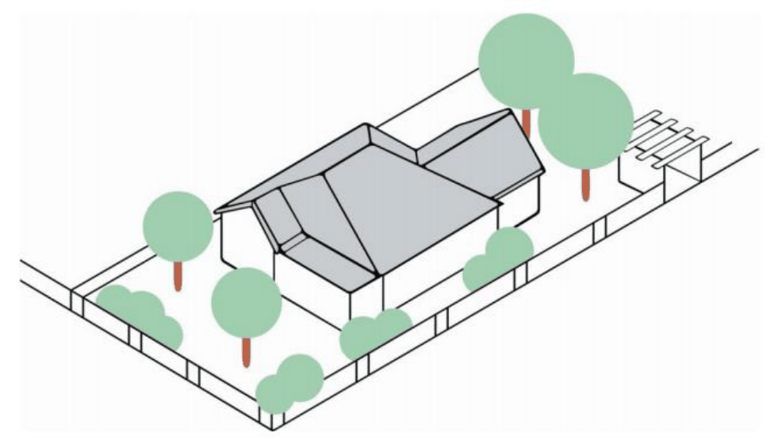

> [Picture on page 30: a picture, saved as a picture (images/part-03-general-development-controls-page-30-1.gif, 150 dpi).]

Figure 3.3:  Both Street frontage elevations muse be considered on corner blocks

#### Development in the Vicinity of a Heritage Item

Development in the vicinity of a heritage item can have an impact upon the heritage significance of the item, in particular through impacts on an items context or setting. Determining whether a property is within the context or setting of a heritage item is a necessary component of the site analysis for any proposal. Advice from Council’s heritage advisor may be required to determine

this. The analysis should consider historical property boundaries, significant vegetation and landscaping, archaeological features and significant views.

#### Objectives

1\. To ensure that new development achieves a sympathetic relationship with nearby heritage items in terms of scale, massing, character, setback, orientation, materials and detailing.

2\. To ensure that any new development respects the established streetscape, and the patterns of development in the vicinity of the heritage item.

3\. To ensure the careful siting of new development retains the significance, integrity and setting of the heritage item.

4\. To retain views and vistas from and to heritage items.

#### Controls

A. Development on land adjacent to, or within the vicinity of a heritage item should not detract from the identified significance or setting of the heritage building or the heritage conservation area. B. Where development is proposed adjacent to or within the vicinity of a heritage item, the following matters must be taken into consideration:

1\) The character, siting, bulk, scale, height and external appearance of the development;

2\) The visual relationship between the proposed development and the heritage item;

3\) The potential for overshadowing of the adjoining heritage item;

4\) The colours and textures of materials proposed to be used in the development;

5\) Maintenance of original or significant landscaping;

6\) The landscaping and fencing of the proposed development;

7\) The location of car parking spaces and access ways into the development;

8\) The impact of any proposed advertising signs or structures;

9\) the interpretation of any archaeological features associated with the heritage item;

10\) The maintenance of the existing streetscape, where the streetscape has significance to the heritage site including impact on grassed verges in the road reserve;

11\) The significance or integrity of any archaeological remains;

12\) The impact the proposed use would have on the amenity of the heritage site; and

13\) The effect the construction phase will have on the well-being of a heritage building. C. Development in the vicinity of a heritage item should give strong regard to any significant views to and from the heritage item and any public domain area. D. Where subdivision is proposed in the vicinity of a heritage item, the impact of future development of the lots should be considered. E. Any new development should:

1\) Complement not compete with the elements that contribute to the uniqueness and heritage significance;

2\) Not overshadow or impede existing views;

3\) Not visually dominate, compete or be incompatible with the form of the heritage item;

4\) Be contemporary in design, however the scale, form, bulk and detail of the proposal must not detract from the scale, form, unity, cohesion and predominant character of the heritage item;

5\) Avoid making a replica copy of a heritage item; and

6\) Be kept simple and must not use a mixture of features from different eras or add heritage features to new buildings.

#### Dual Occupancies / Secondary Dwellings

#### Objectives

1\. To retain the traditional relationship between heritage items or Heritage Conservation Areas and the original subdivision lot pattern and character.

2\. To ensure that heritage items are not dwarfed by new additions or new development.

#### Controls

A. Dual occupancy development on lots that were originally intended to contain a single dwelling house must not create adverse impacts on the traditional relationship between a heritage item and the original lot boundaries, setbacks and characteristics. B. Dual occupancy development on lots that were originally intended to contain a single dwelling house must not dwarf a heritage item, nor compromise its heritage values. C. Applications seeking consent for subdivision of lots on which there is a heritage item or in a Heritage Conservation Area must include full details of proposed future development on the land, together with an assessment of potential impacts on heritage values.

Note:  Council is unable to approve a subdivision of a lot on which development for the purposes of a Secondary dwelling has been carried out.

#### Multi Dwelling Housing Developments

#### Objectives

1\. To ensure that multi-dwelling residential development will be consistent with the existing density, form, scale, architectural and streetscape character of the conservation area and/or heritage item.

#### Controls

A. Building bulk is to be minimised through separating out garages under a different roof form, following natural ground levels to avoid abrupt changes of level, and separating large floor areas into separately roofed areas. B. The first (or leading) unit in a group is to face the primary street frontage and its design should be compatible with the adjoining streetscape. C. Adequate visual and sound privacy between units achieved by brick party walls between semi-detached units and by having windows that do not face each other. D. Proposals for multi dwelling housing near heritage items or within heritage conservation areas should include:

1\) A detailed landscape plan showing fencing, plant species, paving and plot sizes;

2\) A schedule of materials and finishes;

3\) Scale and form of adjoining development should be reflected in housing design;

4\) Show consistency with ground contours;

5\) Reflect vertically proportioned traditional window types;

6\) Steep pitched roofs;

7\) Address the street;

8\) Separate garage roofing;

9\) Simple verandah forms; and

10\) Not imitate heritage elements.

#### Signage and Advertising

#### Objectives

1\. To ensure that new signage is visually sympathetic or contributory to the heritage character of the streetscape.

2\. To ensure that inappropriate signage or advertising does not detract from the significance of the heritage item or Heritage Conservation Area through inappropriate design, location, colour or scale.

#### Controls

A. Commercial advertising banners and placards are prohibited. B. Business signs must be designed to complement the visual quality of the building or conservation area streetscape. C. Signs must not have an adverse impact on the heritage character of buildings or conservation area. D. Business signs on fascia, verandah beams or awnings must be no larger than the fascia. E. Signs should be of colour and lettering appropriate to the period style of the building (Figure 3.4). F. Subdued colours should be used and signs should be spot lit instead of self-illuminating. G. Also refer to Section 6.4 Advertising and Signage which provides details in relation to signage.

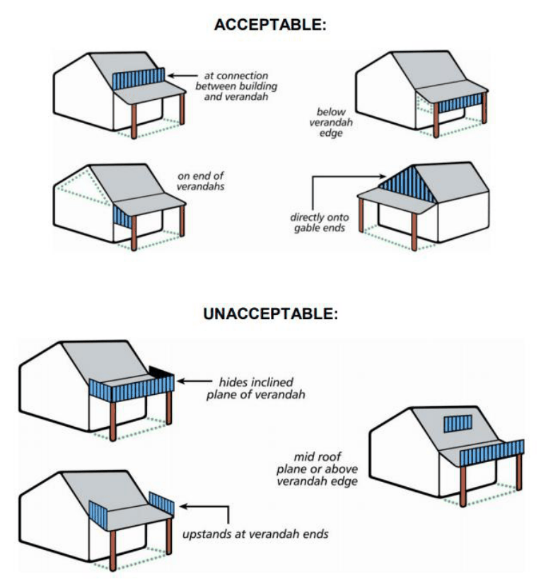

> [Picture on page 34: a picture, saved as a picture (images/part-03-general-development-controls-page-34-1.gif, 150 dpi).]

Figure 3.4:  Acceptable and unacceptable placement of signage and advertising

> [Picture on page 35: a picture, saved as a picture (images/part-03-general-development-controls-page-35-1.gif, 150 dpi).]

> [Picture on page 35: a picture, saved as a picture (images/part-03-general-development-controls-page-35-2.gif, 150 dpi).]

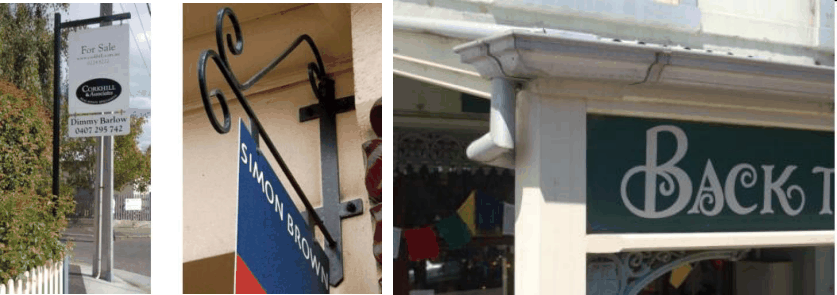

> [Picture on page 35: a picture, saved as a picture (images/part-03-general-development-controls-page-35-3.gif, 150 dpi).]

Figure 3.5:  Good Examples of signage on heritage buildings and in heritage areas

#### Building Materials, Colours and Finishes

It is important to use the right materials, colours and finishes to maintain the integrity and character of heritage buildings and streetscapes.

#### Objectives

1\. To ensure that the selection of building materials, colours and finishes are based on an understanding of the original building finishes and maintains heritage integrity and character.

2\. To avoid the use of colours that are inappropriate or incompatible with the heritage character.

3\. Ensure colours are consistent and harmonious in the streetscape.

4\. To ensure that new development has a level of detail which is appropriate to its context.

5\. To ensure that new development has regard to the architectural character and style of the Heritage Item and setting but does not incorporate elaborate new detailing in a period style that would prevent interpretation of what is original and what is new.

6\. Finishes employed in new development should be selected with regard to the significance and character of the Heritage Item and the likely impact of that proposed work.

#### Controls

A. Restoration or reinstatement works should:

1\) Use matching materials when repairing fabric or external surfaces;

2\) Use traditional construction methods where the quality of restoration or reinstatement is more desirable;

3\) Colour schemes are to reflect the period and detail of the property (Figure 3.5);

4\) Not paint or render face brick, stone, tiles or shingles;

5\) Ensure the form and materials of principal elevations must not be altered, unless it is associated with acceptable reconstruction or restoration works;

6\) Not include new decorative detailing unless documentary or physical detail indicates it once existed;

7\) Use matching bricks, where they cannot be matched, contemporary materials may be appropriate, particularly on rear elevations; and

8\) Not use textured paint finishes.

B. New work should:

1\) Adopt a simple character which uses external finishes, colours and textures which complement the heritage fabric, rather than mimic inappropriate heritage decoration and/ or detailing;

2\) Select materials to be compatible, but not necessarily matching the materials of the building;

3\) Use materials that complement the period and style of the heritage item;

4\) Employ finishes that are compatible with the heritage significance and character of the heritage item they adjoin or of development in the street or Heritage Conservation Area; and

5\) Use traditional colour schemes and contrasting tones for alterations and additions.

> [Picture on page 38: a picture, saved as a picture (images/part-03-general-development-controls-page-38-1.gif, 150 dpi).]

Figure 3.6:  Examples of Heritage Colours 1820-1940

Note:  Equivalent colours from other manufacturers may be used.  Art Deco requires a different colour palette.  Colours should be specified by manufacturer.  This figure is not an endorsement of any paint manufacturer.

#### Building Form, Scale and Style

#### Objectives

1\. To ensure that the scale of new development is sympathetic to the streetscape and does not dominate or compete with existing heritage items, nor reduce their contribution and importance to their context.

2\. To ensure that the style and form of new development does not destroy the historical pattern of development and respects the architectural character and style of the heritage item or conservation area.

3\. To ensure that new development acknowledges any dominant massing and form of the Heritage Item or Heritage Conservation Area, and is in sympathetic with existing significant fabric and form, and with the surrounding streetscape; and

4\. To ensure that the form of new development is compatible with or complements the heritage significance of its context.

5\. To ensure that new development respects the proportions of elements of existing heritage fabric.

#### Controls

A. The scale (including height, bulk, density and number of storeys) of the new work must relate visually to the scale of adjacent buildings which are Heritage Items or are located in a Heritage Conservation Area.  In this regard, unless it can be clearly demonstrated that greater scale would be appropriate in the individual circumstances, new buildings and additions are to be of the same scale as the surrounding development. B. New developments should avoid overshadowing of existing heritage items or contributory architecture. C. Extensions must not visually dominate or compete with the original scale of the existing buildings to which they are added or altered. D. New buildings must not visually dominate, compete with or be incompatible with the scale of existing buildings of heritage significance or contributory value either on the site or in the vicinity of the proposal. (Figure 3.6) E. New buildings and extensions should have a similar massing, form and arrangement of parts to existing buildings of heritage significance in any Heritage Conservation Area. See Figure 3.7 for development that does not respect the massing and form.

F. New work and extensions should respect the proportions of major elements of significant existing fabric including doors, windows, openings and verandahs. (Figure 3.8) G. More specifically:

1\) Where buildings or dwellings are single storey, second storey additions are not encouraged;

2\) Creation of attic space within the existing roofline is preferred;

3\) Existing rooflines may be extended to the rear and dormers may be added to the extension, provided development does not impact negatively on the streetscape and the character of the house. In particular, the roof silhouette should remain; and

4\) Additions at the side of the house may be acceptable providing it is setback a minimum of 5 metres from the front building line and softened by planting and vegetation.

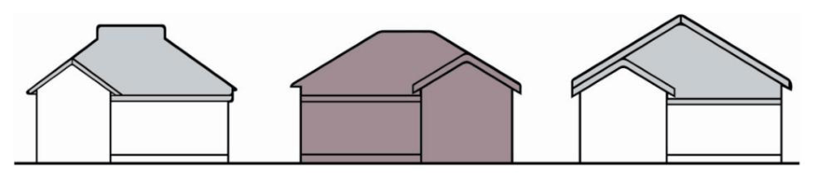

> [Picture on page 40: a picture, saved as a picture (images/part-03-general-development-controls-page-40-14.gif, 150 dpi).]

Figure 3.7:  Pattern of harmonious scale consistent with surrounding development

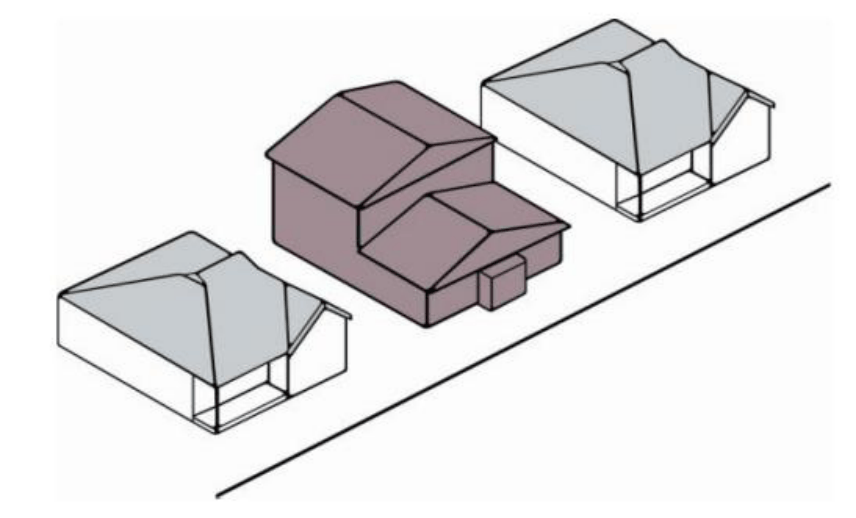

> [Picture on page 40: a picture, saved as a picture (images/part-03-general-development-controls-page-40-16.gif, 150 dpi).]

Figure 3.8:  This example does NOT respect the massing and form of surrounding buildings

> [Picture on page 41: a picture, saved as a picture (images/part-03-general-development-controls-page-41-2.gif, 150 dpi).]

> [Picture on page 41: a picture, saved as a picture (images/part-03-general-development-controls-page-41-3.gif, 150 dpi).]

Figure 3.9:  Existing pattern of simple cottages versus new development that does not respect the existing pattern by selecting windows that are out of proportion and adding an over-scaled finial to the gable.

#### Roof Form and Chimneys

The pitch and form of a roof has a major effect on the overall appearance of a building and has a strong relationship to its proportions.  The style of the roof will have an important bearing on whether or not a new building fits comfortably within an existing streetscape in a conservation area or near a heritage item.

#### Objectives

1\. To retain the characteristic scale and massing of roof forms of heritage Items and within Heritage Conservation Areas.

2\. To ensure that the original chimney elements are retained and any new roof elements relate to the existing heritage fabric of the heritage item or component of a Heritage Conservation Area.

#### Controls

A. Maintain traditional roof forms and materials. B. Use appropriate profile gutters in the maintenance of older buildings.  Quad, half round and ogee gutters are the most appropriate profiles, depending on original details. Perforated box gutters are not appropriate in a historical context. C. Roofs of extensions should be carefully related to the existing roof in materials, shape and pitch.  Replacement materials must match the existing in colour, materials, finish and details.  (Figure 3.9) D. all chimneys must be retained internally and externally and where necessary repaired, even if the fireplace is no longer used.  Demolition of chimneys is not favoured unless necessary for structural reasons. E. Minimise large, blank areas of roofing in new developments to reduce the impact on the existing building and adjoining properties. F. New buildings must have roofs that reflect the orientation, size, shape, pitch, eaves, ridge heights and bulk of existing roofs in the locality, and must be in proportion with the proposed building. G. Attic rooms must use compatible roof forms that retain the streetscape appearance of the existing building and must not adversely affect significant views or vistas. H. Skylights or other structures attached to the exterior of the roof should avoid being located where visible from the street or on the principle elevation of buildings.

Note: Despite the above, Council may consider a development application for replacement of an existing iron roof where the application demonstrates that the replacement will be consistent in colour, design and character with the existing roof.

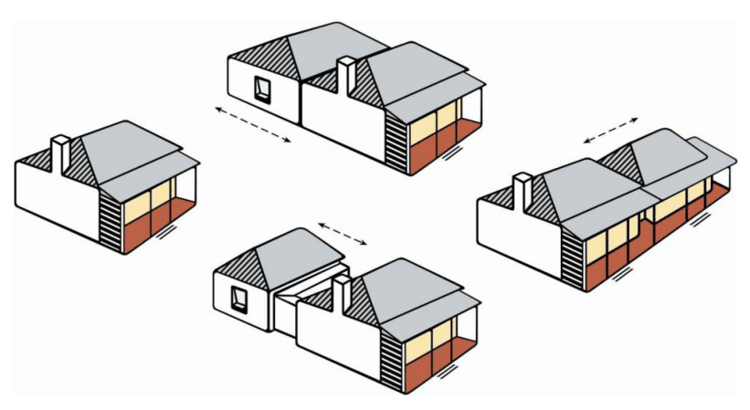

> [Picture on page 42: a picture, saved as a picture (images/part-03-general-development-controls-page-42-24.gif, 150 dpi).]

Figure 3.10:  Suitable options for extending an original building

#### Verandahs

Verandahs have a functional purpose as well as an aesthetic one, being useful in climate control as well as providing sheltered outdoor space.  The incorporation of verandahs into the design of new buildings helps integrate the building with the existing built character of historic precincts.

#### Objectives

1\. To ensure that original verandahs or verandah elements are retained and that any new verandah elements relate to the proportions and scale of the existing heritage fabric of the heritage item or component of a Heritage Conservation Area.

#### Controls

A. Removal of verandahs is not favoured and maintenance or reconstruction of original detail is encouraged. B. In altering existing buildings, original verandahs must be kept, repaired and respected. Additional verandahs must not compete with the importance of the original and should be simple in design. C. Enclosed verandahs should be opened up where feasible, and missing details reinstated. However in some cases the verandah infill may itself have heritage or aesthetic value and the removal of the infill may not be appropriate.  These cases must be justified in any application. D. The reconstruction of verandahs which once existed and whose detail is known is also encouraged.  Where the form of the verandah survives but the details are missing, these can be reinstated if known from documentary evidence such as photographs or original drawings. E. New development should include verandahs where consistent with the character of surrounding development.  Simple skillion verandahs may be appropriate as this style integrates well with new buildings. F. Features such as bullnose style, lace ironwork, decorative fretwork or Federation brackets on posts must not be introduced on modern buildings, as these features lack historical context. G. The infilling of front and side verandahs is generally not encouraged, although infilling verandahs at the rear of houses may be appropriate.

#### Windows and Doors

Window and door proportions have a major impact on the individual character of a building and its relationship with neighbouring buildings, and are also very important in the design of a new extension or infill development.  Many heritage buildings have double-hung timber framed windows which provides a strong vertical element to the window proportions.

#### Objectives

1\. To ensure that original windows and doors or window and door elements are retained and where new elements occur that the character and patterns of door and window openings and their construction are clearly related to the proportions, placement, character and scale of the existing heritage fabric.

#### Controls

A. original doors and windows must be retained and repaired/restored.  Authentic reconstruction of similar material to the original is encouraged where repair of the original doors and windows is not possible. B. Original leadlight and coloured glass panes must be kept. C. New doors and window openings must reflect the existing style, size, proportion, position and where possible must match sill and head heights of existing doors and windows. D. in new buildings they must be compatible with the proportions, position and size of those typical of the locality.  Vertical proportions should be featured in window design. (Figure 3.11) E. Timber windows should be used for restoration of traditional buildings.  Modern aluminium-framed windows are not acceptable.

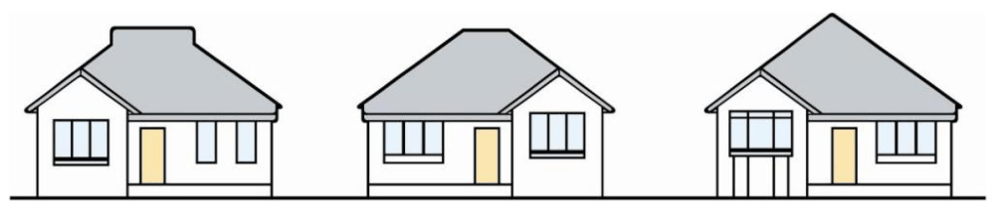

> [Picture on page 44: a picture, saved as a picture (images/part-03-general-development-controls-page-44-24.gif, 150 dpi).]

Figure 3.11:  Traditional window and door examples with vertical proportions

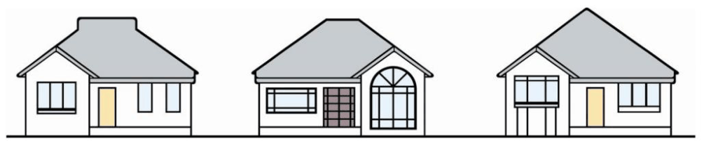

> [Picture on page 45: a picture, saved as a picture (images/part-03-general-development-controls-page-45-1.gif, 150 dpi).]

Figure 3.12:  Existing pattern of simple cottages with vertically proportioned doors and windows versus new development that does not respect the existing pattern, with uncharacteristic arched window and double leaf door.

#### Facades

#### Objectives

1\. To retain the existing façade, fabric, scale and massing and character of original development, in terms of the proportions of façades;

2\. To ensure that new development does not disturb or reduce the importance of original verandahs or façades; and

3\. To ensure new verandahs and façades do not conflict with the heritage significance or significance of the place or building.

4\. To break up visually long facades using vertical elements.

5\. To avoid tilt slab construction with blank, flat or minimal moulding.

6\. To respect traditional town development with individual shopfront separation.

7\. To avoid blank window panels that are used as advertising panels to ensure streetscape is not overwhelmed.

#### Controls

A. Two storey façades must only be used where surrounding development is of a predominantly two storey scale. B. Limit bay widths to match those of surrounding significant development. C. Alteration of the form and materials of principal elevations is not appropriate. Removal of the external skin or rendering of exterior walls is not appropriate unless associated with acceptable reconstruction works. D. In altering existing houses, original sunhoods, blinds, awnings and skirts to principal elevations should be retained and repaired. Authentic construction or reconstruction is supported. E. In altering existing buildings, original verandahs / façades are to be retained and restored.

F. New buildings must take into account the significance and design of verandahs / façades in the locality, the methods of their incorporation in building designs and their harmonising role in streetscapes. (Figure 3.12) G. Alteration to original façades which are of heritage significance is not supported. H. The proposed works are to be sympathetic to and/or not detract from the style, character and significance of the building and place. Designs, whose massing, details, materials and colours reflect the type of façade historically used in each locality, without insistence upon replication, are encouraged. I. Avoid blank exteriors by avoiding tilt slab construction and encouraging staggering of the façade through vertical elements =. J. Retain and repair/restore original shopfronts. Authentic reconstruction is encouraged. Original timber and metal shopfront framing must be retained (Figure 3.13). K. Use active shopfronts to the street to activate the footpath and create interest. L. Provide details of materials, finishes, profiles and colours for façades including any proposed signage.

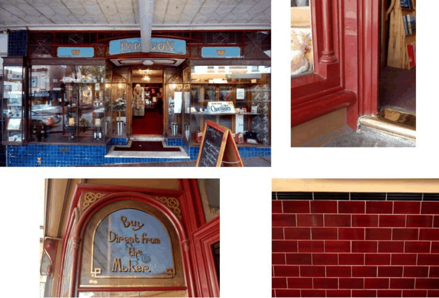

> [Picture on page 46: a picture, saved as a picture (images/part-03-general-development-controls-page-46-16.gif, 150 dpi).]

Figure 3.13:  Shopfront examples - Style elements include retention of original details such as ceramic tiles, symmetrical layout, ornamental timber joinery, decorative signage on glazing, retention of original shopfront framing.

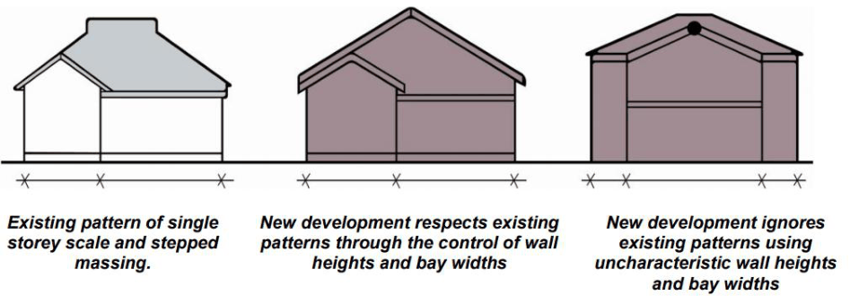

> [Picture on page 47: a picture, saved as a picture (images/part-03-general-development-controls-page-47-1.gif, 150 dpi).]

Figure 3.14:  Example of new development not respecting pattern of existing façades

#### Parking – Garages and Carports

#### Objectives

1\. To allow for reasonable on-site car parking while retaining the character and significance of the heritage item or Heritage Conservation Area.

2\. To ensure that car parking facilities (such as garages, carports and driveways) are designed to be compatible with the heritage environment, do not have an adverse visual impact on heritage streetscapes and are visually discreet.

#### Controls

A. The introduction of car parking must not impact on the setting or character of the heritage item or Heritage Conservation Area. B. Early garages, carports and sheds must be retained wherever possible as they contribute to the character of heritage items and Heritage Conservation Areas. C. Garages and carports should generally be kept separate from the house.  Attachment of garages and carports to the buildings they service is generally not favoured unless the structure is located at the rear of the building and is not visible from the surrounding streets, or it is set well back from the front façade and unobtrusively attached.  In those cases a simple carport under a continuation of the roofline may be appropriate. D. Garages and carports must be of a simple design, must use traditional pitched roof forms and must match the roof pitch, form and materials of the main building as closely as possible.  The design must respect vertical proportions.  Double width horizontal doors are unacceptable.  Garages and carports must not dominate existing buildings on site (Figure 3.15). E. Prefabricated metal sheds with low-pitched roofs are not appropriate, as they are incompatible with traditional streetscapes.

F. The location of car parking must respect the existing vegetation and original garden layouts on the site. G. In relation to access:

1\) Existing rear lane access is to be utilised in preference to front access;

2\) Existing side vehicular access is to be utilised;

3\) Driveways are to be to side boundaries and not central; and

4\) Development which removes existing access must not preclude future carports or garages behind the building line.

H. In relation to location:

1\) Open stand car spaces may be provided forward of the building line;

2\) Garages and carports are to be located behind the building alignment wherever physically possible; and

I. In relation to scale:

1\) Maximum width of a driveway at street frontage is to be 3.5m;

2\) Garages and carports are to occupy no more than 20% of street frontages (Figure 3.15) ;

3\) Carparking structures should be diminutive in scale in relation to the residence; and

4\) Structures forward of the building line must be designed to minimise their bulk with a maximum eaves heights of 2400mm. Flat roof structures of sympathetic materials and detail are acceptable.

J. In relation to appearance:

1\) Materials, form, and details of car parking structures are to harmonise with and be subservient to the residence;

2\) A similarity in colour of garage doors and wall surfaces may reduce impact to street and therefore is favoured;

3\) Structures forward of the building line must be screened with vegetation; and

4\) Garage doors and structures are to be recessed behind the primary façade to create a shadow line.

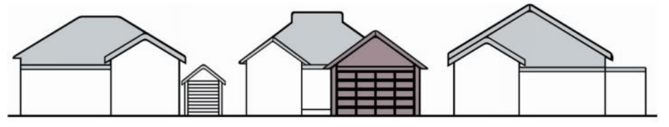

> [Picture on page 48: a picture, saved as a picture (images/part-03-general-development-controls-page-48-30.gif, 150 dpi).]

Figure 3.15:  Dominance of garages (especially double) can destroy and dominate a heritage streetscape

#### Fences

#### Objectives

1\. To provide or retain fencing which contributes to the heritage significance of the heritage item or Heritage Conservation Area, defines public and private spaces and complements the overall character of the streetscape.

2\. To provide fencing that reinstates the original form of fencing, that is consistent with and does not detract from the established patterns of the street.

#### Controls

A. Original fencing and gates must be retained.  If fences and gates are in good condition they can be maintained; if not they can be reconstructed with new, matching elements. Any good sections of the old fence should be integrated. B. New fencing on heritage properties must be of a traditional design, with modest height and not solid in order to allow views of the garden and front of the building.  The design may be based on photographic evidence, or if this is not available, the design must be appropriate to the age and style of the house.  (Figure 3.16) C. New fencing must be consistent with traditional fences in the streetscape. D. On new developments simple fencing styles that harmonise with the heritage streetscape may be appropriate. E. New fencing must respect the traditional hierarchy of fences for the front, side and rear boundaries. F. Fence heights must be consistent with the heights of the predominant fences in the street.  Generally height should be 1.2m forward of the front building setback, and 1.8m elsewhere. G. Metal panel fences, spear tops, and aluminium lace panels are generally inappropriate in the heritage environment. Refer to Figure 3.17 for examples of suitable fencing.

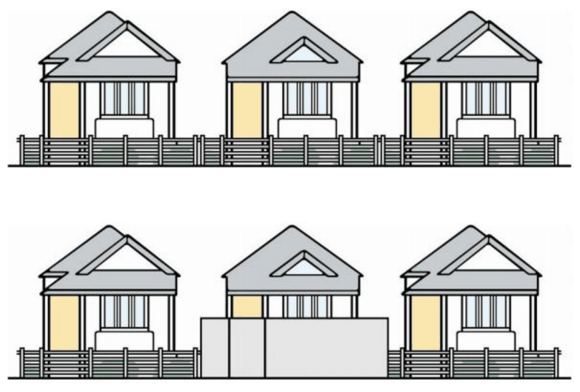

> [Picture on page 50: a picture, saved as a picture (images/part-03-general-development-controls-page-50-1.gif, 150 dpi).]

Figure 3.16:  High and solid fencing destroys the harmony of the streetscape and precents views of the dwelling and front garden

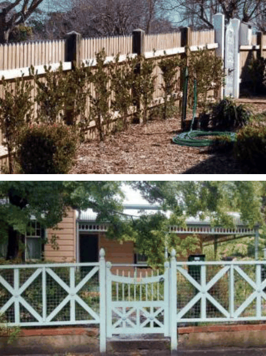

> [Picture on page 51: a picture, saved as a picture (images/part-03-general-development-controls-page-51-1.gif, 150 dpi).]

Timber Picket

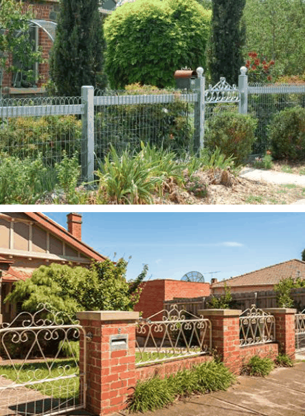

> [Picture on page 51: a picture, saved as a picture (images/part-03-general-development-controls-page-51-3.gif, 150 dpi).]

Ornate Timber - Federation

Woven Wire & Post and Rail

Brick and Iron – Californian Bungalow

Figure 3.17:  Examples of suitable fencing options

#### Outbuildings and Pools

#### Objectives

1\. To ensure that outbuildings and swimming pools do not detract from the heritage significance of the heritage item or Heritage Conservation Area through inappropriate siting, excessive scale, bulk or visibility.

#### Controls

A. Swimming pools and additional shed space must be positioned to respect the setting and spaces around buildings and the original garden layouts of the heritage item or the components of a Heritage Conservation Area.  Generally they should be located at the rear of properties. B. Swimming pool safety fencing must be located where it will be screened from public

view.  Landscaping must be provided where it is important to soften the impact on a heritage item. C. The proposed structure must be well integrated with its site and surrounds, and where appropriate the design must include landscaping such as screening or planting of species appropriate to the heritage character of the locality. D. Significant outbuildings that may form part of a historical curtilage must be retained where feasible.

#### Gardens

#### Objectives

1\. To encourage the retention and enhancement of the garden setting.

2\. To ensure new gardens reflect the character of existing gardens.

3\. To conserve original garden elements and layouts

#### Controls

A. Keep hard surfaces to a minimum. As a guide, 70% of the area forward of the building line should be soft landscaped. B. Screening of hard surfaced areas with vegetation is encouraged. C. Garden structures are to be appropriate to primary buildings in terms of scale, style, and materials. D. Retain all mature or semi-mature plantings in the front and side gardens. E. Hedges along front and side boundaries (forward of building line) should be maintained at not more than 1200mm in height. (Figure 3.18) F. Ensure historic trees and vegetation are retained, where not a danger. G. New development should:

1\) Include a front garden with lawn, shrub and tree elements;

2\) Limit hard paving to only paths and driveways; and

3\) Use simple fencing that complements the streetscape and architectural features of the area.

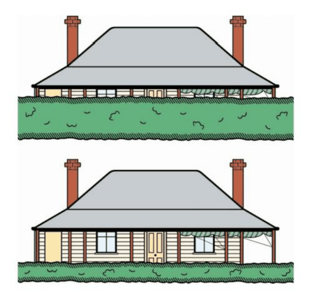

> [Picture on page 53: a picture, saved as a picture (images/part-03-general-development-controls-page-53-5.gif, 150 dpi).]

Figure 3.18: Soft landscaping should not hide contribution to streetscape.  Hedges should be limited to 1200 maximum height on main frontages.

#### Non-Indigenous Archaeology

Due to the extensive history of Goulburn Mulwaree LGA and the changes that have occurred over time, it is important to consider the potential for archaeological deposits and relics that may be on a site, not only for Aboriginal / Indigenous heritage but also for non-Indigenous / European heritage.  This section includes objectives and controls relating to archaeological assessment requirements.

#### Objective

1\. To provide for the consideration of impacts on non-indigenous archaeology from proposed development within the Goulburn Mulwaree LGA.

#### When is an Archaeological Assessment Required?

Any development application which proposes the disturbance or development of a heritage item listed as an archaeological site is to be accompanied by an Archaeological Assessment prepared by a suitably qualified and experienced archaeologist and submitted as part of the heritage impact statement or conservation management plan.

Council may also request an archaeological assessment to accompany a development application, if they believe a site is likely to contain archaeological relics or deposits.

#### What is an Archaeological Assessment?

An archaeological assessment is an evaluation of the probable extent, nature and integrity of the site, determination of the significance of the site, and which defines the appropriate management measures for the site having regard to its significance.

The archaeological assessment is to be prepared in accordance with applicable guidelines and information sources published by the NSW Office of Environment and Heritage..

Where the development or disturbance of an archaeological site is proposed, the applicant will be required to liaise with the NSW Office of Environment and Heritage, to ensure any related statutory requirements of the Heritage Act 1977 and subsequent amendments, are complied with prior to the submission of the development application.

Any proposal to disturb or excavate land which will or is likely to result in a relic, deposit or other archaeological remains being discovered, exposed, moved, damaged or destroyed, requires an excavation permit to be obtained from the NSW Office of Environment and Heritage. This applies whether or not the site is listed as an archaeological site under the LEP.

#### Publications

• Historical Archaeology Code of Practice, NSW Heritage Office, 2006

• Revealing the Past: An Introduction to Historical Archaeology, NSW Heritage Office, 2004

• Guidelines for the preparation of Archaeological Management Plans, Heritage Branch, NSW Department of Planning, 2009

• Assessing Significance for Historical Archaeological Sites and ‘Relics’, Heritage Branch, NSW Department of Planning, 2009

• Skeletal Remains – Guidelines for the Management of Human Skeletal Remains under the Heritage Act, NSW Heritage Office, 1998

• Stabilising Stuff – A Guide for Conserving Archaeological Finds in the Field, NSW Office of Environment and Heritage and International Conservation Services, 2012

• Archaeological Assessments, Heritage Council of NSW, 1996

• Excavation of Director Criteria, Heritage Council of NSW, 2011

#### Old Marulan Heritage Conservation Area

#### Definition and Location

Old Marulan is located 31kms east of Goulburn and is located 5km south of the current Marulan Township. No buildings remain in the locality and it is now mainly an area of archaeological importance, including two cemeteries.   The extent of the HCA is shown in Goulburn Mulwaree LEP 2009 and in Figure 3.19 below.

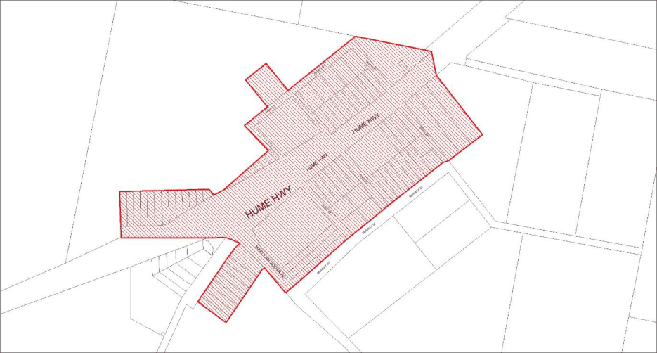

> [Picture on page 55: a picture, saved as a picture (images/part-03-general-development-controls-page-55-11.gif, 150 dpi).]

Figure 3.20:  Old Marulan Heritage Conservation Area

#### Character

Old Marulan was a busy village on the Great South Road, not far from the Wingello Stockade which housed the convicts building the road.  The area is now rural in character which include a series of historic allotments split by the Hume Highway / Motorway.  The area was given a simple design with no side streets and all allotments with frontage to a major road.  It was

unusual as it did not conform to the layout of towns and villages of the time. The layout was altered when expansion occurred in the 1830-40s.

#### History

Marulan, originally known as Mooroowoolen, was developed as a stop along the Great South Road and later the Hume Highway.  It was this road development that determined the location of the settlement and influenced its growth.  Marulan was officially gazetted as a town in March 1835 at the intersection of the road to Bungonia and the Coast and the road to Goulburn Plains. It developed rapidly as a town and by 1836 has a daily mail service to the post office, inn, church stores, school, police station, wheelwright and blacksmiths.

When the railway came through in 1868, the old part of Marulan began to decline in favour of the township near the railway which soon overtook the road as the main transport through the region and the services once provided in the old town relocated to the new area.

#### Statement of Significance

The site of Old Marulan Town is considered to be an outstanding archaeological resource which is able to vividly illustrate unrecorded details of Australian history relating to the form and functions of an early colonial service town, and the way of life of its inhabitants. Examination of the ground surface indicates that the total area of the site contains relics relating to the early occupation of the town. Future archaeological research of the site should result in a wealth of information which is only suggested from surface findings. The significance of the relics and deposits within the land is heightened by the limited period of the towns existence and the subsequent lack of further development of the land. The site therefore is a rare "time capsule" relating to colonial town life from 1835-67 which has suffered minimal contamination from latter phases of use. (From SHI)

#### Positive Characteristics

There are a number of positive characteristics for Old Marulan which reflects its importance as an archaeological area.  These include the following:

• Limited pressure for development;

• Location of two historic cemeteries; and

• Rural nature of the locality.

There are only two items within the HCA that are listed, including the two cemeteries.  Only remnants of other buildings remain.

#### Objectives

The objectives of the HCA for Old Marulan are:

• To protection of the vegetation in the area;

• To ensure any archaeological evidence is protected from development; and

• To maintain and restore the cemetery areas to ensure they are not damaged or destroyed.

#### Controls for Future Development

There are no specific development controls for this area.  Refer to those controls and guidelines within the Goulburn Mulwaree LEP 2009 and Sections 3.1.5 and 3.1.6 of this DCP.

#### Goulburn Central Business Heritage Conservation Area

#### Definition and Location

Goulburn is located 192kms south west of Sydney and includes a large commercial area with associated institutional buildings and residential areas.  The Goulburn Central Business Heritage Conservation Area includes the central business district of Goulburn and is generally bounded by Mulwaree River / Blackshaw Road, Clinton Street, Bradley Street and Cowper Street.  The Heritage Conservation Area (HCA) includes extensive heritage buildings and streetscapes that are significant to the development of Goulburn.  The extent of the HCA is shown in Goulburn Mulwaree LEP 2009 and in Figure 3.20 below.

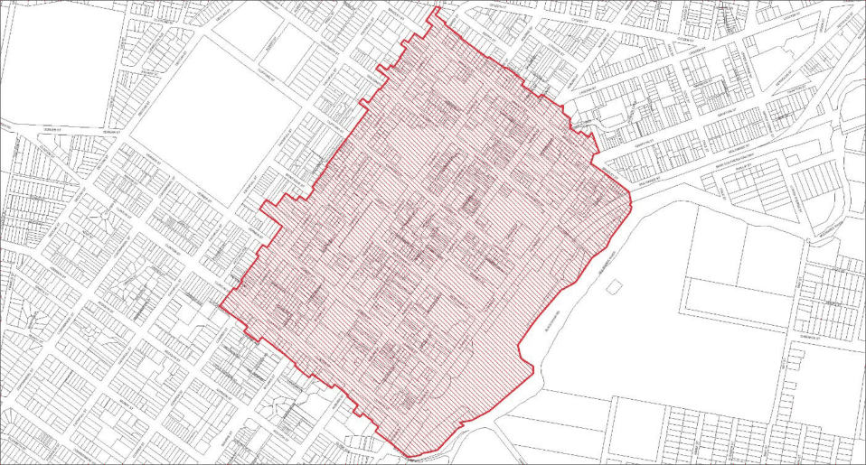

> [Picture on page 57: a picture, saved as a picture (images/part-03-general-development-controls-page-57-19.gif, 150 dpi).]

Figure 3.21:  Goulburn Central Business Heritage Conservation Area

#### Character

The central business area contains a mix of major retail, civic, office and administrative functions of the City of Goulburn as well as a number of ecclesiastical, educational (former) and rail related services.  The road pattern is based on the original grid pattern set out in the development of Goulburn and assists in providing dramatic vistas and view corridors.  The area includes six distinct land use areas which contribute to the existing character including the following:

• Auburn Street commercial area;

• Belmore Park and Civic area;

• Montague Street Offices;

• Southern ecclesiastical group;

• South eastern rail area; and

• North eastern mixed use zone.

The following areas make a lesser contribution to the Goulburn CBD area, including but not limited to, central block car parking, service industries, car sales yards and service stations.

The area’s built environment ranges from 1-3 storeys in height and includes a mix of architectural elements from a variety of eras.

#### History

Little of the built fabric of early Goulburn in the 1840-50s remains today.  The arrival of the railway in 1867 together with the late 19th Century public and private building boom and contemporary development has had a marked impact.

The timeline below from the CBD report shows the history of development for the Goulburn Centre.  There were a number of events that has helped shape how Goulburn developed and appears today.

#### HISTORIC DEVELOPMENT

The CBD has developed around its original planned city centre incorporating a uniform grid subdivision pattern.  The formal axis along Montague Street from Victoria Park through St. Saviours Church to Belmore Park was an important component of the original town plan.

#### TIMELINE

|  | Exploration by Hume, Throsby, |  |  |
|---|---|---|---|
|  | Meehan and Oxley alerted early |  | Period of significant growth in the |
| 1817-1820 | colonists to good grazing potential of the southern highlands Governor Macquarie marked out the new town of Goulburn as a | 1880s | City (1881 Auburn Street Post Office opened) |
| 1828 | key service centre of the southern highlands – built at the confluence of the Wollondilly and Mulwaree Rivers Present city centre laid out on | 1887 | Court House opened Moderate expansion with only minor change. Rail as an |
| 1833 | higher land to the south west to avoid repeated flooding | Early 20th C | employment and development focus diminished with growth in road transport Period of decline with many |
| 1841-1845 | Town population increased from 655 to 1,200 Construction of railway | 1950s > | regional headquarters relocating to Sydney or other regional centres. Hume Highway by-pass. Loss of highway traffic caused a change in business mix but not significant |
| 1868 | completed and physical connection of the City Centre with the river severed | 1992 | loss of business. Council began Main Street Improvement Program to capitalise on new opportunities for public domain improvement. |

Source:  Adapted from figure from Goulburn CBD Plan, Interim report 1, 29 August 2008 Edaw/AECOM

#### Statement of Significance

Defined by the original rectangular grid road system and incorporating the Australia’s earliest inland town settlement, Goulburn’s Central Business area is highly significant as an outstanding example of historic townscape and cultural continuity since the early 1800s.

Goulburn includes a large number of building types dating from the Victorian and Federation periods reflecting the setting and character of Goulburn as an important administrative regional centre of the time. Despite changes to the historic buildings and loss of some significant aspects, particularly verandahs and balconies supported on timber posts over the footpaths, the area

maintains its overall cohesive historic town character. The area’s rich and exceptional historical importance is evident by the large number of heritage items within the centres boundaries.

The area demonstrates a good diversity of building types and styles as development ranged from the Georgian style workers cottages of the early 1850s to the Inter-War commercial buildings and Victorian civic and ecclesiastical buildings.  The significant historic character of the central area has been diminished slightly due to the intrusive, yet reversible, introduction of single-storey and uncharacteristic infill buildings within a consistent two to three-storey continuous streetscape and the removal of traditional verandahs and balconies.

The recent introduced elements including service stations, industrial buildings, corporate establishments and block car parking make no reference to the traditional main street character and architectural styles.  They have detracted from the cohesive streetscapes and urban setting.

The topography of the land within the CBD (as well as in Goulburn City) is defined by a number of ridges and hills that create distinctive views and vistas in the study area and this allows the whole city to be experienced when approached from the north. Tree lined streets in some areas enhance the historical character of the CBD.  (from SHI)

#### Positive Characteristics

There are a number of positive characteristics for the business centre of Goulburn which reflect their contributory nature.  These include the following:

• Original grid form of subdivision and street pattern;

• Relatively intact sections of commercial streetscape with 2-3 storey continuous character;

• Commercial architectural features including vertically proportioned above awning façades and decorative parapets;

• Traditional shop front areas;

• Generally intact housing stock;

• Topography is characterised by small hills and ridges that create distinctive view corridors; and

• Well established and defined public domain areas including parks, street trees, footpaths and grass verges.

The central area also includes some uncharacteristic elements that should be avoided.  These elements include:

• Uncoordinated and unregulated advertising and signage that is out of proportion and not integrated with the building facade can create unpleasant presentation;

• Unsympathetic infill development that is single storey or oversized with an inconsistent streetscape;

• Buildings painted in corporate colours and signage with no regard to building elements, including those of neighbouring or nearby buildings;

• Contemporary buildings that have not been designed with regard to the historic streetscape;

• Overhead wires and antennas in residential or low scale areas; and

• Large vacant areas for car parking, service stations, car yards or similar.

The majority of buildings and places within this area contribute in some form to the heritage character and appeal of the HCA.  Part 8.1 of this Development Control Plan includes a character summary or statement for each street located within the HCA area.  These outline important aspects of streets and landscapes that can be respected or avoided.

#### Objectives

• To ensure the HCA supports a local business centre that can balance development with heritage conservation elements and adaptive reuse of existing contributing buildings.

• To maintain, protect and enhance the city’s built and natural heritage;

• To provide standards and guidelines to improve the image, attractiveness and function of the centre;

• To promote adaptive reuse of buildings that may otherwise be demolished or left in state of disrepair; and

• To attract new development to the centre through tourism and new business options.

#### Controls for Future Development

This section should be read in conjunction with the more extensive development controls included in Sections 3.1.5 and 3.1.6 of this DCP.

| Scale | Generally Storeys FSR | Maintain development similar in scale to existing commercial and residential areas. Maintain consistent main street with 2-3 storeys. Outer residential areas are predominantly single storey uniform streetscapes. Commercial core (B3) – 2:1 and Mixed Use (B4) – 1.5:1 |
|---|---|---|

| Setting / | Subdivision | Maintain original grid form subdivision, including lanes and |
|---|---|---|
| Subdivision |  | rectangular allotments addressing the streets. |
|  | Setbacks | Maintain consistency in setbacks. |
|  | Landscaping | Maintain parks and open space areas. |
|  |  | Streets dominated by street trees. |
|  | Car parking | Limit car parking to rear of developments. |
|  |  | Residential car parking should be low impact and not |
|  |  | dominate the streetscape. |
|  | Front fencing | In residential areas maintain garden settings with low or no |
|  |  | fencing. |
|  | Views | Maintain important views and vistas within and to and from the |
|  |  | city centre. |
| Form / | Roof | Maintain simple roof forms, retain existing chimneys and roof |
| Massing |  | pitches for new development should be at least 27.5 degrees. In commercial areas parapets should dominate roofs. |
|  | Façade | Vertical features above awning facades. |
|  |  | Corner features are important. |
|  |  | Traditional shop windows, with narrow frontages to match |
|  |  | existing / original development. |
|  | Height | Commercial core (B3) – 15m and Mixed Use (B4) – 10m |
| Design | Residential | Street facing prominent gables, hipped or pitched corrugated iron or tile roofs, timber framed windows, front verandahs, asymmetrical façades, and face brick finished. |

#### Goulburn Residential Heritage Conservation Areas

#### Definition and Location

There are three residential localities that surround the central business area and overlap with it in some cases.  These areas are located to the west, south and north of the central business area and provide important support elements.  The extent of the HCA is shown in Goulburn Mulwaree LEP 2009 and in Figure 3.21 below.

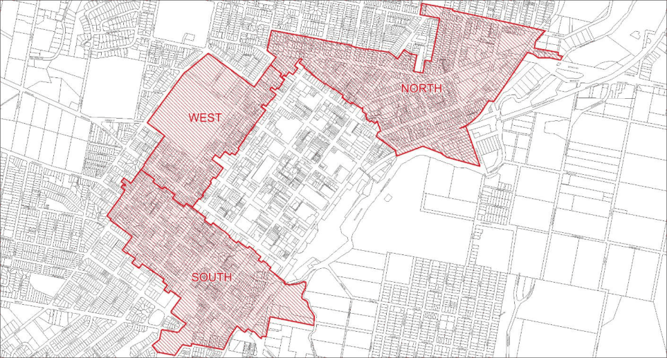

> [Picture on page 63: a picture, saved as a picture (images/part-03-general-development-controls-page-63-1.gif, 150 dpi).]

Figure 3.22:  Goulburn Housing Heritage Conservation Areas

#### Character

These three areas to the north, south and west of the town centre all include predominantly residential elements interspersed with schools, ecclesiastical elements and small scale retail and commercial development.

The Western area, due to the topography, includes a number of grand homes and landscape areas from both the Victorian and Federation periods.  The land rises westwards from the City centre area.  A small number of Georgian buildings remain scattered through the area.  The streets are tree lined with relatively consistent setbacks.

The Southern area past Clinton Street is also residential in character and includes a mix of dwelling styles from the boom of the 1880s / Victorian to the post World War I growth period. The area includes a largely uniform road grid pattern, with a mix of setbacks from being on the street to setback semi-rural dwellings that are oriented northward rather than to the street dating from the Georgian cottage / farmhouse period.  The landscaping in this area is also diverse, with some tree lined streets and some sparse.

The North eastern area includes a mix of residential and commercial development, including the main entrance to the town area, which was part of the Great South Road.  This means there are a number of former two storey inns and other travel type related former buildings including small shops.  The character is mainly determined by small scale, simple Georgian and Victorian

cottages, terraces and semi-detached.  Further north is the original subdivision of Goulburn Township, of which little remains.  It continues the mix of land use for this precinct.

#### History

Apart from the original Goulburn Township which is in North Goulburn, the majority of these areas remained relatively undeveloped until the building boom of the 1880s.  They then continued to develop through the years, with additions around the turn of the century, post- World War I and following World War II, especially with housing commission in the late 1940s.

#### Statement of Significance

Occupying the outer areas of the original centre of Goulburn, these mainly residential areas developed from the 1880s when the building boom in Goulburn commenced and Goulburn was declared a City.

Like the other parts of Goulburn, these areas include a large number of building types dating from the Victorian and Federation periods reflecting the setting and character of Goulburn as an important regional centre of the time. Although there has been loss and changes to a number of the elements within these areas, the rich and exceptional historical importance of the area is still evident though the extensive numbers of heritage items and contributory buildings.

The areas demonstrate a good diversity of building styles from a variety of periods dating from the Georgian style workers cottages of the early 1850s.  The character has been diminished slightly by inappropriate infill development from the 1970s.

The topography of the western area in particular and the wide tree lined streets of the residential area further contribute to the significance of the area.

#### Positive Characteristics

There are a number of positive characteristics for these mixed use areas surrounding the business centre of Goulburn which reflect their contributory nature.  These include the following:

• Original grid form of the subdivision and street pattern;

• Relatively intact residential streetscape;

• Street tree plantings that contribute to the streetscape and character of the areas;

• Traditional shop fronts and former inn developments;

• Generally intact housing stock from a variety of eras;

• Topography, particularly in the western and southern areas, is characterised by small hills and ridges that create distinctive view corridors;

• The remaining topography is relatively flat and view corridors are limited and localised;

• Groupings of ecclesiastical based development; and

• Established public domain areas including parks, street trees, footpaths and grass verges.

The north, west and southern areas also include some uncharacteristic elements that do not contribute to the heritage value of the HCA.  These elements include:

• Impacts of past road widening for former highway development;

• Inappropriate additions and alterations to early buildings;

• Unsympathetic infill development that is not consistent with the streetscape and uses inappropriate materials, colours and finishes;

• Location of industrial and services;

• Contemporary buildings that have not been designed with regard to the historic streetscape;

• Overhead wires and antennas in residential or low scale areas;

• Removal of street trees and other landscaping within the area;

• Lack of maintenance of historic buildings that have led to disrepair and potential requests for demolition; and

• Breaks in built form such as large vacant areas for car parking, service stations, or car yards are uncharacteristic and can detract from the historic built form of the centre.

The majority of buildings and places within these areas contribute in some form to the heritage character and appeal of the HCA.  To ensure the areas maintain the character for which they are known, the controls in Sections 3.1.5 and 3.1.6 should be followed to maintain the landscape and visual appeal.

#### Objectives

• To ensure the HCA permits mixed use development (although the majority of which is residential) that can balance development and conservation sustainably;

• To maintain, protect and enhance the city’s built and natural heritage;

• To provide standards and guidelines to improve the image, attractiveness and landscape of the localities;

• To promote adaptive reuse of buildings that may otherwise be demolished or left in state of disrepair;

• To ensure alterations and additions to contributory and heritage properties and infill development are sympathetic to the heritage value and character of the area in which they are located; and

• To ensure the landscape and street trees in the area are protected and maintained by requiring new development to have large gardens and where possible a tree.

#### Controls for Future Development

This section should be read in conjunction with the more extensive development controls included in Sections 3.1.5 and 3.1.6 of this DCP.

| Scale | Category Storeys FSR | Controls 1-2 storeys in residential area 2-3 storeys in mixed use area Mixed Use (B4) – 1.5:1 Residential area – no statutory FSR |
|---|---|---|
| Setting / | Subdivision | Maintain traditional subdivision layout and grid street pattern. |
| Subdivision |  | Limit subdivision in residential areas that detracts from heritage significance of the area and views to and from significant buildings. |
|  | Setbacks | Maintain existing setbacks, especially for any new |
|  |  | development. |
|  | Frontage | Maintain consistent frontages for residential lots. |
|  | Landscaping | Maintain tree lined street trees and significant landscaping. |
|  |  | Ensure front landscaping is maintained, including settings of |
|  |  | historic homes. |
|  |  | Infill development should include large garden areas with at |
|  |  | least one tree per dwelling to retain the landscape setting. |
|  | Car parking | Car parking should be located at the rear or located where the |
|  |  | least impact to the streetscape and heritage significance or the |
|  |  | area. |
|  | Front fencing | No or low front fencing in residential areas. |
| Form / | Roof | Ensure original roof form and materials are maintained. Retain |
| Massing |  | existing chimneys. |

New development should include simple roofs with similar pitches to existing, especially in residential areas – over 27.5 degrees.

Façade Maintain and restore existing facades, especially in mixed use

areas.

Height Residential (R1) areas – 8m and Mixed Use (B4) areas – 10m.

Overall heights in the residential and mixed use areas should be respected for existing and new development.

Design Residential Street facing prominent gables, hipped or pitched corrugated

iron or tile roofs, timber framed windows, front verandahs, asymmetrical façades, and face brick finished. Attic rooms can be considered to the rear of items or within new buildings where not visible or obtrusive from the front façade or streetscape.

#### South East Goulburn Heritage Conservation Area

#### Definition and Location

The South East Goulburn Heritage Conservation Area (HCA) was previously called the Lansdowne Estate conservation area.  The Lansdowne Estate is a precinct located as the name suggests to the south east of Goulburn and is located on either side of the Mulwaree River, which is crossed by the Lansdowne Bridge.  The extent of the HCA is shown in Goulburn Mulwaree LEP 2009 and in Figure 3.22 below and includes the Lansdowne Homestead, Lansdowne brewery and associated buildings and landscape.

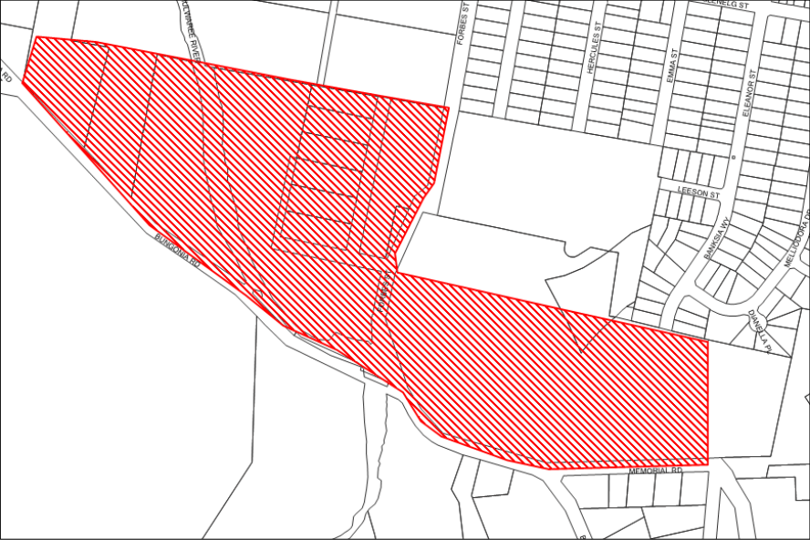

> [Picture on page 68: a picture, saved as a picture (images/part-03-general-development-controls-page-68-9.gif, 150 dpi).]

Figure 3.23:  South East Goulburn Heritage Conservation Area

#### Character

The Lansdowne precinct in South East Goulburn is characterised by a mainly rural landscape along the river flats of the Mulwaree River.  It includes rural homesteads and the oldest industrial complex in the Goulburn Region.  The industrial character of the brewery group is the predominant physical element of this HCA followed by the original Lansdowne homestead.

#### History

Jonas Bradley was a pioneer in the cultivation of tobacco and he went on to become the first to plant and harvest tobacco as a crop in the Goulburn district and more specifically Lansdowne. In 1836, 1.5 tons of tobacco was harvested from Lansdowne.

William Bradley also opened a brewery complex at the base of the hill below Lansdowne (homestead) in 1836 and between 1836 and 1840 a steam powered mill was added. This was one of the first steam powered industries in the colony. The mill, when completed in 1838, processed about 100,000 bushels of wheat per annum.

After Bradley's death in 1868 the complex was sold to Messrs Walford, Sparks & Emanuel who continued the milling but ceased the brewery operation. Emanuel was also the purchaser of Lansdowne at this time. The new owners sold on to Messrs Bartlett and Oddy who operated only the brewery.

Jonas' scientific approach to agriculture was shared by William - inspired by his father's interest in and knowledge of tobacco, he is reputed to have developed a nicotine based treatment for scab in sheep that led to the eradication of scab from NSW flocks. Bradley's work on scab and catarrh for the sheep industry is ranked equal in importance to that of Farrar's for rust in the wheat industry.  Bradley also introduced the first Southdown (coarse haired) sheep to NSW in the Monaro. (SHI)

#### Statement of Significance

Lansdowne homestead, brewery and surrounding precinct is of outstanding heritage significance. It has been associated with the development of Goulburn since the earliest days of exploration in the area and was one of the first properties settled in the area south of the Cumberland basin. It provides physical evidence of its establishment and occupation by one of the most powerful men in the colony who played an important role in shaping the development of NSW.

The homestead is a rare example of an early timber colonial homestead with its 'U' plan, high-pitched roof and encircling verandah. The fabric provides rare physical evidence of early timber building techniques used in the colony.

Lansdowne has retained extensive evidence of its early period of development along with evidence of most of the outbuildings which once supported the house. It provides evidence of early colonial life, including all facets of human activity. The homestead forms part of an intact

group of buildings which have the potential to provide a complete vignette of 19th century rural life and activity.

The property exhibits strong associations with the Aboriginal population as it was used as both a meeting place and burial ground. It was also a place of primary contact between Aboriginal and European peoples.

Lansdowne's location on a spur overlooking the flood plain has enabled a strong relationship to develop between the city and the rural hinterland. The property has largely retained its rural curtilage and yet continues to define the boundary between the town and rural land as Bradley's properties have done for over 180 years (to 2017).

The property provides physical evidence of the close association with one of the earliest industrial enterprises in Goulburn.  The Goulburn Brewery and Mill is a rare surviving example of a vernacular 19th century industrial complex. In terms of its longevity, complexity and intactness the place is of high heritage significance.  It is a well-designed, integrated industrial complex that has been put to different uses in response to shifts in the economy. Its changes in function illustrate the fluctuating fortunes of the flour milling and brewing industries in country NSW in general and the Southern Tablelands and Goulburn in particular.

It is a rare example of a pastoral, industrial and political empire, providing information of the development and concomitant development of the colony. It demonstrates the characteristics associated with important pioneering family homesteads.

The site has the potential to provide valuable archaeological information about both Aboriginal and European periods of occupation (SHI)

#### Positive Characteristics

There are a number of positive characteristics for the South East Goulburn HCA which reflects their contributory nature to the precinct.  These include the following:

• Important ecological areas along the Mulwaree River;

• Rural homestead group;

• Significant industrial complex relating to brewing, flour mill and tobacco growing; and

• Supporting rural buildings and facilities related to farming and cultivation.

The landscape and buildings of the Lansdowne precinct contribute to the HCA and create a standout complex significant at a State level, not only for design but relationship to important architects and farming families.

#### Objectives

The objectives of the HCA for South East Goulburn include:

• Ensure the HCA controls and guidelines encourage sustainable conservation and development;

• Maintain, protect and enhance the HCAs built and natural heritage;

• Provide standards and guidelines to ensure the significance of the Lansdowne precinct is protected; and

• Promote adaptive reuse of rural and industrial buildings to ensure they do not fall into a state of disrepair.

#### Controls for Future Development

This section should be read in conjunction with the more extensive development controls included in Sections 3.1.5 and 3.1.6 of this DCP.

| Scale | Category Storeys FSR | Control Two storey limit for new development. No FSR identified in LEP. |
|---|---|---|
| Setting / | Subdivision | Rural nature of the area should be retained if any subdivision |
| Subdivision |  | is proposed. |
|  | Landscaping | Landscaping should retain the rural nature of the locality. |
|  |  | Landscaping around buildings should reflect the nature of the |
|  |  | building and any historic information about garden elements. |
|  | Car parking | Garages should reflect the rural nature of the area and low |
|  |  | scale sheds out of important view lines or vistas. Extensive |
|  |  | parking areas should remain open air with informal base. |
|  | Fencing | Fencing should reflect the rural nature of the area and be open |
|  |  | in appearance. |

Form / Height Height limit 8m Massing

Adaptive Options Adaptive reuse of this area should be considered to Re-use

ensure buildings do not fall into state of disrepair. Options to consider could include light industrial, tourism, events, accommodation or the like.

#### Kenmore Heritage Conservation Area

#### Definition and Location

The Kenmore Goulburn Heritage Conservation Area (HCA) is a precinct based around the Kenmore Asylum and Psychiatric Hospital.  The extent of the HCA is shown in Goulburn Mulwaree LEP 2009 and in Figure 3.23 below and includes:

• The former buildings associated with the hospital including administration, maintenance, service areas, storage, staff amenities, and wards;

• Orphanage;

• Recreation areas and buildings;

• Cemetery and chapel;

• Farm buildings, including stables; and

• Cottages.

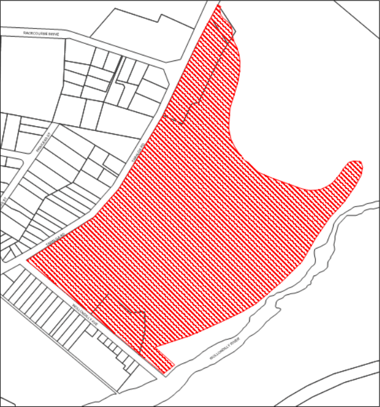

> [Picture on page 73: a picture, saved as a picture (images/part-03-general-development-controls-page-73-1.gif, 150 dpi).]

Figure 3.24:  Kenmore Heritage Conservation Area

#### Character

The Kenmore HCA has the character of an institutional complex that includes a complex series of buildings and landscape elements.  There is a variety of buildings from a mix of historic periods that together form an important precinct of the oldest psychological facility in Australia.

#### History

The Kenmore estate was originally owned by William Lithgow and Andrew Allen. Their grants of land can be traced back to the mid-1820s, the time of Goulburn's first European settlement. The village of Kenmore developed from a number of land sales from the late 1870s. Dr. Frederick Norton Manning, a prominent early Australian psychiatrist and Inspector-General of the Insane, fought to establish a psychiatric hospital in the serene estate of Kenmore. In 1895 it was opened as the Kenmore Lunatic Asylum; its architect was Government Architect Walter Liberty Vernon.  The acquisition of Kenmore was the first major achievement of Mannings in his role as Inspector General of the Insane.

Throughout much of the 19th and 20th centuries, both this facility along with Morisset on the Central Coast once accommodated up to 1500 and 1400 mental health patients respectively. Kenmore was also used as a repatriation hospital following both World Wars. Kenmore patient records are available from State Records NSW (SHI).

THE BUILDING OF THE HOSPITAL 1894-1900 – The first contracts for the construction work were let in 1894, the major one going to the Sydney builder, John Baldwin, for an amount of 12,760-6-5 pounds. A second contract for about 923-9-0 pounds was awarded to the local Goulburn builder, JC O'Brien. Baldwin's contract involved the erection of a number of permanent buildings in brick, as well as some temporary wooden structures.

Although the first patients would be chosen for their quiet and industrious natures, it was necessary to provide separate accommodation for any patients who became violent or uncontrollable. O'Brien's contract called for the erection, at a cost of 423-9-0 pounds, of a small brick 'special ward' (site of the dental clinic) where such patients could be kept under lock and key.

In March 1941, the NSW government offered the hospital to the army as the site for a military hospital, an offer the army promptly accepted. Over the next twelve months, Kenmore's patients were moved to various mental institutions in Sydney, in preparation for the army's occupation of the site.

The army moved out at the end of January 1946, the Department of Health resuming control of Kenmore a week later.

REVERSION AND REDIRECTION 1946-93 – With the army's departure, patients were gradually moved back in to Kenmore, ward by ward, from other mental institutions in the state. It was not long before the accommodation situation at the hospital took on a familiar pre-war appearance. By 1949, Kenmore was once again overcrowded.

The hospital was modernised in the 1960s and 70s with an orientation towards rehabilitation. By 1974 the capacity of the hospital was 700 and continued to reduce further in the 1980s as the emphasis was on removing patients from the hospital environment.  It closed in early 2000s and was sold in 2003 and later in 2010.  Plans for its redevelopment are being considered.

#### Statement of Significance

The Kenmore Psychiatric Hospital site is of State significance: as the first purpose-built, whole complex for mental health care in rural NSW; as the largest example of the work of W.L. Vernon

(the first Government Architect); and for having been used and maintained by the one agency for the original purpose continuously (except for the brief Defence period during WWII).

The Kenmore Psychiatric Hospital complex is a representation, in physical form, of the changing ideas and policies concerning the treatment of the mentally ill and handicapped people, in the State, spanning over one hundred years.

Within the Hospital precinct, and within the actual layout and design of the precinct buildings and landscape, these changing ideals are 'laid out' one upon another like successive occupation layers of an archaeological site. The Hospital fabric also clearly evidences the Military occupancy of the site.

The original 1890s Vernon complex of buildings still evidence the features that made Kenmore Psychiatric Hospital one of the most modern psychiatric institution of its day. Many of the buildings which followed the Vernon structures have significant historical associations in their own right and in their functional relationships with the original Vernon buildings.

The early buildings of Kenmore, particularly the 'core' Vernon buildings, represent perhaps the finest 'corporate' architectural expression of the Edwardian (later Federation) Free style in Australia.

The institution of Kenmore has important links with the community of the locality and region. These links were particularly strong in the early 20th century, when Kenmore was a focal point for regional sporting and cultural activities.

The institution of Kenmore has played a pivotal role in the evolution and development of treatment for the mentally ill and handicapped in the State of NSW.

The farm complex of Kenmore is culturally significant as a physically intact precinct created as an integral part of rehabilitation treatment for the patients of Kenmore. The sporting related functions, particularly the cricket pavilion, are significant as exemplars of the close connection of Kenmore to its community, and the use of sport as an integral part of rehabilitation treatment.

The cemetery complex, and its landscape, is a significant element of the life / death cycle of the Kenmore Psychiatric Hospital. It is one of the few 'pauper' cemeteries in the state.

The institutionalisation of psychiatric patients is a function now less practised. A large psychiatric institution, such as Kenmore, although not unique, demonstrates a way of life and a

treatment ethic now no longer practised. The layout and design of the core buildings clearly evidence the institutional beliefs and treatments of psychiatric patients in the late 19th century.

The Kenmore Psychiatric Hospital, although not unique as a remnant late 19th century psychiatric hospital, is by its intactness and architectural excellence an exemplar of the structure and philosophy and physical basis of the institution. The hospital also has specific association with those Inspectors General who ran it. (SHI).

#### Positive Characteristics

There are a number of positive characteristics for the Kenmore HCA which reflects the contributory nature of the buildings and landscape to the precinct.  These include the following:

• Important ecological areas along the Wollondilly River;

• Early government architecture designed buildings;

• References to changes to psychiatric treatments over more than 100 years;

• Farm complex;

• Sporting and recreational complex;

• Series of dwellings;

• Cemetery complex;

• Tree and vegetation plantings creating important landscape elements; and

• Relationship to nearby developments and the community of Goulburn

The landscape and buildings of the Kenmore precinct are the major part of the HCA and create a standout complex significant at a State level, not only for design but relationship to important architects and medical treatment and facilities of the past 100 plus years.

#### Objectives

• To ensure the HCA controls and guidelines encourage sustainable conservation and development;

• To maintain, protect and enhance the HCAs built and natural heritage;

• To provide standards and guidelines to ensure the significance of the Kenmore precinct is protected;

• To ensure the site is interpreted through appropriate signage and information; and

• To promote adaptive reuse of buildings to ensure they do not fall into a worse state of disrepair.

#### Controls for Future Development

This section should be read in conjunction with the more extensive development controls included in Sections 3.1.5 and 3.1.6 of this DCP.

| Scale | Category Storeys FSR | Control 1-2 storeys for new development to limit impact on existing development on the site. No FSR is applicable to the site. |
|---|---|---|
| Setting / | Subdivision | Any subdivision proposed for the site should respect the |
| Subdivision |  | historical buildings and their relationship to each other and impacts of such subdivision such as fencing. Strata subdivision would be more appropriate for this site. |
|  | Landscaping | Significant landscaping on the site should be retained. |
|  |  | Ecological areas along Wollondilly River should be maintained |
|  |  | and restored. |
|  | Fencing | Fencing should be limited and only used where needed and |
|  |  | should be open and rural in nature. Views to and from items |
|  |  | of significance should be maintained. |
| Form / | Roof | Roof pitch and materials should be maintained. |
| Massing | Height | Height limit 8m |
| Design | Building Use | New development should respect the existing and historic buildings on the site, in terms of scale, bulk, design and materials. Adaptive reuse of the site and buildings is encouraged to ensure that they are maintained and their history can be established through interpretation. |

#### Goulburn Waterworks Heritage Conservation Area

#### Definition and Location

The Goulburn Waterworks Heritage Conservation Area (HCA) is a precinct located to the north west of Goulburn on the banks of the Wollondilly River at the Marsden Weir.  The extent of the HCA is shown in Goulburn Mulwaree LEP 2009 and in Figure 3.24 below and includes the only complete, functioning Beam engine powered municipal water supply left in its original location, in the Southern Hemisphere.

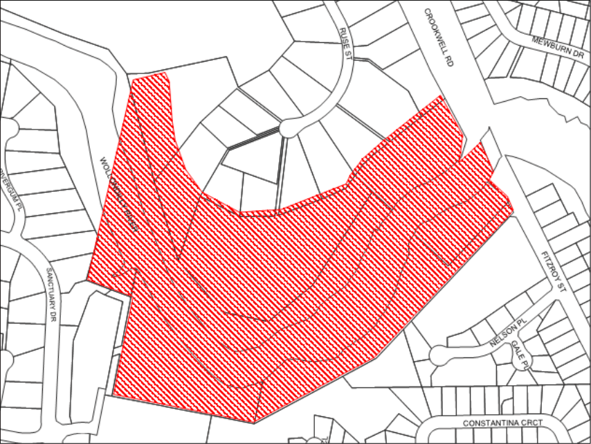

> [Picture on page 78: a picture, saved as a picture (images/part-03-general-development-controls-page-78-8.gif, 150 dpi).]

Figure 3.25:  Goulburn Waterworks Heritage Conservation Area

#### Character

The Goulburn Waterworks HCA has an industrial character made up of steam engines and water supply systems.  There is a mixture of built and landscape elements set on the banks of the Wollondilly River.  The waterworks is now the site of the Historic Waterworks Museum, which is managed by volunteers with assistance from Goulburn Mulwaree Council.

#### History

Built in 1887 and set on the banks of the picturesque Wollondilly River at Marsden Weir, Goulburn, the steam operated pumping facility provided Goulburn's first reticulated water

supply. The pumphouse still contains the original Appleby Bros. Beam Engine pump and Lancashire Boilers.

The original Goulburn Waterworks became operation in January 1886, providing a reticulated water supply to the growing City of Goulburn.  The pumphouse was powered by timber / wood piles which fired the boilers 24 hours a day, seven days a week.  Before 1886 the residents of Goulburn would have collected water in tanks or wells or purchased supplies from a carter. The demand of the growing city resulted in the Rivers and Harbours Board installing a waterworks on the Wollondilly River powered by a steam operated Beam engine. Water was pumped from the river to a filtration plant and reservoir, then gravity fed to residents of the city.

The original 1883 Appleby Bros. steam engine situated inside the pumphouse was one of four installed in Pumphouses around NSW. The others were at Wagga Wagga, Albury (both scrapped in 1936) and Bathurst.  The steam engine is known as a beam engine because of the large overhead rocking beam that transmits motion from the pistons to the cranks.

This great beam engine was one of the types first invented by Thomas Newcomen in 1712 and is an example of the powerhouse that drove the Industrial Revolution. Originally designed for pumping water out of mines in the UK it was improved by Watt, Smeaton, Maudsley and other engineers of the steam age until it became a very efficient and reliable engine.

The Goulburn Waterworks Beam engine is of medium size and produces 120 horse power. It has compound cylinders and a jet condenser. The fly wheel is 5 metres in diameter and at 18 r.p.m. the pumps delivered 660,000 litres of water per hour.  The two boilers that produce the steam that powers the engine, are located in the western wing of the building.  Fired by wood or coal, they produce high temperature steam that is piped through to the beam engine in the central part of the building. Only one boiler would have been operational at any one time. The other being shut down for regular cleaning and maintenance.

Steam from the boilers enters the valve chest on the cylinders from where it is transmitted to the cylinders by means of a valve mechanism. The action of the steam on the pistons causes them to reciprocate. Rods connect the pistons to the beam at one end, and to the crank at the other. This converts the 'rocking' motion to rotary motion which makes the flywheel turn, giving a smooth and continuous action.

By 1918 the beam engine had become obsolete when electric motors were installed.  It was idle for many years and was restored in 1958.

The Pumphouse – The east wing of the building houses a horizontal steam engine, the Hick Hargreave and the early dynamo room with its electric pump.  The Waterworks is notable not just for its historic steam engine, but for the elegant Victorian building that houses the beam engine and boilers. Only metres away further up the hill stands the original fireman's cottage, also of Victorian design.

From 1968 the Goulburn Waterworks operated as a museum of engines. It was during this period that a grant was made available under the Regional Employment Development Scheme

(1975) which saw some of this funding used for the installation of the Hick Hargreaves engine now on display and operational on steaming days, in the annexe of the pumphouse.

The single cylinder horizontal engine measures 9 metres in length, weighs 17 tons with the flywheel being 4 metres in diameter.  It was originally used to power equipment in a Sydney tannery, becoming discarded in 1961. It was reported that it had been acquired to represent the nest stage of steam engine development after the beam type engine (SHI).

#### Statement of Significance

The former Goulburn Water Works now referred to as the ‘Goulburn Waterworks Museum’ is listed on the NSW State Heritage Register. It is highly significant for its association with the original water supply to the town of Goulburn. Built in 1885, the steam operated pumping facility provided Goulburn's first reticulated water supply. The pump house contains the original Appleby Bros. Beam engine pump and Lancashire Boilers. This unique facility is the only complete, workable beam engine powered municipal water supply in its original location, in the Southern Hemisphere. The buildings and engine are of national significance and are listed on the NSW State Heritage Register.

#### Positive Characteristics

There are a number of positive characteristics for the Goulburn Waterworks HCA which reflects the contributory nature of the buildings and landscape to the precinct.  These include the following:

• Important ecological areas along the Wollondilly River;

• Landscape elements for recreational areas along the river;

• Historic buildings that house the pumps, including the pumphouse; and

• The historic steam engines which are the basis of the historic linkages.

The landscape and the design and architecture of the buildings within the Waterworks precinct are the major part of the HCA and create a standout complex significant at a State level, not

only for design but relationship to important steam engines and the progress of the industrial revolution in regional Australia.

#### Objectives

• To ensure the HCA controls and guidelines encourage sustainable conservation and development;

• To maintain, protect and enhance the HCAs built and natural heritage;

• To provide standards and guidelines to ensure the significance of the waterworks precinct is protected; and To ensure the site is interpreted through appropriate signage and information.

#### Controls for Future Development

There are no specific development controls for this area.  Refer to those controls and guidelines within the Goulburn Mulwaree LEP 2009 and Sections 3.1.5 and 3.1.6 of this DCP.

### Bungonia Heritage Conservation Area

#### Definition and Location

The Bungonia Heritage Conservation Area (HCA) has been included in the Goulburn Mulwaree LEP and DCP to reflect the archaeological significance of the town of Bungonia which is located 28kms south east of Goulburn.  The extent of the HCA is shown in Goulburn Mulwaree LEP 2009 and in Figure 3.25 below.

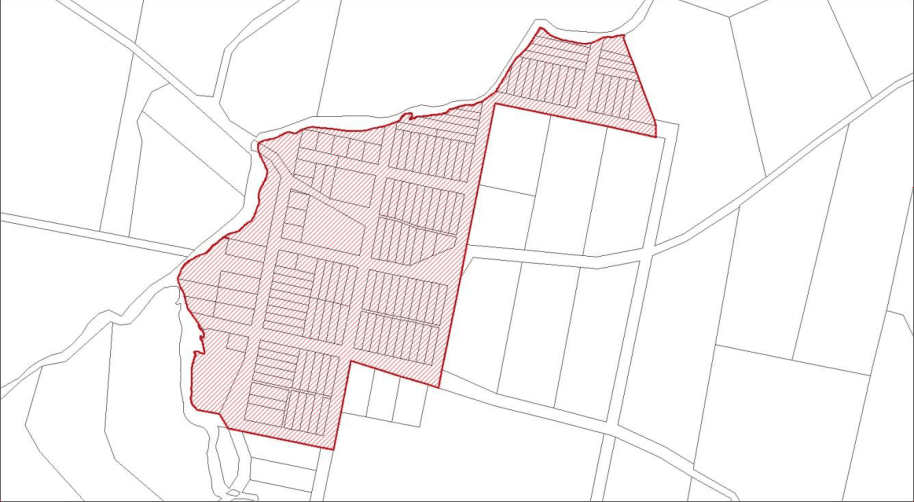

> [Picture on page 81: a picture, saved as a picture (images/part-03-general-development-controls-page-81-19.gif, 150 dpi).]

Figure 3.26:  Bungonia Heritage Conservation Area

#### Character

Bungonia retains its village characteristics and remains a small town, with a historical built form. The Village has a wide ranging contextual heritage and is significant for its place in pastoral expansion and development in south-eastern New South Wales from 1820.

The landscape elements of the town with the undulating topography show the importance of spiritual elements, being the churches located on the high points.  Significant trees and ecological elements also form a significant part of the landscape.

#### History

Bungonia was established following the development of the New South Road through to Braidwood and Bungendore in about 1830, formally surveyed in December 1831.  It thrived as a major centre on the road, providing water from Bungonia Creek and other services for those travelling along the road including inns, wheelwrights, and blacksmiths.  Unfortunately, the growth of Bungonia stopped when the traffic began favouring the route through Goulburn south.

The town remained as a centre for the surrounding pastoralists and includes, on top of the travelling-based services, police, school, courthouse and churches.  In the 1930s the Bungonia Caves were officially reserved and became a destination for recreation and holidays.  Although the caves are not part of the HCA, they are important in the development of the town.

Today most of Bungonia has been lost, apart from a few key buildings and the existing lot / title layout.  It has significant archaeological importance which has been recently researched.

Bungonia's historical built form includes St Michael's Catholic Church, which was built over a period of nearly eight years officially opening in 1847, making it one of the oldest operating Catholic Churches in Australia.

#### Statement of Significance

The town of Bungonia superseded Inverary and predated Goulburn as the administrative centre of the southern inland colony. The former Town of Bungonia provides physical evidence of the early historical development of inland southern NSW in the 1820s through to the 1840s.  The development of Bungonia indicates its aspirations to be a major centre on the Great South Road and demonstrates the demise of the town when that did not eventuate due to the Great South Road being developed on the Goulburn Plains.  The pre-1850s buildings and ruins in Bungonia are evidence of the role the village played in hosting travellers and administering a

pastoral community. The place has associations with administration of justice and convict road gangs and stockades.

Bungonia has an historical association with the use of indentured labour. Many of the original buildings and archaeological sites provide physical evidence of the convict history of Bungonia between 1822 and 1841. The village has high archaeological potential relating to the early colonial period when the town serviced travellers due to its location on the eastern branch of the Great South Road and for its role as an administration centre for the surrounding district.

The remnants of the town of Bungonia is rare as an early inland Colonial town established south of the Sydney penal settlement that has retained most of its setting and original buildings in their original context.  It has aesthetic value due to its location on a rise at a bend in Bungonia Creek and the historic character of the buildings within the Village, in particular the Catholic and Anglican churches and other stone buildings and structures within the Village.

#### Positive Characteristics

There are a number of positive characteristics for the township of Bungonia which reflect their contributory nature.  These include the following:

• Important ecological areas;

• Archaeological remains of former buildings and sites;

• Small number of historic buildings in a variety of conditions and their relationship to each other;

• Sandstone construction of several the remaining buildings including two churches; and

• Proximity to the water supply of Bungonia Creek.

There are a number of buildings and places that contribute to the character of the precinct. They include:

• Small number of historic dwellings of different styles and ages;

• St Michaels Catholic Church, oldest standing Catholic church in mainland Australia and Gothic style Christ Church, Anglican Church, both set in rural landscape settings;

• Georgian style former Hope Inn served travellers through Bungonia;

• Bungonia Police Station associated with law enforcement in the village and rural areas;

• Former primary school, provided education to the local community;

• Bungonia Hall is a social focal point for the community;

• War Memorial provides memory of those killed in wars and conflict; and

• Archaeological remains of several other buildings including former inns and the like that show the history of the village and its importance in the growth of the area.

The landscape of the area including a number of important stands of trees and vegetation contribute to the rural landscape and backdrop of the town.  The village appears to be delineated / surrounded by these vegetated area, of note include those to the north and south around the Catholic and Anglican Churches, to the west along Bungonia Creek and to the east along Inverary and The Lookdown Roads.  This environmental based landscape is important to maintain the setting of the township.

#### Objectives

• To ensure the HCA permits development that can balance development and conservation sustainably;

• To maintain, protect and enhance the existing visual, built and environmental heritage and landscape character;

• To provide guidance for new development in the HCA that respects archaeological evidence; and

• To ensure new development complements the unique and positive characteristics of the town and rural lifestyle using materials, colours and finishes that complement the existing built form.

#### Development Controls

This section should be read in conjunction with the more extensive development controls included in Sections 3.1.5 and 3.1.6 of this DCP.

| Scale | Category Storeys FSR | Control 1-2 storeys. No FSR is applicable for the area. |
|---|---|---|
| Setting / | Subdivision | Subdivision within the area reflects the grid pattern of the |
| Subdivision |  | village. No additional subdivision should be proposed that detracts from this pattern. Disposal of effluent should be a major consideration. |
|  | Setbacks | Reflective of existing development within the village. |
|  | Landscaping | Informal and significant landscaping should be retained. |
|  |  | Any ecological stands of vegetation should be retained |
|  |  | especially along Bungonia Creek. If replacement vegetation |

|  |  | or new landscaping are required, they should be native |
|---|---|---|
|  |  | species indigenous to the area. |
|  | Car parking | Mainly located at the rear of housing and should be separate |
|  |  | and semi-rural in nature. |
|  | Front fencing | Low scale or rural type fencing. |
| Form / | Roof | Relatively simple hip or gable roofs, retain chimneys. |
| Massing |  | Use of roof pitch of 27.5 degrees or more. |
|  | Height | Village (RU5) – 8m |
| Design | Building Materials | New development should respect the existing and historic buildings in the village, in terms of scale, bulk, design, materials, finishes, and colours. Traditional materials should be used on new buildings or extensions to existing ones that relate to the village feel, including timber and iron. |

Note:  Please also refer to Section 3.3.3 relating to non-indigenous archaeology.

#### Rural Villages

The Goulburn-Mulwaree local government area comprises the historical landscape of the city of Goulburn and the villages of Bungonia, Tallong, Tarago, Lake Bathurst and Marulan. These villages are evident in the subtle landscape transition from urban to rural areas.

Traditional conservation principles focus on historical building fabric and heritage landscape context. In addition, social significance should be considered equally with scientific, historical and aesthetic significance in heritage assessments, and statements of heritage impact. Significant social benefits flow to smaller communities from participation in the management of their cultural heritage.

These principles refer to:

• The conservation of places, objects, features and landscapes of cultural value

• The conservation of natural values

• Provision for sustainable visitor use and enjoyment that is compatible with the conservation of the village's natural and cultural heritage values

• Provision for the sustainable use, including adaptive reuse, of any buildings or structures or modified natural areas, having regard to the conservation of the historical landscape context

• Promote public appreciation and understanding of the villages' natural and cultural values.

The objectives of such conservation are:

• To protect the village curtilage, landscape setting, and its visual prominence

• To encourage an 'active' village, built upon the surviving fabric and cultural landscapes that reflect its heritage

• To promote landscape themes that provide identities for the individual villages, yet maintain a coherent whole and link them together with Goulburn as a city centre

• To promote an architecture and built-form that is civic, yet relates to the culture, identity and character of the village

• To ensure a visual landscape that retains a natural, uncluttered ambiance, free from visually intrusive hard elements, surfaces and structures

• To preserve and enhance native bushland and significant flora and fauna habitats.

These principles and objectives should be considered when preparing development applications for villages with Goulburn Mulwaree local government area.

### Landscaping

#### Objective

Provide well-designed, constructed and maintained landscapes that are an asset to the community. Well-designed landscapes contribute to the attractiveness of outdoor spaces, to the protection of the natural environment and to the health and well being of the community.

Promote good landscape design. Good design is critical in producing environmentally sustainable landscapes.

Provide attractive landscapes that are consistent with the visual character of the landscapes within the Goulburn Mulwaree local government area.

Provide for public safety by allowing for passive surveillance and other management techniques.

Provide open space for recreation within residential developments.

Provide for privacy, summer shade and winter solar access.

Promote the use of local native plant species to provide habitat for native fauna, to minimise water usage, to decrease the need for insecticide and pesticide for exotic plant species and to achieve biodiversity objectives.

Ensure that landscaping is an integral part of the site planning process and that it suits the proposed development.

Ensure that the positive landscape values of the site are not compromised.

#### Landscape plan design requirements

Development proposals over $250,000 value are to be accompanied by landscape plans prepared by a qualified landscape architect, designer or other suitable qualified person.

Base the design on a thorough analysis of the site and surrounding areas attributes and context. Take advantage of opportunities and heed constraints (refer to Appendix G).

Landscape design and vegetation should be considered as a component of the site planning process and reflect the scale of development and context it is in. It should complement the surrounding streetscape and landscape.

Landscape design should be sensitive to site attributes such as existing landscape features, existing vegetation both native and exotic, streetscape character, land capability, micro-climate, views and vistas.

Allow for views to and from the site by not creating visual blockages, especially the views of important buildings.

Evergreen plant species should be used where screening of views is required.

Provided dedicated pedestrian access to all developments, design to avoid conflict with motor vehicles.

Assess the significance and health of the existing vegetation on the site prior to design; retain as much of the significant vegetation as possible. Protect existing native vegetation and fauna habitat. Provide protection for vegetation to be retained during the construction phase.

Landscape works shall maintain existing heritage significant plantings that contribute to the heritage significance of listed items and heritage conservation areas.

Note: vegetation in Heritage Conservation Areas and in listed heritage items requires Council approval prior to removal or significant modification.

Select plant material that reflects the character of the area. (Part 2 of this Plan looks at character in detail).

Design vegetation to provide privacy and allow for summer shade and winter solar access (refer to Figure 3-3).

#### Figure 3-1: Use of vegetation for solar access

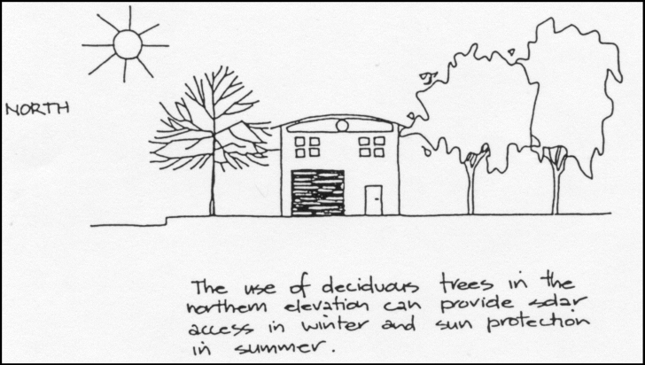

> [Picture on page 88: a picture, saved as a picture (images/part-03-general-development-controls-page-88-8.gif, 150 dpi).]

Outside Heritage Conservation Areas the use of local native plant species is preferred (refer to Appendix B for a list of preferred planting species suitable for varying conditions and locations within the Goulburn Mulwaree local government area). Choose plants that will not spread and become weeds in natural bushland but act as a buffer area.

Proposed landscaping is to include species that will grow to a height consistent with the height and scale of the building and the neighbouring buildings (refer to Figure 3-4).

Shrub and ground cover plants are to be planted at spacings so that when mature they form a continuous cover of the ground.

#### Figure 3-2: Example of landscaping complementing building scale

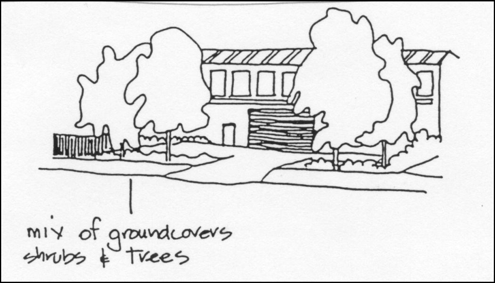

> [Picture on page 89: a picture, saved as a picture (images/part-03-general-development-controls-page-89-1.gif, 150 dpi).]

Minimise use of water by using drought tolerant plant species and reducing areas of lawn.

Use irrigation systems and practices that minimise the use of water. Utilise water collected in rainwater tanks for irrigation of plant material.

Use surface mulch to conserve moisture in the ground, inhibit weed growth and lessen the need for herbicide use (minimum thickness of mulch 75mm).

Provide site lighting.

Select environmentally friendly construction materials.

Do not remove or import bush rock as it provides habitat for native fauna. Enhance fauna habitats e.g. by providing rockeries, ponds for frogs and habitat plants (nectar for small birds).

Locate above and below ground services away from significant vegetation that is to be retained and protected. Maximise the use of common trenching for compatible underground services to reduce repeated disturbance of established plantings, now and into the future.

Provide waste and recyclables storage facilities that are not adjacent to communal outdoor/recreation areas. The storage area is to be suitably screened.

#### Residential development

Developments of two or more dwellings require a landscape plan (refer to Figure 3-5).

(Refer to chapter 4 of this Plan for further development controls)

#### Figure 3-3: Example of a landscaping plan

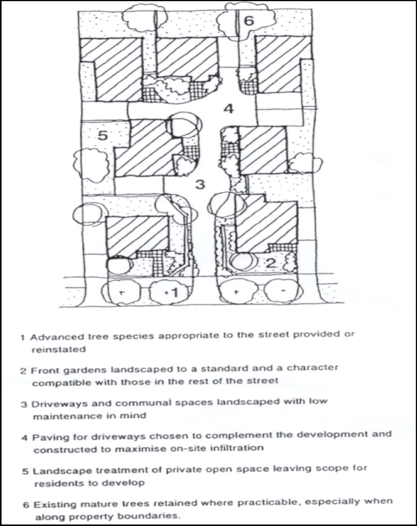

> [Picture on page 90: a picture, saved as a picture (images/part-03-general-development-controls-page-90-3.gif, 150 dpi).]

Provide communal open space area/s in residential developments containing five or more dwellings, the open space area is to be suitably landscaped.

Shade tree planting is required in parking areas where 6 or more places are provided at the rate of one tree per six parking spaces.

#### Non-residential development

All major non-residential developments require a landscape plan (refer to Figure 3-6).

#### Figure 3-4: Non-residential landscape planning

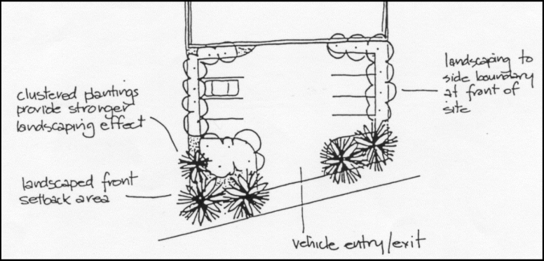

> [Picture on page 91: a picture, saved as a picture (images/part-03-general-development-controls-page-91-1.gif, 150 dpi).]

#### Streetscape (urban)

#### Objectives

To provide attractive streetscapes that reinforce the functions of a street, enhance the amenity of buildings, and are sensitive to the built form, landscape, environmental conditions and services of the locality.

#### Controls

#### Figure 3-5: Landscape designed to integrate with development

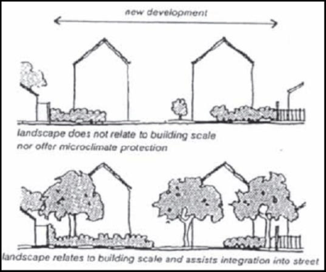

> [Picture on page 91: a picture, saved as a picture (images/part-03-general-development-controls-page-91-9.gif, 150 dpi).]

For infill development that abuts an existing public street, the application should demonstrate how the development fits in with the existing streetscape and makes efficient use of the site.

For new release urban areas, the provision for appropriate street tree planting taking into account the image and role of the street, solar access requirements, soils, selection of appropriate species and services (refer to Figure 3-7).

The site layout and building design enables the use of features of the site such as views, existing vegetation and landmarks.

#### Fences and gates (urban)

#### Objectives

Design fences to complement the architectural styles of the building and the local area.

#### Controls

Design fences to respect the architectural character of the house and heritage context. Design fences to take account of streetscape, privacy and security issues, and to enhance entrances to the site and building. Use fences to define the edge between the street and semi-public front garden space.

Original fencing should be retained where possible and, if damaged, should be repaired rather than replaced.

Fencing shall complement any original fencing relating to the architectural style of the dwelling or found on adjoining properties and in the wider streetscape in terms of style, height and materials.

Where side fences project in front of the building line ensure that they complement the scale of the adjoining front fence and function of the front yard. The height limit for front fences should coincide with that that of neighbouring dwellings, measured from the finished footpath level at any point adjacent to the fence to the top of the main part of the fence. This does not include supporting posts or mailboxes.

Where there is a change in ground level along the street boundary, the higher of the two levels will be taken when measuring fence heights:

▪ fencing over 1.2 metres in height shall be 50% transparent; or

▪ where there is dual street frontage, consideration may be given for the allowance of a higher side fence to ensure privacy. All controls are subject to the provision of adequate sight lines for emerging vehicles to enable surveillance of pedestrians.

Integrate the design of fences, with the location of mail boxes, nameplates and street numbering.

The use of intervening fences/walls setback from the front property boundary is discouraged and should not be used to determine the measuring point for the building envelope.

Generally, the fencing styles identified in Table 3-1 should be reflected in the design of fences and gates, according to the character of the surrounding area and property.

#### Table 3-1: Preferred period fencing styles

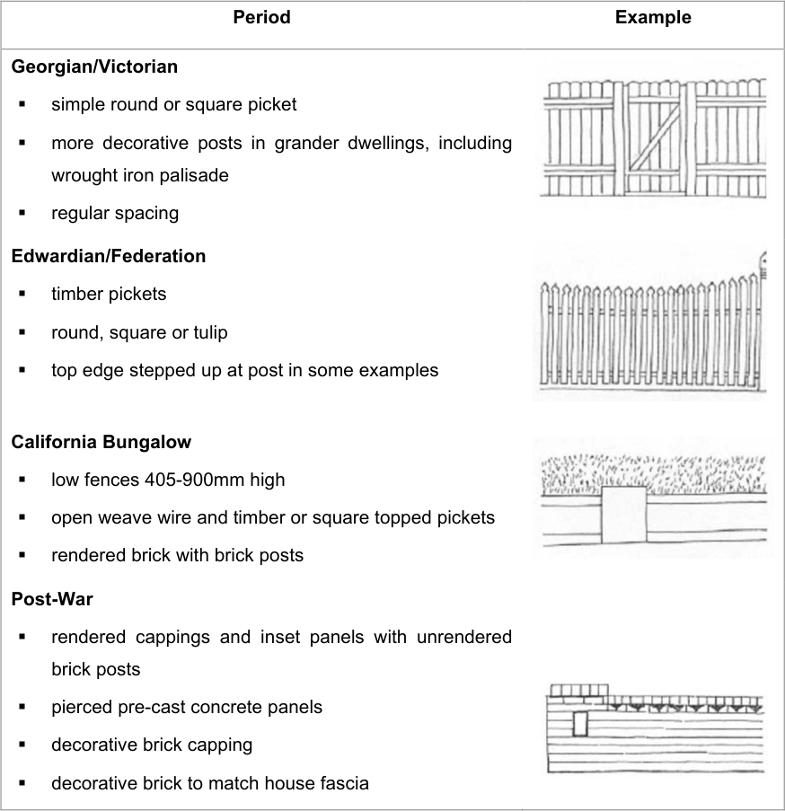

> [Picture on page 93: a picture, saved as a picture (images/part-03-general-development-controls-page-93-4.gif, 150 dpi).]
> Words printed on the picture (title and legend, copied from the PDF):
> ▪ simple round or square picket
> ▪ more decorative posts in grander dwellings, including
> wrought iron palisade
> ▪ regular spacing
> ▪ timber pickets
> ▪ round, square or tulip
> ▪ top edge stepped up at post in some examples
> ▪ low fences 405-900mm high
> ▪ open weave wire and timber or square topped pickets
> ▪ rendered brick with brick posts
> ▪ rendered cappings and inset panels with unrendered
> brick posts
> ▪ pierced pre-cast concrete panels
> ▪ decorative brick capping
> ▪ decorative brick to match house fascia

#### Period

#### Example

#### Georgian/Victorian

#### Edwardian/Federation

#### California Bungalow

#### Post-War

#### Set backs

All setbacks are to be landscaped (refer to Figures 3-4, 3-5, 3-6 and 3-7)

No parking will be permitted within setback areas.

Minimum Setbacks:

▪ Urban – Refer to chapter 4 for residential building setbacks.

▪ Industrial – Refer to chapter 4 for industrial building setbacks.

▪ Rural – Refer to chapter 5 for rural dwelling setbacks.

In front setbacks for developments facing a classified road or a public place plant trees with a mature height of a least 8 metres.

Trees must be a least 3 metres in height at the time of planting.

### Vehicular access and parking

This policy aims to provide sufficient and convenient parking for residents, visitors and service vehicles; to ensure vehicular and pedestrian safety and to encourage access design to form part of the overall landscape design.

#### Parking layout, servicing and manoeuvring

#### Objective

Where on-site car parking or service areas are required, ensure that the layout and design does not detract from the amenity of adjoining areas.

Ensure the design of parking and servicing areas is efficient, safe, convenient, discrete and suitably landscaped.

Minimise nuisance caused by traffic movement, generation and servicing

#### Controls

The layout and design of access, parking and service areas should address the needs of the site occupants and visitors as well as respecting the amenity of the area. Account should be taken of potential noise disturbance, pollution and light spillage. Car parking areas can have a significant impact on the streetscape and should therefore be carefully designed having regard to landscaping, layout and location to ensure that parking and service areas are integrated sympathetically with the development and locality.

Provision should be made for various modes of transport for employees and visitors to the

site. Where parking is provided it must be in a safe and efficient manner, allowing for easy access for occupants, visitors and service vehicles, whilst ensuring the safety of pedestrians and other road users.

Where non-residential development is within or adjoining a residential zone, locate and design parking areas, servicing areas and the means of access/egress to:

▪ minimise conflict between non-residential, residential and pedestrian traffic;

▪ provide off-street parking and servicing of premises;

▪ respect the character of the existing residential areas and streetscape character by means of siting, design and landscaping.

Surface parking should be visually articulated by the use of soft and hard landscaping and the use of different surface treatments.

Parking areas and accessways should be designed, surfaced and graded to reduce run-off and allow stormwater to drain into the site.

Ventilate enclosed parking areas using natural ventilation techniques.

Mechanically assisted parking facilities should not be provided.

Ensure public car parking and service areas are well signposted or otherwise identified from the entry point.

#### Specific land use requirements

Off-street parking shall be calculated in accordance with Table 3-2 or you may take the option of undertaking a traffic impact and parking study.  .

Disabled standard will apply to most land uses at a rate of 1 space per 50 spaces or part thereof.  The Building Code of Australia Part D prescribes the minimum requirements for the provision of parking spaces for people with disabilities.  This plan does not relieve an applicant of any obligation to comply with the Building Code of Australia.

Bicycle parking/racks should be considered for shopping and recreational developments.

#### Table 3-2: Off-street parking requirements

| Land use | Number of spaces |
|---|---|
| Commercial/business |  |
| Car tyre retail outlet | 3 spaces per work bay |
| Catering and reception centre | 1 space per 3 seats; or 1 space per 40m2 of GFA for centres less than 100m2 GFA |
| Drive-in liquor store (separately or in conjunction with a hotel/club) | 1 space per 40m2 of “browse room” area plus 1 space per employee |

| Land use | Number of spaces |
|---|---|
| Hotel, (tavern), club (licensed) | 20 spaces per 100m2 of licensed floor area (bar, lounge, beer garden, bistro/dining areas) plus 1 space per motel unit |
| Motel | 1 space for each unit; plus 1 space for each 2 employees; plus 1 space per 40m2 of restaurant GFA |
| Motor showroom | 1.5 spaces per 200m2 of site area; plus 5 spaces per service work bay |
| Office premises | 1 space per 40m2 of GFA |
| Outdoor displays and sales | 1.5 spaces per 200m2 of external site area for storage, display and sale of goods |
| Restaurant or café | 1 space per 3 seats for restaurants 100m2 or greater or 1 space per 40m2 of GFA for restaurants less than 100m2 GFA |
| Roadside stall | Minimum number of spaces 4 |
| Service stations | 6 spaces per work bay; plus 1 space per 40m2 of GFA for a convenience store; plus 1 space per 40m2 of GFA for a restaurant |
| Shop | 1 space per 40m2 of GFA for shops less than 200m2 GFA |
| Shopping centre (supermarket/convenience stores) | 4.4 spaces per 100m2 of NLS for developments of 200m2 or greater |
| Drive-in take-away food outlet (fast food outlet) | 12 spaces per 100m2 of NLS plus 1 space per 3 seats plus, for development with drive-through facilities, a queuing area for 5 to 12 cars measured from pick up point and a separate area for vehicles waiting pickup |
| Education |  |
| Child care centre | 1 space per 2 employees plus set down/drop off area |
| Schools | 1 space per 2 employees; plus minimum 10 spaces for students; plus bicycle racks |
| Tertiary institutions/adult education | 1 space per employee; plus |

| Land use | Number of spaces 1 space per 3 students |
|---|---|
| Health care |  |
| Hospital | Subject to parking study |
| Medical centre/health consulting rooms | 3 spaces per consulting room; plus 1 space for each 2 employees |
| Veterinary surgery | 3 spaces per surgery (Note: total parking may be reduced where it can be demonstrated that all consulting rooms will not be in concurrent operation) |
| Industry/employment |  |
| Road transport terminal/container depot/bus depot | 1 space per 3 employees; plus 1 space per company vehicle, including vehicles leased for or servicing the company |
| Truck stop | 1 space for each motel unit; plus 1 space for 2 employees; plus 15 spaces per 100m2 of GFA for public restaurant, with 50% of these spaces being truck parking spaces |
| Industrial building | 1 space per 100m2 of GFA; plus 1 space per 40m2 of office GFA; plus 1 space per 37m2 of retail GFA |
| Wrecking yard/junkyard | 1 space per employee; plus 1 space per 200m2 of site area |
| Warehouse/bulk stores | 1 space per 300m2 of GFA; plus 1 space per 40m2 of retail GFA |
| Home industry | 1 space per 3 employees; plus 1 space per dwelling |
| Extractive industry | 1 space per company vehicle; plus 1 space per 2 employees |
| Vehicle repair station | 5 spaces per work bay. This may include the area available within the work bays where vehicles are worked upon |
| Places of assembly |  |

| Land use | Number of spaces |
|---|---|
| Hall, meeting place, church, convention centre, cinema, community facility | 1 space per 10 seats; or 1 space per 10m2 of space used by the public, whichever is the greater (Note: Total parking provision may be reduced where it can be demonstrated that the time of peak demand for parking associated with locality does not coincide). Cinema complex may require a parking study. |
| Recreational |  |
| Recreational facility | 3 spaces per squash court; 3 spaces per tennis court; 3 spaces per bowling alley; 30 spaces for first bowling green; plus 15 spaces for each additional bowling green; 4 spaces per gymnasium; 16 spaces per indoor cricket court; 1 space per 40m2 GFA, otherwise. |
| Tourist recreation | 1 space per 40m2 of GFA for restaurant; plus 1 space for each unit; plus 1 space per 40m2 of GFA for commercial/retail; plus 1 space per 2 employees |
| Caravan park | 1 space for each site; plus 1 space for each 10 long-term sites; plus 1 space for each 20 short-term sites; with a minimum visitor parking of 4 spaces |
| Residential |  |
| Dwelling house | 1 space per dwelling |
| Dual occupancy | 2 spaces |
| Multi dwelling housing | 2 spaces per dwelling unit, plus 0.25 spaces per dwelling unit (visitor spaces) |
| Housing for older people or people with a disability | Refer to State Environmental Planning Policy.(Seniors Living 2004) |

Gross floor space GFA is defined under the Goulburn Mulwaree Local Environmental Plan 2009

Net leasable space (NLS) means the internal area of a building excluding all stairs, toilets, cupboards, vertical ducts, lifts, shafts, escalators, tea rooms, amenities, lobbies, plantrooms, service vehicle deliver areas, kitchens, corridors and the like.

### Crime prevention through environmental design

#### Objectives

The objectives of this plan for crime prevention through environmental design (CPTED) are to:

▪ enhance and improve community safety within the Goulburn Mulwaree local government area

▪ create a physical environment that encourages a feeling of safety

▪ address community concerns with regard to issues of community safety and crime prevention

▪ reduce the level of crime within the Goulburn Mulwaree local government area

▪ prevent the opportunity for criminal activity

▪ ensure that new developments promote CPTED

#### Controls

These controls apply to all development in the Goulburn Mulwaree local government area on both public and private land. Some of the controls, however, are tailored to specific development types and are clearly stated as such.

#### Lighting

Lighting plays a vital role in crime prevention and personal safety as you can see and respond to what is around you and ahead of you. Moreover, others can see you, which further reduce the likelihood of a crime being committed. The following CPTED requirements for lighting apply:

▪ all areas intended to be used at night should allow appropriate levels of visibility

▪ pedestrian pathways, lane ways and access routes in outdoor public spaces should be lit to the minimum Australian Standard (AS 1158). Lighting should be consistent in order to reduce the contrast between shadows and illuminated areas. Lighting should be designed in accordance with AS4282 – Control of the obtrusive effects of outdoor lighting

▪ lighting should have a wide beam of illumination, which reaches to the beam of the next light, or the perimeter of the site or area being traversed. Moreover, lighting should clearly illuminate the faces of users of pathways

▪ streetlights should shine on pedestrian pathways and possible entrapment spaces as well as on the road

▪ lights should be directed towards access/egress routes to illuminate potential offenders, rather than towards buildings or resident observation points

▪ lighting should take into account all vegetation and landscaping that may act as a entrapment spot

▪ lighting should be designed so that it is difficult for vandals to break

▪ where appropriate use movement sensitive and diffused lights

▪ avoid lighting spillage onto neighbouring properties as this can cause nuisance and reduce opportunities for natural surveillance

▪ illuminate possible places for intruders to hide

▪ as a guide areas should be lit to enable users to identify a face 15 metres away

▪ all lighting should be maintained and kept in a clean condition with all broken or burnt out globes replaced quickly

▪ use energy efficient lamps/fittings/switches to save energy

#### Fencing

If fencing is too high or made of inappropriate materials it reduces the opportunity for casual surveillance of the street and for users of the public domain to see what activities are taking place on your site. This then further increases the likelihood of a crime being committed. The following CPTED requirements for fencing apply:

▪ fence design should maximise natural surveillance from the street to the building and from the building to the street, and minimise the opportunities for intruders to hide

▪ front fences should preferably be no higher than 1.2 metre. Where a higher fence is proposed, it will only be considered if it is constructed of open materials (eg. spaced pickets, wrought iron etc)

▪ if noise insulation is required, install double-glazing at the front of the building rather than a high solid fence (greater than 1 metre)

#### Car parking

Poorly designed car parks whether underground or not can be a dangerous environment for their users. Through the provision of some basic design elements, such as lighting and signage, these spaces can be made safer. The following CPTED requirements for car parking apply:

#### ▪ car parks, aisles and manoeuvring areas shall be:

- designed with safety and function in mind

- have dimensions in conformity with AS2890 - Parking Facilities (relevant parts of this standard are AS2890. 1 - Off-street parking, AS2890.2 - Commercial vehicle facilities, and AS2890.3 - Bicycle parking facilities)

▪ where parking spaces are to be provided for people with disabilities, these spaces are to be:

- suitably located near entrances to the building and lifts/ access ramps, if required

- provided in accordance with Australian Standards 1428.1 - Design for access and mobility

- appropriate signage and tactile pavement treatments should also be installed, where required

▪ the design of car parking areas should incorporate the following elements:

- provision of a safe and convenient vehicle entry and exit that avoids traffic/pedestrian conflict and impact on the surrounding road

- the internal (vehicular) circulation network is free of disruption to circulating traffic and ensures pedestrian safety

▪ the movement of pedestrians throughout the car park should be clearly delineated by all users of the car park and minimises conflict with vehicles

▪ the design of the car park should ensure that passive surveillance is possible and where appropriate, incorporate active measures such as cameras and security patrols. Car parks should be designed to minimize dark areas through the provision of appropriate lighting

▪ large car parks should incorporate communication devices such as:

- intercoms

- public address systems

- telephones

- emergency alarms

▪ to ensure users of large car parks are easily able to determine their location, exit and access points security intercoms, and the like appropriate signage is to be included

▪ all surfaces in the car park should be painted in light coloured paint or finished in light grey concrete to reflect as much light as possible

▪ all potential entrapment points should be avoided (e.g. under stairs, blind corners and wide columns). Adequate lighting and mirrors should be used when certain design features are unavoidable

#### Entrapment spots & blind corners

Entrapment spots and blind corners provide opportunities for perpetrators of crime to hide and or commit crime. The following CPTED requirements for the avoidance of entrapment spots and blind corners apply:

▪ pathways should be direct – all barriers along pathways should be permeable (including landscaping, fencing etc)

▪ consider the installation of mirrors to allow users to see ahead and around corners – the installation of glass or stainless steel panels in stairwells can also assist in this regard

▪ entrapment spots adjacent to main pedestrian routes such as a storage area or small alley should be eliminated from all designs

▪ if entrapment spots are unavoidable they should be well lit with aids to visibility such as convex mirrors and locked after hours

▪ to eliminate excuse making for individuals to loiter, avoid placement of seating near or adjacent to ATM’s, public phone boxes, toilets, corridors and isolated locations

#### Landscaping

Trees and shrubs that are inappropriately located can easily reduce surveillance opportunities and provide entrapment spots and blind corners. The following CPTED requirements for landscaping apply:

▪ avoid medium height vegetation with concentrated top to bottom foliage. Plants such as low hedges and shrubs, creepers, ground covers and high-canopied vegetation are good for natural surveillance

▪ trees with dense low growth foliage should be spaced or crown raised to avoid a continuous barrier

▪ use low ground cover or high-canopied trees with clean trunks

▪ avoid vegetation, which conceals the building entrance from the street

▪ avoid vegetation screening of all public use toilets

▪ avoid vegetation that impedes the effectiveness of public and private space lighting

▪ use ‘green screens’ (wall hugging vegetation that cannot be hidden behind) if screening large expanses of fencing to minimise graffiti

#### Communal/public areas

Communal or public open space areas that do not have adequate natural surveillance are a risk to personal safety. The following CPTED requirements for communal/public areas apply:

▪ position active uses or habitable rooms with windows adjacent to main communal/public areas (playgrounds, swimming pools, gardens, car parks etc)

▪ communal areas and utilities (e.g. laundries and garbage bays should be easily seen and well lit)

▪ where elevators or stairwells are provided, open style or transparent materials are encouraged on doors and/or walls of elevators/stairwells

▪ waiting areas and entries to elevators/stairwells should be close to areas of active uses, and should be visible from the building entry

▪ seating should be located in areas of active uses

#### Movement predictors

Movement predictors are routes which people move through on a regular and predictable basis such as a pedestrian underpass. Careful design is needed to ensure that they are not included in a development or are appropriately treated where included to reduce the

risk. Through site links are another type of movement predictor, however, unlike under passes these can provide a benefit to the community if designed appropriately to ensure safety. The following CPTED requirements for movement predictors apply:

▪ pedestrian underpasses should not be included in new developments

▪ where movement predictors are used the users of it should have clear site lines so they can see what is ahead and behind at all times

▪ lighting of movement predictors is essential. Natural lighting should be used where possible with consideration given to wall and ceiling materials to help reflect light

▪ emergency intercoms, telephones and security videos should be included in the design of movement predictors. Adequate consideration should be given to who will be monitoring such equipment

▪ no entrapment spots should be included in any movement predictor

#### Entrances

Entrances to all types of development that are not visible from the public domain provide an opportunity for perpetrators of crime to hide and or commit crime. Entrances to all types of development need to be clearly visible and legible so that the users can obtain entry quickly and expediently. The following CPTED requirements for entrances apply:

▪ entrances should be at prominent positions and clearly visible and legible to the users

▪ design entrances to allow users to see into the building before entering

▪ entrances should be easily recognisable through design features and directional signage

▪ minimise the number of entry points – no more than 10 dwellings should share a common building entry

▪ if staff entrances must be separated from the main entrance, they should maximise opportunities for natural surveillance from the street

▪ avoid blank walls fronting the street

▪ in industrial developments, administration/offices should be located at the front of the building

#### Introduction to next subsections 3.7 – 3.16

The next subsections generally deal with the maintenance and improvement of amenity and natural resource areas. The following overall objectives are the target outcomes expected of development proposals.

#### Objectives

To maintain and improve existing biodiversity values and habitat connectivity corridors between conservation reserves and remaining areas of native vegetation for the purpose of facilitating species movement, dispersal and interchange of genetic material.

To minimise the fragmentation of land through subdivision.

To protect land within zones from adverse impacts of development located on land with an adjoining zone.

To ensure that there is no net loss of native vegetation.

To have regard to the likely long term effects of climate change on the areas natural environment when considering development proposals including:

▪ Increased bushfire and flood risk and any associated measures required to mitigate that risk to protect human assets.

▪ The long term sustainability of water supply and its availability to natural area.

▪ The cumulative impacts of water extraction and use on the catchment surface and underground waters and water quality.

▪ The impacts of climate change on biodiversity, natural habitats, endangered ecological communities, threatened species and native fauna.

### Flood Affected Lands

#### Purpose and objectives of this chapter

The purpose of this Chapter is to specify development controls for development occurring within land that is identified as flood prone or as potentially flood prone.

Note: Clause 5.21 of Goulburn Mulwaree Local Environmental Plan 2009 identifies considerations for the assessment of development on land identified within the flood planning area. Clause 5.22 identifies considerations for development between the flood planning area and the probable maximum flood (PMF).

The objectives of this chapter are to:

• Minimise impacts from flooding for development occurring within flood prone land both within and outside of an adopted flood study or floodplain risk management study and plan.

• Provide specific flood planning controls for the identified area within the Goulburn Floodplain Risk Management Study and Plan 2022 (GFRMS) and Marulan Floodplain Risk Management Study and Plan 2025.

• Provide additional flood related development controls to support those already included within the Goulburn Mulwaree Local Environmental Plan 2009.

• Introduce and implement the Flood Policy and apply its Flood Planning Constraint Categories (FPCC) and specific development controls for certain development on land identified within adopted Floodplain Risk Management Studies.

• Impose development controls for sensitive and hazardous development that occurs within the Probable Maximum Flood (PMF).

This chapter prevails to the extent of any inconsistency with any other chapter in the Goulburn Mulwaree Development Control Plan 2009.

#### Definitions and Interpretation

#### Definitions

This chapter is to be read in conjunction with any Council adopted Floodplain Risk Management Study and Plan. Further definitions or background information may be found

in these documents which are available on Council’s web site or within the Flood Risk Management Manual, ISBN 978-1-923076-17-4, published by the NSW Government in June 2023.

Annual Exceedence Probability (AEP): The chance of a flood of a given or larger size occurring in any one year, usually expressed as a percentage.

Average Recurrence Interval (ARI): The long-term average number of years between the occurrence of a flood equal to or larger in size than the selected event.

Design Flood Event (DFE): The flood event selected as a general standard for the management of flooding to development.

Flood Planning Area (FPA): the area of land that is below the Flood Planning Level.

Flood Planning Level (FPL): the floor level of development that incorporates a freeboard that is applied to the 1% AEP event.

Flood Planning Constraint Categories (FPCC): separated areas within the flood plain, categorised from most constrained to least constrained, that define specific development controls for development types.

Flood Prone Land: land susceptible to flooding by the PMF event

Freeboard: a factor of safety expressed typically used in relation to the setting of minimum floor levels which is:

• 0.8m above the 1% AEP event in the Goulburn Floodplain Risk Management Study and Plan 2022 for riverine and major tributary flooding.

• 0.5m above the 1% AEP event in the Marulan Floodplain Risk Management Study and Plan 2025 for riparian flood and in some locations 0.3m for overland flooding.

• an assumed 0.5m above the 1% AEP event elsewhere, including Goulburn for overland flood affected areas outside of the 0.8m area identified in the Goulburn Floodplain Risk Management Study and Plan 2022.

Flood Policy: The Flood Policy Prepared by GRC Hydro in Appendix J.

Local Government Area (LGA): Goulburn Mulwaree local government area.

Mainstream Flooding: Mainstream flooding occurs from rising water on a defined water course causing the watercourse to break its banks and inundate area that are usually dry. This mechanism typically occurs over a long period of time and can result in deep flood waters. This type of flooding may occur along rivers and creeks.

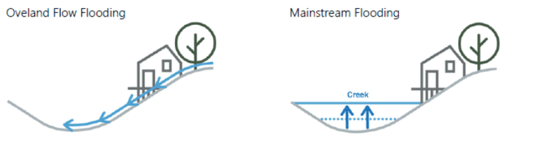

> [Picture on page 107: a picture, saved as a picture (images/part-03-general-development-controls-page-107-5.gif, 150 dpi).]

Overland Flooding: Overland flow flooding occurs when excess rainfall runoff is generated from impervious or saturated surfaces and flows toward a watercourse. This type of flooding is often referred to as “stormwater” flooding or “flash flooding” due to short warning times. Typically, this type of flooding rises and recedes over a short period of time and the floodwaters are usually relatively shallow and fast moving.

Probable Maximum Flood (PMF): The largest flood that could conceivably occur at a particular location, usually estimated from probable maximum precipitation (PMP), and where applicable, snow melt, coupled with the worst flood-producing catchment conditions.

Sensitive and hazardous development: development that is defined in the Standard Instrument as Sensitive and hazardous development or in the Flood Policy (Appendix J).

#### Application of this chapter

#### Development Outside of Adopted Flood Study Areas

Properties not yet identified in Council studies may still be flood affected.  An assessment will be required to be submitted with any development application (see controls section below) for potentially flood prone land.

#### Controls for Development Outside of Adopted Flood Study Areas

Developments that are identified as potentially flood affected are required to submit a Flood Assessment Report or a Flood Impact and Risk Assessment with a development application (DA)

The following factors identify sites which are potentially flood affected:

• Within 40m of a water course;

• Within 10m of a major drainage system;

• Within an overland flow path

• Within a drainage easement;

• Has a history of flooding.

In Goulburn, land outside Flood Planning Constraint Category 4 (FPCC4) in the Goulburn Floodplain Risk Management Study and Plan 2022 is not identified as subject to flooding from the two rivers (and major tributaries) and therefore not subject to the application of the Flood Policy and flood planning controls. Council has developed some interim predictive modelling for overland flooding outside of the rivers and major tributaries (refer to the link below to the Goulburn Overland Flow Modelling). www.goulburn.nsw.gov.au/Development/Plans-Strategies#section-10

The interim modelling identifies flood planning constraint categories (FPCCs). The Flood Policy and matrix can still be used as a relevant guide to appropriate design, safety and other management measures. The flood behaviour identified in the model was determined by using airborne laser scanning survey and is approximate only. The extent of inundation at individual lots near the flood fringe should be confirmed by site specific survey. Furthermore, in identified areas subject to potential overland flooding a site-specific study may be required.

In Marulan, all land within the study area is considered for both mainstream/riparian flooding and overland flooding.

Generally, for sites outside of adopted Study areas the following is to be provided on a site which is potentially flood affected:

Flood Impact and Risk Assessment Report

A Flood Impact and Risk Assessment Report must be prepared by a suitably qualified and experienced engineer recognised under the National Engineers Register (NER) in this field. The full name of the person who prepared the report, relevant qualifications and registration number are to be provided on the front page of the report. The assessment report provides information on existing flood risk for a catchment and is to be commensurate with the latest version of the NSW Flood Risk Management Manual 2023 and must include the following information:

(a) A description of the creek or drainage system that is relevant to the flood characteristics of the site, whether located on, adjacent to or remote from the development site;

(b) Flood levels must be defined for the PMF, 1%, 5%, 10% and 20% AEP events for the climate change pre-development scenario (all assumptions, calculations and modelling output tables must be provided).  From this information the FPL and FPA is to be determined (note for areas outside an adopted Council Flood Study a freeboard of 0.5m is to be applied to the 1% AEP to determine the FPL).

(c) Flood velocities and vectors for the 1% AEP event for the climate change pre-development scenario (all assumptions, calculations and modelling output tables must be provided);

(d) Provisional Hazard categories based on depth and velocity as well as obvious other hazards such as evacuation difficulties as per the requirements of the NSW Flood Risk Management Manual 2023.

(e) Provisional Hydraulic categories based on depth and velocity as per the requirements of the latest version of the NSW Floodplain Development Manual; and

(f) Flood Planning Constraint Categories based on the definitions provided in the latest adopted version of the Goulburn or Marulan Floodplain Risk Management Study and Plan or a Council adopted Floodplain Risk Management Study and plan more relevant to the

site.  Once determined the relevant FPCC controls in the Flood Policy matrix can be applied (albeit with a 0.5m freeboard for areas outside an adopted Council Flood Study Refer to Appendix J).

(g) Plans showing the results of (c) to (f) as well as the location of the proposed development.

Please note for point:

a) The modelling shall include climate change considerations as per Council’s adopted Floodplain Risk Management Study predicted changes in rainfall.

b) The modelling shall include a 50% and 100% blockage analysis of all existing drainage structures that may affect the development site.

c) Localised flow effects shall be investigated and reported on where relevant.

d) The roughness coefficients used shall allow for fully vegetated stream conditions in order to account for potential revegetation of degraded areas without impact on flood levels.

e) In areas where local sub-catchment flooding, such as flows from drains, overland flow paths or similar, interact with overall catchment flooding from waterways and lakes a joint probability analysis of flood behaviour shall be undertaken.

Development on Land Identified as Flood Prone in the Goulburn or Marulan Floodplain Risk Management Study and Plans

The Goulburn Floodplain Risk Management Study (the Study) and Plan 2021, investigates flood behaviour and impacts from the Wollondilly and Mulwaree Rivers and provides management measures to remedy flood risk to infrastructure and private development. The Marulan Floodplain Risk Management Study (the Study) and Plan 2025 investigates flood behaviour and impacts from riparian and overland flooding and provides management measures to remedy flood risk to infrastructure and private development.

A Flood Policy was originally prepared as part of the Goulburn FRMSP, which forms the basis for the controls on land identified in this study, the Policy is contained within Appendix J. It sets out development controls for development within flood prone land, up to and including the Probable Maximum Flood (PMF). The Policy implements Flood Planning Constraint Categories (FPCC) which group similar types and scales of flood related constraints to support land use planning. The Policy implements four FPCCs from most constrained to least constrained. The FPCCs are as per Table 1 below.

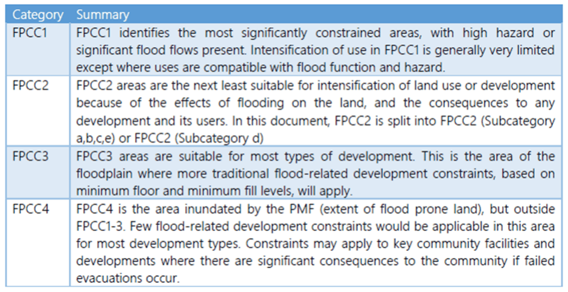

> [Picture on page 111: a picture, saved as a picture (images/part-03-general-development-controls-page-111-1.gif, 150 dpi).]

Table 1. Identification of the four Flood Planning Constraint Categories (FPCC).

The Flood Planning Area (FPA) forms the extent of FPCC3 above.

The Probable Maximum Flood (PMF) is bounded by the extent of FPCC3 and up to the extent of FPCC4.

In Goulburn, land outside FPCC4 (as identified in the Goulburn Floodplain Risk Management Study and Plan 2022) is not identified as subject to flooding from the two rivers (and major tributaries) and therefore not subject to the application of the Flood Policy and flood planning controls in this section (see general controls in 3.8.2.2). Council has developed some interim predictive modelling for overland flooding outside of the rivers and major tributaries (refer to the link below to the Goulburn Overland Flow Modelling).

www.goulburn.nsw.gov.au/Development/Plans-Strategies#section-10

The interim modelling identifies flood planning constraint categories (FPCCs). The Flood Policy and matrix can still be used as a relevant guide to appropriate design, safety and other management measures.

Council is preparing a consolidated Floodplain Risk Management Study and Plan which will address both riverine and overland flooding.

In Marulan, the Marulan Floodplain Risk Management Study and Plan covers both riparian and overland flooding.

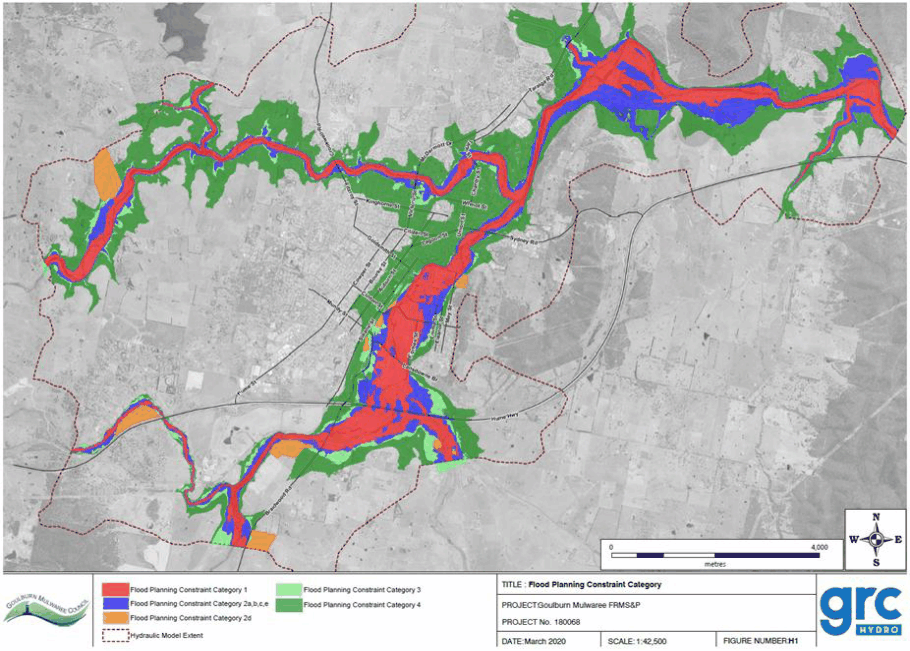

> [Picture on page 112: a picture, saved as a picture (images/part-03-general-development-controls-page-112-1.gif, 150 dpi).]

Figure 1. Example of FPCC Mapping - Goulburn Flood Planning Constraint Categories (FPCC) Riverine and Major Tributaries.

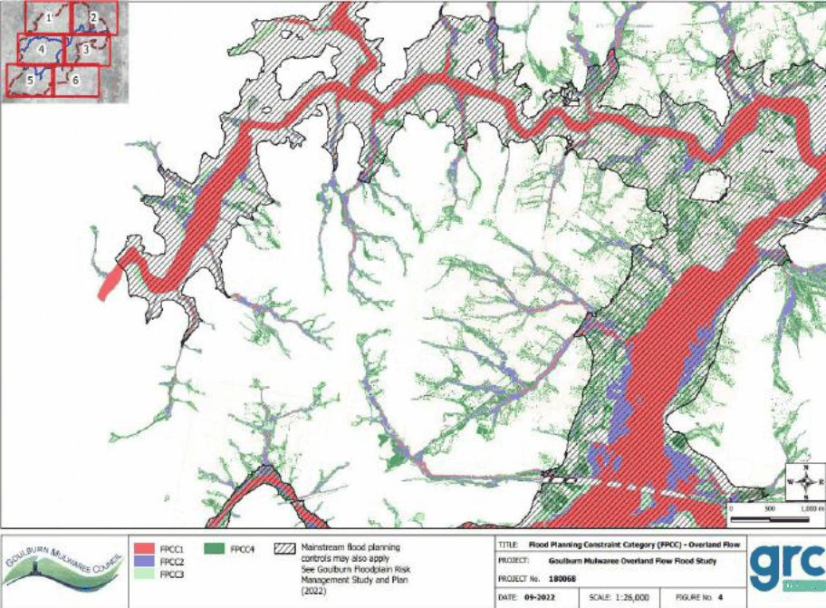

> [Picture on page 113: a picture, saved as a picture (images/part-03-general-development-controls-page-113-1.gif, 150 dpi).]

Figure 2 Interim Goulburn Overland FPCC Model (Central Goulburn). Note areas also containing riverine controls are hatched in black.

The extent of Flood Planning Constraint Categories (FPCC) in the Goulburn Flood Risk Management Study are shown in Figure 1.

The 1 in 100 or 1% Annual Exceedence Probability (AEP) plus a suitable freeboard has been used to derive the Flood Planning Area (FPA). For the Goulburn Floodplain Risk Management Study the freeboard recommended is 0.8m reflecting the additional risks associated when rivers flood (i.e. floating debris, wave action etc.). In Marulan, the freeboard ranges from 0.3m to 0.5m based on flood risk and behaviour.

The extent of Flood Planning Constraint Categories (FPCC) in the Marulan Flood Risk Management Study are shown in Figure 3.

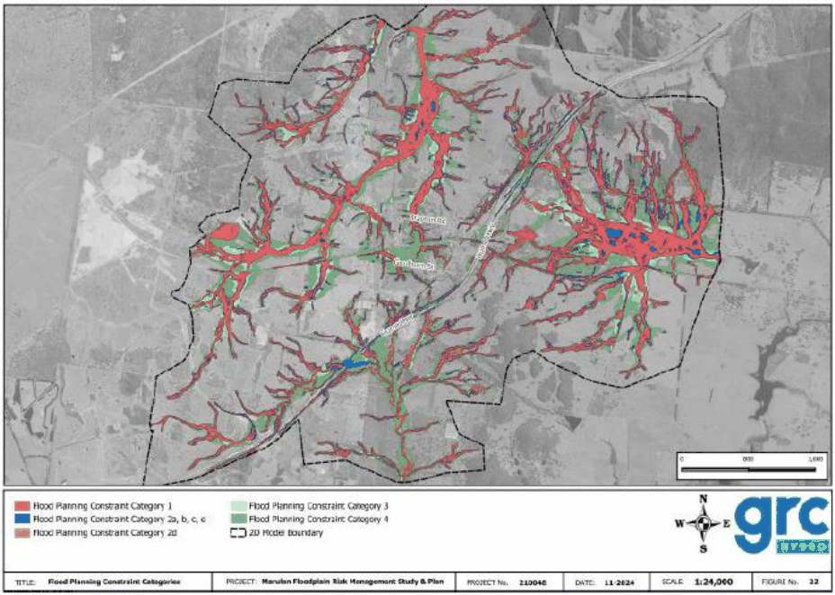

> [Picture on page 114: a picture, saved as a picture (images/part-03-general-development-controls-page-114-1.gif, 150 dpi).]

Figure 3. Example of FPCC Mapping - Marulan Flood Planning Constraint Categories (FPCC) Riparian and Overland Flooding.

The 1 in 100 or 1% Annual Exceedence Probability (AEP) plus a suitable freeboard has been used to derive the Flood Planning Area (FPA). For the Marulan Floodplain Risk Management Study and Plan the freeboard recommended ranges from 0.3 to 0.5m for areas of identified overland or riparian areas.

For the remainder of the LGA (not within an adopted flood study area) a 0.5m freeboard is to be applied above the 1%AEP event pending further studies being undertaken.

Development is required to apply and meet the requirements of the Flood Policy as set out in Appendix J.

Controls for development at or below the Flood Planning Area (FPA) and the Probable Mximum Flood (PMF) in the Goulburn or Marulan Floodplain

#### Risk Management Study and Plan

Refer to controls in the Flood Planning Policy (Appendix J).

Controls for development between the Flood Planning Area (FPA) and the probable Maximum Flood (PMF) in the Goulburn or Marulan Floodplain Risk

#### Management Study and Plan.

Refer to controls in the Flood Planning Policy (Appendix J).

Other reference material which may be used to inform Council assessment of flood impacts and risks.

Council may in its assessment of applications draw upon other relevant information such as that published by the NSW State Government in relation to flooding such as the:

• Flood Risk Management Manual, ISBN 978-1-923076-17-4, published by the NSW Government in June 2023.

The Manual also references other related documents including:

Understanding and Managing Flood Risk FB01

Flood Function FB 02

Flood Hazard FB 03

Flood Risk Management Measures MM01

Flood Impact and Risk Assessment

• Shelter in place guideline for flash flooding, NSW Department of Planning, Housing and Infrastructure, 2025.

### Tree and vegetation preservation

#### Purpose

The purpose of this Section is to declare trees and other vegetation under Part 2.3 of the State Environmental Planning Policy.(SEPP) Biodiversity and Conservation 2021 (Chapter 2, Vegetation in Non Rural Areas) (the ‘Biodiversity and Conservation SEPP’).

Where a tree or other vegetation is declared in this Section a person must not clear vegetation without a permit granted by Council (Clause 10(1) of the Biodiversity and Conservation SEPP). This is referred to as ‘removal or pruning’ in this Section and includes:

▪ Cutting down, felling, uprooting, killing, poisoning, ringbarking, burning or otherwise destroying the vegetation, or

▪ Lopping or otherwise removing a substantial part of the vegetation.

Council can only issue a permit for the removal or pruning of native vegetation that is below the biodiversity offsets scheme threshold and where there will be no significant impact on any threatened species, habitat, population or Ecological Communities listed under the NSW Biodiversity Conservation Act 2016 and/or the Commonwealth Environment and Biodiversity Conservation Act 1999.

Removal of native vegetation that exceeds the biodiversity offsets scheme thresholds must have approval from the Native Vegetation Panel in accordance with Part 4 of the Vegetation SEPP.  The biodiversity offsets scheme thresholds are described in section 7.1 of the Biodiversity Conservation Regulation 2017. For more information about applying for approval from the Native Vegetation Panel contact Local Land Services on 1300 795 299, or via email to info@nvp.nsw.gov.au.

This Section also provides guidance on the process for obtaining a permit for the removal or pruning of trees and other vegetation on land in the Goulburn Mulwaree Local Government Area (LGA).

#### Objectives

The objectives are to:

▪ Support the aims of the Biodiversity and Conservation SEPP to protect the biodiversity values of trees and other vegetation in non-rural areas and to preserve the amenity of non-rural areas through the preservation of trees and other vegetation.

▪ Achieve the long term retention of existing trees, appropriate tree maintenance, and in relation to replacement trees, suitable tree locations and considered species selection.

▪ Protect and enhance trees and vegetation in non-rural areas including street trees, park trees (including bushland) and trees on private property as an important community and tourism asset;

▪ Facilitate the removal or pruning of undesirable exotics, environmental weeds, priority weeds, dangerous trees and any other inappropriate plantings e.g. plantings that are causing damage to buildings or other infrastructure;

▪ Facilitate the removal or pruning of vegetation for maintenance of existing rural infrastructure; and

▪ Minimise impacts to vegetation with high environmental value e.g. threatened ecological communities, threatened species and their habitats.

#### Application of this section

This Section applies to all non-rural land (all zones except RU1, RU2, RU3, RU4 & RU6) as defined in the Biodiversity and Conservation SEPP within the Goulburn Mulwaree (GM) Local Government Area (LGA) and where referred to in the GM Development Control Plan 2009 that applies to the land.

This Section applies to removal or pruning of any vegetation that does not exceed the biodiversity offsets scheme threshold on non-rural land. Refer to Section 3.7.4.

#### Definitions

Other than those listed below, terms in this document have the same meanings found in the Environmental Planning and Assessment Act 1979 (EP&A Act),  Biodiversity and Conservation SEPP and Goulburn Mulwaree Local Environmental Plan 2009 (GM LEP) dictionary.

| Category | Meaning/Definition |
|---|---|
| Front Boundary | Means any boundary which faces a public road or public open space wider than 6 metres |
| Building Footprint | Means the maximum extent of the two dimensional area of the plan view of a building excluding minor ancillary structures. Note: The reference to minor ancillary structures in this definition includes, but is not limited to, garden sheds, cubby houses, detached car ports, gazebos, barbeques and detached decks and pergolas. |
| Clearing | Means any one or more of the following: Cutting down, felling, thinning, logging or removing native vegetation Killing, destroying, poisoning, ring-barking, uprooting or burning native vegetation; Severing, topping or lopping branches, limbs, stems or trunks of native vegetation; |

|  | Substantially damaging or injuring native vegetation in any other way (see definition for injury). |
|---|---|
| Dead Tree | Means a tree(s) that is no longer capable of performing the following processes: photosynthesis, take up water through its roots, hold moisture in its cells and produce new shoots. |
| Root Zone | The area under the drip line or branches of the tree that generally aligns with the root system required for the ongoing viability of the tree. |
| Environmental Weed | Means a plant that poses a threat to the natural environment. Environmental weeds are Either not native to the Goulburn Mulwaree area or are plants growing outside their natural range. A list of plants considered by Council to be environmental weeds can be found in section 3.9.7 of this plan. |
| Habitat Tree | Means any tree(s) which has developed hollows in the trunk or limbs and is suitable for nesting native birds, arboreal marsupials and mammals or which support the growth of locally indigenous epiphytic plants (such as orchids). |
| Imminent | Means about to happen or threatening to occur. |
| Injury | means damage to a tree or native vegetation and includes: Lopping and topping; Poisoning, including applying herbicides and other toxic chemicals to a tree or spilling (including washing off or directing water contaminated by) oil, petroleum, paint, cement, mortar and the like onto the root zone; Cutting, snapping off and tearing of branches and roots that is not carried out in accordance with accepted arboricultural practices. Ring-barking, scarring the bark when operating machinery, fixing objects (e.g. signs) by nails, staples or wire, using tree climbing spikes in healthy trees marked for retention (except |

|  | for access to an injured tree worker) or fastening materials that circle and significantly restrict the normal vascular function of the trunk or branches; Damaging a tree’s root zone by compaction or excavation, asphyxiation (including unauthorised filling or stockpiling of materials); Under scrubbing, unless carried out by hand tools, such as brush cutters and the like. Wounding the stem with machinery (e.g. lawn mowers), fixing objects (e.g. signs) to the stem or branches by nails, staples or wire, using tree climbing spikes in healthy trees to be retained (except for access to an injured tree worker), fastening materials around the stem or branches that circle and restrict the normal vascular function of the stem or branches. |
|---|---|
| Key Threatening Process | Means a process that threatens, or could threaten, the survival or evolutionary development of species, populations or ecological communities. |
| Lopping | Means cutting between branch unions or at internodes on young trees |
| Native Vegetation | Means any of the following types of plants native to New South Wales: trees (including any sapling or shrub or any scrub), understorey plants, groundcover (being any type of herbaceous vegetation), plants occurring in a wetland. A plant is native to NSW if it was established in NSW before European settlement |

| Priority Weeds | Priority Weed (formerly known as Noxious Weeds) - means a plant declared within the South East Local Land Services Area Priority weeds \| NSW Department of Primary Industries |
|---|---|
| Prune or Pruning | Means the following activities as specified in Australian Standard AS 4373, Pruning of Amenity Trees: Crown maintenance pruning involving: General pruning Thinning Dead wooding Selective pruning Formative pruning Crown modification pruning involving: Reduction pruning Crown lifting Pollarding Remedial pruning Line clearance |
| Remove | Means to clear, take away or transplant a tree from its place of origin |
| Suitably Qualified Person | Means an arborist or similarly qualified or experienced person (refer to section 3.9.9 of this Plan) or an ecologist with experience and qualifications to undertake tests of significance required by the Biodiversity Conservation Act 2016. |

| Threatened Species | Has the same meaning as in the Biodiversity Conservation Act 2016 which includes native species, populations and ecological communities of flora and fauna. |
|---|---|
| Topping | Means cutting away part or all of the tree canopy leaving a trunk and stubbed main branches |
| Tree | Means a perennial plant with at least one self-supporting woody or fibrous stems which: is 3 metres or more in height has a trunk circumference of 400 mm or more measured at ground level or has a crown/branch span of 3 metre diameter or more; |

#### Declared Trees or Other Vegetation under Part  2.3 of the Biodiversity and Conservation SEPP

This clause provides a declaration for trees and other vegetation for the purposes of Part

2.3 of the Biodiversity and Conservation SEPP. In accordance with Clause 2.6 of the Biodiversity and Conservation SEPP, a person must not cut down, fell, uproot, kill, poison, ringbark, burn or otherwise destroy the vegetation, or lop or otherwise remove a substantial part of the vegetation without a permit granted by Council.

All trees are declared for the purposes of Part 2.3 of the Biodiversity and Conservation SEPP unless exempt to the requirement for a permit as set out in Section 3.9.6 and 3.9.7 of this Code, that is trees that are at least 3 metres in height, or have a trunk circumference of 400mm at ground level or have a crown/branch span of 3 metres diameter or more.

All native vegetation is declared for the purposes of Part 3 of the Vegetation SEPP on land zoned RE1 Public Recreation, (C2) Environmental Conservation, (C3) Environmental Management, (C4) Environmental Living, R5 Large Lot Residential or RU5 Village by the Goulburn Mulwaree Local Environmental Plan 2009, unless exempt to the requirement for a permit set out in Section 3.9.6 and 3.9.7 of this Code.

#### Exemptions

Exemption under this section does not equal an exemption under other legislation controlling the removal or pruning of trees and other vegetation.

Exemptions under this Code cannot be used for removal or pruning of trees and other native vegetation that is required to be retained by development consent or a Section 88B restriction to user instrument. Applicants may choose to apply to Council for a variation to the conditions of consent (for dwelling and/or subdivision) or the 88B Instrument in this instance.

Exemptions under this Code cannot be used for removal or pruning of trees and other native vegetation related to a heritage item, Aboriginal object, Aboriginal place of heritage significance, or on land within a heritage conservation area. Clause 2.10 of the Biodiversity and Conservation SEPP states Council can only grant a permit for the removal or pruning of vegetation on land that is, or forms part of a heritage item; or is within a heritage conservation area; or that is or forms part of an Aboriginal object; or is within an Aboriginal place of heritage significance, if Council is satisfied it is:

▪ Of a minor nature; or

▪ For the maintenance of the heritage item, Aboriginal object, Aboriginal place of heritage significance, or heritage conservation area; and

▪ Would not adversely affect the heritage significance of the heritage item, Aboriginal object, Aboriginal place of heritage significance, or heritage conservation area.

Exemptions under this Code cannot allow vegetation removal that exceeds the Biodiversity Offsets Scheme thresholds identified in the Biodiversity Conservation Regulation 2017. Approval from the Native Vegetation Panel under Part 4 of the Biodiversity and Conservation SEPP is required in that circumstance. More information about the Biodiversity Offset Scheme thresholds can be found on NSW Department of Planning Industry and Environment’s website. The thresholds are defined by clause 7.1 (1) of the Biodiversity Conservation Regulation 2017 and include:

a) the clearing of native vegetation exceeding the thresholds shown in Table 3-1.

b) the clearing of native vegetation on land included on the Biodiversity Values Map published under clause 7.3 of the Biodiversity Conservation Regulation 2017.

Table 3-1: Clearing area thresholds (source Clause 7.2 of the Biodiversity Conservation Regulation 2017).

| Minimum Lot Size of Land in the GM LEP 2009 | Area of clearing |
|---|---|
| Less than 1 hectare | 0.25 hectares or more |
| 1 hectare to less than 40 hectares | 0.5 hectares or more |
| 40 hectares to less than 1000 hectares | 1 hectares or more |
| 1,000 hectares or more | 2 hectares or more |

A permit under this Code is not a defence for significant impacts to any threatened species, habitats, populations or ecological communities listed under the NSW Biodiversity Conservation Act 2016 and/or the Commonwealth Environment Protection and Biodiversity Conservation Act 1999.

#### List of exemption activities

The following activities do not require a permit from Council:

(1) The removal of dangerous vegetation that Council is satisfied is an imminent risk to human life or property.   Council must be notified prior to the removal of any tree(s) and the tree(s) must show obvious instability that represents immediate danger, for example, storm damage resulting in structurally split trunks, limbs, or branches. Photographic evidence of the trees condition is required if there is not time to notify Council.

(2) The clearing of vegetation that is authorised under section 60O of the Local Land Services Act 2013 (Clearing authorised under other legislation). This includes:

a) Planning approval e.g. development consent under Part 4 of the Environmental Planning and Assessment Act 1979

b) Other planning authorisation e.g. an activity carried out by a determining authority under part 5 of the Environmental Planning and Assessment Act 1979

c) Biodiversity conservation authorisation under the Biodiversity Conservation Act 2016

d) Rural fires authorization under the Rural Fires Act 1997 10/50 Vegetation Clearing

Note: The State Government has introduced the Rural Boundary Clearing Code to assist landowners to prevent the spread of bush fires. It allows for vegetation clearing on property boundaries in specified areas. It is accompanied by the Boundary Clearing Tool and a

Frequently Asked Questions page. For more details, visit https://www.rfs.nsw.gov.au/plan-and-prepare/boundary-clearing-tool

e) Electricity network operator bush fire risk mitigation direction under the Electricity Supply Act 1995

f) State emergency authorisation under the State Emergency and Rescue Management Act 1989 or the State Emergency Service Act 1989 and was reasonably necessary in order to avoid a threat to life or property

g) Biosecurity authorisation under the Biosecurity Act 2015

h) Plantation operations authorisation under the Plantations and Reafforestation Act 1999

i) Forestry operations authorisation under the Forestry Act 2012

j) Water management authorisation under the Water Management Act 2000

k) Mining/petroleum authorisation under the Mining Act 1992 or the Petroleum (Onshore) Act 1991

l) Fisheries management authorisation under the Fisheries Management Act 1994

m) Survey work under the Surveying and Spatial Information Act 2002 and carried out under the direction of a surveyor

n) Roads authorisation under the Roads Act 1993

o) Private land conservation agreement under the Biodiversity Conservation Act 2016

(3) The clearing of vegetation in accordance with a property vegetation plan under the former Native Vegetation Act 2003; or

(4) The removal or harvesting of trees grown commercially or domestically for their edible fruit; or

(5) The removal or pruning of trees on Council owned/managed land authorised by Goulburn Mulwaree Council and provided that assessment of the tree work is carried out in accordance with this Code or in accordance with a Plan of Management for the land.

(6) Trees or other vegetation declared to be weeds in the Goulburn Mulwaree Local Government Area under the Biosecurity Act 2015 (it will not be sufficient defence that

the species was not correctly identified prior to removal). Visit NSW Department of Primary Industries NSW Weed Wise for a list of priority weeds.

(7) Removal of undesirable species listed in Section 3.7.7 (it will not be sufficient defence that the species was not correctly identified prior to removal).

(8) Removal of trees or other vegetation in accordance with Goulburn Mulwaree Council’s Local Weed Management Plan.

(9) If the land is zoned E4 Environmental Living, E3Environmental Management, R5 Large Lot Residential or E2 Environmental Conservation:

▪ Clearing for the following maintenance of existing rural infrastructure. The minimum extent of clearing necessary for carrying out the activity is permitted up to the distances from the infrastructure below:

(a) fences —3 metres either side,

(b) road – 3 metres either side from edge of road,

(c) track— 1 metre either side from edge of track,

(d) pipeline—3 metres total width of clearing,

(e) shed 10 metres from the outer edge of the structure,

(f) tank—3 metres from the outer edge of the structure,

(g) dam—10 metres from the outer edge of the structure,

(h) stockyards— 10 metres from the outer edge of the structure,

(i) bore—5 metres from the outer edge of the structure,

(j) pump—3 metres from the outer edge of the structure,

(k) water point—3 metres from the outer edge of the structure,

(l) windmill —5 metres from the outer edge of the structure.

▪ The continuation of existing cultivation, grazing or rotational farming practices if it does not involve the clearing of native vegetation.

▪ Sustainable grazing that is not likely to result in the substantial long-term decline in the structure and composition of native vegetation is permitted if it does not involve the clearing of native vegetation; or

(10) Removal of trees and other native vegetation within 3.0 metres (as measured on the horizontal plane from the edge of the building footprint to  the  trunk  of  the  tree)  of an  existing  lawful  dwelling  or  an  approved  building  footprint  in accordance with a development consent. This exemption does not apply to a tree on adjoining land unless the adjoining landholder gives written permission for the vegetation removal; or

(11) The removal of vegetation that Council is satisfied is dying or dead as determined through the application of the code of practice associated with the Tree Risk Management Policy on Council Controlled Land or to trees or vegetation subject to assessment under Council’s Vegetation Clearing – Roadsides and Infrastructure Lines Policy and is not required as the habitat of native animals e.g. it does not contain hollows. Council must be notified prior to the removal of any tree(s) that are dead or dying so that Council can issue a letter confirming that the tree is exempt from the requirement for a permit and removal or pruning may be undertaken; or

(12) Pruning of trees if pruning does not exceed 10% of canopy per year and complies with Australian Standard 4373 – Pruning of Amenity Trees; or

(13) Removal of vegetation on a boundary between properties for the purpose of enabling a boundary survey to be carried out by a registered surveyor.  The surveyed lands must exceed one hectare and the maximum width of clearing is 0.5m either side of boundary. The adjoining owner’s written approval is necessary; or

(14) Removal of trees or vegetation directly on a boundary line between properties for the purpose of erecting a boundary fence – adjoining owner’s written approval is necessary.

(15) Pruning and removal of fruit trees specifically planted for human consumption e.g. where used in association with commercial orchards.

(16) The activities listed in subsections (9) to (13) above, do not require a permit from Council, unless:

▪ The vegetation is a threatened species, provides habitat for a threatened species or is part of a threatened ecological community (EECs) under the Biodiversity Conservation Act 2016 and/or the Environment and Biodiversity Conservation Act 1999. Seek advice from a suitably qualified person e.g.  an ecologist;

▪ The vegetation is, or forms part of, a heritage item identified in the GM LEP 2009;

▪ The vegetation is within a heritage conservation area identified in the GM LEP 2009; or

▪ The proposed additional clearing would exceed the biodiversity offsets scheme clearing area threshold of the lot (see Table 3-1).

#### Evidence is required for some exemptions to apply

This section describes the evidence that is required to satisfy Council that the above exemptions apply.

Expert advice from a suitably qualified and experienced person must be obtained (refer to Section 3.9.9) with respect to dangerous, dead or dying trees:

i. to confirm their condition prior to removal or injury, and

ii. to ensure that they do not provide habitat for Threatened Species

Where a dangerous tree is removed or pruned in an emergency situation due to obvious instability or hazard before Council has been notified:

i. photographic evidence of the tree’s condition; or

ii. a report by a suitably qualified and experienced person;

iii. a  written  statement  from  the  State  Emergency  Service,  if  the  Service  carried  out the emergency tree works at the owners request

In relation to exempt, dated photographic evidence of the subject tree(s) before and after pruning or removal must be retained for a period of 6 months after the completion of works and produced as evidence of compliance with this Code at the request of a Council officer.

#### List of Exempt Species

A permit is not required to remove or prune any of the following trees on private land provided the tree is not part of a threatened ecological community, habitat for any threatened species, listed as a Heritage Item or within a Heritage Conservation Area, or listed on Council’s Significant Tree Register.

A list of plants considered by Council to be environmental weeds can be found below;

| SCIENTIFIC NAME | COMMON NAME | LOCATION | DESCRIPTION | COMMENT |
|---|---|---|---|---|
| Alianthus altissima | Tree of Heaven | Wide spread, favours fences | Medium size deciduous tree | Vigorous growers. Deep green pinnate leaves to 1.0m long. |
| Centaurea calcitrapa | Star Thistle |  | Thistle | Mainly in native grass land. |
| Cirsium vulgare | Spear Thistle | Wide spread along rivers | Thistle |  |
| Cotoneaster glaucophyllus | Cotoneaster | Gardens | Small evergreen tree with red berries | Spread by birds, poisonous berries |
| Crataegus monogyna & hybrid cultivars | Hawthorn | Wide spread | Small evergreen tree with red berries | Spread by birds. Encourages predatory bird species. |
| Cytisus proliferus | Tagasaste | Widespread | Large evergreen shrub to small tree | Invades bushland areas, eg common on Rocky Hill |
| Dactylis glomerata | Cocksfoot | Any grassy area, woodlands and native grasslands. | Tall upright grass with broken flower spike circling stem |  |
| Foeniculum vulgare | Fennel | Neglected areas & roadsides | Erect perennial herb to 2.5 m high | A weed of waste spaces in urban areas |
| Hedera helix | English Ivy | Gardens | Evergreen climber |  |
| Ilex species | Holly | Gardens & bushland | Evergreen shrub with prickly leaves | Spread by birds |
| Ligustrum species | Privet, Large & Small Leaved. | Widespread, likes moist places | Smallevergreen tree, masses of black berries | Difficult to kill, spread by birds |
| Lonicera japonica | Japanese Honeysuckle | Rivers | Rampant climber |  |
| Marrubium vulgare | Horehound | Rivers & neglected areas | Bushy perennial herb to 0.75 m | Germinates from seed. |
| Myrsiphyllum asparagoides | Bridal Creeper, Florists Smilax | Wet areas | Rampant smothering creeper |  |
| Paspalum dilatatum | Paspalum | Widespread on rivers | Grass |  |
| Phalaris species | Phalaris | Widespread | Tall tough grass |  |

| SCIENTIFIC NAME | COMMON NAME | LOCATION | DESCRIPTION | COMMENT |
|---|---|---|---|---|
| Pinus radiata | Radiata Pine | Neglected areas | Large, fast growing conifer | Invades bushland areas |
| Populus alba | White Poplar | Rivers and creeks | Fast growing, suckering deciduous tree | Invades moist areas and forms dense thickets |
| Prunus species | Plum & Cherry Plum | Widespread in neglected areas. | Small deciduous tree. |  |
| Pyracantha species | Firethorn | Neglected areas | Large evergreen shrub | Red – orange berries spread by birds. |
| Ranunculus repens | Creeping Buttercup | Wet places | Creeping herb | Can form dense pure stands replacing other understorey. |
| Rhamnus alaternus | Italian Buckthorn | Riversides and neglected areas | Evergreen woody shrub with black berries | Small leathery leaves. |
| Salix calodendron Salix reichardtii | Pussy Willow | Riversides | Deciduous trees or large shrubs | Willow species clog rivers. All other species are on the priority weed list. |
| Sambucus nigra | Black Elder | Rivers | Small deciduous tree | Not currently a problem locally but is in similar areas |
| Sorbus domestica | Service Tree | Neglected areas | Deciduous tree | Spread by birds |
| Vinca major & V. minor | Periwinkle also variegated forms. | Creeks & streams E.g. Rocky Hill & Mt. Gray | Slender stemmed herbaceous perennials | Groundcovers with purple flowers. Can climb to 3.0 m |

#### Procedures

Removal of native vegetation that triggers entry into the biodiversity offsets scheme must have approval from the Native Vegetation Panel in accordance with Part 2.4 of the Biodiversity and Conservation SEPP.  The biodiversity offsets scheme thresholds are described Section 7.1 of the Biodiversity Conservation Regulation 2017.

If any threatened species, habitats, populations or ecological communities are present on the land to be cleared, a Test of Significance must be conducted, regardless of whether

the biodiversity offsets scheme thresholds are triggered. If the Test of Significance indicates that a significant impact is likely, a Biodiversity Development Assessment Report (BDAR) will be required to be prepared by an accredited Biodiversity Assessment Method (BAM) Assessor and submitted to the Native Vegetation Panel.

The Native Vegetation Panel must refuse to grant approval if the Panel is of the opinion that the proposed clearing of native vegetation is likely to have serious and irreversible impacts on biodiversity values.

For more information about applying for approval from the Native Vegetation Panel contact Local Land Services on 1300 795 299, or email info@nvp.nsw.gov.au or contact your Local Land Services office.

If you are applying for a Complying Development Certificate under State Environmental Planning Policy (Exempt and Complying Development Codes) 2008 you need to obtain a permit to remove or prune vegetation to which this Code applies.

If a Development Application has been approved for the removal of a tree or other native vegetation, a permit is not required.

A Tree Removal Application is not required for removal or pruning of vegetation for the maintenance of a heritage item, Aboriginal object, Aboriginal place of heritage significance, or in heritage conservation area if it is minor in nature. Council can confirm this via an email to planningenquiries@goulburn.nsw.gov.au. A development application for any other removal or pruning of vegetation located on heritage items and heritage conservation areas are required in accordance with Clause 5.10 of the GM LEP 2009.

#### Application procedures

For trees on Council reserves, please contact Council’s Parks Coordinator on (02) 4823 4444.

If native vegetation removal would exceed the Biodiversity Offsets Scheme Thresholds described in Part 7 of the Biodiversity Conservation Regulation 2017 (i.e. mapped by the Biodiversity Values Map (https://www.lmbc.nsw.gov.au/Maps/index.html?viewer=BVMap or exceeds the area thresholds in Clause 7.2 of the that regulation) please contact Local Land Services on 1300 795 299, email info@nvp.nsw.gov.au or contact the South East Local Land Services office via email to enquiry.southeast@lls.nsw.gov.au

You can also find further information on the Native Vegetation Panel here: https://www.nvp.nsw.gov.au/.

All requests for a permit to remove or prune trees or vegetation subject to this Code are to be submitted on a Tree Removal Application Form available from Council for this purpose and may be accompanied by a Tree Plan drawn to scale and illustrating;

(a) Property boundary, existing structures and access roads.

(b) Location of all trees on the lot and identification of those trees or other native vegetation proposed for removal or pruning.

(c) A description of the trees or other native vegetation proposed for removal or pruning.

(d) Distance of those trees or other native vegetation proposed for removal or pruning from the nearest boundary and/or structure.

(e) A north arrow.

(f) The area of native vegetation being cleared in square metres (this can be generated by the Biodiversity Offsets Scheme Entry Tool available on the NSW office of Environment Heritage’s website,

https://www.lmbc.nsw.gov.au/Maps/index.html?viewer=BOSETMap)

(g) Mitigation measures proposed e.g. replacement plantings locations.

(h) Relevant site features (e.g. watercourses and services).

Where Council requires a suitably qualified and experienced person to prepare a Tree Assessment Report, applicants should engage their own suitably qualified arborist.

The owner of the property, on which the trees or vegetation are growing must sign the Tree Removal Application Form;

The  appropriate  processing  fee (refer Goulburn Mulwaree Council – Fees and Charges) as determined  by  Council  must  accompany  the  Tree  Removal Application Form;

Upon submission of the Tree Removal Application Form, Tree Plan and relevant fee, Council staff will ensure that the form is correctly filled out and contains all necessary information required to allow lodgement.;

If more than 6 trees are proposed to be removed, or if the vegetation is a threatened species, provides habitat for threatened species (eg contains hollows or fissures) or is component of a threatened ecological community, Council may require the applicant to provide a Test of Significance of the potential impacts of vegetation removal on these

threatened entities in accordance with Part 7.3 of the Biodiversity Conservation Act 2016. This must be prepared by a suitably qualified person.

All trees must be clearly marked on site for inspection purposes.

Council may request further information about the proposed clearing that is necessary for proper consideration of the application.

#### Assessment criteria

Council may issue a permit for the removal or pruning of trees or other native vegetation if the following criteria are met:

▪ The tree is a poor specimen and is in a state of decline that is prolonged and irreversible. The application is supported by a Tree Assessment Report (refer to section 3.9.9);

▪ The tree has caused significant structural damage and the application is supported by a Tree Assessment Report (refer to section 3.9.9) including photographic evidence;

▪ It can be demonstrated that there is an on-going problem with the tree that no other course of action will rectify. The application is supported by a Tree Assessment Report (refer to section 3.9.9);

▪ Council is satisfied there is unlikely to be a significant impact on threatened species, their habitat (e.g. hollows) or ecological communities and the reason for removal or pruning would otherwise be an exempt activity under section 3.9.6.1 and 3.9.6.2 of this Code and other reasonable alternatives are not available.

▪ Clear evidence is provided of how impacts to hollow bearing trees, threatened species or vegetation communities have been avoided and minimised and that other reasonable alternatives are not available.

▪ Trees or other vegetation removed or pruned to facilitate solar access for the tree owner or their neighbours are kept to the minimum necessary to ensure solar efficiency.

▪ Removal or pruning of trees and other vegetation that occurs within 20 metres of a bank of a large (category 1) water course is minimised and erosion control measures have been considered; and a program of replanting of local native species is proposed to maintain bank stability, water quality and terrestrial habitat. The program should be provided as a written plan with maintenance commitments to ensure long term survivability.

▪ Removal or pruning of trees and other vegetation on mapped land with a slope in excess of 20% is minimised and erosion control measures have been considered; and, a program of replanting of local native species is proposed to maintain slope stability.

Applications for impacts to any tree that contains a hollow, is a threatened species or is a component of a threatened ecological community may need to include a Test of Significance completed by a suitably qualified and experienced person e.g. an ecologist.

If hollows will be removed, an animal handler must be present on site to rescue any animals potentially using the tree as habitat.

Provided that no significant hazard or other safety issues also apply, the following will not justify the removal of a tree:

a. Dropping of leaves, flowers, fruit, bark, sap or twigs into gutters, downpipes or pools for example;

b. To enhance views, solar access, increase natural light or increase sunlight to garden areas;

c. To reduce minor lifting of driveways and paths by tree roots or impacts to minor structures;

d. For bushfire hazard control that has not been approved by the Rural Fire Service;

e. Potential damage to sewer mains unless supported by written expert advice and only where reasonable alternatives are not feasible;

f. Damage to buildings or structures that have not been built in accordance with the relevant planning controls and legislation in force at the time of construction

g. Damage to buildings or structures where alternative tree sensitive construction measures could be undertaken

Where mature trees are proposed to be removed, they are replaced with trees identified in Appendix 2 of this plan in an appropriate location including consideration of providing street trees nearby. Replacement species and locations must be agreed to by Council.

The amount of vegetation approved to be removed by Council in the previous 5 years is cumulatively less than the Biodiversity Offsets Scheme Thresholds.

The distance or area specified as exempt for maintenance of rural infrastructure in its application to the land concerned may be extended, if:

a) the proposed increase is minor, and

b) the proposed increase is for a legitimate purpose associated with the management of the land concerned, and

c) the increase is necessary in the circumstances.

The removal of vegetation would allow exempt or complying development where the vegetation proposed to be removed is for direct impacts by the proposed development or within 3 metres of the development only (i.e. not for an asset protection zone). Clear evidence that impacts to vegetation have been avoided and minimised and there are no other reasonable alternatives is provided.

Removal or pruning of trees and other vegetation on land with a slope in excess of 20% or within 20 metres of a water course is avoided. Erosion control measures must be proposed eg a program of replanting of local native species to maintain slope stability, water quality and terrestrial habitat.

#### Tree assessment reports

Suitably qualified and experienced arborist

Where Council requires a suitably qualified and experienced person to prepare a Tree Assessment Report, applicants shall engage their own suitably qualified arborist. A suitably qualified and experienced person is one who holds the diploma of Horticulture (Arboriculture) Australian Qualification Framework of Level 5. Council will consider reports from consulting arborists who are members of either the Institute of Consulting Arborists or Arboriculture Australia.

Tree Assessment Report requirements

A Tree Assessment Report must contain the following information:

▪ Name, address, telephone number, qualifications and experience of the arborist carrying out the inspection and reporting;

▪ Address of the site containing the trees;

▪ Who the report was prepared for and the aims of the report;

▪ Methods and/or techniques used in the inspection;

▪ A plan, to scale, consistent with the requirements of the application procedure in this Code;

▪ A table showing, for each tree the subject of the application:

i. Species name;

ii. Age/classification;

iii. Height;

iv. Trunk diameter at 1 metre above ground;

v. Canopy spread;

vi. Health and condition

▪ A discussion of other relevant information, including details of tree hollows or potential hollows for wildlife, tree structure/weaknesses, root form and distribution, soil stability, scenic amenity, pests and diseases and/or a Tree Hazard Assessment;

▪ Supporting  evidence  such  as  photographs  and  laboratory  results  to  confirm presence  of  soil pathogens or support soil assessment, where relevant;

▪ Proposed replacement plantings, landscaping and soil remediation;

▪ Tree protection measures and post tree maintenance program which can be used as conditions, should the application be approved;

▪ Sources of information referred to in the report;

▪ Amenity value;

▪ Any other relevant matters.

#### Determination

Council can either issue a permit or refuse to issue a permit. If a permit is issued it can be subject to conditions.

#### Public notification

Council is not required to notify the public including neighbours of an application for a permit to clear or for the public to be given the opportunity to comment.

#### Appeals

An appeal to Council against an approval or refusal to grant a permit under this Code may be made by the applicant.

If dissatisfied with the result of the appeal to Council, an applicant for a permit may appeal to the Land and Environment Court against the refusal by Council to grant the permit. Any such appeal is to be made within 3 months after the date on which the applicant is notified of the decision or within 3 months after the Council is taken to have refused the application (whichever is later).

An application for a permit that has not been determined is taken to have been refused after 28 days from the date the application was made.

#### Penalties

There are significant penalties for the illegal removal or pruning of trees and other vegetation.

#### Local Government Act 1993

Under Section 629 of the Local Government Act 1993, it is an offence to cause injury or unnecessary disturbance to trees and native vegetation on public land including road reserves.  This specifically relates to street trees, foreshore reserves and public open space.   A person who, without lawful excuse, deliberately damages, poisons or injures vegetation on public land, is guilty of an offence under that Act.

#### Environment Planning and Assessment Act 1979

Clearing vegetation or trees without a permit is prohibited, and prohibited development can be enforced by a penalty notice under the Environmental Planning and Assessment Act 1979 for each offence.

Alternatively, Council can undertake court proceedings for the injury, removal of trees and native vegetation on private and public land without a permit. Penalties for offences under Section 4.3 of the EP&A Act can exceed $1 million for individuals. Where a person is guilty of an offence involving the destruction of or damage to a tree or vegetation, the court dealing with the offence may also direct that person to pay costs incurred:

(i) to plant new trees and vegetation and maintain those trees and vegetation to a mature growth; and

(ii) to provide security for the performance of any obligation imposed under (i).

Councils can prosecute offences within two years of an offence coming to a council investigation officer’s attention.

#### Biodiversity Conservation Act 2016

It is an offence to harm or pick threatened species, populations or endangered ecological communities (EECs) under the Section 2.2 of the Biodiversity Conservation Act 2016. Prosecutions can result in significant penalties including fines and imprisonment.

A permit from Council to remove vegetation is a defence under section 2.8 of the Biodiversity Conservation Act 2016.

#### Other acts

Exemption under this Chapter does not equal an exemption under other legislation controlling the removal or pruning of trees and other vegetation. Consideration should be given to the following legislation before carrying out any work:

▪ Biodiversity Conservation Act 2016 and Regulations

▪ Biosecurity Act 2015

▪ Environmental Planning and Assessment Act 1979

▪ Environmental Protection and Biodiversity Conservation Act 1999

▪ Fisheries Management Act 1994

▪ Forestry Act 1916

▪ Heritage Act 1977 (Sections 129A and 139)

▪ Local Land Service Act 2013

▪ Rivers and Foreshores Improvements Act 1948

▪ Rural Fires Act 1997

▪ {SEPP Biodiversity and Conversation 2021 (Chapter 2, Vegetation in Non Rural Areas)

▪ SEPP (Exempt and Complying Development Codes) 2008

▪ State Environmental Planning Policy No 14 – Coastal Wetlands (not applicable in this LGA)

▪ State Environmental Planning Policy No 26 - Littoral Rainforests (not applicable  in this LGA)

▪ SEPP Biodiversity and Conservation 2021 (Chapter 3, Koala Habitat Protection 2020 or Chapter 4, Koala habitat Protection 2021 as applicable

▪ Water Management Act 2000 (Guidelines for Riparian Corridors and Waterfront Land)

Vegetation removal on rural zoned land must be in accordance with the Local Land Services Act 2013. For vegetation removal on rural zoned land, contact Local Land Services on 1300 778 080, email slm.info@lls.nsw.gov.au or contact the South East Local Land Services office via email to enquiry.southeast@lls.nsw.gov.au.

Other Relevant Policies & Guidelines:

▪ Australian Standard - Protection of trees on development sites: AS 4970-2009

▪ Australian Standard - Pruning of amenity trees: AS 4373-2007

▪ Rural Fire Service Planning for (Planning for Bushfire Protection 2019)

#### Trees on Neighbouring land

Council has no power to order the owner of a tree to remove or prune a tree on their property apart from under the provisions of the Biosecurity Act 2015.

Where a tree is growing on a boundary, ownership is determined by which side of the boundary the centre of the trunk originated, or which side of the boundary, the majority of the trunk’s diameter exists (at ground level).

Permission for removal of a tree on a neighbour’s property can only be granted to the owner of the tree and requires the consent of Council.   Written agreement from the owner of the tree must occur prior to making an application.

Where neighbour disputes arise, Council refers people to the Trees (Disputes Between Neighbours) Act 2006. Please contact the Clerk of the Court at Goulburn Courthouse for further information.

### Dryland salinity

#### Objective

To direct development away from actual and potential salinity affected areas.

#### Controls

Moderate dryland salinity and urban salinity occurs in the Goulburn Mulwaree LGA. The first principle in development assessment in regards to salinity is to avoid development in any area identified as having dryland or urban salinity.

Information is available from the Council on potential salinity areas.

As a known hazard all residential development needs to be designed, constructed and managed with salinity in mind. Applicants should be aware that issues such as cut and fill, road and house construction and stormwater discharges can exacerbate salinity affection and design accordingly.

### Waterbody and wetland protection

#### Objective

Manage and protect natural resources in an ecologically sustainable manner.

#### Controls

Applicants must have regard to clause 7.2 GM LEP 2009. Further information is available from Council on known wetland areas such as Lake Bathurst. The Morass, Wollogorang Lagoon, Narrambulla Creek, Breadalbane Plains and Roses lagoon are mapped as part of the Goulburn Mulwaree Biodiversity Strategy.

The following table is taken from the Lake Bathurst and the Morass wetland Management Plan.

The table is generally representative of all the local government areas mapped wetland areas.

Developers of land, including agricultural development in the catchment areas of the identified wet lands are to demonstrate how their development proposals will satisfy the applicable management objectives detailed in table 2 to the Lake Bathurst and the Morass Wetland Management Plan.

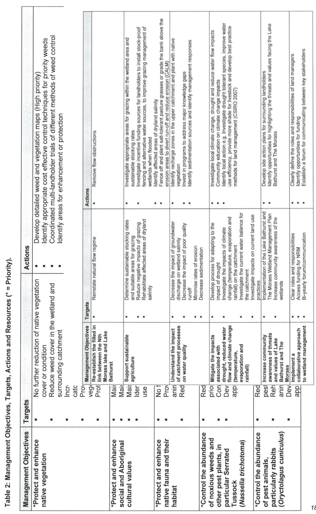

> [Picture on page 140: a picture, saved as a picture (images/part-03-general-development-controls-page-140-1.gif, 150 dpi).]

### Groundwater

#### Objective

To protect and enhance the water quality of groundwater systems.

The objective is to identify and protect vulnerable groundwater resources from contamination as a result of inappropriate development.

#### Controls

Information is available from Council on potential groundwater areas (limestone).

Applicants must consider the extent to which the development would affect the groundwater resources in terms of the:

1\. potential for ongoing impacts through the operation of the development.

2\. adequacy of the measures proposed to avoid, mitigate or remedy any adverse effects of the proposed development.

3\. Development consent must not be granted to development unless the applicant has submitted a report with the development application that addresses, to the satisfaction of the consent authority, the following matters:

(a) characteristics of the groundwater present in the area,

(b) any potential risk of groundwater, contamination from on-site storage or disposal of solid or liquid waste and chemicals,

(c) any potential adverse cumulative impacts on groundwater including the impacts on groundwater extraction for potable water supply or stock water supply,

(d) a description of any proposed measures to be undertaken to avoid or ameliorate any potential adverse impact.

(e) that the extraction is environmentally sustainable, ie does not exceed re-charge

Note: Groundwater extraction also requires consent from the Department of Primary Industries - Water.

### Basic landholder riparian rights for subdivision

#### Objective

1\. To achieve rural living water use that is consistent with water management principles.

2\. To ensure compliance with section 5(2) of the Water Management Act 2000.

#### Controls

Lots created by subdivision for a dwelling where a town water supply is not available shall not have direct frontage to the Wollondilly, Mulwaree and Shoalhaven rivers.

The dwelling shall not be sited on land that overlaps an aquifer.

The development application must demonstrate how an adequate potable water supply and non-potable water supply will be sourced for each lot to be created (minimum supply is 0.7Ml/year).

### Biodiversity management

Note: Reference Clause 7.2 – LEP 2009

#### Wollondilly, Mulwaree, Shoalhaven and Tarlo Rivers

#### Objectives

1\. To provide bed and bank stability

2\. To protect water quality

3\. To maintain viability of riparian vegetation

4\. To provide continuity and connectivity

#### Controls

Major development proposals including subdivision, residential accommodation, tourist and visitor accommodation, are to provide buffer corridors adjacent to nominated rivers including a 40 metre wide core riparian zone, 10 metre wide vegetated buffer and a bushfire asset protection zone between the outer edge of the vegetated buffer and the development each side of the river where appropriate.

Development is to be excluded from the 50 metre wide zone and the zone is to be fenced off with limited access points to the river.

Bushfire asset protection zone area can be utilised for stormwater infrastructure, walkways, cycleways, perimeter road and building set back area.

Stormwater is to be captured and treated outside of the 50 metre buffer area prior to discharge to the Rivers.

#### Riparian corridors

#### Objectives

1\. Protect and manage existing good condition vegetation remnants in riparian corridors.

2\. Restore degraded vegetation in riparian corridors.

3\. Regenerate vegetation in cleared areas along riparian corridors.

4\. Protect and restore buffer areas to vegetation along riparian corridors.

5\. Identify, protect and manage the aquatic ecological values including bed and bank stability, water quality and natural flow regimes.

6\. Protect the linkages provided by riparian corridors.

7\. Have a neutral or beneficial effect on water quality.

Reference: Goulburn Mulwaree Biodiversity Strategy 2007.

Riparian corridors are identified in Figure 3-6.

#### Controls

#### Category 1

A person must not take an action in or adjacent to lands mapped as Category 1 (40m from top of bank) where that action:

▪ is within 10 metres of the 40m buffer, or

▪ leads to an adverse effect on the condition of native vegetation within the riparian corridors, or

▪ fragments an occurrence of vegetation within the riparian corridors, or

▪ modifies or destroys abiotic factors (such as water, nutrients or soil) necessary for the survival of vegetation within riparian corridors, or

▪ results in invasive species that are harmful to riparian corridors becoming established in an occurrence of these lands, or

▪ diminishes the capacity of a buffer area adjacent to riparian corridors, or

▪ adversely affects the capacity of a regional connectivity area or a riparian corridor, or

▪ adversely affects water quality

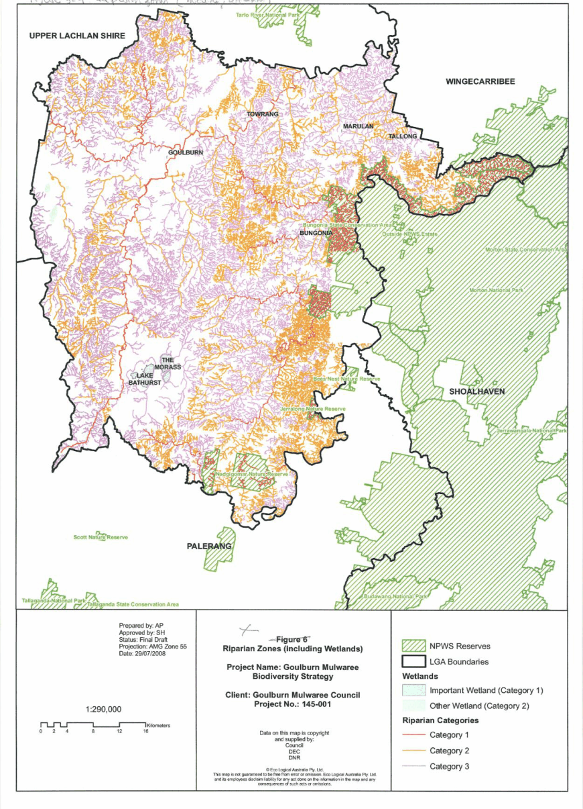

> [Picture on page 145: a picture, saved as a picture (images/part-03-general-development-controls-page-145-1.gif, 150 dpi).]

#### Figure 3-6: Riparian Corridors (including wetlands)

#### Category 2

A person must not take an action in or adjacent to lands mapped as Category 2 (20 metres from top of bank) where that action:

▪ is within 10 metres of the 20m buffer, or

▪ leads to a long-term adverse affect on good or moderate condition native vegetation within riparian corridors, or

▪ reduces the overall extent of vegetation within the riparian corridors, or

▪ fragments an occurrence of vegetation within the riparian corridors, or

▪ modifies or destroys abiotic factors (such as water, nutrients or soil) necessary for the survival of vegetation within the riparian corridors, or

▪ results in invasive species that are harmful to riparian corridors becoming established in occurrence of these lands, or

▪ adversely affects the capacity of the riparian corridor, or

▪ adversely affects water quality.

#### Category 3

A person must not take an action in or adjacent to lands mapped as Category 3 (10 metres from top of bank) where that action:

▪ leads to a long-term adverse affect on good condition native vegetation within the riparian corridors, or

▪ fragments an occurrence of vegetation within the corridor, or

▪ destroys abiotic factors (such as water, nutrients or soil), or

▪ results in invasive species that are harmful to riparian corridors becoming established in an occurrence of these lands, or

▪ adversely affects the capacity of the riparian corridor, or

▪ adversely affects water quality.

Note: A person must not take an action in or adjacent to riparian corridors where the requirements under the {NSW Biodiversity Conservation Ac 2016t}, Fisheries Management Act and Rivers and Foreshore Improvement Act (or Water Management Act when it repeals the Rivers and Foreshores Improvement Act) have not been met.

#### Regional corridors

Corridors are linear landscape features that connect two or more, larger habitat patches, allowing either movement of individuals, or gene – flow among native fauna and flora.

#### Objectives

1\. Protect and manage existing vegetation remnants in regional corridors.

2\. Protect the linkages provided by regional corridors.

3\. Restore degraded vegetation.

4\. Regenerate vegetation in cleared areas.

#### Reference

Regional Corridors are identified in Figure 3-7

#### Controls

A person must not undertake an action in or adjacent to lands mapped as regional corridors where that action:

▪ leads to a long-term adverse effect on native vegetation within the regional corridor

▪ reduces the extent of vegetation within the regional corridors

▪ adversely affects the capacity of a regional corridor or riparian corridor

A person must not undertake an action in or adjacent to vegetation within regional corridors where the requirements under the {NSW Biodiversity Conservation Act 2016} and {NSW Biodiversity Conservation Act and/or NSW Local Land Services Act (as applicable) have not been met.

#### Figure 3-7: Regional corridors, biodiversity hotspots and reserves

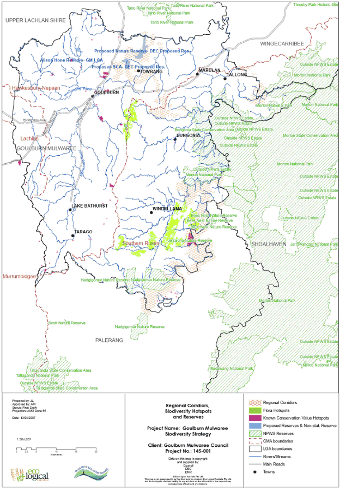

> [Picture on page 148: a picture, saved as a picture (images/part-03-general-development-controls-page-148-2.gif, 150 dpi).]

### High Environmental Conservation Value areas

Reference: Vegetation conservation values are identified in Figure 3-8.

#### Objectives

1\. Protect remaining high conservation value vegetation.

2\. To prevent trading unless considered to be a social and economic benefit of State significance.

3\. Protect and restore buffer areas to high conservation value vegetation.

4\. Protect the contribution high conservation value vegetation has to regional connectivity areas and riparian corridors.

#### Figure 3-8: High Environmental Conservation Value map

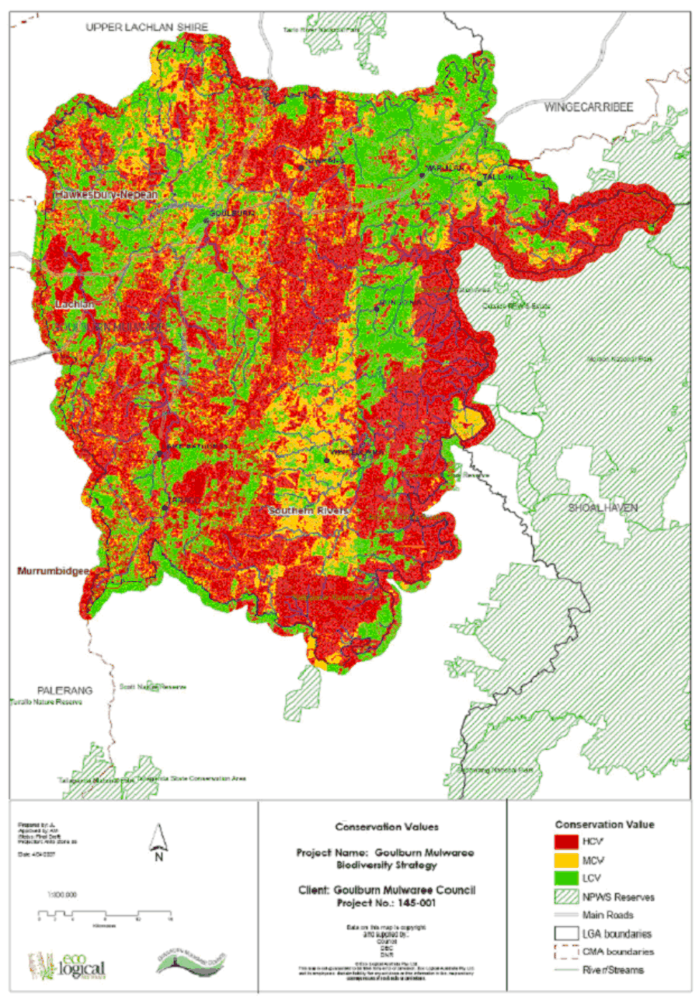

> [Picture on page 150: a picture, saved as a picture (images/part-03-general-development-controls-page-150-2.gif, 150 dpi).]

#### Controls

A person must not undertake an action in or adjacent to high conservation lands where that action:

▪ will not meet the ‘maintaining and improve’ biodiversity outcomes

▪ leads to a long-term adverse effect on high conservation value vegetation

▪ reduces the extent of high conservation value vegetation

▪ fragments an occurrence of high conservation value vegetation

▪ adversely affects habitat critical to the survival of high conservation value vegetation

▪ modifies or destroys abiotic factors (such as water, nutrients or soil) necessary for the survival of high conservation value vegetation

▪ results in invasive species that are harmful to high conservation value vegetation becoming established in an occurrence of these lands

▪ diminishes the capacity of a buffer area adjacent to high conservation value vegetation

▪ adversely affects the capacity of a regional connectivity area or riparian corridor

#### Medium conservation valued areas

#### Objectives

1\. No net loss of medium conservation value vegetation.

2\. Some flexibility for trading and offsets.

3\. Protect the viable remnants of medium conservation value.

4\. Restore medium conservation value when low conservation value native vegetation is to be cleared.

5\. Protect the contribution medium conservation value lands have to regional and riparian corridors.

#### Controls

A person must not undertake an action in or adjacent to medium conservation value lands where that action:

▪ leads to a long-term adverse effect on medium conservation value vegetation

▪ reduces the extent of a medium conservation value vegetation

▪ fragments an occurrence of the medium conservation value vegetation

▪ adversely affects the capacity of a regional connectivity area or riparian corridor Note: A person must not undertake an action in or adjacent to medium conservation value vegetation where the requirements under the {NSW Biodiversity Conservation Act 2016}

and or an applicable Property Vegetation Plan certified by the relevant Catchment Management Authority have not been met under the former Native Vegetation Act or an approval has been issues by LLS under the Local Land Services Act.

#### Key fish habitat

#### Objectives

Protect and restore fish habitat.

Restore degraded vegetation in riparian corridors.

#### Controls

▪ NSW Department of Primary Industries:

- Many developments within or adjacent to waterways (Refer to Key Fish Habitat Map Figure 3.11) are subject to the provisions of the Fisheries Management Act 1994. The Act may apply regardless of whether or not development consent from Council is requested or has been granted.

- Proponents are strongly advised to contact the Department of Primary Industries for advice before undertaking any development work in the Key Fish Habitat areas.

▪ Key threatening processes:

- “Installation of instream structures that modify flow regimes” is listed as a Key Threatening Process under the provisions of the Fisheries Management Act 1994.” Careful consideration of the appropriateness of a development proposal that will involve the installation of a dam, weir, causeway or culvert is required.

- Removal of large woody debris (snags) is listed as a Key Threatening Process under the provisions of the Fisheries Management Act 1994.” Careful consideration of the appropriateness of a development proposal that will involve or contribute to the removal of large woody debris is required.

- “Degradation of Native Riparian Vegetation” is listed as a Key Threatening Process under the provisions of the Fisheries Management Act 1994. Careful consideration of the appropriateness of a development proposal that will contribute to a loss or decline in riparian vegetation is required.

#### Figure 3-9: Key Fish Habitat

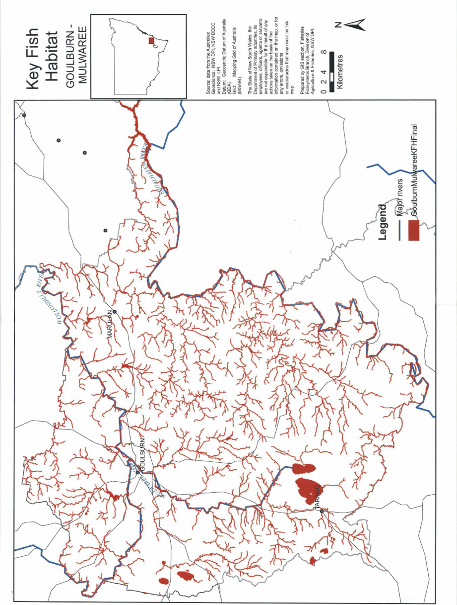

> [Picture on page 153: a picture, saved as a picture (images/part-03-general-development-controls-page-153-2.gif, 150 dpi).]

Approvals or concurrence required from NSW Department of Primary Industries include:

▪ Any dredging or reclamation in any waters (permanent or intermittent, man-made or natural, public or private) will require a permit from NSW DPI, whether carried out by a developer or the Council itself (unless approved by another NSW Public Authority). The definitions of dredging or reclamation under (s198-203) of the Fisheries Management Act 1994 are very broad and essentially can be interpreted as any works within a waterway or “water land”. This potentially includes:

▪ Waterway crossings, culverts, weirs, bridges or similar structures;

▪ Water recreation structures (eg wharf, jetty, boat ramps);

▪ Earthworks and drainage works (in “water land”);

▪ Stormwater control devices;

▪ Environmental protection work (e.g. erosion control devices, wetland restoration, riverbank erosion protection);

▪ Extractive industries;

▪ Flood mitigation work;

▪ Maintenance dredging;

▪ Irrigation works (pipelines, pumping stations);

▪ Any blockages or obstructions to fish passage under (s218-220) of the Fisheries Management Act 1994;

▪ Any release or importation of “fish” under (s216-217) of the Fisheries Management Act 1994 into any waters will require a permit from NSW DPI Fisheries;

▪ Removal or movement of in-stream snags including large woody debris or boulders (i.e. Fish Habitat Protection Plan No. 1);

▪ Use of explosives or electrical devices within a waterway under (s111-114) of the Fisheries Management (General) Regulations 1995; and

▪ Any damage to gravel beds in waters where trout are likely to spawn under (s206-

207\) of the Fisheries Management Act 1994.

#### Subdivision – Consent Requirements

NSW DPI recommends that the consent authority, before granting consent for subdivision, must consider the following matters:

1\. Roads or subdivision access across watercourses are potential blockages to fish passage. Single access points across a watercourse should be incorporated into planning (e.g. a single road easement across a watercourse to subdivisions). All such structures should require development consent and a minimum requirement to grant consent should be compliance with NSW DPI’s Policy and Guidelines for Waterway

Crossings (Why do fish need to cross the road?) which is available from the Department’s website.

2\. Rural subdivision adjacent to waterways needs to be minimised or controlled so that there is no net increase in basic riparian water rights and extraction levels of surface water from natural watercourses. Subdivision of water front land can result in a proliferation of Basic Landholder Rights (formerly Riparian Rights) administered by the Water Management Act 2000. Increased extraction has a severe cumulative negative impact on the protection of downstream aquatic habitats.

Advisory Note: (1) Excavation of material from the bed or banks of a waterbody, (2) depositing any sand, soil, rock, rubble or other material on the bed of a waterbody, (3) constructing a structure (weir, dam, causeway etc) within a waterbody such that the flow of water or the free passage of fish may be obstructed, or (4) extracting water from the waterway may require a permit in accordance with the provisions of the Water Management Act, Rivers and Foreshores Improvement Act or the Fisheries Management Act 1994. Please check with the Department Primary Industries -  Water.

Advisory Note: “Degradation of native riparian vegetation along NSW waterways”, “Removal of large woody debris (snags)” and “Installation and operation of instream structures and other mechanisms that alter natural flow regimes of rivers and streams” are listed as Key Threatening Processes under the provisions of the Fisheries Management Act 1994. Careful consideration of the appropriateness of a development proposal that will contribute to a loss or decline in native riparian vegetation, involve the removal of snags or involve the installation or change in operation of an instream structure is required. If the area is habitat for a threatened species, population or community of fish, then a “significant impact” is likely to be the conclusion of the 7 part test and a Species Impact Statement will be required.

Advisory Note: Any removal of native vegetation including trees, shrubs and other vegetation that occurs in an area zoned non-urban and non-industrial may require consent under the {NSW Biodiversity Conservation Act and/or NSW Local land Services Act (as applicable) unless an exemption applies. Applicants should contact the NSW Local Land Services – South East for details.

### Stormwater pollution

#### Long term pollution control

#### Objective

Limit the amount of pollution entering waterways via stormwater

#### Controls

Stormwater pollution is caused by litter, debris and dust which are washed off the streets and other surfaces during rainfall. Pollution is increased by chemicals and products that are poured or leak into drains and also by sewer overflows. The management of urban stormwater volumes has relied upon engineering hard pipe and channel systems. These systems are effective at removing stormwater quickly and therefore minimise the social and economic costs of flooding, however do not address stormwater quality issues.

To limit the amount of pollution entering waterways via stormwater, new development should implement such measures as:

• Incorporate pervious portions into otherwise sealed areas, to allow water to infiltrate into the ground

• Attempt to ‘fit’ development into the hydrology of the natural system

• Reduce the possibility of pollutants entering the stormwater by implementing erosion and sedimentation controls

• Provide on-site detention to control peak stormwater flows. On-site detention, especially when used on unpaved or grass surfaces, can trap and remove contaminants from stormwater and increase infiltration into the ground.

• Where an open space is a part of a development, investigate its dual use for site drainage by means of infiltration and/or delayed release to the stormwater system.

Reference should also be made to State Environmental Planning Policy Biodiversity and Conservation (Chapter 8 Sydney drinking water catchment) 2021and the Water NSW website, which outline the requirements for developments in the drinking water catchment and current recommended practices and performance standards endorsed or published by Water NSW that relate to the protection of water quality.

#### Short term pollution control

#### Objective

Minimise water pollution caused by development construction.

#### Controls

During construction the potential to pollute is high. To reduce this risk Council may require:

• On-site wheel and vehicle base cleaning facilities to reduce soil and contaminated material leaving the site

• Protection of as much existing vegetation as possible to reduce erosion

• Storage of building materials on-site to minimise stormwater contamination

To ensure all potential water pollutants are controlled and dealt with on-site, Council may require devices such as:

• Effective bunding

• Retention pits

• Grease traps

• Booms and trash racks

• Silt ant litter arrester pits

• Situation ponds

These lists are not exclusive and may vary as innovative products and methods are developed.

The pollution of any water is prohibited. Discharges from premises of any matter, whether solid, liquid or gaseous into any waters is required to conform with the Protection of the Environment Operations Act 1997 and the Regulations, or an environment protection licence issued by the Environment Protection Authority for Scheduled Premises.

### Bushfire risk management

All development on land that is classified as bush fire prone land identified on Council’s bushfire prone land map must be developed in accordance with the Rural Fire Service Planning for Bush Fire Protection Guidelines 2019.

#### Objectives

1\. Provide for the protection of human life (including firefighters).

2\. Minimise impacts on property from the threat of bush fire, while having due regard to development potential, on-site amenity and protection of the environment.

3\. Afford occupants of any building adequate protection from exposure to a bush fire.

4\. Provide appropriate separation between a hazard and buildings which, in combination with other measures, prevent direct flame contact and material ignition.

5\. Ensure that safe operational access and egress for emergency service personnel and residents is available.

6\. Provide for ongoing management and maintenance of bush fire protection measures, including fuel loads in the asset protection zone (APZ).

7\. Ensure that utility services are adequate to meet the needs of firefighters (and others assisting in bush firefighting).

#### Controls

“The Rural Fire Service advises that any development on bush fire prone land will be subject to the requirements of Section 79BA of the Environmental Planning and Assessment Act 1979 and Section 100B of the Rural Fires Act 1997.”

Additionally, the following bushfire matters should be provided for in the planning stages of any development:

▪ The future management regimes for any areas of hazard remaining within the subject

area. This should focus on the level of hazard posed to future development by the land or adjacent land and how the hazard may change as a result of development.

▪ Minimising the impact of radiant heat and direct flame contact by separating the development from the bush fire hazard by identifying the extent to which future development can provide for asset protection zones in accordance with Planning for

Bush Fire Protection  2019. Setbacks will depend on proximity to vegetation, vegetation type and slope.

▪ Substantial revegetation of a property, a riparian or wildlife corridor may increase bush fire risk to proposed or existing development. Any proposed revegetation should be undertaken in such a way that limits the spread and occurrence of fire.

▪ A plan of management will need to include fuel management within the development and maintenance of asset protection zones in accordance with Planning for Bush Fire Protection 2019 and the Service’s document ‘Standards for asset protection zones’.

▪ Roads within new development areas are designed to comply with section 4.1.3 of Planning for Bush Fire Protection 2019.”

Note: RFS has made getting additional information easier. For general information on Planning for Bush Fire Protection 2019, visit the RFS web page at www.rfs.nsw.gov.au and search under Planning for Bush Fire Protection 2019

### Urban Servicing (Water and Sewer)

#### Objectives

• To promote the orderly and economic use and development of land in urban areas where water and sewer reticulation services exist.

• To ensure the maximisation and optimal use of public water and sewer infrastructure.

• To improve amenity outcomes in relation to odour and run off from on-site effluent disposal systems by connection to reticulated town sewer services.

• To ensure consistent water supply.

• To protect water quality within the Sydney drinking water catchment.

• To ensure better public health outcomes in areas with a higher density of population.

#### Controls

(i)  Minimum lot sizes quoted by the LEP for zones R1 General Residential, R2 Low Density Residential, R3 Medium Density Residential, and R5 Large Lot Residential (equal to or less than 2,000m²) are for serviced land where each lot created will be connected to reticulated water and sewerage services.

(ii)  The minimum lot size quoted for zones R5 Large Lot Residential (with lot areas greater than 2,000m2) and RU5 Village are for unserviced land.

#### Note. Clause 7.3 of Goulburn Mulwaree Local Environmental Plan 2009 also

includes considerations for residential development servicing in the R5 Large Lot

#### Residential and RU5 Village zones.

#### The 2000m2 lot size is expressed as a minimum and is subject to site conditions

or site constraints, and the type of on-site effluent management system proposed in relation to onsite wastewater management.

(iii) Land zoned, E1 Local Centre, E2 Commercial Centre, E3 Productivity Support, E4 General Industrial, is intended to be serviced land where each lot created will be connected to Council reticulated water and sewerage services.

(iv) The following provisions apply to unserviced urban land for new development in Marulan (Zones R1 General Residential, R2 Low Density Residential, R5 Large Lot Residential,  E1  Local Centre, E3 Productivity Support, and E4 General Industrial):

a) Council  is  currently  undertaking  an  expansion  and  upgrade  of  the  existing Marulan  Waste Water Treatment  Plant,  and  due  to  current  capacity  issues  further sewer  connections are limited. Generally, further sewer connections will not be permitted until the new treatment plant has been commissioned. Therefore, further subdivision or  development beyond  1 equivalent tenement  (ET)  per  existing  lot cannot  be  supported  until  such  time  that  capacity  becomes available.

In some circumstances (in relation to development applications) Council may issue a ‘deferred commencement’ condition to the effect that the applicant is required to satisfy the Council that the site will be able to be connected to Council’s reticulated sewerage system by way of an approval under s68 of the Local Government Act 1993.

However, this would still be pending the commissioning (commencement of operation) of the upgraded Waste Water Treatment Plant.

b) Alternatively, should any onsite sewerage/waste water treatment system be proposed in a development application and installed prior to the commissioning of the upgraded Marulan WWTP it shall only be temporary. Connection is required to Council’s system once the system is commissioned (refer Section 124, Order 24, NSW Local Government Act 1993).

c) Private recycled water schemes (private package sewer treatment plants servicing more than 1 lot) may be considered as a temporary solution in Marulan where reticulated sewer capacity is not available and land is zoned for urban purposes (Zones R1 General Residential, R2 Low Density Residential, R5 Large Lot Residential, E1 Local Centre, E3 Productivity Support, and E4 General Industrial).

The following matters must be considered as a part of any proposed private scheme:

1\. Private recycled water schemes or package sewer plants (serving more than 1 lot) are treated as a “water utility” under the Water Industry Competition Act 2006 (WIC Act). The following link to the IPART Fact Sheet clarifies how this development sits with the NSW Environmental  Planning  and  Assessment  Act development  approval  process (whether assessed under Part 4 or 5 of the Act):

Private Water Utilities (WIC Act) | IPART

#### Note: A licence under the POEO Act may be required for systems over 2500

persons capacity (or 750 kilolitres per day) and involve the discharge or likely discharge of wastes or by-products to land or waters.

2\. Developments proposing these schemes will require the concurrence of Water NSW and will need to demonstrate a neutral or beneficial effect (NorBE) on water quality.

3\. Compliance with relevant guidelines and Australian Standards such as:

▪ Australian Guidelines for Water Recycling -https://www.waterquality.gov.au/guidelines/recycled-water

▪ NSW Guidelines for Management of Private Recycled Water Schemes, NSW Department of Water and Energy, 2008. -https://water.dpie.nsw.gov.au/__data/assets/pdf_file/0006/180582/Section-60- Interim-NSW-Guidelines-for-Management-of-Private-Recycled-Water- Schemes.pdf

▪ Environmental Guidelines – Use of Effluent by Irrigation (Department of Environment and Conservation (NSW), 2004). -https://www.epa.nsw.gov.au/sites/default/files/effguide.pdf

4\. Private recycled water schemes are at the full cost of the developer and are considered to be temporary. Full connection to the Council WWTP once commissioned will be required including associated fees and charges. Any residential or employment related development that anticipates the need for a private recycled water scheme or package sewer plant must clearly outline details of this in the accompanying development application (DA).

d) Pump out services may be considered  as a  temporary solution in Marulan where reticulated sewer  capacity  is  not  available  and  land  is  zoned  for  urban purposes  (Zones  R1  General Residential,  R2  Low  Density  Residential,  R5 Large  Lot  Residential,  E1  Local  Centre,  E3 Productivity Support, and E4 General Industrial). Pump out services are not cost effective or efficient compared to on-site sewage management or reticulated sewerage.  Additionally, transportation of effluent by truck (tanker) creates traffic and pollution issues.

Council are to contact WaterNSW for advice in circumstances where a pump out system is considered to be the only viable option - as per the NorBE Guideline (WaterNSW, 2022).

The following is required to ensure that the installation of pump out systems is environmentally and economically efficient:

1\. Where approved the applicant is to meet any costs including all associated costs in relation to provision of the service including the design, construction of the reticulation services within and outside the land (to properly serve the land) and payment of the full calculated developer charge for any newly created dwelling and/or lots.

2\. Further to the above, regarding the provision of new pump out services, if Council permits a  new  effluent  pump out  service,  any  cost  of  providing  the  pump out

service  will  not  be borne by Council but will be the responsibility of the applicant/landowner and this will be noted  in  the  Section  10.7  Certificate  and  the Title  Deeds  under  Section  88  of  the Conveyancing Act.

3\. Pump out systems will not be considered in relation to any land proposed to be rezoned as identified in Council’s Urban and Fringe Housing Strategy or the subject of any planning proposal.

4\. Council will undertake routine inspections of onsite sewage management systems (except aerated wastewater treatment systems) as part of the process of obtaining approval to operate a system of sewage management. Aerated waste water treatment systems are inspected and reported on by qualified third party operators. Council require up to date service reports (within three months) when issuing a License to Operate for this type of system. Council will notify the owner, or the occupier of the property where the system is operated, of the result of an inspection. Furthermore, any restriction under Section 88 of the Conveyancing Act will benefit Council in relation to providing the ability to ensure maintenance and to have Council undertake maintenance where this has not occurred at the cost of the landowner.

5\. Any pump out system will be temporary. Connection to Council’s reticulated system will be required once the Waste Water Treatment Plant and associated system is commissioned.

#### Note:  Council does not provide pump out services.  Any pump out service will

be privately arranged between the landowner and a licensed contractor with appropriate approvals. Contractor details and licence information will need to be provided to Council.  This requirement will be outlined as a condition of consent.

(v) For  unserviced  land  the  lot  size  quoted  depends  on the  concurrence  of  Water NSW  and a satisfactory detailed investigation of:

a) Accumulative water quality issues associated with wastewater management of effluent disposal and stormwater disposal for the proposal must be considered and assessed against State Environmental Planning Policy Biodiversity and Conservation 2021, Part 6.5 – Sydney Drinking Water Catchment. A Water cycle Management Study must be submitted with any development application demonstrating that on site systems can achieve a neutral or beneficial effect on water quality.

b) The provision of an adequate water supply to each lot for drinking (potable supply), ablutions and firefighting purposes. (Chapter 5.3 discusses development standards for individual rural dwellings and should be noted for the purpose of these investigations).
