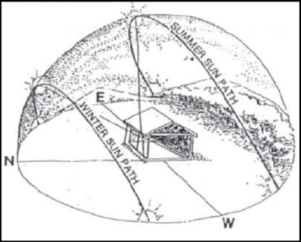
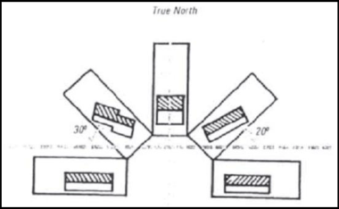
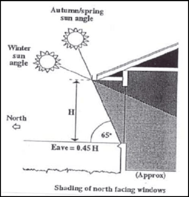
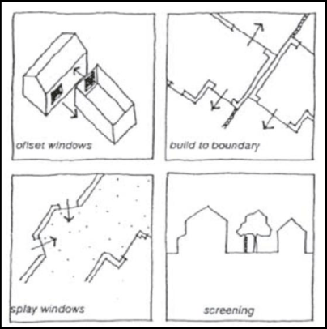
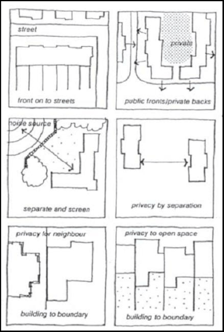
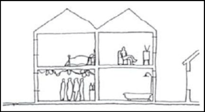
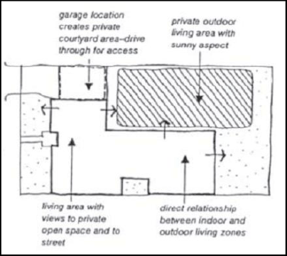
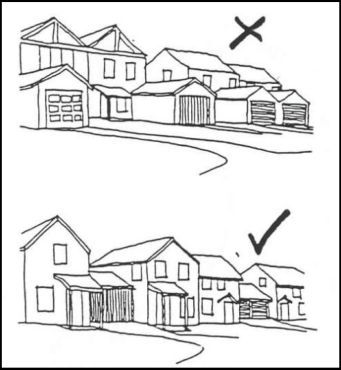
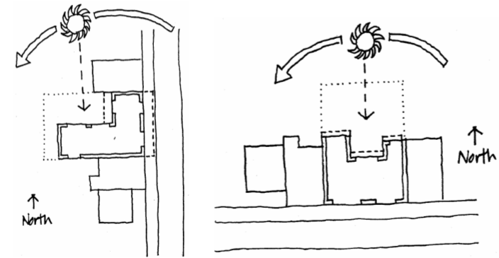

### Residential development

This Section applies to residential development, residential development in business zones and miscellaneous development in residential zones.

#### Site planning, bulk, scale and density

#### Objective

Achieve a coherent site layout that provides a pleasant, attractive, manageable, resource efficient and sustainable living environment.

Ensure bulk and scale does not have an unacceptable impact on the streetscape and the character of the locality.

Higher density developments are located close to public transport shopping and community facilities.

#### Controls

Ensure the site layout integrates with the surrounding environment through:

▪ adequate pedestrian, cycle and vehicle links to street and open space networks;

▪ buildings facing streets and public open spaces;

▪ building, streetscape and landscape design relating to the site topography and the surrounding neighbourhood character.

(i) Percentage of residential development allowed in Business zones:

▪ B2 Local Centre– 40% of gross floor area;

▪ B4 Mixed Business – 100% of gross floor area;

The minimum gross floor area for dwelling units all Business zones is 150m².

Developments with higher floor space ratios are to be located:

▪ within walking distance of good public transport; or

▪ within reasonable walking distance of shopping and community facilities; or

▪ where favourable physical conditions exist such as an outlook onto public open space, a wide road, corner position, a north-facing slope, rear lanes or multiple access opportunities; or on sites larger than normal infill sites (eg. greater than 1000m2).

(ii) Places of public worship in R2 Low Density Residential zones.

Gross floor area of places of public worship shall not exceed 150m².

(iii) Multi dwelling housing density.

The minimum average amount of site area required for each dwelling in dual occupancy and multi dwelling housing development is:

▪ R1 General Residential and R2 Low Density Residential – 350m² per dwelling unit.

▪ R5 Large Lot Residential (sewered land) – 1000m² per dwelling unit.

▪ R5 Large Lot Residential (unsewered land) – 1 hectare per dwelling unit.

▪ RU5 Village – 700m² per dwelling unit.

Note: To ascertain minimum allowable lot sizes for individual sites reference should be made to the lot size maps (LEP 2009).

#### Sheds and other ancillary structures

Sheds and other ancillary structures to residential development (e.g. car ports) must adhere to the height limits outlined in Table 4-1 below:

#### Table 4-1: Height limits

| Setback | Height limit |
|---|---|
| 0-1m | 2.4m |
| 1m | 3m |
| 2m or greater | 3.6m |

Note: A shed means an outbuilding, usually for a specific purpose such as storage and is a building that cannot be used for a habitable purpose

#### Rain gardens

Rain gardens are to be located on a low spot away from any dwelling with access to sunlight. Rain gardens must drain away from nearby dwelling.

Note: Rain gardens are not to be used in the calculation of private open space.

#### Cut and fill

#### Objectives

To minimise the extent of cut and fill within residential allotments.

To protect and enhance the aesthetic quality of the area by controlling the form, bulk and scale of land forming operations.

To ensure that the amenity of adjoining residents is not adversely affected by any land forming.

To ensure that stormwater management is not adversely affected.

#### Controls

Earthworks shall be undertaken to a maximum of 600mm excavation or fill from the natural surface level of the property.

Council will assess proposals for excavation or fill greater than 600mm having regard to the visual impact of the proposed earthworks.

All cut and fill shall have a setback to the boundary to permit any retaining walls to be located wholly within the property boundary and to allow fencing to be installed at the boundary.

#### Dwelling design

Dwelling houses and each unit of a detached dual occupancy development are not to comprise of substantially the same streetscape design of any other dwelling house or unit of a detached dual occupancy development that exists or is proposed as part of the same application within four lots either side of the development site and on either side of the road it is fronting (inclusive of the development site). This provision does not apply to attached dwellings (e.g. attached dual occupancies, semi-detached dwellings etc.) or developments within heritage conservation areas or adjoining heritage items where the development is designed to be sympathetic to existing development and period details etc.

#### Number of storeys

#### Objective

Minimise the impact of building heights on neighbours of proposed residential development.

#### Controls

Dwellings and multi dwellings are to have a maximum of 2 storeys outside the statutory height mapped areas

(Refer also to height of buildings maps in the LEP 2009).

#### Solar access

#### Objective

Achieve energy efficient urban housing, using passive solar design that provides residents with year round comfort and reduces energy consumption.

#### Controls

Residential buildings shall be designed to ensure that the principal living spaces of the proposed dwelling, adjoining residential buildings, and at least 50% of their private open space, have at least three hours of sunlight between 9.00am and 3.00pm on 21 June (winter solstice). Figure 4-3 identifies the variation of the sun’s path in winter and summer.

Note: Direct sunlight is achieved when 1m² of direct sunlight on the glass is received for at least 15 minutes. To satisfy 3 hours direct sunlight, 12 periods of 15 minutes will need to be achieved, however the periods do not need to be consecutive.

No structure is permitted where it would prejudice the ability of adjacent lots to meet the above control or overshadow existing neighbouring solar powered devices (e.g. photovoltaic panels, solar water heaters).

In circumstances where an adjacent southern lot has an east-west orientation, the following southern setbacks should be applied in order achieve the above controls:

▪ 1.5m for all single storey development within 12m of the forward building line.

▪ 3m for all single storey development behind the first 12m of the forward building line.

▪ 3m for all second storey development within 12m of the forward building line.

▪ 6m for all second storey development behind the first 12m of the forward building line.

Shadow diagrams or solar access diagrams may be required by Council to demonstrate compliance with this section.

#### Figure 4-3: Variation of the sun’s path

> [Picture on page 6: a picture, saved as a picture (images/part-04-principal-development-controls-urban-page-6-2.gif, 150 dpi).]

The dwelling should be designed and positioned so that the greatest potential for adequate shade in summer and exposure to sunlight in winter occurs (where windows to living areas of dwellings have an orientation within an angle of 20 degrees east and 30 degrees west from the north).

#### Figure 4-4: Best orientation of buildings

> [Picture on page 6: a picture, saved as a picture (images/part-04-principal-development-controls-urban-page-6-11.gif, 150 dpi).]

Shaded areas in Figure 4-4 identify the preferred location of habitable rooms relative to True North to maximise energy efficiency. Where possible, buildings are orientated on a north-south or east-west access to maximise solar access.

#### Figure 4-5: Shading of north facing windows

> [Picture on page 6: a picture, saved as a picture (images/part-04-principal-development-controls-urban-page-6-19.gif, 150 dpi).]

Figure 4-5 demonstrates the shading of north facing windows in buildings with optimum orientations. Eaves on north facing walls should be designed to completely shade windows in summer but allow the sun to shine through in winter. To calculate the distance the eaves should overhang, from the base of the window on an elevated plan, draw a line at 65°. Methods for shading the glass with awnings or vegetation should be considered.

#### Privacy

#### Objectives

Ensure privacy between dwellings.

Avoid overlooking of living spaces in buildings and private open spaces.

#### Controls

Windows and balconies are not to be positioned in a location where it allows for direct views into nearby/adjoining approved habitable rooms. Balconies and second storey windows are also not to have direct views into the private open space of nearby approved residential areas unless permanent privacy elements are applied (e.g. privacy screens or high still windows). Figures 4-6 and 4-7 demonstrate appropriate ways to maintain privacy.

Note: habitable rooms has the same definition as in the National Construction Code for the purposes of this Plan.

Bathrooms and water closets are excepted from the above control provided that their windows are permanently frosted.

Windows must not be located parallel to other windows of adjacent dwellings. However this may be permitted on the ground level if it can be demonstrated that the erection of a fence will completely restrict overlooking into the opposite room.

Swimming pool pumps and other miscellaneous noise producing ancillary structures must be located at least 6m from the nearest habitable room. Sound insulation must be also be used if a swimming pool pump is within 3m of a property boundary.

#### Figure 4-6: Locating windows to reduce overlooking

> [Picture on page 8: a picture, saved as a picture (images/part-04-principal-development-controls-urban-page-8-2.gif, 150 dpi).]

Visual privacy for adjoining properties and within development projects can be achieved by:

▪ using windows which are narrow, translucent, or obscured

▪ ensuring that windows do not face directly onto the windows, balconies, or courtyards of adjoining dwellings (refer to Figure 4-6)

#### Figure 4-7: Designing for privacy

> [Picture on page 9: a picture, saved as a picture (images/part-04-principal-development-controls-urban-page-9-2.gif, 150 dpi).]

▪ screening devices and landscaping opposing windows, balconies and courtyards

▪ windows and balconies of dwellings to be separated or screened from commercial areas so as to avoid overlooking of private open space (refer to Figure 4-7)

#### Figure 4-8: Designing for acoustic privacy

> [Picture on page 9: a picture, saved as a picture (images/part-04-principal-development-controls-urban-page-9-13.gif, 150 dpi).]

Noise generating areas of a development (e.g. driveway entrances to car parks, air conditioning plant and swimming pool areas) should be adequately screened or located away from the bedroom areas to minimise their impact on neighbouring areas (refer to Figure 4-8).

Bedrooms of one dwelling must not share walls with living rooms or garages of adjacent dwellings; and

Bedroom windows are to be at least 3 metres from shared streets, driveways and parking areas of other dwellings.

#### Private open space

#### Objective

Provide open space for recreation within the site.

Maintain and enhance the existing streetscape and landscape character.

Provide for privacy and shade.

#### Controls

#### Figure 4-9: Optimising private open space

> [Picture on page 10: a picture, saved as a picture (images/part-04-principal-development-controls-urban-page-10-4.gif, 150 dpi).]

Whenever possible, private open space is to be orientated to have a north easterly aspect and the principal living areas are to have direct access to the private open space (refer to Figure 4-9).

Areas used for driveways, car parking, drying yards, service yards, rain gardens, rainwater tanks, services or the like shall not be included as private open space.

The minimum amount of private open space required per detached, attached or semi-detached dwelling is 75 m². This 75m2 of private open space must be a single contiguous area with a minimum length of 6m and width of 4m.

Secondary dwellings must also provide a minimum of 75m2 of private open space in accordance with the above control.

#### Setbacks

#### Rear setback

A minimum rear setback of 6m is required for all residential development.

#### Side setback

A minimum side setback of 1m is required for all residential development, which excludes all ancillary service infrastructure such as hot water services, air-conditioning units, electrical meter boxes and the like.

#### Front setback

A minimum front setback of 4.5m, measured from the forward building line to the property boundary, is required for residential development. A smaller front setback distance may only be considered if it is consistent with the front setback of adjacent dwellings constructing on subdivisions that predate this Development Control Plan.

Note: garages must be setback a further 1m from the front façade of the building in accordance with the controls contained within the next section.

Secondary frontages on corner allotments must be setback 3m and exclude all raised pathways, steps, parking spaces and the like.

#### Views

#### Objectives

1\. To minimise, where possible, the obstruction of views from adjoining buildings or public places.

2\. To maximise views from living areas within the allotment.

#### Controls

Step buildings to follow the slope of the land.

Minimise the height of buildings and planting on the highest part of the site.

Council may require an applicant to provide a survey showing the position of the proposal on its site, the location of adjoining buildings and the degree of view lost.

Retain and protect existing vegetation where possible.

#### Traffic safety and management

#### Objectives

Ensure that garages meaningfully contribute to the parking capacity of the dwelling.

Reduce the visual impact of garages, carports and parking areas on the streetscape and improve dwelling presentation.

Provide sufficient and convenient parking for residents, visitors and service vehicles.

Ensure vehicular and pedestrian safety.

Encourage access design to form part of the overall landscape design.

Provide acceptable levels of access, safety and convenience for all road users.

#### Controls

#### Car parking and driveways

#### Figure 4-10: Preferred garage treatment

> [Picture on page 12: a picture, saved as a picture (images/part-04-principal-development-controls-urban-page-12-6.gif, 150 dpi).]

The visual impact of garages is to be minimised, as illustrated on Figure 4-10.

All garage and carport entries are to be set back from the front facade of the dwelling by a minimum of 1 metre and comprise of not more that 40% or 6m of the front façade of the building, whichever is the greater. Additional or wider garages may be permitted if they are not visible from the street.

For residential development, the minimum standard of provision is detailed at clause 3.4 of this plan.

A minimum of two (2) parking spaces is required per dwelling unit for a dwelling house, attached dwelling, dual occupancy or semi-detached dwelling development. Single vehicle garages do not count towards this parking space requirement unless there is a minimum of 10m2 additional storage space provided within the garage, with a minimum dimension of not less than 1.5m, not including space designated for car parking, circulation space or space used as a laundry. The minimum internal width of a car parking space shall be at least 3.5m by 6.5m. This control may be varied if it can be demonstrated that the dwelling provides the equivalent area in dedicated storage space elsewhere in the building, not including pantries, wardrobes or any unenclosed space of any other room.

Parking areas and driveways shall be designed in accordance with the current version of Council’s Standards for Engineering Works. All driveways, paths, car parking areas are to be paved in brick pavers, bitumen, concrete or another approved manner. Use of decorative paving is encouraged.

Long, straight driveways are to be avoided, eliminated or appropriately landscaped to Council’s satisfaction.

Paved area is to be minimised.

Access for one dwelling via right of carriageways is to be a minimum of 3.5 metres in width (excludes traffic control devices), except when it is more than 40 metres long where the total minimum width increases to 5.5 metres. Landscaping with a minimum width of 0.5 metres is to be provided along the boundary of the driveway in addition to the minimum width.

#### Site Facilities

#### Objectives

Design to integrate adequate and convenient site facilities such as storage, recycling and collection areas into the overall development.

Ensure site facilities are practical and easily maintained.

#### Controls

Garbage bins, waste recycling areas, mailboxes and external storage facilities should be adequate in size, durable, waterproof, blend in with the development, avoid visual clutter and be accessible to the users of the building and service vehicles.

Ensure garbage storage and waste recycling areas are not located adjacent to any residential habitable rooms.

Provide adequate internal storage and design internal layouts to allow the building to be re-used for other purposes in the future.

#### Energy efficient siting and layout

#### Objective

Achieve improved energy efficiency through the siting and design of all buildings.

Building shape and orientation have a high impact on the energy performance of a building. A well designed building has the potential to reduce energy costs by up to 50%. The improved performance does not have to add to the project cost or change the appearance of a building.

#### Controls

Building shape and orientation are major influences that affect energy consumption. The most critical element of a building's form is the size and orientation of its windows. The

shape of a building influences the amount of floor area that can benefit from daylight through windows. Daylight is generally useful to a depth of 4-6 metres from a window.

Buildings must be designed to ensure that all floor areas are to be within a 6 metre distance of an external window. An elongated plan shape produces this characteristic, as will the use of an atrium or courtyard. Maximise north and south facades, whilst minimising east and west facades (refer to Figure 4-3 & 4-11).

#### Figure 4-11: Examples of building orientations to maximise energy efficiency

> [Picture on page 14: a picture, saved as a picture (images/part-04-principal-development-controls-urban-page-14-8.gif, 150 dpi).]

#### External window shading and internal and external lighting

#### Objectives

Integrate external window shading into the design of buildings to improve energy efficiency and comfort.

Maximise natural light to buildings and reduce the use of non-renewable energy resources.

#### Controls

Shading devices must be external.

North facing windows can provide valuable heat gain and light in winter but should be shaded from direct sunlight in summer.

East and west facing windows are difficult to shade in summer and should be minimised. South facing windows require no shading but can cause substantial heat loss in winter.

Maximise north and south windows and minimise those facing east and west.

For north facing walls provide horizontal shading devices such as awnings, upper floor balconies, pergolas, verandas, eaves and overhangs.

Where windows face east or west, vertical shading devices such as blinds, shutters, adjustable awnings and landscaping should be used.

Consider the location, shape, type and height of fully grown trees when using landscaping as a shading device.

Shading materials are to comply with C1.10 of the Building Code of Australia.

The choice of glass depends upon whether you want to maximise the sunlight or heat loss, or minimise heat gain into the building.

The use of skylights, light wells, and atriums can let additional daylight into a building although provision of shading in summer and possible heat loss in winter will need to be considered.

The need for artificial lighting can be reduced by the correct orientation and design of the building and the size and placement of windows and service areas which require high lighting levels (e.g. desks or workstations, by individual task lights).

Lighting costs can be reduced by selecting low energy lamps, ballasts and fittings which provide the desired level of illumination but consume 75% less energy. Lighting controls can be fitted to ensure that lights are not left on when not required. For instance, switches should be provided for separate zones within a large room and for task lights. Time switches or movement sensors should be employed for areas with sporadic use.

Lighting systems should be designed to supplement daylight in order to provide appropriate lighting levels for specific tasks.

#### Insulation

#### Objectives

Improve the energy efficiency and comfort of buildings by designing to make the best use of natural ventilation.

#### Controls

Windows should be oriented to take advantage of the cooling summer breezes. The position of internal walls and partitions should allow the passage of air through the building although, in some cases, ceiling fans may be required.

In cases where mechanical ventilation is necessary (e.g. kitchens, some computer rooms or areas where external noise levels are high), ensure that the system installed has appropriate controls which can cater for the particular use of the building whilst maximising the conservation of non-renewable energy.

Significant factors affecting natural air movement are:

▪ building form and the location of windows

▪ site and landscaping features

▪ internal planning and design

Ventilation can be achieved in the following ways:

▪ cross ventilation, where air enters a building from one side passing out on the other, replacing warm inside air with cooler outside air

▪ stack effect, where warm air rises through the height of the building, and is replaced by cool air at the base of the building

▪ artificial ventilation, where fans are used to extract warm air allowing it to be replaced by cool air

For effective ventilation:

▪ locate openings on opposite sides of rooms

▪ locate windows and openings in line with each other, and where possible, in line with prevailing breezes - a low level inlet and high level outlet is preferable

▪ use water features such as fountains in strategic positions to cool breezes

▪ consider strategic positioning of vegetation to modify wind direction

▪ use ceiling fans to provide a high level comfort on most hot days, at low running costs

Use window types that provide security while allowing for good ventilation.

Design buildings with a maximum internal dimension between openings of 14m to maximise natural ventilation without compromising other design elements.

Ensure ventilation can be achieved by permanent openings, windows, doors or other devices, which have an aggregate opening or openable size of not less than 5% of the floor area of the room.

In restaurants or buildings with kitchens where mechanical ventilation is needed, use those which operate directly above cookers, rather than designing high ventilation rates through the whole kitchen.

#### Space heating and cooling

#### Objectives

Where thermal comfort cannot be achieved through building design elements choose energy-efficient and environmentally-friendly space heating and cooling systems.

#### Controls

If air conditioning is necessary, install a unit with sufficient controls to ensure that it is used only when required. Consider partial air-conditioning directed to areas, rooms where it is needed, whilst the rest of the building remains naturally ventilated.

When choosing heating, consider which type is most suited to your particular needs, i.e usage patterns, location of staff etc. As with other equipment select heating devices that have appropriate controls to cater for the particular use of the building whilst maximising the conservation of non-renewable energy.

Use passive methods of minimising heat gain.

Design buildings with window shading, appropriate insulation, and sealed against hot air infiltration during the day, incorporating ventilation and natural cooling.

#### Working hours – residential and business

#### Objectives

Ensure the operations of the proposed development and construction period will not cause nuisance to residents by way of working hours.

#### Controls

Council seeks to ensure that the hours of operation of businesses, commercial premises and places of work are compatible with the type of activities carried out on the premises and the relationship with neighbouring residential occupiers (e.g. for home businesses, home industries, neighbourhood shops etc.).

Where residential buildings are physically attached to non-residential buildings, hours of operation should not normally fall outside the hours of 7.30am and 6.00pm Monday to Friday and 7.30am and 1pm on Saturday.

Hours of operation will depend on the type of use proposed, its location in relation to residential properties and the impact of extended hours on the occupiers of those properties.

Where development sites are within a residential area, hours of work during site preparation and construction should not normally fall outside the hours of 7.30am and 6.00pm Monday to Friday and either 8.00am to 2.00pm on Saturday or 8.00am to 2.00pm on Sunday.

#### Subdivision

The following subdivision controls apply to all residential subdivisions. Site specific development controls supersede to the extent of any inconsistency.

#### Objectives

▪ Control the density of development in order to manage population growth and maintain the character of urban areas.

▪ Promote lot sizes of appropriate size to accommodate residential dwellings and related private open space.

To encourage subdivision layouts that:

▪ allow integration of neighbourhoods between “natural” boundaries or barriers and connections between the neighbourhoods

▪ minimise environmental impact by ensuring subdivision into residential lots only occurs on land free of development constraints

▪ are based on a hierarchy of roads for the efficient movement of vehicle traffic

▪ focus open space on the drainage constraints and network

▪ incorporate water sensitive urban design principles into subdivision design

▪ encourage northern orientation of future dwellings for energy efficiency benefits and passive solar access

▪ ensure residential lots have a sufficient area to allow for the siting of a dwelling and ancillary buildings (including private open space, vehicle access and parking)

▪ ensure residential lots face public areas (including open space areas) for passive surveillance

▪ provide for protection/enhancement of visually prominent sites/locations

▪ protect riparian areas and native vegetation areas

#### Qualifications for servicing

(i) Minimum lot sizes quoted by the LEP for zones R1, R2 and R5 (equal to or less than 2,000m²) are for serviced land where each lot created will be connected to reticulated water and sewerage services.

(ii) The minimum lot size quoted for zones R5 (with lot areas greater than 2,0002) and RU5 are for unserviced land.

(iii) For unserviced land the lot size quoted depends on a satisfactory detailed investigation on:

▪ Accumulative water quality issues associated with wastewater management of effluent disposal and stormwater disposal for the subdivision proposal and

#### ▪ The provision of an adequate water supply to each lot for drinking (potable

supply), ablutions and firefighting purposes. (Chapter 5.3 discusses development standards for individual rural dwellings and should be noted for the purpose of these investigations).

#### Controls

#### Master planning

Council is receptive to subdivision designs that accommodate a mixture of lot sizes and dwelling types. Such subdivisions designs can accommodate a broader cross-section of housing development and maximise development yield. However, in order to facilitate such development, Council must first ensure adequate provisions are made to ensure that the subdivision design can accommodate this increased density.

Residential subdivision applications involving the creation of a new public road are to be provided with a master plan to consider the future development capacity of the land and demonstrate compliance with relevant controls in this Plan.

Each proposed lot shall be labelled as being primarily intended for:

▪ Single detached dwelling houses;

▪ Dual occupancies or semi-detached dwellings;

▪ Multi dwelling housing (with the number of dwellings to be specified);

▪ Attached housing (with the number of dwellings to be specified); or

▪ A combination of any of the above.

Where a lot is identified as being suitable for a combination of the above or as being identified as suitable for a range of different dwelling yields, Council will apply controls relevant to the highest dwelling yield identified and the most intensive dwelling type in terms of infrastructure demand. For the avoidance of doubt, Council will determine that a lot is intended for a higher dwelling yield than specified if more dwellings can be subsequently approved under the complying development approval pathway.

Subdivision design must allow for any subsequent development to be reasonably capable of complying with other development controls in this Plan.

Battle-axe lots are not permitted if the subdivision can reasonably be carried out without their use.

#### Road location and hierarchy

A road hierarchy must be indicated and designed in accordance with Council’s Engineering Standards. If there is an inconsistency between these standards and this Plan, this Plan prevails to the extent of the inconsistency.

Road widths and hierarchy must be designed to accommodate the maximum dwelling yield identified for the subdivision.

Road widths and hierarchy must be designed to allow for increased traffic and on-street parking for services that may reasonably be expected to occur in the subdivision (e.g. child care facilities, neighbourhood shops).

The nominated road network must also include an assessment of how it is the optimal means of achieving the following:

1\. Safety for all road users.

2\. Access to community centres and recreational areas.

3\. Access from within the subdivision to surrounding areas.

4\. Integration or compatibility with pedestrian and cycling routes within the subdivision (e.g. ensuring safe crossings).

5\. Minimisation of through traffic in residential areas.

6\. Adequate provision of on-street parking.

7\. Compliance with other controls in this Plan.

The road hierarchy must allow for any subsequent development to be within 400m walking distance of existing bus routes. If bus routes do not exist, the road hierarchy must be capable of supporting a new bus route within 400m walking distance of all subsequent development.

Should remnant vegetation be located in either existing or proposed road reserves it shall be conserved in the design and construction process. Access to new lots should be located in an alternate position or to take advantage of existing road reservations where they exist. Council will require that access to lots (driveways) be nominated in Section 88B instruments in order to protect existing vegetation and to reduce their visual impact.

#### Building envelopes

In circumstances where Council considers the land or part of the land to be particularly constrained or unique, a plan must be submitted to Council that indicates the location of building envelopes to be enforced through a restriction as to user on the land. Building envelopes for residential subdivisions are to assume a minimum site coverage of 65%, including carports, driveways, potential swimming pools, sheds and other ancillary structures that may subsequently be built.

Lot orientation

The following design techniques are to be adopted to maximise opportunities for solar access to allotments and to allow for the consequent design and siting of energy efficient houses:

▪ align streets east-west and north-south. Aim for north-south streets within 20o west and 30o east of true north and east-west streets within 30o south and 20o north.

▪ allotments on east-west orientated streets need to have greater depth and width to make best use of solar access.

▪ allotments on south side of street should be sufficient depth so buildings can be set well back to allow north facing rooms to look onto larger front yards.

▪ allotments on north-south streets to be of sufficient width to allow for private open space on the north side and for houses to be built on the south boundary.

▪ taking into account views and topography, lot orientation and layout should enable the majority of dwellings to be designed so that the main living area receives not less than 3 hours of sunlight per day between 9am and 3pm.

▪ regular rectangular shaped allotments maximises siting opportunities and increases potential lot yield.

▪ on sloping sites, north-facing sites improve opportunities for solar access.

Lots shall face toward public open space areas, vegetation conservation areas and public roads to encourage passive surveillance from dwellings over these public spaces to assist with safety and security. This must not be to the detriment of achieving suitable solar access.

#### Water Sensitive Urban Design

Natural drainage lines are to be preserved and enhanced where possible.

Natural drainage lines are not to be channelled if connecting to natural drainage channels downstream.

Stormwater detention basins are to be made easily accessible for maintenance purposes.

Stormwater detention basins are to be fenced in urban areas and incorporated into the landscape design of the subdivision.

#### Public open space

All new lots created must be within 400m walking distance of public open space. Public open space, for the purposes of this control, is taken to have a minimum contiguous area of 1500m2, containing landscaping and amenities designed to encourage utilisation (e.g. playground equipment, exercise equipment etc.).

#### Bicycle and pedestrian movements

Provision for bicycle and pedestrian movements are to be provided throughout the subdivided area.

Cyclists can be integrated into the road network through a combination of on and off road measures together with bike parking at clusters of community and commercial facilities

To encourage cycling as an easy transport alternative, on-road and off-road cycle networks will be clearly highlighted with signposting and pavement logos.

Paved footpaths are to be provided in accordance with Council’s engineering standards.

#### Retention of significant environmental features

Where significant environmental features such as natural landforms, remnant native vegetation, wetlands or natural drainage lines or water courses occur on a development site, they shall be conserved and or enhanced. Subdivision design shall incorporate these elements as much as can practicably be achieved. This may necessitate larger lot sizes in order to maintain these features.

#### Landscape embellishment

A condition of Council’s subdivision approval will be to carry out landscape treatment of lots and public road reserves with the objective of enhancing vegetation and specifically native vegetation in the locality. The landscape treatment shall be designed to mitigate the:

▪ environmental impact of the development;

▪ visual obtrusiveness of new development and enhance the visual connection of the newly created landscape with any remnant native vegetation in the locality.

#### Street trees

Street tree planting is required where new or existing lots are developed in order to create a consistent theme. Street trees add to the areas character and reduce the visual impact of new development. They have environmental benefits of reducing the impacts of sun in the summer months; reducing global warming and when natives are used providing possible habitat for native fauna.

Important Street Tree principles are:

▪ Preserve vistas to and from significant heritage buildings and to rural areas;

▪ Reinforce traditional exotic planting themes and prominent gardens where they exist;

▪ Retain and enhance significant existing trees and remnant native areas;

▪ Reinforce the planting themes of the central town or village area.

Non-residential development – retail, commercial and
