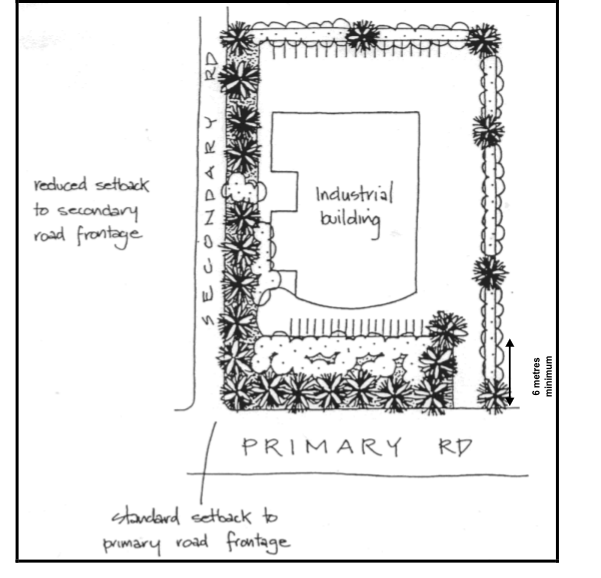

### industrial

Note: Clause 4.2 of this plan applies to new business, industrial and other non specified residential development irrespective of the zoning of the land.

Floor Space Ratio (FSR) controls on bulk and scale are found in the LEP 2009 clauses 4.4 and 4.5 for zones B2, B3, B4 and B6.

Heritage controls are found in chapter 3.1 of this plan.

Separate controls for the business zones of Goulburn’s CBD are found in Appendix I, “Good Design Statement” 2005.

#### Retail and commercial (general)

Chapter 8 contains site specific provisions for:

▪ The Marulan Local Business Centre – George Street Marulan, Chapter 8.4 and

▪ The Goulburn City Business District – Chapter 8.6.

These chapters relate to Council’s main retail and commercial areas.

Retail and commercial development outside of these areas should refer to the general principles outlined in these sub-chapters.

Heritage principles are also found in Chapter 3.1. Previous design principles which are still worth referencing are contained in “Goulburn Mulwaree Good Design Statement”, September 2005 – Appendix I.

#### Design principles – industrial

#### Objectives

Encourage a high standard of architectural design which contributes to a visually cohesive character.

Encourage building design which allows energy efficient development and good solar access.

#### Controls:

Large blank wall surfaces visible from a public place (eg road) shall be articulated by structural variations and/or blend of external finishes.

Prominent elevations and ‘areas of visual importance’ are to have a building form of significant architectural and design merit, with special attention to scale, form, external finishes, setbacks, height limits and landscaping.

Areas of visual importance include:

▪ gateway entries to the City, township or village

▪ developments than can be viewed from residential and public areas

▪ Heritage Conservation Area and heritage items Prominent elevations include:

▪ arterial road frontage

▪ public reserve exposure.

▪ Visual

#### Visual quality – industrial

#### Objectives

Identify areas of visual importance.

Limit external storage of goods.

#### Controls

External storage areas shall not be visible from a public place.

External storage areas are to be:

▪ located behind a building, or

▪ suitably screened (with dense landscaping and/or solid fencing);

In assessing development applications involving external storage of goods, Council shall take into consideration:

▪ height and arrangement of stored goods

▪ safety issues

▪ access arrangements

▪ aesthetics and ease of maintenance

#### Building setbacks – industrial

#### Objective

Provide an open streetscape which will enhance visual quality of development and the urban landscape.

#### Controls

All setback areas are to be landscaped (refer to Figure 4-11).

No parking will be permitted within setback areas.

Minimum requirements:

▪ frontage – 6 metres;

▪ side and rear – setbacks required for corner allotments (secondary road frontage) and in areas of visual importance. Note: Setback distances are proportionally related to required building materials so as to satisfy wall fire ratings – refer to Building Code of Australia for details.

#### Figure 4-11: Preferred industrial setbacks

> [Picture on page 27: a picture, saved as a picture (images/part-04-principal-development-controls-urban-page-27-2.gif, 150 dpi).]
> Words printed on the picture (title and legend, copied from the PDF):
> 6 metres minimum

#### Height – industrial

#### Objectives

Encourage building forms to respond to topography and the site’s relative position to other allotments and the streetscape.

Maintain the visual quality of the locality.

#### Controls

On land within a residential Zone, a maximum 8 metre height limit is recommended (distance measured vertically from any point on the roof of the building to the ground level immediately below that point).

Variations on land within such zones will only be considered where it can be demonstrated that:

▪ the proposed height is in keeping with the character of the locality

▪ it is not visually obtrusive

▪ the additional height is required due to the nature of the proposal

▪ the overall design, including landscaping and building materials, reduces the impact of height and bulk

On land not affected by the height of building maps, no height limit is specified, however the height (as defined above), shall take into account and address the following matters in the development application’s, statement of environmental effects:

▪ the proposed height is in keeping with the character of the locality

▪ it is not visually obtrusive

▪ the height is required due to the nature of the proposal

▪ the overall design, including landscaping and building materials, reduces the impact of height and bulk

#### External materials and finishes - industrial

#### Objectives

Promote the use of appropriate external finishes and innovative use of materials.

Ensure that industrial development contributes to the streetscape and visual aesthetics of the area.

#### Controls

The external walls of industrial buildings shall be profiled colour treated cladding or masonry materials, or a combination of both and incorporate visual relief elements.

Particular consideration shall be given to the design and use of materials for the street elevation of industrial buildings.

Where the side or rear elevation of an industrial building is visible from residential or public areas, colours and wall profiles should be selected to minimise their visual impact.

#### Noise and vibration – general requirements

#### Objectives

Minimise the impact of noise and vibration by proposed operations and on proposed developments of existing and projected future sources of noise and vibration.

#### Controls

Council is the appropriate regulatory authority for noise related activities, such a heavy industries, mining, extractive industry, motor racing tracks and the like under the Protection of the Environment Operations Act 1997. If development sensitive to noise were to be approved on adjacent properties to the noise source, Council will be responsible for regulating any resulting noise impacts.

Council recommends applicants utilise the following documents to assist them in making decisions relating to acceptable noise levels for noise generating and noise sensitive developments:

▪ NSW Industrial Noise Policy

▪ Environmental Criteria for Road Traffic Noise

▪ Noise Guide for Local Government

The above documents are available from the NSW Environment Protection Authority website: www.environment.nsw.gov.au/noise

The impact of noise generated by a proposal can be minimised to comply with the statutory requirements in different ways. The following guidelines address means of achieving the standards.

Incorporate sound proofing for machinery or activities considered likely to create a noise nuisance during design development.

Locate noisy operational equipment within a noise insulated building away from residential areas.

Design logistically efficient business practises to minimise the use of equipment, movements per site, and number of vehicle movements per site per day.

Where sites adjoin a residential area, limit the number of hours and times at which mechanical plant and equipment is used in conjunction with the measures described above.

Ameliorate the noise and vibration impact of transport operations by using appropriate paving or track mounting and installing acoustic barriers as required to meet standards on neighbouring uses.

Incorporate appropriate noise and vibration mitigation measures into the site layout, building materials, design, orientation and location of sleeping recreation/work areas of all developments proposed in areas adversely impacted upon by road or rail related noise and vibration.

#### Air pollution - industrial

#### Objectives

Minimise air pollution caused by new development.

#### Controls

The operation of any new premises and any machinery or plant to be installed or any process to be used must not cause emissions contrary to the Protection of the Environment Operations Act 1997 and Regulations. Applicants will need to demonstrate that these standards are met. Approvals may also be required from the NSW Environment Protection Authority for some types of development.

Machinery and operations should be designed to minimise the emission of air impurities. This includes minimising vehicular movements to and from the site.

Restricting the hours of operation may reduce any emissions to an acceptable level.

#### Mixed use development – industrial and residential

#### Objectives

Ensure that industrial development does not have an unacceptable impact on existing residential development within the same zone or at the interface between industrial and residential development.

#### Controls

Building setbacks between residential (existing) and proposed industrial development shall be 9m.

Height of industrial buildings in a mixed use situation are to be consistent with nearby housing development.

Traffic management and calming measures are to be recommended on roads shared by both industrial and residential traffic.

Change of use in mixed use situations are to detail and include amenity protection measures for existing residential development.

These measures may include (but not limited to):

▪ additional landscaping provisions (reference chapter 3.3);

▪ additional amenity considerations and actions;

▪ additional privacy provisions built into the proposal (reference chapter 4.1.4);

▪ traffic safety and management provisions (reference chapter 4.1.8);

▪ industrial design to ‘fit’ with residential streetscape and character (reference chapter 4.1.9);

▪ noise and vibration generation mitigation measures (reference chapter 4.2.15);

▪ reduce hours of operation (reference chapter 4.2.18);

▪ use of hard (solid barriers) and soft (vegetation) buffers at the interface between residential and industrial developments (principles of the use of buffers are contained in chapter 5.8).
