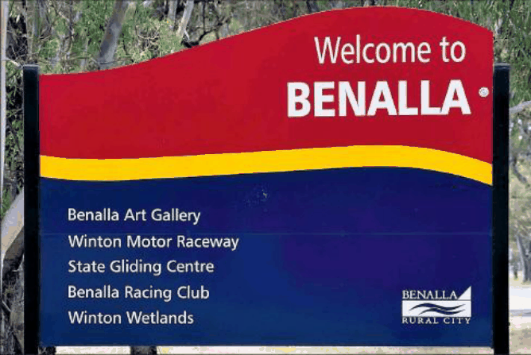

### Advertising and signage

#### Objectives

The aims of advertising and signage requirements are to:

Control the size and number of advertising structures or signs displayed on premises to improve the streetscape and amenity of the locality.

Provide information and guidance to building owners and occupiers and Council to enable appropriate design and placement of advertising.

Ensure desired urban or rural character of surrounding land uses is not compromised.

Encourage innovation in the design and construction of signs, within the parameters of this plan.

Encourage a co-ordinated and cooperative approach to advertising signs.

Reduction in the number of signs.

Encourage the use of simple, clear and uncluttered signs.

Discourage the use of neon signs for heritage buildings.

Ensure that any sign fits the streetscape and architecture of the building or location in terms of colour, illumination, wording and visual interest.

Eliminate all signs above awning level except where the architecture of the building provides for such signs.

#### Controls

The following design practices and strategies are to be adhered to when making applications for advertising and signage proposals:

#### Amenity

Materials, colours and placement of signs to be compatible with the existing building and streetscape – where available and suitable use existing materials, colours and placements.

Advertisements above awning level are not permitted except where the design of the building incorporates an advertising panel.

Designers will need to compromise on matters of corporate design where it is unsuitable in a particularly sensitive area, ie Heritage Conservation Area. The compromise may include lighter/softer shades, reduced signs different manufacturing techniques or the like.

Retain any significant (including previous) signs that are fixed to and or part of the building and recognisable as part of an historic building.

#### Design

a) Bulk, scale, shape and size

Signs in commercial zones should aim to attract pedestrians (across the road or into an arcade) by the use of below awning level signs. In assessing a development application for an advertising sign, it is necessary that the proposal:

▪ conforms to the desired future character of the area and does not dominate the streetscape or view

▪ complements the character, architectural design and period of construction of the building and surrounding buildings. For example signs should either be placed on windows, near entrance doors to the retail facility on panels defined using the grid analysis or on an appropriate architectural element such as a podium, pier or pole

▪ signs shall not extend beyond the dimensions of the building (or features they are mounted on in terms of width or length, e.g. awning fascia)

▪ be simple, clear and efficient and to a professional standard to inspire confidence in the business or product advertised

▪ not be visually spoiled by the method of providing electrical services to the sign

b) Number of signs

Fewer signs are encouraged in the interests of reducing clutter, improving amenity and improving sign efficiency – as with too many signs the message is lost in the clutter.

c) Colour, lettering and illumination for heritage buildings

#### Colour of signs

Sign colour shall be compatible with and complementary to the colour of the period of the construction of the building or locality.

Subdued colours rather than vivid are preferred in the Heritage Conservation Area. Fluorescent and iridescent colours are not acceptable in the Heritage Conservation Area, and a white background is also not acceptable.

Corporate colours are acceptable only if the colours, number of signs and sizes are compatible and complementary to the architecture and streetscape.

Council encourages the use of traditional colours as produced by Pascol, Berger, Dulux, Haymes, Porters, Taubmans and Wattyl.

Colour schemes, particularly for intact buildings shall be continuous above and below the awning so as to enhance the appearance of the whole building.

#### Lettering

The advertisement is to be designed to be uncluttered and clear with the wording being bold enough for easy reading and understanding.

Lettering style and size shall be compatible with and complementary to the architectural style of the building and streetscape, e.g. on historic buildings and streetscapes (pre-1950), signs must be professionally hand painted, not machine cut.

Buildings are encouraged to display street numbers in locations, size and colours, which complement the architecture and streetscape.

#### Illumination of signs

Illumination of signs is not appropriate when businesses are not trading.

Illumination shall be continuous only. Flashing or chasing lights are not acceptable.

Neon signs are not appropriate on buildings identified as heritage significant in a Heritage Study or in a Heritage Conservation Area under the LEP, buildings predating neon signs (c1922) or on buildings within the heritage streetscape of the CBD.

Internal illumination is only permitted for under awning signs on modern buildings.

d) Contemporary buildings and corporate signs

Modern signs are appropriate for modern buildings, however the objectives outlined are applicable. Signs on modern buildings must consider their impact on adjacent properties and the streetscape.

e) Traffic safety

Advertisements shall be designed so that they will not:

▪ obscure or interfere with road traffic signs

▪ obscure or interfere with vehicle vision

▪ distract drivers at intersections, level crossings or bends

▪ vary or move the intensity of the illumination

▪ issue traffic instructions, e.g. use of the words halt, stop or imitate traffic signs

▪ project over the boundaries of a classified road

▪ a sign must not be nailed or similarly fixed to a tree or street light pole

#### Highway and rural signage

All highway and rural signage proposals must comply with the NSW Department of Planning, Industry and Environment’s Transport Corridor Outdoor Advertising and Signage Guidelines requirements.

a) Assessment criteria

Each proposal shall undertake a design analysis for the specific locality that identifies:

▪ Existing character of the locality.

▪ Key scenic qualities and features of the locality.

▪ Desired future character of the locality.

b) Locality criteria

No signage is permitted in a rural zone or within 250m of the Hume or Federal Highways, except in the following circumstances:

▪ The sign relates only to the property on which it is erected.

▪ The sign relates to a temporary event and will only be displayed for no more than three (3) months and will be removed no more than two (2) weeks after the event.

▪ The sign is erected by Council or any other public authority.

▪ The sign indicates services or attractions available within a nearby settlement on a non-commercial basis. Only one of these signs is permitted per approach to each settlement, not including signs erected by Transport for NSW. Signs may refer to commercial services but not to business that provide them (Figure 6-1).

▪ The sign replaces an existing sign that was lawfully erected.

▪ It is a sponsorship sign for a local event, club or sporting group that is only intended for viewing from the land on which it was erected and not for viewing by passers-by.

▪ The sign is exempt under the Goulburn Mulwaree Local Environmental Plan 2009, the {SEPP Industry and Employment 2021 (Chapter 3, Advertising and Signage) 2021 or under any other Environmental Planning Instrument.

Figure 6-1: Example of a non-commercial sign showing tourist attractions in a nearby town.

> [Picture on page 17: a picture, saved as a picture (images/part-06-special-development-types-page-17-19.gif, 150 dpi).]

The signs should not:

▪ project over the carriageway

▪ be prejudicial to the safety of the public

▪ flash, move or cause glare

▪ be located in or adjacent to a residential zone

The sign should be incorporated with any other business identification signs at the site.

Maximum site sign area is 40m2 per side.

Signs are not to:

▪ impact on traffic safety

▪ adversely impact on the environmental character and quality of the classified road and views from classified roads

▪ interfere with traffic advisory and traffic control signs
