## 8 Site specific provisions

### Goulburn City Business District Preliminary

#### Aim

▪ Develop a plan for Goulburn City’s Business District that facilitates future management by balancing development and conservation in a sustainable way.

#### Objectives

▪ Develop standards, guidelines and principles to improve the image, attractiveness and functionality of the Business District of Goulburn City

▪ Attract business, tourism and residents to Goulburn Mulwaree.

▪ Maintain, protect, enhance and promote Goulburn City’s built and natural heritage.

#### Land to which Plan applies

This Plan applies to the land identified on the map shown as Figure 8-1-1

#### Figure 8-1-1: Land to which Plan applies – Goulburn City Business District

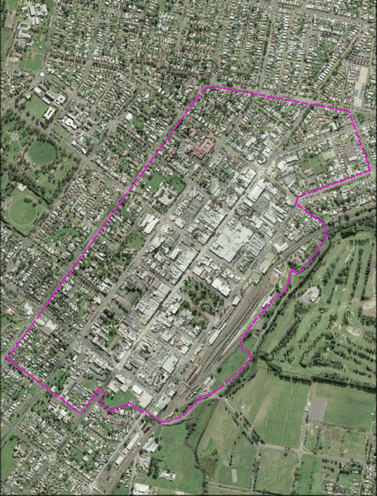

> [Picture on page 2: a picture, saved as a picture (images/part-08-site-specific-provisions-page-2-2.gif, 150 dpi).]

#### Background context material

(a) Historic context

The CBD has developed around its original planned city centre incorporating a uniform grid subdivision pattern. The formal axis along Montague Street from Victoria Park through St. Saviours Church to Belmore Park was an important component of the original town plan.

| 1817-1820 | Exploration by Hume, Thorsby, Meehan and Oxley alerted early colonists to good grazing potential of the southern highlands Governor Macquarie marked out the new town of Goulburn as a key |
|---|---|
| 1828 | service centre for the southern highlands – built at the confluence of the Wollondilly and Mulwaree Rivers |
| 1833 | Present city centre laid out on higher land to the south west to avoid repeated flooding |
| 1841-1845 | Town population increased from 655 to 1,200 |
| 1868 | Construction of railway completed and physical connection of the City Centre with the river severed |
| 1880s | Period of significant growth in the City (1881 Auburn Street Post Office opened); |
| 1887 | Court House opened |
| Early 20th C | Moderate expansion with only minor change. Rail as an employment focus diminished with growth in road transport |
| 1950s> | Period of decline with many regional headquarters relocating to Sydney or other regional centres Hume Highway by-pass. Loss of highway traffic caused a change in |
| 1992 | business mix but not significant loss of business. Council began Main Street Improvement Program to capitalise on new opportunities for public domain improvement. |

Reference: Goulburn CBD Plan, Interim Report 1, 29 August 2008 Edaw/AECOM.

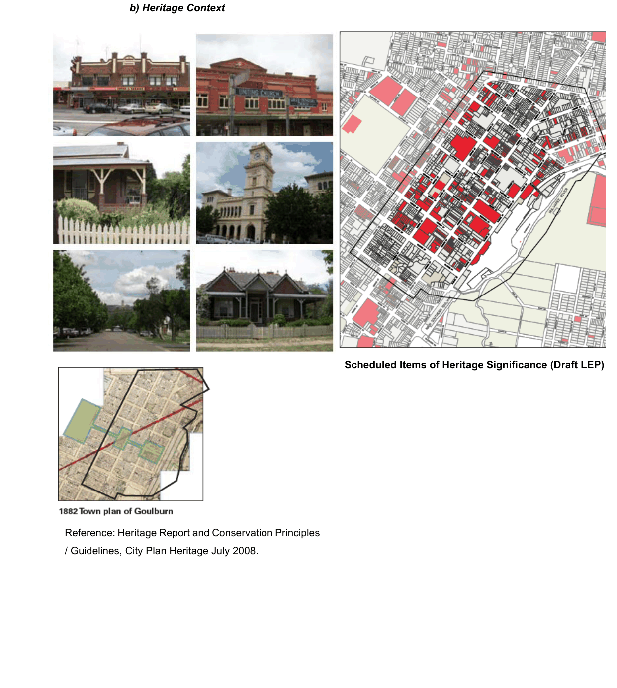

> [Picture on page 4: a picture, saved as a picture (images/part-08-site-specific-provisions-page-4-1.gif, 150 dpi).]

b) Heritage Context

#### Scheduled Items of Heritage Significance (Draft LEP)

Reference: Heritage Report and Conservation Principles / Guidelines, City Plan Heritage July 2008.

A report on heritage matters as they pertain to planning for the CBD have been provided by City Plan Heritage. The results of this work are described in the report available on Council’s website.

Items of Heritage Significance scheduled in the Goulburn Mulwaree Local Environmental Plan (LEP) 2009 are indicated in the heritage significance map.

“The City Plan report describes the following characteristics as being critical to the heritage significance of the CBD:

▪ The original grid form subdivision pattern dating from the establishment of Goulburn including nightsoil lanes, various rectangular allotment sizes addressing the street, and parks/open spaces.

▪ Predominately single-storey and uniform streetscapes with mostly intact Victorian and Federation housing stock.

▪ Relatively intact consistent main street commercial streetscape with two to three storey continuous historic character.

▪ Common residential architectural features such as street facing prominent gables, hipped or pitched corrugated iron or tile roofs, timber framed windows, front verandas, asymmetrical facades, face brick finished, and low fencing in keeping with the styles of the period.

▪ Common commercial architectural features including vertically proportioned above awning facades, decorative parapets with advertising evident in public and administrative buildings, two-storey continuous streetscape, verandas supported on posts over footpaths, dominant tower elements or splayed facades at the corner allotments, traditional shop windows and uncluttered above awning facades.

▪ Streetscapes that are dominated by mature trees creating a dense leafy setting generally concealing the houses in street-long views and frame views to houses close to the viewer.

▪ Maintained garden settings with generally low or no fencing to the street along residential zones of the CBD.

▪ Topography that is characterised by a number of small hills and ridges allowing the city to be experienced as a whole when approached from north whilst creating a distinctive view corridors and vistas towards north, south and particularly east from the ridge of the CBD (along Montague Street) in and out as well as within the study area.

▪ Well established public domain including roads with kerbed footpaths and grasses verges traffic management devices throughout, street trees and parks.

Conversely, the following elements are described as intrusive to the CBD’s heritage values:

▪ Uncoordinated and unregulated advertising and business signs along consistent streetscape creating unpleasant presentation.

▪ Unsympathetic single-storey or oversized infill development within a consistent two to three storey streetscape.

▪ Corporate buildings with their respective designs, corporate colours and signs.

▪ Contemporary buildings with no regard to the established heritage streetscape.

▪ Vacant allotments, service stations, car parking or car repair workshops / car sales yards.

▪ Overhead wires and antennas in some residential areas.”

Reference: Goulburn CBD Plan, Interim Report, 29 August 2008, EDAW/AECOM

(c) Street Character Statements

The character statements for each street that is located within the boundaries of the Goulburn Central Business District are provided in the form of dot points outlining the significant and dominant aspects of the street. The character statements also identified issues and negative aspects of the individual streets. The Statements are based on the Goulburn Mulwaree CBD Master Plan, Heritage Report and Conservation Principles / Guidelines, the Street Character Statements, July 2008, City Plan Heritage.

Note: The point of the statements and their accompanying photographs is to illustrate good and bad design elements.

It is the writers opinion and not necessarily the opinion of Council. It is not meant as a personal criticism and if taken that way please accept the writers apology.

(i) Addison Street

#### Good Elements:

• Consistent single storey residential streetscape (Photos 1 and 2)

• Wide footpath, street trees and small landscaped front garden (Photo 1)

• Setback building alignment (Photo 1)

• Pitched and multi gabled corrugated iron or tiled roofs (Photos 1 and 2)

• Low brick fence or no fence with open front gardens (Photo 2)

• Veranda with asymmetrical façade (Photo 3)

• Well established street trees (Photo 4)

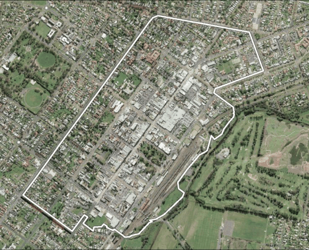

> [Picture on page 7: a picture, saved as a picture (images/part-08-site-specific-provisions-page-7-14.gif, 150 dpi).]

• Significant dwelling cluster between Auburn Street and Addison Lane (Photo 5)

#### Intrusive Elements:

• TV antennas and street overhead wiring (Photo 6)

• Eastern block (north side is a disjointed character mix of open space, community, industrial and residential activities (Photo 7)

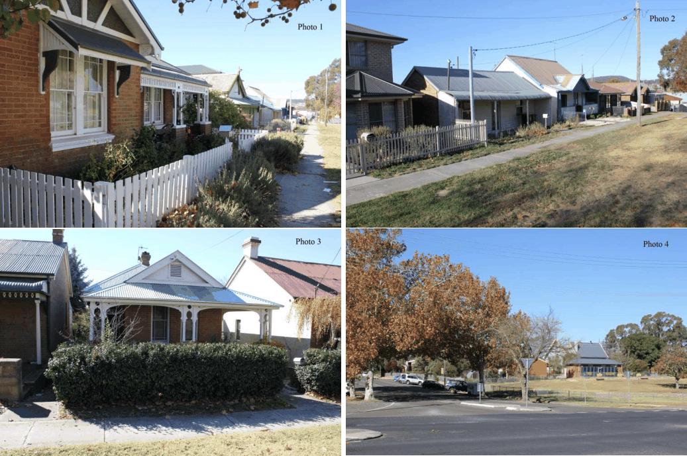

> [Picture on page 8: a picture, saved as a picture (images/part-08-site-specific-provisions-page-8-3.gif, 150 dpi).]

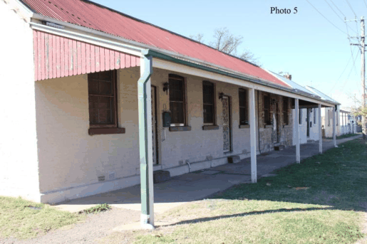

> [Picture on page 9: a picture, saved as a picture (images/part-08-site-specific-provisions-page-9-1.gif, 150 dpi).]

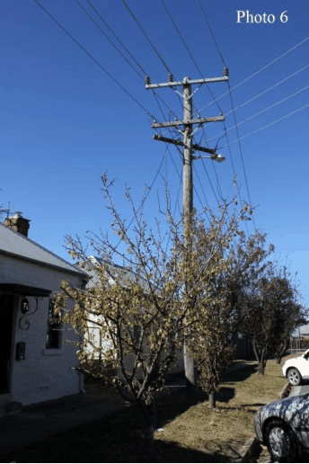

> [Picture on page 9: a picture, saved as a picture (images/part-08-site-specific-provisions-page-9-2.gif, 150 dpi).]

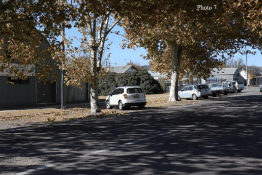

> [Picture on page 9: a picture, saved as a picture (images/part-08-site-specific-provisions-page-9-3.gif, 150 dpi).]

(ii) Auburn Street Auburn Street is the main commercial street of the CBD since the establishment of the town featuring

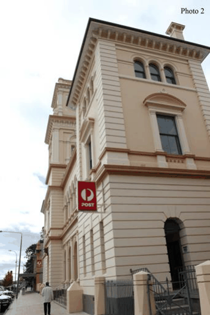

> [Picture on page 10: a picture, saved as a picture (images/part-08-site-specific-provisions-page-10-3.gif, 150 dpi).]

a high number of heritage items and consistent traditional commercial strips.

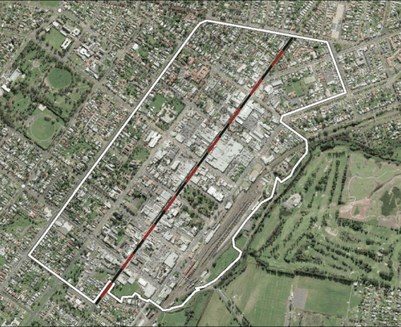

> [Picture on page 10: a picture, saved as a picture (images/part-08-site-specific-provisions-page-10-5.gif, 150 dpi).]

#### Good Elements:

• Two to three storey cohesive Victorian and Federation period. Shops with flats / offices above dominate the street particularly between Verner and Bradley Street (Photo 1).

• Important public and administrative domain buildings (Photo 2).

• Improvements to Belmore Park (Photo 3).

• Above awning façades (Photo 4).

• Well defined corner allotments with original buildings (Photo 5).

• Contemporary buildings reflecting some traditional design elements (Photo 6).

#### Intrusive Elements:

• Above awning signs (Photo 7).

• Infill buildings having no regard to the established character of the street (these include banks, government office, car yards, motels and shopping centre) (Photo 8).

• Loss of below awning and facia signs (Photo 9).

• Out of character corporate developments and signage (Photo 10).

• Service station development at the northern end of Auburn Street (Photo 11.1 & 11.2) – this is an important “gateway” entry.

• New building at the corner of Market Street complicates the simplicity of the traditional shops (Photo 12).

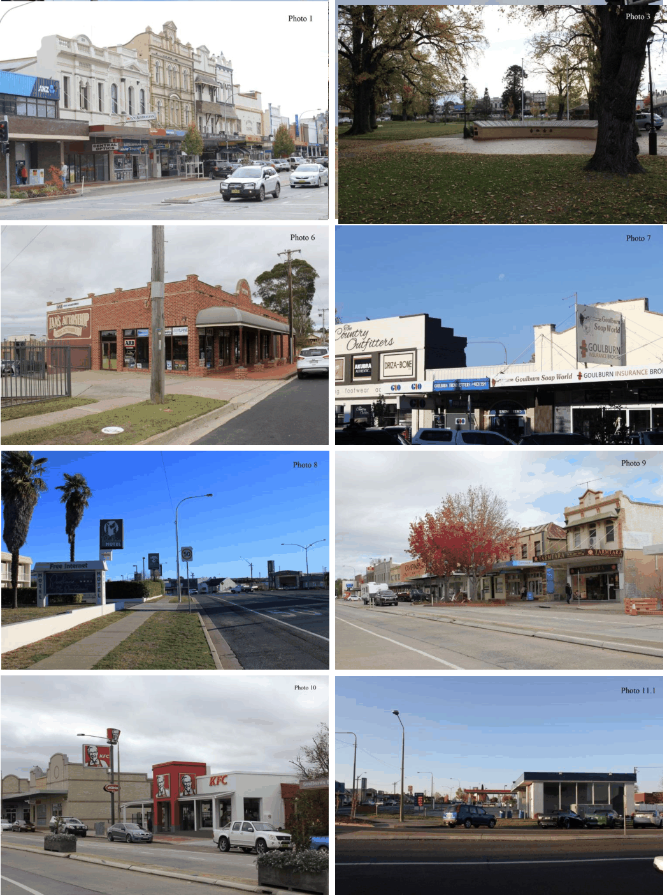

> [Picture on page 11: a picture, saved as a picture (images/part-08-site-specific-provisions-page-11-3.gif, 150 dpi).]

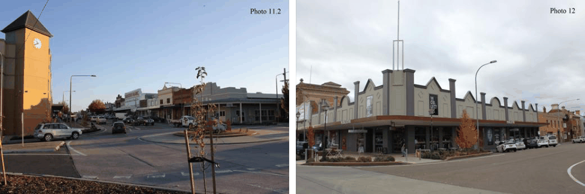

> [Picture on page 12: a picture, saved as a picture (images/part-08-site-specific-provisions-page-12-1.gif, 150 dpi).]

(iii) Beppo Street A short, residential and no thoroughfare street that runs between Cowper and Bourke Streets.

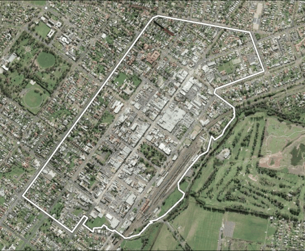

> [Picture on page 13: a picture, saved as a picture (images/part-08-site-specific-provisions-page-13-3.gif, 150 dpi).]

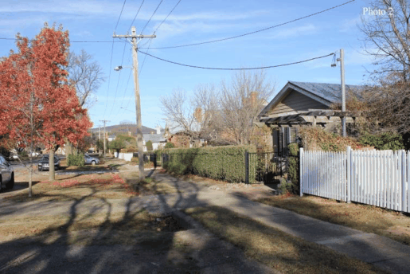

> [Picture on page 13: a picture, saved as a picture (images/part-08-site-specific-provisions-page-13-4.gif, 150 dpi).]

#### Good Elements:

• Mainly federation period residential dwellings (Photo 1).

• Established streetscape with dwellings ranging from two to single storey with large allotments (Photos 2 and 3).

• Tree lined quiet neighbourhood friendly street (Photos 2 and 3).

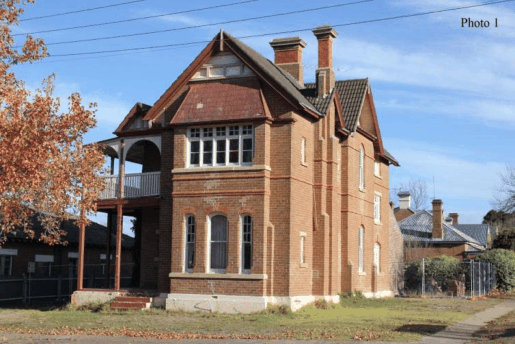

> [Picture on page 13: a picture, saved as a picture (images/part-08-site-specific-provisions-page-13-13.gif, 150 dpi).]

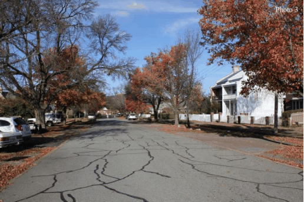

> [Picture on page 13: a picture, saved as a picture (images/part-08-site-specific-provisions-page-13-14.gif, 150 dpi).]

(iv) Bourke Street Bourke Street is typified by mixed developments and features a number of scattered heritage items, residential housing, motels, Conservatorium Technical College, a number of churches, St Saviours Cathedral at the highest point, Goulburn civic centre, Goulburn Public School, St John of God Hospital, fire station, and Apex Park. The residential developments are located at the northern and

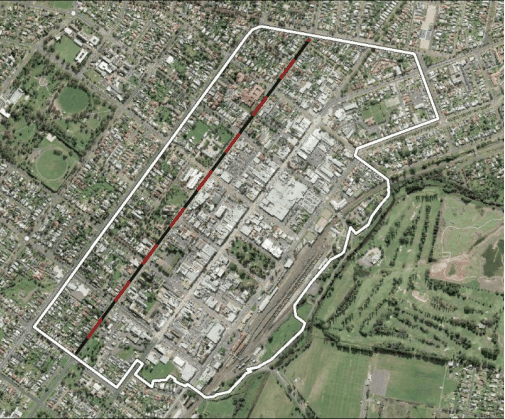

> [Picture on page 14: a picture, saved as a picture (images/part-08-site-specific-provisions-page-14-6.gif, 150 dpi).]

southern ends of the Street with consistent streetscape character.

#### Good Elements:

• Two storey form and mass (Photo 1).

• Institutional and religious buildings providing interesting and dominant streetscape elements (Photo 2).

• Mixed uses with residential developments at north and south ends (Photo 3).

• Significant dwelling cluster between Clinton and Verner Streets on western side (Photo 4)

• Significant Churches and associated ecclesiastical buildings; St Peter & Pauls, St Saviours,  Uniting & Baptist Churches (Photos 5, 6 ,7 & 8)

#### Intrusive Elements:

• Lack of street trees in some sections (Photo 9).

• Lack of streetscape consistency (Photo 10).

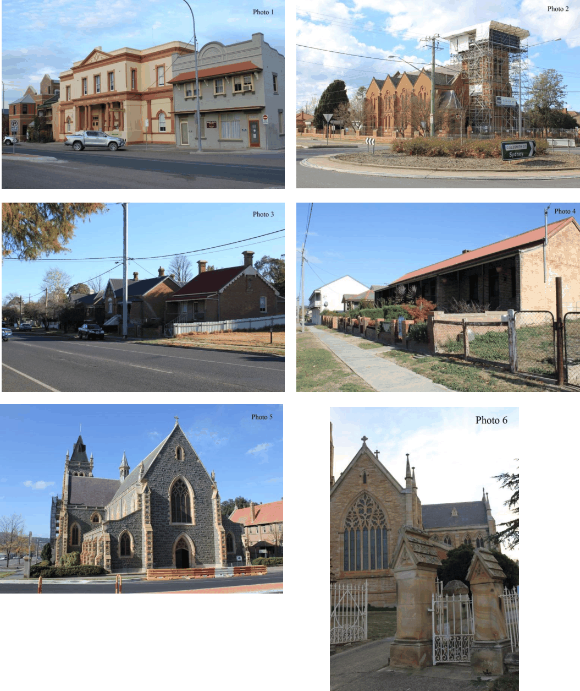

> [Picture on page 15: a picture, saved as a picture (images/part-08-site-specific-provisions-page-15-1.gif, 150 dpi).]

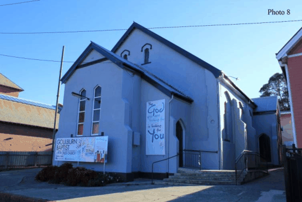

> [Picture on page 16: a picture, saved as a picture (images/part-08-site-specific-provisions-page-16-1.gif, 150 dpi).]

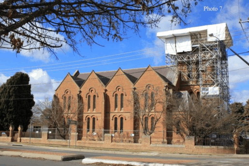

> [Picture on page 16: a picture, saved as a picture (images/part-08-site-specific-provisions-page-16-2.gif, 150 dpi).]

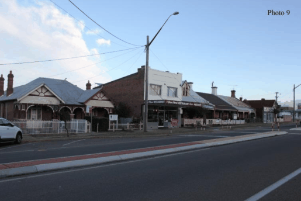

> [Picture on page 16: a picture, saved as a picture (images/part-08-site-specific-provisions-page-16-3.gif, 150 dpi).]

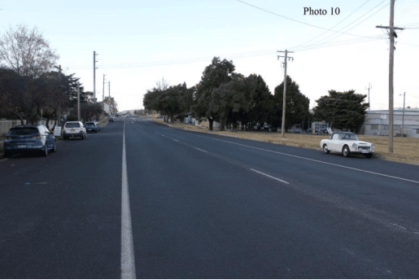

> [Picture on page 16: a picture, saved as a picture (images/part-08-site-specific-provisions-page-16-4.gif, 150 dpi).]

(v) Bradley Street Bradley Street forms the northern boundary of the original grid town layout extending between Cowper

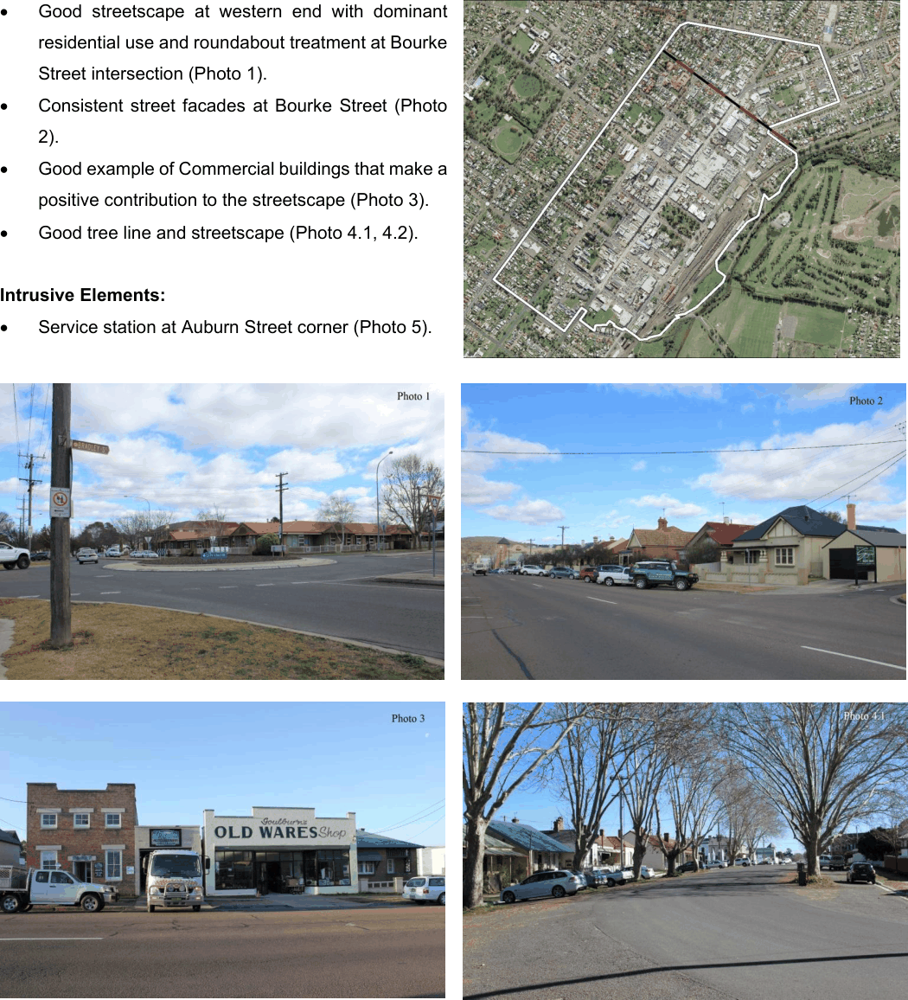

> [Picture on page 17: a picture, saved as a picture (images/part-08-site-specific-provisions-page-17-3.gif, 150 dpi).]

Street on the west and Sloane Street on the east.

#### Good Elements:

• Good streetscape at western end with dominant residential use and roundabout treatment at Bourke Street intersection (Photo 1).

• Consistent street facades at Bourke Street (Photo 2).

• Good example of Commercial buildings that make a positive contribution to the streetscape (Photo 3).

• Good tree line and streetscape (Photo 4.1, 4.2).

#### Intrusive Elements:

• Service station at Auburn Street corner (Photo 5).

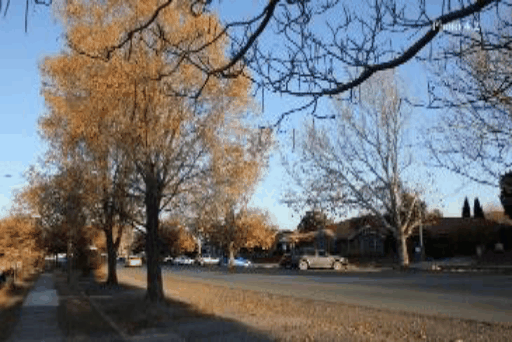

> [Picture on page 18: a picture, saved as a picture (images/part-08-site-specific-provisions-page-18-1.gif, 150 dpi).]

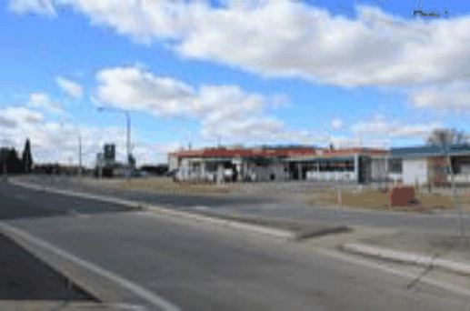

> [Picture on page 18: a picture, saved as a picture (images/part-08-site-specific-provisions-page-18-2.gif, 150 dpi).]

(vi) Citizen Street

#### Good Elements:

• Citizen Street has generally a leafy streetscape with a tree lined avenue at the eastern end where it meets Cole Street (Photo 1). The street trees lose their dominance between Bourke and Auburn Streets.

• It is characterised by single storey residential development dating from the Victorian, Federation

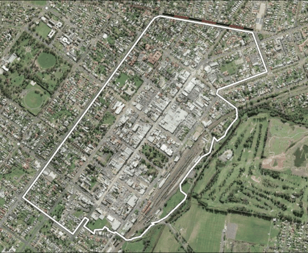

> [Picture on page 19: a picture, saved as a picture (images/part-08-site-specific-provisions-page-19-7.gif, 150 dpi).]

and 20th Century. The northern side of the street contains a more cohesive and early building stock some of which are listed as heritage items. The southern side of the street also presents consistent but lesser early and intact building stock (Photo 2).

• Low height well maintained front fencing provides consistent and pleasant streetscape (Photo 3).

• Some good infill developments (Photo 4).

• Significant housing cluster (Photo 5).

• Towards the eastern end the street’s character changes with the insertion of a corner shop and more established street trees creating a good tree lined streetscape (Photo 6).

• Roundabout treatment at the intersection of Citizen, Belmore, Cowper and Hurst Streets creates a good neighbourhood character (Photo 7).

• Garages are generally well setback to the rear of the allotments with concrete and grass strip driveways (Photo 8).

#### Intrusive Elements:

• Street trees lose their dominance between Bourke and Auburn Streets (Photo 9).

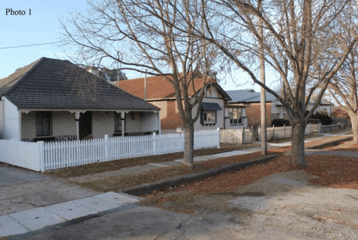

> [Picture on page 19: a picture, saved as a picture (images/part-08-site-specific-provisions-page-19-27.gif, 150 dpi).]

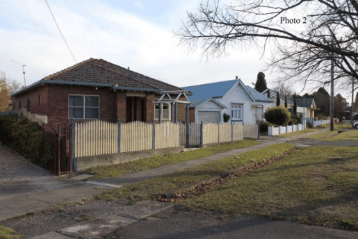

> [Picture on page 19: a picture, saved as a picture (images/part-08-site-specific-provisions-page-19-28.gif, 150 dpi).]

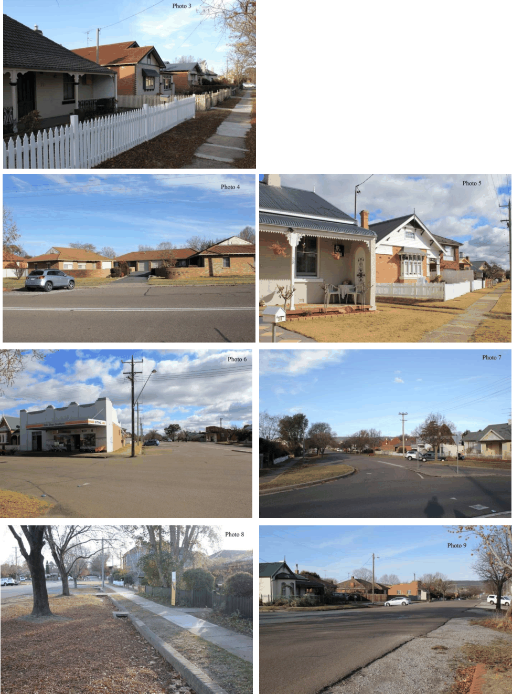

> [Picture on page 20: a picture, saved as a picture (images/part-08-site-specific-provisions-page-20-1.gif, 150 dpi).]

(vii) Clifford Street

Featuring the Council Chambers and Goulburn Public School, Clifford Street has only limited

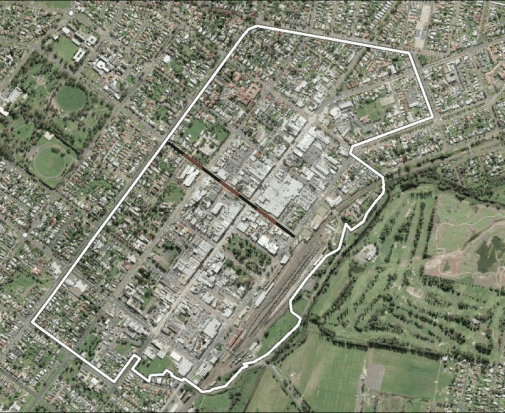

> [Picture on page 21: a picture, saved as a picture (images/part-08-site-specific-provisions-page-21-3.gif, 150 dpi).]

consistency mainly on the western end towards Cowper Street.

#### Good Elements:

• Some two to single storey building consistency at western end towards Cowper Street (Photo 1).

• Avenue street trees along western end to Cowper Street and beyond (Photo 2).

• Two key corner heritage item buildings at Auburn Street. Excellent examples of Goulburn’s traditional corner buildings with their tower like structures (Photo 3).

#### Intrusive Elements:

• No particular character with a mix of building styles (contemporary civic centre / bank / church and

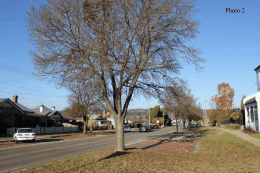

> [Picture on page 21: a picture, saved as a picture (images/part-08-site-specific-provisions-page-21-17.gif, 150 dpi).]

contemporary shopping mall) (Photos 4.1, 4.2).

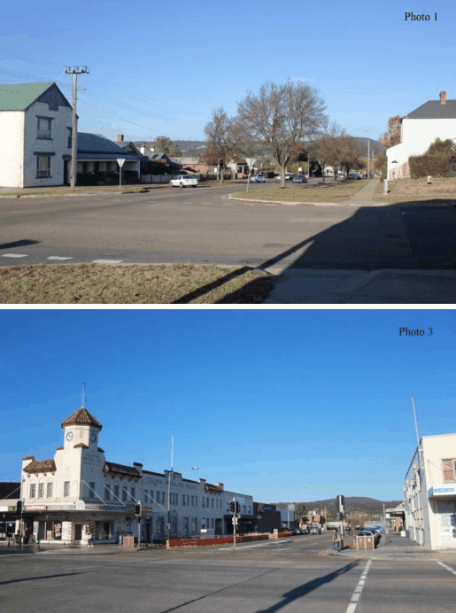

> [Picture on page 21: a picture, saved as a picture (images/part-08-site-specific-provisions-page-21-19.gif, 150 dpi).]

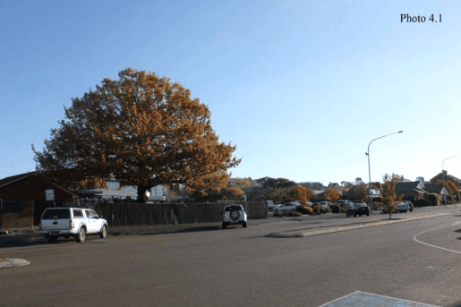

> [Picture on page 22: a picture, saved as a picture (images/part-08-site-specific-provisions-page-22-1.gif, 150 dpi).]

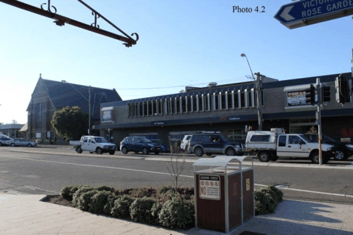

> [Picture on page 22: a picture, saved as a picture (images/part-08-site-specific-provisions-page-22-2.gif, 150 dpi).]

(viii) Clinton Street

Clinton Street is one of Goulburn’s major transport streets and it’s character is affected by service station and accommodation premises.

#### Good Elements:

• Two to single storey buildings (mainly residential) towards Cowper Street end on northern side (Photo 1).

• Some new central avenue street trees (Photo 2).

• View to west (Photo 3).

• Wide footpaths (Photo 4).

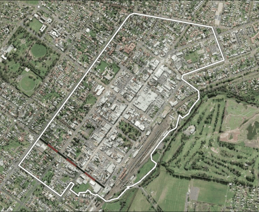

> [Picture on page 23: a picture, saved as a picture (images/part-08-site-specific-provisions-page-23-12.gif, 150 dpi).]

• Relatively consistent bulk and scale of commercial developments (Photo 5).

#### Intrusive Elements:

• Overhead wiring (Photo 6).

• Corners occupied by service station and motel buildings. The corner of Clinton and Auburn Street is an important “gateway” (Refer S.8.6.3(d)(i)) (Photo 7).

• Large corporate signage (Photo 8).

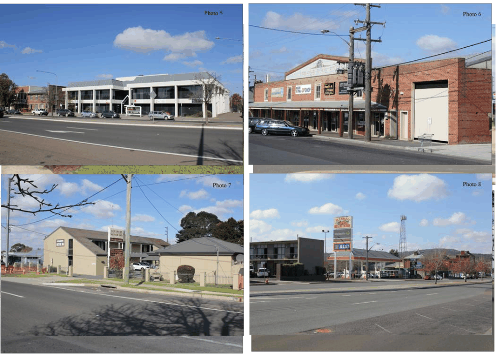

> [Picture on page 24: a picture, saved as a picture (images/part-08-site-specific-provisions-page-24-1.gif, 150 dpi).]

• Lack of streetscape character between Auburn and Sloane Streets (Photo 9).

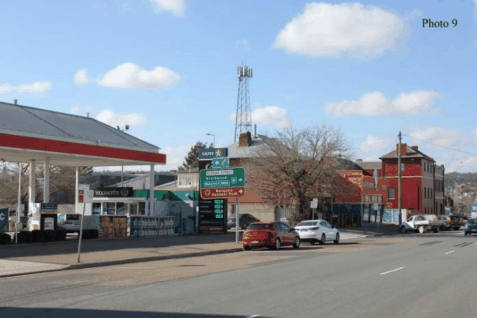

> [Picture on page 24: a picture, saved as a picture (images/part-08-site-specific-provisions-page-24-3.gif, 150 dpi).]

(ix) Cole Street

#### Good Elements:

• Public park at the intersection of Lagoon and Citizen Streets – Park creates an open setting and link between early grid subdivision and the later expansion. Good approach point to focus on (Photo 1).

• Established character between Lagoon and Mulwaree Streets (Photo 2).

• Build fabric – interwar to late 20th century (Photo 3).

• Well established street trees (Photo 4).

#### Intrusive Elements:

• Motel development dominates (Photo 5).

• There are some poorly maintained houses

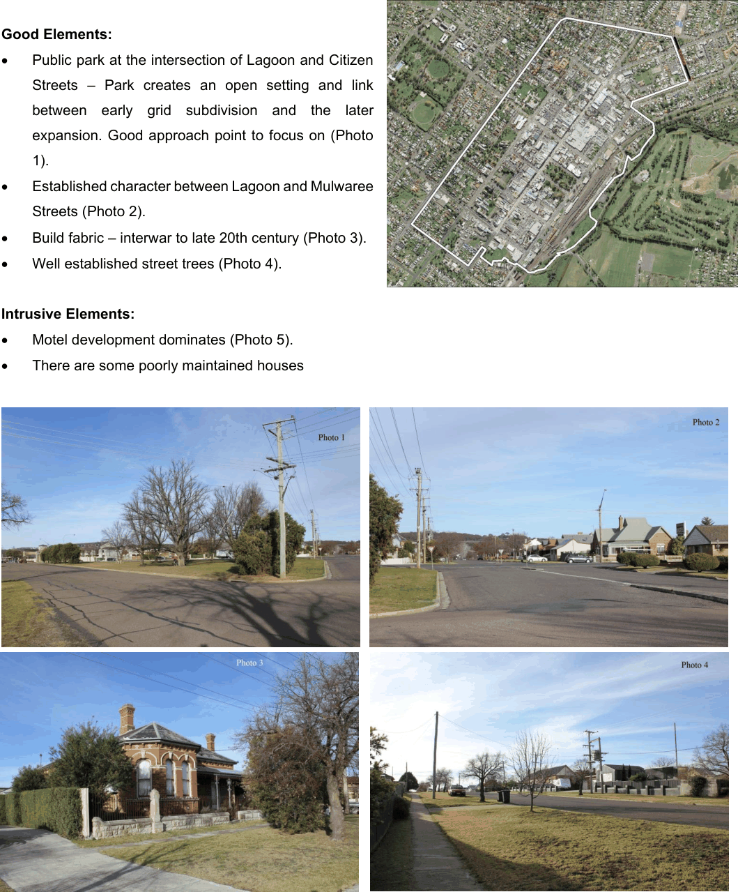

> [Picture on page 25: a picture, saved as a picture (images/part-08-site-specific-provisions-page-25-14.gif, 150 dpi).]

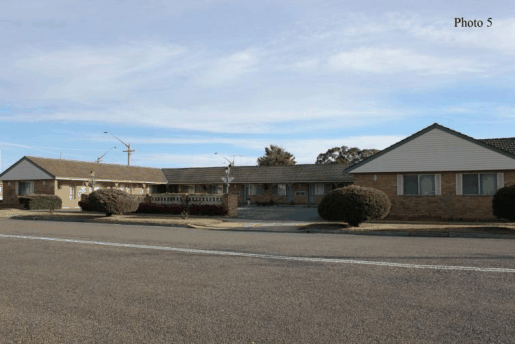

> [Picture on page 26: a picture, saved as a picture (images/part-08-site-specific-provisions-page-26-1.gif, 150 dpi).]

(x) Cowper Street

Creating the western boundary of the CBD, Cowper Street is a residential street with good examples of Victorian, Federation periods and Georgian style housing stock particularly on the western. Cowper

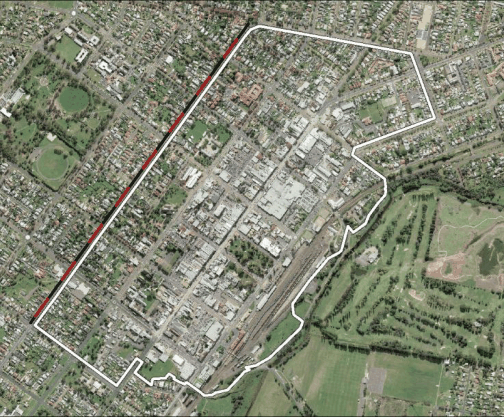

> [Picture on page 27: a picture, saved as a picture (images/part-08-site-specific-provisions-page-27-4.gif, 150 dpi).]

Street has consistency at the north and south blocks of the street.

#### Good Elements:

• Consistent face brick single storey gabled houses with low traditional fencing (Photo 1).

• Infill residential development at the north east corner intersection with Clinton Street (Photo 2).

• Significant view corridors and vistas from highest point at the Montague Street intersection to the Central CBD, St Saviours Cathedral and the extended townscape (Photo 3).

• Laneway development in Little Addison Street, Hillview Road and Thorne Avenue (Photo 4).

• Neighbourhood character at the intersection of Addison Street (Photo 5).

• Vista looking north from Montague Street onto a well maintained tree lined street (Photo 6).

• Significant dwelling cluster between Montague and Clinton Street (Photos 7.1, 7.2, 7.3 & 7.4)

#### Intrusive Elements:

• Service station and industrial development at the southern intersection (Photo 8).

• Infill between Clifford and Goldsmith Street is unsympathetic to surrounding neighbourhood (Photo

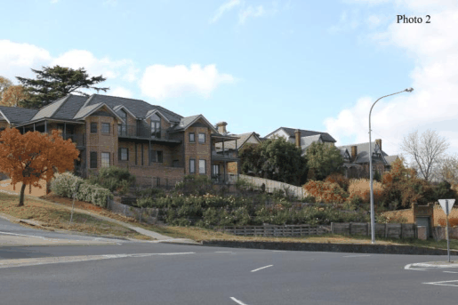

> [Picture on page 27: a picture, saved as a picture (images/part-08-site-specific-provisions-page-27-24.gif, 150 dpi).]

9).

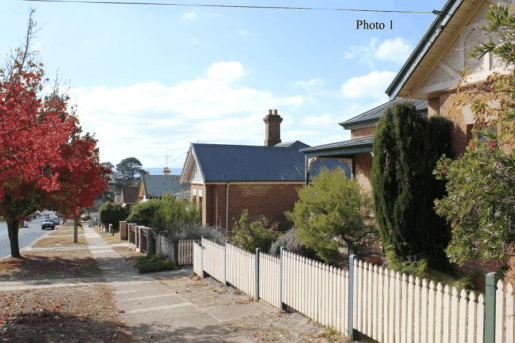

> [Picture on page 27: a picture, saved as a picture (images/part-08-site-specific-provisions-page-27-26.gif, 150 dpi).]

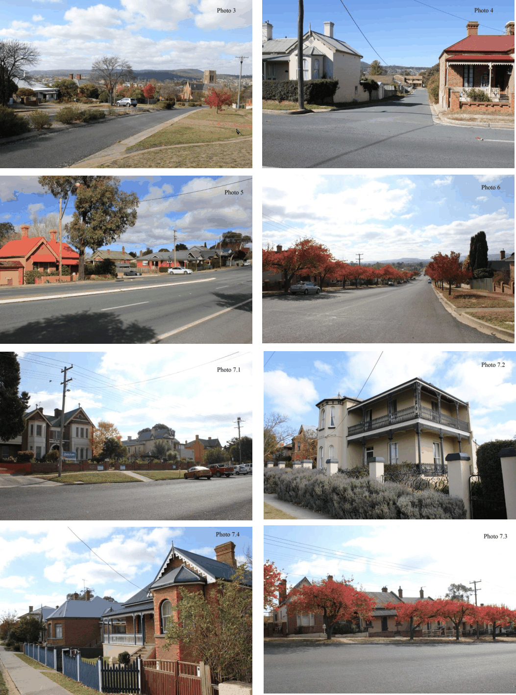

> [Picture on page 28: a picture, saved as a picture (images/part-08-site-specific-provisions-page-28-1.gif, 150 dpi).]

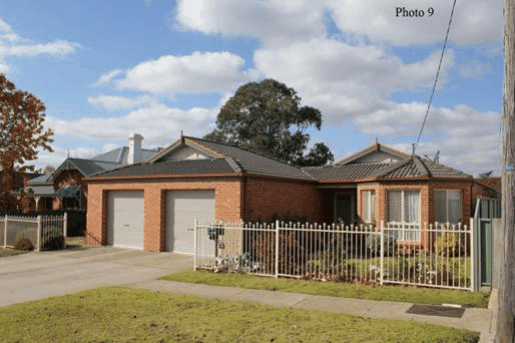

> [Picture on page 29: a picture, saved as a picture (images/part-08-site-specific-provisions-page-29-1.gif, 150 dpi).]

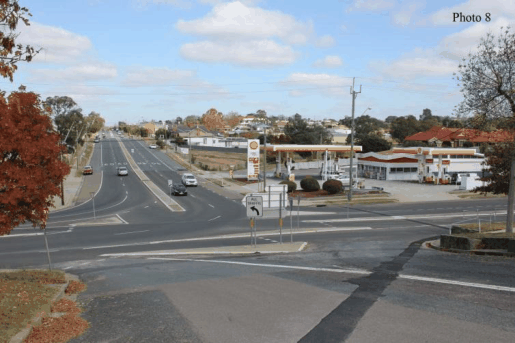

> [Picture on page 29: a picture, saved as a picture (images/part-08-site-specific-provisions-page-29-2.gif, 150 dpi).]

(xi) Goldsmith Street

#### Good Elements:

• Established streetscape west between Auburn and Cowper Streets (Photo 1).

• The early phase single storey free standing houses and shops (Photo 2).

• Methodist Church, Goulburn Public School garden and Georgian style cottages (Photo 3).

• Quality former bank building on the corner with Auburn Street. The brick building addresses both street frontages and makes a positive contribution to the streetscape (Photo 4).

• Significant dwelling clusters (Photos 5.1 5.2).

#### Intrusive Elements:

• Inconsistent streetscapes in the eastern and middle blocks (Photo 6).

• Unsympathetic buildings break the street wall appearance (Photo 7).

• Lack of street trees in the eastern block (Photo 7).

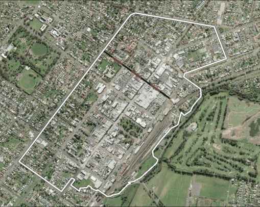

> [Picture on page 30: a picture, saved as a picture (images/part-08-site-specific-provisions-page-30-18.gif, 150 dpi).]

• Side elevations and central car parking of shopping mall further dominates the traditional streetscape character (Photo 8).

• The service station at Bourke Street intersection dominates the traditional streetscape character

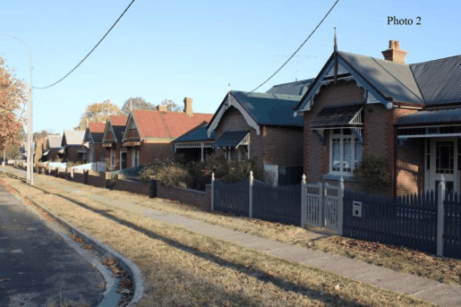

> [Picture on page 30: a picture, saved as a picture (images/part-08-site-specific-provisions-page-30-22.gif, 150 dpi).]

(Photo 9).

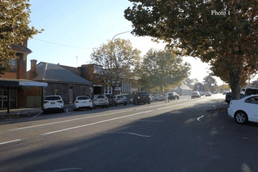

> [Picture on page 30: a picture, saved as a picture (images/part-08-site-specific-provisions-page-30-24.gif, 150 dpi).]

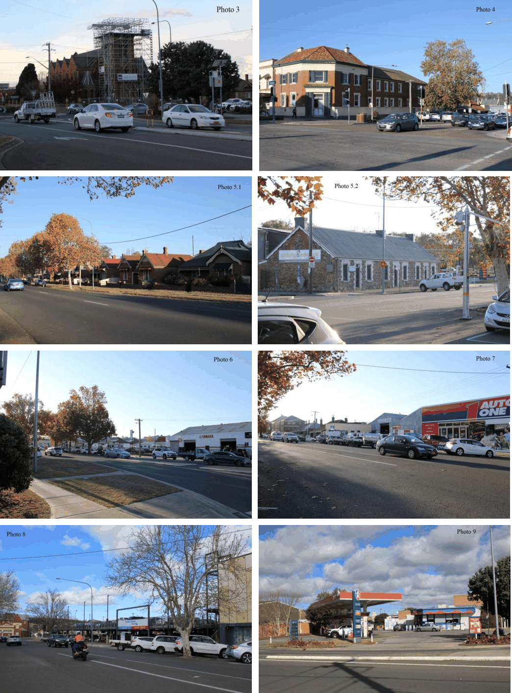

> [Picture on page 31: a picture, saved as a picture (images/part-08-site-specific-provisions-page-31-1.gif, 150 dpi).]

(xii) Grafton Street

#### Good Elements:

• Early major approach road to CBD to north (Photos 1.1, 1.2, 1.3, 1.4 & 1.5). This street, much of which is outside the study area, contains some 21 heritage items from an early phase.

• Good tree lined streetscape with mature trees and central tree island (Photo 2). Mostly sympathetic residential.

#### Intrusive Elements:

• Car yard (Photo 3).

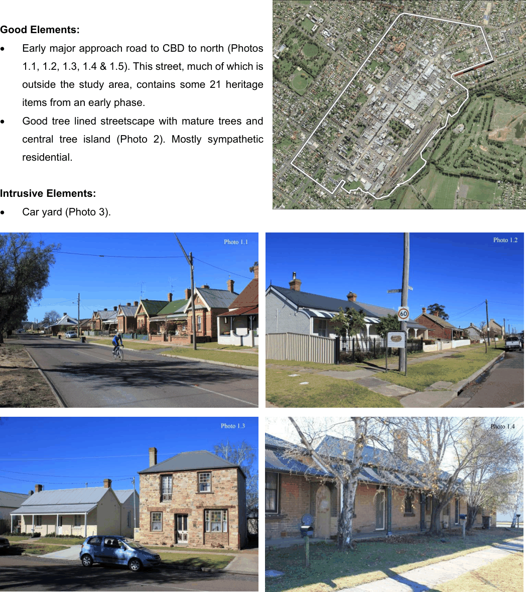

> [Picture on page 32: a picture, saved as a picture (images/part-08-site-specific-provisions-page-32-12.gif, 150 dpi).]

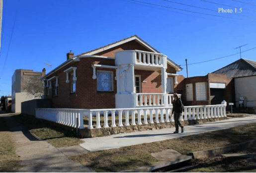

> [Picture on page 33: a picture, saved as a picture (images/part-08-site-specific-provisions-page-33-1.gif, 150 dpi).]

> [Picture on page 33: a picture, saved as a picture (images/part-08-site-specific-provisions-page-33-2.gif, 150 dpi).]

> [Picture on page 33: a picture, saved as a picture (images/part-08-site-specific-provisions-page-33-3.gif, 150 dpi).]

(xiii) Lagoon Street

#### Good Elements:

• Mixed residential and commercial streetscape with some of the dwellings being adaptively reused offices (Photo 1.1 & 1.2).

• Some federation period houses remain intact and contribute to the streetscape with their low fencing and characteristic features of their style (Photo 2).

• Good tree lined pedestrian pathway in sections (Photo 3).

• Park at the intersection of Lagoon & Auburn Streets (photo 4)

#### Intrusive Elements:

• Number of motel designs (Photo 5).

• Unsympathetic signage (Photo 6.1, 6.2).

> [Picture on page 34: a picture, saved as a picture (images/part-08-site-specific-provisions-page-34-16.gif, 150 dpi).]

> [Picture on page 35: a picture, saved as a picture (images/part-08-site-specific-provisions-page-35-1.gif, 150 dpi).]

> [Picture on page 35: a picture, saved as a picture (images/part-08-site-specific-provisions-page-35-2.gif, 150 dpi).]

> [Picture on page 35: a picture, saved as a picture (images/part-08-site-specific-provisions-page-35-3.gif, 150 dpi).]

> [Picture on page 35: a picture, saved as a picture (images/part-08-site-specific-provisions-page-35-4.gif, 150 dpi).]

(xiv) Lithgow Street

#### Good Elements:

• A good tree lined residential streetscape with mature trees (Photo 1).

• Narrow allotments with few as early as 1840s – 60s semi-detached dwellings and former shop and residence (Photo 2).

• Single to two storey free standing or semi-detached housing with corrugated or tile hipped or pitched roofs (Photo 3).

• Asymmetrical façade and front veranda (Photo 4).

• Few garages placed discreetly to the rear of their respective sites with side driveways (Photo 5).

• Street parking is provided between the trees (Photo 6). Note: New colour scheme.

> [Picture on page 36: a picture, saved as a picture (images/part-08-site-specific-provisions-page-36-16.gif, 150 dpi).]

> [Picture on page 37: a picture, saved as a picture (images/part-08-site-specific-provisions-page-37-1.gif, 150 dpi).]

> [Picture on page 37: a picture, saved as a picture (images/part-08-site-specific-provisions-page-37-2.gif, 150 dpi).]

(xv) Market Street

Previously a busy commercial street Market Street has lost its integrity due to changes to the early

> [Picture on page 38: a picture, saved as a picture (images/part-08-site-specific-provisions-page-38-3.gif, 150 dpi).]

buildings including the introduction of the uncharacteristic club building.

#### Good Elements:

• The surviving early buildings (heritage items) provide physical evidence of Market Street early commercial phase (Photo 1).

• Use of appropriate signs (Photo 2).

• Remaining Bull and Woodward Arch has been conserved (Photo 3).

#### Intrusive Elements:

• Street car parking dominance (Photo 4).

• Club building (Photo 5.1, 5.2) and street replacement building at Auburn Street. These two key corner sites have been compromised by these two buildings. The replacement building does have some traditional architecture elements but overstates them by the use of dominant vertical

> [Picture on page 38: a picture, saved as a picture (images/part-08-site-specific-provisions-page-38-18.gif, 150 dpi).]

piers and moulded panels that make it an unsuccessful infill development.

> [Picture on page 38: a picture, saved as a picture (images/part-08-site-specific-provisions-page-38-21.gif, 150 dpi).]

> [Picture on page 39: a picture, saved as a picture (images/part-08-site-specific-provisions-page-39-1.gif, 150 dpi).]

> [Picture on page 39: a picture, saved as a picture (images/part-08-site-specific-provisions-page-39-2.gif, 150 dpi).]

> [Picture on page 39: a picture, saved as a picture (images/part-08-site-specific-provisions-page-39-3.gif, 150 dpi).]

> [Picture on page 39: a picture, saved as a picture (images/part-08-site-specific-provisions-page-39-4.gif, 150 dpi).]

(xvi) Montague Street

Montague Street forms the central axis of the original street grid pattern with extensive view corridors up and down in both directions along the street focussed on the St Saviours Cathedral hill.

> [Picture on page 40: a picture, saved as a picture (images/part-08-site-specific-provisions-page-40-4.gif, 150 dpi).]

#### Good Elements:

• Good consistent streetscape between Auburn and Bourke Street terminating with St Saviours Cathedral (Photo 1.1, 1.2).

• Contains two of the most important early features of the City – Goulburn Court House group and Belmore Park (Photo 2.1, 2.2).

• Contains central axis view corridor to St Saviours Cathedral (Photo 3.1, 3.2).

• Contains significant portion of heritage architectural character of area (Photo 4.1, 4.2).

• Belmore Park with its important traditional street lights, good pedestrian friendly traffic managements and landscaped treatments (Photo 5.1, 5.2).

• Good adaptive reuse of early building as a Café (Photo 6).

#### Intrusive elements:

• Key corner occupied by unsympathetic bank building and signage which also breaks up the

> [Picture on page 40: a picture, saved as a picture (images/part-08-site-specific-provisions-page-40-22.gif, 150 dpi).]

streetscape (Photo 7).

> [Picture on page 40: a picture, saved as a picture (images/part-08-site-specific-provisions-page-40-24.gif, 150 dpi).]

> [Picture on page 41: a picture, saved as a picture (images/part-08-site-specific-provisions-page-41-1.gif, 150 dpi).]

> [Picture on page 42: a picture, saved as a picture (images/part-08-site-specific-provisions-page-42-1.gif, 150 dpi).]

> [Picture on page 42: a picture, saved as a picture (images/part-08-site-specific-provisions-page-42-2.gif, 150 dpi).]

> [Picture on page 42: a picture, saved as a picture (images/part-08-site-specific-provisions-page-42-3.gif, 150 dpi).]

(xvii) Mulwaree Street

#### Good Elements:

• A street that is characterised by a row of single-storey semi-detached brick cottages associated with the railway development some of which present the same architectural detailing in groups suggesting their construction by the same builder(s) (Photo 1.1, 1.2).

• Good streetscape with mature trees along the railway line containing (together with Bradley Street) some of the oldest trees in Goulburn (Photo 2).

#### Intrusive Elements:

> [Picture on page 43: a picture, saved as a picture (images/part-08-site-specific-provisions-page-43-13.gif, 150 dpi).]

• Uncharacteristic and unsympathetic alterations and modifications to the buildings’ fabric and

fencing are evident (Photo 3).

(xviii) Sloane Street

Sloane Street has a similar role and importance to Auburn Street as one of the main commercial and administrative streets of Goulburn from the early years of settlement. It contains a number of buildings from early period however it has lost its cohesive traditional appearance with the majority of public movements shifted to Auburn Street. Sloane Street contains a large number of heritage items of local

> [Picture on page 44: a picture, saved as a picture (images/part-08-site-specific-provisions-page-44-5.gif, 150 dpi).]

and state significance.

#### Good Elements:

• Scattered two storey terraces at northern end (Photo 1).

• Warehouses including former railway workshop adaptively reused building in a sympathetic manner (Photo 2).

• Belmore Park, Courthouse precinct, railway precinct buildings and traditional hotels (Photo 3).

• View and vistas especially vistas towards St Saviours Cathedral along Montague Street (Photo 4).

• Early buildings adaptively reused – old Connolly’s Mill (Photo 5).

• High quality government & privately owned buildings including the firmer Courthouse, Railway, Alpine Lodge Hotel & Railway/Coolavin Hotel (Photos 6.1, 6.2, 6.3 & 6.4)

#### Intrusive Elements:

• Bowling Club car park area, contemporary hotel, railway yards, open storage areas and major car parking for shopping mall break the continuity of the street (Photo 7).

• Corporate signage. Though it was incorporated some of the traditional design elements and compatible colour scheme, the signage makes it an unsuccessful development (Photo 8).

> [Picture on page 44: a picture, saved as a picture (images/part-08-site-specific-provisions-page-44-27.gif, 150 dpi).]

• Communication Tower (Photo 9).

> [Picture on page 44: a picture, saved as a picture (images/part-08-site-specific-provisions-page-44-29.gif, 150 dpi).]

> [Picture on page 45: a picture, saved as a picture (images/part-08-site-specific-provisions-page-45-1.gif, 150 dpi).]

> [Picture on page 46: a picture, saved as a picture (images/part-08-site-specific-provisions-page-46-1.gif, 150 dpi).]

> [Picture on page 46: a picture, saved as a picture (images/part-08-site-specific-provisions-page-46-2.gif, 150 dpi).]

> [Picture on page 46: a picture, saved as a picture (images/part-08-site-specific-provisions-page-46-3.gif, 150 dpi).]

> [Picture on page 46: a picture, saved as a picture (images/part-08-site-specific-provisions-page-46-4.gif, 150 dpi).]

(xix) Verner Street

#### Good Elements:

• Good streetscape with trees on both sides (Photo 1).

• Vista from Cowper Street to the town centre and the hills beyond on the eastern edge (Photo 1).

• Views to Cowper Street and Church from Sloane Street end (Photo 2).

• Traditional early buildings of similar scale on north side between Auburn and Sloane Streets (Photo 3).

• Well defined corner allotments by two storey buildings (Photo 4).

• Church buildings (Photo 5.1, 5.2).

• Significant housing cluster on western end both north and south sides (Photo 6).

#### Intrusive Elements:

> [Picture on page 47: a picture, saved as a picture (images/part-08-site-specific-provisions-page-47-16.gif, 150 dpi).]

• No uniform streetscape towards Bourke Street due to the dominance of motel car park and bank

car park (Photo 7.1, 7.2).

> [Picture on page 48: a picture, saved as a picture (images/part-08-site-specific-provisions-page-48-1.gif, 150 dpi).]

(xx) Laneways

#### Good Elements:

• Thorne Avenue – Good use of timber post and rail pedestrian balustrade, timber pailing and picket fencing and pavements grassed on one side and paved on the other (Photo 1).

• Hillview Road – Good laneway streetscape with mature garden landscaping (Photo 2).

• Little Addison Street – Established narrow streetscape with single to two-storey housing stock (Photo 3).

• Horne Square – Complete physical evidence of identical Victorian period detached dwellings built by former mayor c1869 – 1871 (Photo 4).

#### Intrusive Elements:

> [Picture on page 49: a picture, saved as a picture (images/part-08-site-specific-provisions-page-49-16.gif, 150 dpi).]

• Lanigan Lane – No particular consistency or dominate features (Photo 5).

> [Picture on page 50: a picture, saved as a picture (images/part-08-site-specific-provisions-page-50-2.gif, 150 dpi).]

> [Picture on page 50: a picture, saved as a picture (images/part-08-site-specific-provisions-page-50-3.gif, 150 dpi).]

> [Picture on page 50: a picture, saved as a picture (images/part-08-site-specific-provisions-page-50-4.gif, 150 dpi).]

(d) Levels of Heritage Significance

(i) Items of Environmental Heritage

These items are of key importance to the areas character eg. building works, relics, places, landscapes, gardens, trees or vegetation of historic, scientific, cultural, social, natural or

aesthetic significance as listed in Schedule 5 of Goulburn Mulwaree Local Environmental Plan 2009 and shown in Figure 8-1-2.

(ii) Contributory Items

These items are of moderate significance and contribute to the predominant character and visual attractiveness of the Schedule 5 items above. Again shown in Figure 8-1-2.

(iii) Non-Contributory Items

These items are buildings or places that have either a neutral or detrimental contribution to the areas character. Such items are buildings and places not mapped as a Heritage Item or Contributory Item in Figure 8-1-2.

(iv) Heritage Conservation Areas (HCA)

Applicable HCA’s are mapped in Goulburn Mulwaree Local Environmental Plan 2009 and shown in maps HER 004, 005, 006, 007, 008, 009 and 010. The objective of the HCA is to conserve the heritage significance of the Area included associated fabric, setting and views.

Clause 5.10 of Goulburn Mulwaree Local Environmental Plan 2009 details statutory requirements that need to be addressed in development applications which fall within the HCA.

> [Picture on page 52: a picture, saved as a picture (images/part-08-site-specific-provisions-page-52-1.gif, 150 dpi).]

(e) Protective structures in the public domain

#### Objectives

Any structures within the public domain should principally serve to enhance public use and amenity in terms of shade, shelter, comfort, egress and safety.

The structure should enhance the building and streetscape.

Where restoring a lost structure this should be done on the basis of the known evidence and Burra Charter principles.

Structures that are new to the building should be identifiably modern whilst complementing the style and form of the building.

Structures can provide other benefits such as improved private open space or commercial opportunities such as outdoor dining, providing that these do not compromise the public amenity.

#### Controls

Generally all buildings in a commercial centre should have permanent protective structures over footpaths. The only exceptions are where such structures are not compatible with the heritage or architectural values of the building. This is usually the case with civic buildings, churches, and often with banks.

Where a building has heritage value either as a Heritage Item or is contributory to a heritage precinct or Heritage Conservation Area, the approach should be to restore on the basis of known evidence, preferably photographic, as well as by the detailed examination of the structure and surrounds. Where the evidence is lacking, appropriation of conjectural detail from a nearby structure of similar form and style may be reasonable.

Where an existing building is not consequential in heritage terms, or a new building is proposed, the protective structure should be complementary to the building in terms of form, material, detail etc, and compatible to the row if it is in a row of like buildings. The options are identified in Figure 8-1-3 below.

> [Picture on page 54: a picture, saved as a picture (images/part-08-site-specific-provisions-page-54-1.gif, 150 dpi).]

#### Figure 8-1-3: Preferred public domain protective structures

> [Picture on page 54: a picture, saved as a picture (images/part-08-site-specific-provisions-page-54-3.gif, 150 dpi).]

Generally protective structures over footpaths are light, open, timber or steel structures. The structural members are normally exposed and the structure unlined so that any upper floor is exposed and any roofing is exposed to the underside. This gives them a light and airy appearance, appropriate to their function and location. All structures need to be carefully crafted as with a piece of joinery or street furniture, as the whole structure is exposed to view. All structures also need to be robust given their exposure to public use and risk.

The traditional materials are usually timber for the structure with often metals including cast iron for decorative elements. The timbers are always planed and usually shaped such as with stop chamfering, with hardwood tongue and groove flooring which falls to the kerb, and corrugated profile roofing. These materials are appropriate for reinstatements. It may be appropriate to use other materials such as steel and metals, or glass and acrylics with new structures.

Post supported structures are often appropriate in heritage precincts and Heritage Conservation Areas both for new structures and restorations. Posts can enhance the rhythm and composition of a building and streetscape, provide a protective edge to the pedestrian space, and frame the views in and out. They should be placed so as to minimise obstruction of pedestrian access, and the structure designed so that it will continue to stand intact even if a corner post or posts are damaged or removed due to a vehicle or similar collision.

(f) Principles for Goulburn City Business District

(i) Commercial Development

▪ New, infill and alteration developments are to respect and contribute to the special character of the CBD demonstrated in the street character statements;

▪ Prominent corner buildings are to maintain the traditional corner design element of addressing both street facades with a prominent tower-like corner element and generally splayed entrance or corner;

▪ Façade and restoration works are to be based on sound historical or physical evidence (Reference Main Street Study);

▪ New large scale developments are to respect and retain the existing grid subdivision street pattern;

▪ Intrusive elements such as uncomplimentary oversized buildings, unsympathetic alterations and additions, large sizes, horizontal facades, inappropriate colour schemes, and out of character design elements must be avoided.

(ii) Residential Development

▪ Proposed residential development in the mixed business area is to keep uniform single to two-storey cohesiveness of streetscapes including leafy quality in accordance with their identified street characteristics.

▪ No intrusive changes or elements will be permitted in the residential portions of the study area including high, visually impenetrable front fences, the painting and rendering of face brick facades, the removal of original detailing, or unsympathetic alterations and additions such as first floor additions.

#### Additions:

▪ must not impact upon the contribution of a building to the streetscape,

▪ should be restricted to the rear of a dwelling,

▪ must minimise impact upon original roof form when viewed from the public domain,

▪ should be recessive and not dominate the original form and character of the dwelling, and

▪ which interrupt the front roof plane of a heritage item or contributory building, will not be permitted.

▪ Established character of the main streetscapes should be reflected in the form, design, materials and signs of the infill and corporate developments. New developments should be compatible with the dominant streetscape and town centre character.

Reference: Goulburn Mulwaree CBD Master Plan, Heritage Report and Conservation Principles / Guidelines, July 2008, City Plan Heritage.

(iii) Demolition

▪ Buildings that are listed as heritage items and contributory items should not be demolished unless such demolition is justified in a Heritage Impact Statement (HIS). Applicants must retain as much as possible of the existing building fabric particularly those aspects that contribute towards the items visual / heritage significance and the identified streetscape qualities. This process must be informed by an assessment of the heritage / streetscape significance of the items (this does not apply to the removal of unsympathetic elements).

▪ Non – contributory items may be demolished but must be replaced by a building that will contribute to the character and significance of the streetscape.

(g) Views and Vistas

> [Picture on page 57: a picture, saved as a picture (images/part-08-site-specific-provisions-page-57-2.gif, 150 dpi).]

Reference: Goulburn Mulwaree CBD Plan, Interim Report 1, 29 August 2009, Edaw/AECOM.

(h) Economic Viability and Social Values

All new developments are to demonstrate a contribution to the economic viability of the Business District.

New development may achieve this outcome by:

(i) following Council’s precinct based approach to land use distribution:

#### Concept Development Plan

> [Picture on page 58: a picture, saved as a picture (images/part-08-site-specific-provisions-page-58-7.gif, 150 dpi).]

Contributing to:

(ii) vibrant north south Auburn Street accommodating a range of retail and commercial business:

(iii) an improved east west activity path, including redevelopment of laneways into supporting niche retail precincts below residential development to increase population mass.

(iv) the dedicated commercial office precinct at the western fringe of the CBD to allow the CBD to remain as a concentrated retail precinct with high pedestrian activity focused on hospitality services and shop front retailing.

(v) large format household goods retailing concentration at the northern end of the CBD. This area presents the leading location for larger format retail and commercial space given the size of the sites, their gateway location and high exposure to passing trade.

(vi) the development of residential development of different housing types throughout the precincts is fundamental to broadening the range of socioeconomic backgrounds of the CBD’s residents. This enrichment of the social fabric of the CBD is necessary to maintain the values of the CBD as a social service centre and its commercial role for residents and visitors.

> [Picture on page 59: a picture, saved as a picture (images/part-08-site-specific-provisions-page-59-10.gif, 150 dpi).]

Reference: Goulburn CBD Plan, Master Plan, 29 August 2008, EDAW/AECOM

(i) Landscape and access

New developments are to contribute, in-kind or by monetary means towards the following public domain treatments:

(i) heritage parks, plazas, urban and suburban walkways and lane ways.

(ii) green link connection following the line of drainage from south of the CBD through Manfred Park towards the Mulwaree River.

(iii) green link along the historic east-west axis connecting the CBD with the Mulwaree River foreshore and Victoria Park.

(iv) additional street tree planting in Sloane Street along the rail edge and in residential streets surrounding the CBD.

(v) traffic control measures.

> [Picture on page 60: a picture, saved as a picture (images/part-08-site-specific-provisions-page-60-6.gif, 150 dpi).]

Reference: Goulburn Mulwaree CBD Plan, Master Plan, 29 August 2008, EDAW / AECOM

(j) Strategies

Concept Plan – Strategies

The following diagram indicates the key strategies of this plan to guide future change in the Goulburn CBD. The key components of a planning framework to achieve the Vision for the CBD are derived from the Planning and Design Principles in the EDAW / AECOM Master Plan document.

#### Consolidate

1\. Define a CBD core and a series of land use precincts that support and enhance its function.

#### Integrate

2\. New development zones including key redevelopment sites identified by Council at the northern and southern ends of the CBD are designed to enhance and strengthen the integrity of the CBD core.

#### Humanise

3\. Define a pedestrian based precinct within the CBD core.

4\. Encourage north – south through traffic to travel around the core via Goldsmith, Bourke and Clinton Streets.

5\. Encourage service and local through traffic to travel east of the Core via Sloane Street.

6\. Concentrate people orientated place making measures on Auburn and Montague Streets and the parks, streets and laneways in this vicinity.

#### Connect

Reinstate the connection of the CBD with its context along two principle lines:

7\. The historic east – west axis is reinforced and extended to reconnect the CBD with the Mulwaree River foreshore and Victoria Park.

8\. The open space connection to the river at the southern edge of the CBD is reinstated and strengthened.

> [Picture on page 62: a picture, saved as a picture (images/part-08-site-specific-provisions-page-62-1.gif, 150 dpi).]

▪ Reference: Goulburn Mulwaree CBD Plan, Master Plan, 29 August 2008, EDAW / AECOM.

#### Acknowledgements

▪ Goulburn Mulwaree CBD Plan, Interim Report 1 and Part 2, Master Plan, 29 August 2008, EDAW / AECOM.

▪ Goulburn Mulwaree CBD Master Plan, Heritage Report and Conservation Principles / Guidelines, July 2008, City Plan Heritage.

▪ Goulburn Mulwaree CBD Plan, Master Plan Development Assessment, Traffic, Transport and Parking, 25 August 2008, GTA Consultants.

▪ Goulburn Mulwaree CBD Master Plan, Economic Assessment, July 2008, AEC Group

### Marulan Local Business Centre

#### Aim

Develop a plan for Marulan’s Local Business Centre that facilitates future management by balancing development and conservation in a sustainable way.

#### Objectives

▪ Create a plan that allows for the fulfilment of the aspirations of the Marulan community for their Local Business Centre;

▪ Maintain, protect and enhance the Local Business Centre’s existing visual, built and environmental heritage and landscape character;

▪ Develop standards and recommendations to maintain and improve the image, attractiveness and functionality of the Local Business Centre in accordance with its existing character;

▪ Provide an appealing and sustainable living and working environment for existing residents;

▪ Attract new residents, business and tourism to Marulan;

▪ Describe Council’s requirements in the form of performance criteria to achieve the objectives above;

▪ Plan for economic development and growth initiatives in accordance with the Goulburn Mulwaree Economic Development Plan 2008.

#### Land to which Plan applies

This Plan applies to the land identified on the map shown as Figure 8-2-1 - George Street Marulan, Local Business Centre.

#### Figure 8-2-1: Land to which Plan applies – Marulan Local Business Centre

> [Picture on page 64: a picture, saved as a picture (images/part-08-site-specific-provisions-page-64-2.gif, 150 dpi).]

#### Performance Criteria

#### Visual Character of Marulan

Old Marulan was surveyed in 1834 by Surveyor Hoddle. Old Marulan was located at the junction of the Bungonia Road and the Hume Highway. When a location for the new Railway Station was chosen it was 2.5 km north of the old village. The railway station was built in 1867 adjacent to the Terminus Hotel that was built in 1866. Old Marulan declined and the town became one in 1878 on the site of the current Marulan. Old Marulan is now only an archaeological site.

In the 1890’s the main part of town had ten stores, Police Station, Post Office, an Oddfellows Hall (also used as the Court House), School of Arts, a number of Churches and numerous residences. Many of these buildings can still be seen.

For fifty years Marulan was a highway town until it faded in importance following the construction of the freeway by-pass in 1985. Marulan Local Business Centre’s role as a refreshment stop has been usurped by the vast roadhouses that have been built alongside the highway including the one at the south of the town. Marulan proper has reverted to a sleepier but more pleasant village.

Marulan’s character in 2008 is a mixture of fine but often run down historic buildings and more recent buildings of various qualities. George Street has a number of now derelict service stations that do nothing to enhance the image of the town. A number of businesses are lifting the aesthetic quality of the precinct.

The length of George Street located in the Village Business Centre Zone can be divided into four character sections. Heading north;

▪ The southern section to the intersection with Goulburn Street has spaced out buildings of various uses and is primarily residential but also includes two churches on large blocks, a disused service station, the school and the former Baldock’s General Store buildings. Baldock’s store buildings are a fascinating time capsule from the past and are an important component of Marulan’s character;

▪ Next the centre of town has something of a “gap toothed grin” in that quality items are interspersed with vacant, run down or poor quality items. This section contains the Terminus Hotel that dates from 1866 but now has a somewhat awkward Spanish Mission façade, the wonderful but underutilised Royal Hotel, the Post Office and Police Station and a number of small businesses and residences;

▪ The section of George Street to the north of the rail bridge to Brayton Road can’t readily be perceived from the centre of town. This is because of the physical separation caused by the rail line and the way the land falls away from the rail bridge. This section is dominated by the former service station on the corner but also includes a number of residences. This is the image that visitors from the north see when approaching Marulan. All items north of the rail line are assessed as being non-contributory to Marulan’s heritage;

▪ The area north of Brayton Road is open and in parts rather messy. It is dominated by the former RTA truck weigh stations and includes a number of residences and the nursery/landscape supply business. Marulan is set amongst a landscape of mature specimens of the Endangered Ecological Community – Yellow Box/ Blakely’s Red Gum Woodland. The trees link to remnant

vegetation in the surrounding farm land to provide fauna habitat. The mature gum trees, regardless of their environmental value give the town a leafy outlook and aspect.

The area also has mature examples of exotic tree and shrub species that are significant to the towns character e.g. Oak, Date Palm, Cypress etc. More recently part of George Street has been planted with Chinese Pistachio; the trees are well suited to the street.

#### Retention of Visual Character

The two significant elements that create visual character are the landscape and the built environments; gardens, parks, road reserves, public spaces and built structures contribute to the Local Business Centre’s visual character;

#### Levels of Heritage Significance

(a) Items of Environmental Heritage.

These items are of key importance to the areas character e.g. buildings works, relics, places, landscapes, gardens, trees or vegetation of historic, scientific, cultural, social, natural or aesthetic significance as listed in schedule 5 of Goulburn Mulwaree Local Environmental Plan and shown on Figure 8.11 (below);

(b) Contributory items.

These items are of moderate significance and contribute to the predominant character and visual attractiveness of the schedule 5 items (Environmental Heritage items above) as shown in Figure 8.11.

(c) Non-contributory items

These items are buildings or places that have either a neutral or detrimental contribution to the areas character. Such items are also shown on Figure 8.11.

> [Picture on page 67: a picture, saved as a picture (images/part-08-site-specific-provisions-page-67-1.gif, 150 dpi).]

Performance objectives for Environmental Heritage, Contributory Heritage and Non-Contributory buildings and places

The following performance objectives must be achieved by each development proposal in the area covered by this plan.

#### For environmental heritage items

(a) Retain as much as possible of the existing building fabric particularly those aspects that contribute towards the items visual/heritage significance. This process should be informed by an assessment of the heritage significance of the item;

(b) Where possible remove unsympathetic building elements and additions;

(c) Reconstruct original detail based on research and avoid mimicry e.g. mock details;

(d) Paint buildings and structures in colour schemes based on schemes of the relevant period and retain natural surface finishes;

(e) Avoid modification to door and window openings, spacing and proportions;

(f) Prohibit cladding of traditional building facades with modern materials and do not allow rendering or painting of external brick work or stone wall elements;

(g) Ensure building additions are sympathetic to the item and its setting in terms of setback, scale, building design and form, materials, proportion and spacing of openings, shopfront/awning treatment etc. and achieve a subtle contrast between old and new. The original item should be able to be distinguished from the new work;

(h) Ensure that development of items adjoining items of heritage significance is sympathetic in siting, design, scale and materials and where relevant maintain the group significance of a cluster of items;

(i) Site and design public on street infrastructure so as to maintain the significance of adjacent heritage items;

(j) Where subdivision occurs around heritage items ensure that an appropriate curtilage area is identified, retained and protected including gardens and landscape elements;

(k) Identify vistas both to and from heritage items and ensure that development does not encroach upon or diminish these vistas.

#### For contributory items

(a) Retain the qualities and details that form the stylistic character of the item and organise alterations and additions so as not to compromise that character;

(b) Discourage the introduction of building elements that are unsympathetic to the style of the building or adjacent heritage items;

#### Non-contributory items

(a) Restrain the visual prominence of non-contributory items by the use of subtle colour schemes, materials and finishes. Ensure that franchise type businesses respect the character of the area in the detailing of their buildings, signage and landscape treatments;

(b) New and redeveloped non-contributory items shall respect the scale, form and pattern of other development in the locality;

#### New buildings on vacant properties or sites to be wholly redeveloped

(a) Avoid large scale monolithic buildings and achieve small scale and discreet built forms by the use of sympathetic detailing;

(b) Respect the visual prominence and scale of existing items of heritage, contributory items and the streetscape generally by means of selective planning for setback, height, architectural design, materials and colour schemes;

(c) Retain sunlight penetration to footpaths and other public spaces;

(d) Avoid mock heritage building styles and fenestration (fenestration refers to windows and other openings).

(e) Enhance the landscape with thematic use of plant species and styles i.e. identify common local plant varieties used and styles of planting e.g. hedges etc.

#### General Development Controls

#### Street Frontage

The predominant character of smaller scale historic buildings is that the frontage is narrower than the depth. Modern housing and businesses etc tend to have a wider street frontages and this will detract from the existing character of the Local Business Centre zone, particularly in George Street.

To maintain the character of the village the front façade of buildings is to be narrower in width than it is deep or long.

> [Picture on page 70: a picture, saved as a picture (images/part-08-site-specific-provisions-page-70-3.gif, 150 dpi).]

Example of modest two storey dwelling where the second storey is contained in the roof area, this reduces the bulk and scale and therefore the impact of the building.

To reduce impact the bulk of larger buildings should be located set back from the front of the site. Designs for new buildings must respect the scale, height and massing of adjacent buildings. Refer to Figure 8-2-3.

> [Picture on page 70: a picture, saved as a picture (images/part-08-site-specific-provisions-page-70-9.gif, 150 dpi).]

#### Existing

#### New

Respect adjacent scale, heights and massing;

Maintain roof form and rhythm;

#### Locate the bulk of new buildings to the rear.

> [Picture on page 71: a picture, saved as a picture (images/part-08-site-specific-provisions-page-71-1.gif, 150 dpi).]

#### Figure 8-2-3: Building Design

#### Roof Pitch

Historically roofs were pitched at 27.5 to 33 degrees. This is a steeper pitch than is used on modern buildings that tend to be pitched at around 22 degrees.

The roof pitch of new buildings or additions shall be similar to that of adjacent buildings e.g. above 27.5 degrees.

#### Garages and Outbuildings

The existing character of historic garages and outbuildings is that they are generally separate buildings set to the rear of the main building. It is preferred that garages not be incorporated into the main building in new work. Where garages are proposed they shall be located fronting the side or rear of the allotment as per Figure 8-2-4. Outbuildings shall also be located to the side or rear of the main building.

#### Figure 8-2-4: Siting of Carports and Garages

> [Picture on page 71: a picture, saved as a picture (images/part-08-site-specific-provisions-page-71-15.gif, 150 dpi).]

#### Fencing

Fencing, walling and gates should complement and enhance the existing streetscape and the locality where they are erected in the village. This is particularly so where they can be view from a public place. Materials used should reflect materials used historically. If timber, brick or stone was predominantly used then these materials should be used in new work.

The following materials have typically been used in Marulan and should be used in new

work. Particular attentions should be paid to the type of building and type of fencing selected. In general simpler buildings used simpler fencing styles and materials.

#### Figure 8-2-5: Fence Diagrams

> [Picture on page 72: a picture, saved as a picture (images/part-08-site-specific-provisions-page-72-10.gif, 150 dpi).]

#### Landscape Character

Public and private landscapes contribute significantly to the character of the Local Business Centre. New development should be designed to minimise its impact on significant landscape elements. Avoid development in the vicinity of major plantings.

Prior to beginning design of a new development a site analysis is required. Significant vegetation including native vegetation and exotic trees and shrubs should be included in the site analysis. See Appendix G for information on preparing a Site Analysis.

If development proposes the removal of significant vegetation an assessment by a suitably qualified Arborist or Horticultural professional will be required. If vegetation is rated of moderate or high significance then a statement will be required in the application that discusses what alternatives have been considered and if removal is proposed justifying why removal is the selected outcome.

Where possible extend existing landscape themes e.g. planting, fence styles etc. into new

work. See Appendix G for information on preparing a Landscape Plan.

#### George Street, Marulan Landscape Concept Plan

Council has prepared a George Street, Marulan Landscape Concept Plan. The actions proposed in the plan and endorsed by Council are;

| Priority | Item |
|---|---|
| 1 | Street tree planting- 25 advanced trees & road treatment south end George street |
| 2 | Southern entry feature |
| 3 | In front of Post Office and adjacent areas |
| 4 | Pedestrian crossing |
| 5 | Northern entry feature |

The Council adopted the recommendation;

“That the amount included in the adopted 2008/9 Management Plan for “George Street Marulan – Streetscape beautification be used to:

(a) undertake landscape works to the northern end of the “Post Office  median strip” area specifically the replacement of the scoria garden and replanting;

(b) undertake replanting of the garden adjacent to the pedestrian crossing in George Street.

Funding for additional actions included in the table above will be considered in future Council Management Plan budgets.

#### Acknowledgement.

Acknowledgement is made of material used from Wingecarribee Shire Council Development Control Plan No. 54 - Exeter including text and sketches.

### Marulan Estates Urban Release Area

#### Land to which Plan applies

This Plan applies to the land identified on the map shown as Figure 8-3-1.

#### Figure 8-3-1: Land to which Plan applies – Marulan Estates

> [Picture on page 74: a picture, saved as a picture (images/part-08-site-specific-provisions-page-74-7.gif, 150 dpi).]

#### Urban Release Area (Goulburn Mulwaree LEP 2009 – Part 6)

#### Staging Plan

Figure 8-3-2 shows the staged residential land release area for the Marulan precinct. Approximately half of the southerly zoned R1 General Residential area off Wilson Drive is proposed to be staged released.

This area will not be released until Council has made an assessment off:

(a) the stock of vacant, serviced, undeveloped or underdeveloped residential land and the potential housing opportunities available within the general Marulan R1 General Residential zone; and

(b) the rate of supply, the degree of choice and the current and projected rate of take-up and demand for residential land and housing types within the Marulan R1 General Residential zone; and

(c) Council is satisfied that:

▪ there is insufficient land available within the R1 General Residential zone to cater for projected household growth having regard to the need to ensure the efficient functioning of the housing market or

▪ the land available within the R1 General Residential zone is inadequate to satisfy housing preferences or requirements of all segments of the housing market; and

▪ adequate arrangements via a planning agreement have been made with Council for the provision of infrastructure and services to the land including essential services of:

o the disposal and management of sewage; o reticulated water supply; o stormwater drainage management; and

o the modification of the ‘at grade’ intersection at George Street – Portland Avenue and the Hume Highway intersection to left turning traffic only.

> [Picture on page 76: a picture, saved as a picture (images/part-08-site-specific-provisions-page-76-1.gif, 150 dpi).]

#### Transport movement hierarchy

Marulan is serviced by a major arterial road (Hume Highway) and a number of Collector Roads:

(a) Brayton Road, connecting the Hume Highway to the northern end of Portland Avenue;

(b) George Street, connecting Brayton Road to the southern end of Portland Avenue;

(c) Portland Avenue south, and George Street intersection connecting the Hume Highway to Wilson Drive; and

(d) Wilson Drive connecting Portland Avenue to the Urban Release Area.

Staged release area is required to contribute towards the upgrading of collector roads Wilson Drive, Portland Avenue and George Street. Figure 8-3-3 shows the road hierarchy. Chapters 7.2 and 7.3 of this plan sets out detailed requirements for access roads, general road provisions, drainage and water sensitive urban design principles.

#### Figure 8-3-3: Road Hierarchy and Remnant Vegetation Map

> [Picture on page 78: a picture, saved as a picture (images/part-08-site-specific-provisions-page-78-2.gif, 150 dpi).]

#### Overall landscape strategy

The overall landscape strategy for the urban release area is to protect, enhance and retain:

▪ remnant vegetation shown on Figure 8-3-3; and

▪ important vegetated areas within land zoned RU2 Rural Landscape and RU6 Transition. Chapter 3.3 of this plan sets out detailed landscaping requirements for future development applications.

#### Passive and active recreation areas

Further to the landscape strategy recreation areas in the Wilson Drive urban release area include:

(a) Passive:

(i) Area of land zoned RU2 adjacent to the Main Southern Railway; and

(ii) Bio - retention swales and basins and proposed artificial wetlands to be developed as part of the stormwater management plan; and

(b) Active:

(i) Bio - retention basin proposed in the south-eastern corner could also be utilised for playing fields; and

(ii) the main active playing fields are located adjacent to the north-eastern corner and zoned RE1 – Public Recreation and are known as the Portland Avenue sporting fields.

#### Stormwater and water quality management

Stormwater and water quality management controls are detailed in chapter 7.3 – Drainage and soil and water management. Patterson, Britton and Partners, December 2005 have developed an “indicative stormwater management plan and a water sensitive urban design (WSUD)” strategy for the Wilson Drive urban release area. Both documents’ principles are recommended for inclusion in development applications. Principles: “The WSUD strategy includes measures such as:

(a) Residential areas:

(i) rainwater tanks for reuse of roof runoff in washing machines;

(ii) use of recycled water (treated effluent) for toilet flushing and irrigation;

(iii) water saving devices on all residential development;

(iv) gross pollutant traps; and

(v) bio-retention / detention basins / swales along the edges of parkland corridors / and artificial wetlands to remove pollutants and to reduce peak flow rates. In some instances, detention storage to attenuate peak flow rates can either be separate or incorporated into the bio-retention basins or artificial wetlands.

(b) Industrial areas:

(i) use of recycled water and rainwater for non-potable uses;

(ii) installation of water saving devices;

(iii) gross pollutant traps;

(iv) bio-retention / detention basins / swales along the edges of hard stand areas to remove pollutants and to reduce peak flow rates. In some instances, detention storage to attenuate peak flow rates can either be separate or incorporated into the bio-retention basins; and

(v) permeable pavers for car parking areas, although, permeable pavers would not be used on high traffic hard stand areas (eg. delivery access ways) because of the greater load of vehicles using these areas.”

(c) Ground water management:

(i) limit additional impervious areas on the site; and

(ii) encourage water infiltration at the base of bio-retention basins and swales.

(d) River protection: The site is at the top of two drainage catchments and as such:

(i) significant existing vegetation is to be retained through the middle of the site as part of the drainage corridor; and

(ii) the perimeter of the drainage corridor is to incorporate further run off water quality treatment measures like retention swales / basins and artificial wetlands.

#### Natural and Environmental hazards

Figure 8-3-4 depicts identified environmental hazards and indicative solutions that need to be addressed and satisfied in future development applications for the Wilson Drive residential and industrial zoned areas. These include:

(a) Flooding hazard

(i) Patterson, Britton and Partners, December 2005 have approximated the 100 year ARI flood extent and the PMF flood extent. Both these events have been plotted onto Figure 8-3-4. The accompanying report concludes that the catchment flood flows are relatively minor and should be incorporated into the piped trunk drainage system and overland flow areas in roadways and

drainage reserves for up to the 100 year ARI flood extent in accordance with industry best management practice.

(b) Bushfire prone land

(ii) Environmental Resources Management (ERM), November 2005 have identified bushfire prone land for the Wilson Drive Marulan site. This map has been incorporated into Figure 8-3-4. The ERM report concludes that development within the identified bushfire prone land will require:

(iii) a preliminary assessed APZ (asset protection zone) of 35m, which incorporates and OPA (outer protection area) of 10m and an IPA (inner protection area) of 25m. This will need to be reassessed at DA stage;

(iv) “Level 1 construction standards (AS 3959-1999) are required for any development within bushfire prone land that is between 20m and 30m from the hazard (woodland) (not including the OPA)”; and

(v) “no construction standards will be required for development that will be more than 30m from the hazard (not including the OPA) or within land outside that classified as bushfire prone”.

> [Picture on page 82: a picture, saved as a picture (images/part-08-site-specific-provisions-page-82-1.gif, 150 dpi).]

(c) Noise assessment Noise sources include:

(i) existing industries (Boral Concrete batching plant);

(ii) operation of Marulan’s waste management facility;

(iii) Main Southern Railway adjoining on the north;

(iv) Hume Highway to the east;

(v) proposed State significant hard rock quarry to the west; and

(vi) proposed industrial zone on the southern side of Wilson Drive.

(vii) Proposed Quarry

(viii) ERM Consulting (November 2005) advise as follows:

(ix) “A proposed Readymix quarry is understood to have been granted approval nearby the site. A review of the noise and blasting assessment part of the May 2005 Environmental Impact Statement (EIS) has been undertaken. Based on this document, noise and blasting at the proposed quarry are predicted to be within appropriate limits at proposed residences subject of this review. Hence, no development restrictions are anticipated as a result of the quarry.”

(x) Further to this report the quarry has been granted Part 3A development consent.

(xi) In addition, the proposed quarry’s current owners have objected against the proposed residential development on land zone R1 at Wilson Drive, Marulan.

(xii) ERM noise control requirements:

(xiii) ERM have recommended an acoustic barrier at the eastern edge of the land zoned IN2 light industrial.

(xiv) Design of such barrier and future residential dwellings will depend on quantification of noise coming from the proposed quarry, and industrial areas to the west and south of residential release area.

(xv) House design may take the form of reducing openings facing noise sounds, providing air conditioning and double brick and window construction.

(xvi) Noise from industrial sources, freeway and rail traffic can also be controlled by employing noise barriers and buffer zones. These can take the form of solid panels or an earth type bund forming part of a nature strip or a combination of both.

(xvii) The following ERM Consulting recommendations have been adopted:

▪ 3m high solid noise barriers adjacent to the Main Southern Railway and proposed residential development along the northern boundary.

▪ 4m high solid noise barrier adjacent to the Boral batching plant and the Wilson Drive Road reserve along the eastern and southern boundaries (for a distance of 300m along the southern boundary).

▪ acoustic buffer between the proposed industrial zone, and the residential zone.

(xviii) This plan also recommends that:

▪ acoustic buffer also be included adjacent to the southern road reserve of Wilson Drive from the 4m high solid barrier to the RU6 zone.

(xix) All barriers to be positioned along the north, east, south and west residential boundaries are to ensure that any proposed dwellings are to be shielded so that the line-of-sight from the noise source, be it rail, Hume Highway or the future industrial development to the south and west and the receptor location is blocked.

(d) Heritage assessment

(i) Aboriginal sites

▪ ERM Consulting (November 2005) have located some five sites within the subject Wilson Drive precinct. A section 90 consent under the NPW Act is required from DECC for the two sites found within the residential release area (Lot 1 DP 221236). Also respective Aboriginal representatives have expressed the wish to collect Aboriginal objects from those sites. Lot 3 DP 517713 which contain the remaining three sites is to be maintained as a conservation area. This area has been zoned RU2 Rural Landscape.

(ii) European items

▪ There are no European heritage items within the residential urban release area.

(iii) Soil and contamination

▪ Coffey Geosciences Pty Ltd, February 2004 advise that there appears to be no significant geotechnical constraints and that likelihood of contamination being present that would pose constraints to residential development of the subject release site is considered to be low.

(iv) Drainage lines

▪ Indicative stormwater management plan has been prepared by Patterson, Britton and Partners, December 2005, though the locations of swales etc may vary the principles developed in this plan will remain the same for the subject residential release area.

#### Figure 8-3-4: Natural and Environmental Hazards (Part 1)

> [Picture on page 85: a picture, saved as a picture (images/part-08-site-specific-provisions-page-85-2.gif, 150 dpi).]

#### Figure 8-3-5: Natural and Environmental Hazards (Part 1)

Public facilities and services

> [Picture on page 86: a picture, saved as a picture (images/part-08-site-specific-provisions-page-86-3.gif, 150 dpi).]
> Words printed on the picture (title and legend, copied from the PDF):
> ▪

#### Figure 8-3-6: Zoning and Lot Size Map

#### Figure 8-3-7: Public Facilities

> [Picture on page 87: a picture, saved as a picture (images/part-08-site-specific-provisions-page-87-2.gif, 150 dpi).]

> [Picture on page 88: a picture, saved as a picture (images/part-08-site-specific-provisions-page-88-1.gif, 150 dpi).]

#### Figure 8-3-9: Sewer

> [Picture on page 88: a picture, saved as a picture (images/part-08-site-specific-provisions-page-88-3.gif, 150 dpi).]

#### Figure 8-3-10: Water

> [Picture on page 89: a picture, saved as a picture (images/part-08-site-specific-provisions-page-89-2.gif, 150 dpi).]

### Charles Valley – Long Street Goulburn

#### Objectives

The overall objectives of this plan are:

▪ to identify the development constraints to urban development of land in the Study area

▪ to provide an indicative plan for the future land use, subdivision and development of the area

▪ to identify and protect natural and heritage assets in the study area

#### Land to which Plan applies

#### This Plan applies to the land identified on the map shown as Figure 8-4-1. Constraints

Investigations have been undertaken into the potential for residential development in the land subject to this plan. The reasons for these investigations were to identify opportunities and constraints to development to guide future residential development and to be used for any rezoning of land in the area.

The initial planning process included the identification of main constraints to development within the area, which includes:

▪ water infrastructure requirements (and estimated costs)

▪ road requirements (access is not available off Memorial Drive)

▪ drainage lines

▪ stormwater runoff

▪ land capabilities for on site effluent disposal and building envelopes

▪ land ownership patterns

▪ existing development, including house locations

▪ remnant vegetation

▪ historic features

▪ potentially contaminated land

▪ bushfire hazards

▪ steep land

▪ the adjoining public recreation area to the west and environmental conservation area to the east

▪ preservation of rural character

▪ potential aboriginal artefacts The major constraints of bushfire hazard/buffer, drainage lines, vegetation and steep land (contours) were mapped on cadastre and aerial photograph which identified potential developable land. The other constraints identified will require consideration and investigation at the development application stage. The land subject to major constraints is not considered suitable for rural lifestyle development. Any development application for the locality will need to reflect all potential constraints and produce an overall master plan for the locality. These major main constraints to development are mapped and shown in Figure 8-4-2.

> [Picture on page 91: a picture, saved as a picture (images/part-08-site-specific-provisions-page-91-1.gif, 150 dpi).]

#### Figure 8-4-1: Land to which Plan applies – Charles Valley

#### Figure 8-4-2: Constraints

> [Picture on page 92: a picture, saved as a picture (images/part-08-site-specific-provisions-page-92-2.gif, 150 dpi).]

#### Aboriginal sites

The Goulburn Mulwaree Council Aboriginal Archaeological Survey Policy identifies specific criteria as being an indicative of a site/area in which Aboriginal artefacts are likely to occur. Several of these criteria are located within the Charles Valley development area.

In accordance with the Aboriginal Archaeological Survey Policy, where a particular site within the Charles Valley development area is deemed to meet one or more of these criteria the following procedure must be followed.

A preliminary assessment to determine the likelihood of artefacts at the site. This assessment to include:

▪ review of the site history

▪ identification of the level of disturbance

▪ literature review and consultation with the National Parks and Wildlife Service on information they hold

▪ site inspection by a person skilled in identifying Aboriginal artefacts

▪ any consultation with the local Aboriginal community

▪ a statement as to the likelihood of artefacts being found and the need, if any, for a more detailed Archaeological survey An Archaeological Survey undertaken by an appropriately accredited person/organisation in accordance with relevant guidelines on the preparation of such documentation.

#### Potentially contaminated sites

Grazing has been the main agricultural use in the area and no sites have been identified as being potentially contaminated.

#### Development potential

Land that has potential for development has been identified by removing land subject to the major constraints identified. The total area covers 120ha and the area of land available for development totals approximately 66ha. The existing lot pattern is shown in Figure 8- 4-3. The minimum lot size to be created within the areas is 2ha.

Factoring in the major land constraints, the approximate developable area has a potential for an approximate additional 33 dwellings.

It is important that an estimate is made on the number of potential dwellings, rather than calculating that all available land will become lots of 2ha. This is because infrastructure must be designed to meet the needs of the expected population. If infrastructure is

designed that overcompensates for the actual population, the cost of providing the infrastructure would effectively stifle any further development in this locality.

With occupancy rate of 2 persons per household (from Goulburn Mulwaree Strategy 2020) and assuming each lot will be used for a single dwelling there is the potential for an ultimate population of 66 people.

POTENTIAL DWELLINGS: 33 dwellings (excluding existing dwellings)

POTENTIAL POPULATION: Between 60 and 100 people

Note: Range of population figures is given because individual lots have the right to a “secondary dwelling”.

#### Figure 8-4-3: Developable land

> [Picture on page 95: a picture, saved as a picture (images/part-08-site-specific-provisions-page-95-2.gif, 150 dpi).]

### Clyde Street

#### Objectives

To:

• Identify the development constraints to larger size residential development of land.

• Provide an indicative plan for future residential subdivision and development.

• Estimate the future population and any community services that may be required.

• Identify and protect natural and heritage assets.

#### Land to which Plan applies

This Plan applies to the land identified on the map shown as Figure 8-5-1, an area of approximately 213 hectares. This land is bounded by:

▪ Wollondilly River to the north

▪ the catchment boundary to the south (i.e. contour line running to the south west between Clinton Street and Addison Street)

▪ the catchment boundary to the east and west

#### Constraints

Investigations have been undertaken into the potential for residential development in the land subject to this plan. The reasons for these investigations were to identify opportunities and constraints to development to guide future residential development and to be used for any rezoning of land in the area.

The initial planning process included the identification of main constraints to development within the area, which includes:

▪ water and sewer infrastructure requirements (and estimated costs)

▪ road requirements

▪ drainage lines

▪ flooding

▪ land capabilities

▪ land ownership

▪ existing development, including house locations

▪ remnant vegetation

▪ historic features

▪ potentially contaminated land The constraints were mapped on cadastre and an aerial photograph, which identified land free of constraints i.e. developable land. The developable land was then refined with the provision of a Ring Road and stormwater management areas identified. Demand for shops, schools and other community facilities were then considered based on potential population numbers.

The main constraints to development are mapped and shown in Figure 8-5-2. The land subject to constraints is not suitable for urban development and this will need to be reflected in any development applications.

#### Figure 8-5-1: Land to which Plan applies – Clyde Street

> [Picture on page 98: a picture, saved as a picture (images/part-08-site-specific-provisions-page-98-2.gif, 150 dpi).]

#### Figure 8-5-2: Constraints

> [Picture on page 99: a picture, saved as a picture (images/part-08-site-specific-provisions-page-99-2.gif, 150 dpi).]

#### European heritage

In the LEP 2009, Schedule 5 the following heritage items have been identified:

▪ 199 River Street

▪ 24 Gilmore Street All development proposals are subject to clause 5.10 of the LEP.

It will be necessary to impose design guidelines for future residential development in the vicinity of these items to ensure that the new development does not compromise the elements of heritage significance.

#### Aboriginal heritage sites

The Goulburn Mulwaree Council Aboriginal Archaeological Survey Policy identifies specific criteria as being an indicative of a site/area in which Aboriginal artefacts are likely to occur. Several of these criteria are located within the Clyde Street development area, namely, land that is in proximity to a watercourse, identified by a “blue line” on the 1:25,000 topographic map; land in close proximity to the Wollondilly River; lower slopes of undulating hills; ridgelines and hilltops.

According to the studies completed for Goulburn on Aboriginal archaeology and site location, there are no specific Aboriginal sites have been identified in the Clyde Street area.

In accordance with the Aboriginal Archaeological Survey Policy, where a particular site within the Clyde Street development area is deemed to meet one or more of these criteria the following procedure must be followed.

A preliminary assessment to determine the likelihood of artefacts at the site. This assessment to include:

▪ review of the site history

▪ identification of the level of disturbance

▪ literature review and consultation with the National Parks and Wildlife Service on information they hold

▪ site inspection by a person skilled in identifying Aboriginal artefacts

▪ any consultation with the local Aboriginal community

▪ a statement as to the likelihood of artefacts being found and the need, if any, for a more detailed Archaeological survey An Archaeological Survey undertaken by an appropriately accredited person/organisation in accordance with relevant guidelines on the preparation of such documentation.

#### Potentially contaminated sites

Grazing has been the main agricultural use in the area and no sites have been identified as being potentially contaminated.

#### Development potential

Land that is suitable for development has been identified by removing land subject to the constraints identified. The total area covers 213ha and the area of land available for development totals approximately 169ha. The distribution of these lots is shown in Figure 8-5-3. The minimum lot size to be created within the developable land areas is 2000m2. This would yield approximately 845 lots if all land could be developed to the 2000m2 minimum. Factoring in land constraints, location of existing houses and road requirements, the yield is estimated to be 500 (including existing houses). The overall density of development expected within this locality following further development is one dwelling per 3300m2. In reality the land constraints in the area will result in a variety of lot sizes.

The number of lots for the area has been calculated based on the anticipation that owners of parcels of land greater than an area of 5 hectares will account for the majority of new lots created. It is also anticipated that approximately half of owners of parcels of land of between 1 and 5 hectares in area will subdivide their land to create an additional lot. It is important that an estimate is made on the number of new lots created, rather than calculating that all developable land will become lots of 2000m2. This is because infrastructure must be designed to meet the needs of the expected population. If infrastructure is designed that overcompensates for the actual population, the cost of providing the infrastructure would effectively stifle any further development in this locality.

With occupancy rate of 2 persons per household (from Goulburn Mulwaree Strategy 2020) and assuming each lot will be used for a single dwelling there is the potential for an ultimate population of 1,000 people.

POTENTIAL RESIDENTIAL LOTS: 500 lots (including existing lots)

POTENTIAL POPULATION: 1000 people

#### Figure 8-5-3: Development potential

> [Picture on page 102: a picture, saved as a picture (images/part-08-site-specific-provisions-page-102-2.gif, 150 dpi).]

### Common Street

#### Objectives

▪ To facilitate industrial development on Common Street.

▪ To ensure that new development is protected from flood risk.

▪ To ensure that new development does not exacerbate flood risk.

▪ To ensure appropriate stormwater management and water quality controls are applied.

#### Land to which Plan applies

This Plan applies to the land on the map shown as Figure 8-6-1. This land is bounded by:

Harris Street, Gorman Road, Waste Management Centre, Chiswick Street, Hetherington Street, Arthur Street, Eaton Street, Main Southern Rail Line, Long Street (north).

Figure 8-6-1:         Land to which Plan applies – Common Street

> [Picture on page 104: a picture, saved as a picture (images/part-08-site-specific-provisions-page-104-2.gif, 150 dpi).]

#### Development potential

The land has been zoned to facilitate the development of an industrial precinct with limited rural and residential development permitted as well.

Restrictions are also applied with respect to flood prone areas.

While much of the land has been used for grazing, some land has been subject to intensive livestock production and use as a junkyard. Any development application would therefore require an assessment of the potential for land to be contaminated.

#### Aboriginal heritage sites

Much of the undeveloped land on Common Street has been subject to an Aboriginal due diligence assessment. In accordance with this due diligence assessment, any development or other disturbance proposed on land identified as ‘flats’ or ‘elevated flats’ in Figure 8-6-2 must be subject to subsurface testing in accordance with the Code of Practice for Archaeological Investigation of Aboriginal Objects in NSW. Should any identified Aboriginal sites be disturbed by the proposed development, then a full Aboriginal Cultural Heritage Assessment must be prepared and an Aboriginal Heritage Impact Permit be obtained.

Figure 8-6-2:         Goulburn North East Enterprise Corridor Survey Results

> [Picture on page 105: a picture, saved as a picture (images/part-08-site-specific-provisions-page-105-13.gif, 150 dpi).]

#### Bushfire Hazards

Most of the subject area is considered to be bushfire prone land at the time of writing, including all undeveloped land. Applicants are encouraged to view the bushfire prone land map directly on NSW Planning Portal as it is amended regularly. Any development proposed for the site must adhere to the requirements of the NSW Rural Fire Service’s (Planning for Bushfire Protection 2019).

#### Subdivision

Battle-axe lots and right of carriageways are not supported. Any proposed subdivision to create a lot smaller than 10,000m2 in the IN1 General Industrial zone must demonstrate how this subdivision will facilitate the development of the locality as a semi industrial or industrial precinct.

#### Stormwater Management

Where possible, land identified as ‘drainage reserve’, ‘stormwater affected’ or ‘stormwater constraints’ in Figure 8-6-3 should be utilised as a natural drainage reserve and stormwater management area, with minimum widths of between 31-46 metres for upper catchment drainage reserves and 44-66 for lower catchment drainage reserves. Where practicable, this should also include the retainment or restoration of riparian areas.  This land is also reflective of land constrained under a 1% Annual Exceedance Probability (AEP) flood and are also subject to flooding controls under this Plan. Figure 8-6-3:         Common Street drainage constraints.

> [Picture on page 106: a picture, saved as a picture (images/part-08-site-specific-provisions-page-106-14.gif, 150 dpi).]

All stormwater management infrastructure must likewise also be designed to withstand a 1% AEP stormwater event.

Alternative engineered drainage infrastructure may also be considered, provided that it does not burden any other lots in the subject area (either upstream or downstream) with any additional works or land dedication that would otherwise not be required if the drainage reserve was maintained. For the purposes of implementing this control, any alternative engineering solutions identified must be capable of complying with all relevant stormwater management and Water Sensitive Urban Design Controls, assuming all other lots in the subject area are developed to the fullest possible extent as allowed under this plan.

Any alternative engineering solution must also be capable of withstanding and containing a 1% AEP stormwater event and demonstrate a neutral or beneficial effect on water quality in accordance with the State Environmental Planning Policy{SEPP Biodiversity and Conservation 2021 (Chapter 8, Sydney drinking water catchments).

Where possible, Stormwater Quality Improvement Devices (SQIDs) are not to be located directly in the path of land effected by overland flow flooding under the 1% AEP stormwater event and be located above the 2% AEP stormwater event flood level (Note: the report prepared by STORM Consulting in 2003 only modelled the 1% AEP stormwater event).

#### Flood assessment

Parts of the subject area are prone to flooding from overland flow. The former Goulburn City Council engaged STORM Consulting in 2003 to provide a stormwater assessment for the subject area to assist any developers with addressing flood concerns. This assessment is available on Council’s website. However it should be noted that this assessment does not include the modelling of a Probable Maximum Flood (PMF) event.

Any developments proposed in the subject area must be accompanied by a risk assessment to address the possible impact of a PMF flood event. Sensitive uses such as aged care, hospitals or centre based child care facilities are not permitted anywhere in land affected by the PMF flood.

In the event that any later Council endorsed overland flow assessment is undertaken on any particular site, that later assessment is considered to supersede the 2003 assessment. Any controls in this Plan referring to land subject to a particular kind of stormwater or flooding event must be taken to refer to land modelled as being affected by the stormwater or flooding event as modelled under the latest study endorsed by Council.

No development is to occur on land susceptible to a 1% AEP stormwater event. This land must also not be used for the storage of plant or materials.

All stormwater management infrastructure must be designed to control and withstand a 1% AEP stormwater event.

#### Water Sensitive Urban Design

All developments requiring consent must demonstrate a neutral or beneficial effect on water quality, in accordance with the State Environmental Planning Policy {SEPP Biodiversity and Conservation 2021 (Chapter 8, Sydney drinking water catchments)}.

Development applications will need to identify and assess the condition of existing natural and artificial water features including existing farm dams. Use of existing farm dams and drainage features as stormwater infrastructure is permitted, however further augmentation works and revegetation may be required in order to demonstrate a neutral or beneficial effect on water quality. Removal of these dams and drainage feature is likewise only permitted if a neutral or beneficial effect on water quality can be determined. Where farm dams are proposed to be filled, the details of the release of water, future capture and release of water, new alternative drainage measures, sediment and erosion control and engineered fill are to be provided.

Porous paving and riparian area protection and revegetation is encouraged where possible.

#### Servicing

Any new development requiring potable water or sewage treatment must be connected to Council’s reticulated water and sewerage network.

#### Road access requirements

Proposed roads widths are to be 22m with a 13m pavement in the IN1 General Industrial zone, plus kerb and gutter.

#### Maximum site Coverage

No development in the B6 Enterprise Corridor zone or the IN1 General Industrial zone is to have more than 70% of the lot being covered in hardstand surfaces.

### Marys Mount

#### Objectives

▪ To provide an indicative plan for the future residential subdivision and development of the area based on the development constraints and infrastructure design.

▪ To identify and protect natural and heritage assets in the Marys Mount development area.

#### Land to which Plan applies

This Plan applies to the land identified on the map shown as Figure 8-7-1.

#### Figure 8-7-1: Land to which Plan applies – Marys Mount

> [Picture on page 109: a picture, saved as a picture (images/part-08-site-specific-provisions-page-109-4.gif, 150 dpi).]

#### Constraints

Opportunities and constraints to development have been identified to guide future residential development and for any future planning proposals.

The initial planning process included the identification of the main constraints to development within the area, which includes:

a) Water and sewer infrastructure requirements (and estimated costs)

b) Road requirements

c) Drainage lines

d) Flooding

e) Land capabilities

f) Land ownership

g) Remnant vegetation

h) Historic features

i) Potentially contaminated land These constraints were mapped on cadastre and an aerial photograph, which identified land free of constraints (i.e. developable land).

The developable land was then refined with collector roads and open space areas identified. Demand for shops, schools and other community facilities were then considered based on potential population numbers.

The main constraints to development are mapped and shown in Figure 8-7-2.

#### European heritage

In the LEP 2009, Schedule 5 the following heritage items have been identified:

▪ 133 Marys Mount Road; and

▪ 38 Marys Mount Road. All development proposals involving these sites are subject to clause 5.10 of LEP 2009.

It will also be necessary to impose design guidelines for future residential development in the vicinity of these items to ensure that the new development does not compromise the elements of heritage significance.

The Ledgerville property also has some local heritage value and a similar approach is to be taken.

#### Aboriginal heritage sites

According to the studies completed for Goulburn on Aboriginal archaeology and site location, no aboriginal sites have been identified in the Marys Mount area. However, there may be potential for some sites near the Wollondilly River.

#### Potentially contaminated sites

Pastoral grazing has been the main agricultural use in the area and no sites have been identified as being potentially contaminated. However, the orchard area around “Tenneriffe” may have involved the use of chemical sprays. An assessment in accordance with State Environmental Planning Policy No.55 – Remediation of Land will be necessary prior to any rezoning/subdivision proposal for the site.

#### Figure 8-7-2: Environmental

> [Picture on page 111: a picture, saved as a picture (images/part-08-site-specific-provisions-page-111-2.gif, 150 dpi).]

constraints

#### Development potential

Land that is suitable for development has been identified by removing land subject to the constraints identified. The area of land available for development is approximately 234 hectares based on an average residential lot size of approximately 1,000 m2.

With an occupancy rate of 2 persons per household (from Goulburn Mulwaree  Strategy

2020\) and assuming each lot will be used for a single dwelling there is the potential for an ultimate population of  4,000 people.

The development potential is displayed in Figure 8-7-3 (below).

POTENTIAL RESIDENTIAL LOTS:  2,000

POTENTIAL POPULATION:  4,000

#### Figure 8-7-3: Development potential

> [Picture on page 112: a picture, saved as a picture (images/part-08-site-specific-provisions-page-112-8.gif, 150 dpi).]

#### Subdivision requirements

#### Subdivision lot size

(a) Battle-axe lots are generally not supported. In calculating the area of a battle-axe allotment, the access way, which includes any rights-of-carriageway/access, are to be excluded.

(b) Allotments should be able to accommodate a building envelope of 150m2 with the minimum dimensions of 10 metres by 15 metres, within a 6 metre front building setback and a 1m side and rear setback and clear of any easements.

#### Lot orientation

a) Solar Access The following design techniques are to be adopted to maximise opportunities for solar access to allotments and to allow for the consequent design and siting of energy efficient houses.

i. Align streets east-west and north-south. Aim for north-south streets within 200 west and 300 east of true north and east-west streets within 300 south and 200 north.

ii. Allotments on east-west orientated streets need to have greater depth and width to make best use of solar access.

iii. Allotments on the south side of a street should have a sufficient depth so that buildings can be set well back to allow north facing rooms to look onto larger front yards.

iv. Allotments on south-north streets to be of sufficient width to allow for private open space on the north side and for houses to be built on the south boundary.

v. Taking into account views and topography, lot orientation and layout should enable the majority of dwellings to be designed so that the main living area receives not less than 4 hours of sunlight per day between 9am and 3pm.

vi. Regular rectangular shaped allotments maximises site opportunities and increases potential lot yield

vii. On sloping sites, north-facing sites improve the opportunities for solar access.

b) Passive Surveillance

(i) Lots shall face toward public open space areas, vegetation conservation areas and public roads. Where this cannot be achieved open style fencing is required to promote passive surveillance of public open space and public road area with some landscape screening to provide privacy.

(ii) Visually contain the carriageway to promote steady, predictable traffic speeds by:

o Encouraging hedging or front fences; o Using upright kerbs; o Provide on-street parking; o Providing wide verges;

o Planting street trees at regular spacing within the carriageway or verge; and o Only use narrow streets, when lot frontages are wide (at least 15 metres).

#### Bicycle and pedestrian movements

(a) Provision for bicycle and pedestrian movements are to be provided throughout the area.

(b) Provide footpaths on both sides of the street. They must be provided in accordance with Council’s Standards for Engineering works.

(c) Cyclists can be integrated into the road network through a combination of on and off road measures together with bike parking and clusters of community and commercial facilities (Refer to Council’s Bicycle Strategy 2008-2018).

(d) On -road and off-road cycle networks will be clearly highlighted with signposting and pavement logos.

#### Streetscape

(a) Street trees and landscaping

(i) A 5 metre landscape buffer area is to be provided along each side of Marys Mount Road. Dedication of this land to Council will attract offsets as provided for in the Section 94 Plan. This area will be planted with suitable native tree species to promote reestablishment of threatened or endangered species. A list of preferred planting species tree species is included in Appendix B.

(ii) Existing trees are to be retained where possible and appropriate.

(iii) Existing trees should be located near boundaries of proposed allotments to avoid conflict with proposed building envelopes (refer to Council Policy- Bushfires and Vegetation Controls).

(iv) Streetscape planting themes are to be developed based on native tree species suitable for the locality in an urban context.

(v) Use robust tree guards to protect immature trees.

(vi) Extensive landscaping to arterial and collector roads in order to soften their appearance and create a more attractive environment for users.

(b) Marys Mount Road presentation

(i) All subdivisions must provide an appealing streetscape presentation to Marys Mount Road that provides for amenity (including adequate separation of dwellings from the road) and surveillance of the road reserve. This may be achieved via one of the following outcomes:

o The incorporation of a slip road so that the front of adjacent dwellings are visible from but not directly accessible from Marys Mount Road. The verge between the main carriageway and the slip road must be landscaped consistent with any Council prepared landscape design for the relevant section of the road. o Dwellings with direct frontage to Marys Mount Road will only be permitted pedestrian access to Marys Mount Road. In this case all vehicular access is to be provided via rear lane(s) within the development. o Where it can be demonstrated that the other outcomes cannot be practically achieved Council may accept a subdivision layout whereby the rear of dwellings face Marys Mount Road if a minimum separation distance of 10m from the road reserve to the dwelling can be accommodated within the lot. At a minimum the boundary of the lot is to be landscaped and fences are to comply with (b)(ii)-(iv) below.

(ii) Where rear fences are proposed to front Marys Mount Road fencing details are to be submitted with the development application for subdivision taking into account the matters in (b)(iii) below. The approved fencing design shall be installed by the developer prior to the release of a subdivision certificate or provided for within a Section 88B (Conveyancing Act 1919) Instrument with Council as the varying authority.

(iii) Fencing along Marys Mount Road shall have regard to the following matters:

• avoidance of long expanses of high fences with same materials;

• the use of multiple materials with differing colours and textures such as pedestrian gates or other measures to activate the streetscape (particularly where the rear of dwellings front Marys Mount Road);

• the inclusion of landscaping to compliment fencing design;

• any existing Council prepared design for the landscaped buffer required by 8.1.4.4 (a)(i) of this Plan; and

• any adjoining existing or proposed fencing.

(iv) Council will not accept colourbond fencing adjoining or within the road reserve of Marys Mount Road.

#### Open space

(a) Open space should be dispersed throughout the locality to ensure equity of access for residents.

(b) Areas identified as being a drainage line shall be set aside as a drainage reserve and the open space network shall be focused on these drainage lines.

(c) Drainage lines are to be re-established as ‘natural’ watercourses largely through revegetation with native species.

(d) Environmental Management plans for natural areas are to be prepared particularly for the watercourses and areas of remnant vegetation.

(e) Council’s Leisure- Recreation and /social Planning Study identifies that there is sufficient active recreational reserves and sports grounds provided elsewhere in the City.

(f) Goulburn Mulwaree Contributions Plan details community facilities and open space requirements.

#### Sites of visual importance

Subdivision design must address sites of visual importance and demonstrate how they will be protected or enhanced. The sites that have been identified, include:

(a) Monastery Hill;

(b) Ridgelines;

(c) Vegetated hilltops.

#### Water sensitive urban design

(a) Development must comply with the neutral or beneficial effect on water quality test (NorBE) (Refer to State Environmental Planning Policy Sydney Drinking Water Catchment 2011).

(b) Drainage lines are to focus on the ‘natural’ or existing lines and integrated into the open space network.

(c) Drainage design is to minimise run off into vegetation conservation areas to assist with ongoing preservation.

(d) Detention basins are required upstream of Marys Mount Road to regulate and control the runoff back to rates equal with ‘natural’ runoff. Detention basins may also be required to regulate and control runoff to rates equal to with ‘natural’ runoff.

(e) Detention ponds and other stormwater treatment devices are to be ‘offline’ and ‘at source’.

(f) Stormwater drainage systems are to be designed in accordance with Council’s Engineering Standards for Engineering Works 1996.

(g) The piped drainage system to be designed for a 1 in 5 year storm event. Higher order storm events to be based on overland flow systems along ‘natural’ drainage lines.

#### General road provisions

All access and road layouts will generally conform to the Indicative Road Layout Plan Figure 8-7-4, Transport Movement Hierarchy Figure 8-7-5 and:

(a) Give consideration to NSW Road Noise Policy (July 2011);

(b) Give consideration to Council’s Standards for Access Driveways and Parking Areas (2001);

(c) Be designed and constructed in accordance with Council’s Standards for Engineering Works (July 2009);

(d) Should border all open space areas to provide a buffer separation;

(e) All proposed road, splay and road widening shall be dedicated to Council, free of cost as public roads;

(f) Where the design of the access road involves realignment, provided the Council agrees to acquire adjoining land, which may be necessary to affect such realignment, the applicant shall bear full cost of such acquisition; and

(g) Take into account Water Sensitive Road Design Practices (Refer to Chapter 8.7.4.7).

(h) All roads will provide upright kerbs to prevent informal use of verges for car parking.

#### Arterial roads

(a) With the exception of existing dwellings, direct access off Crookwell Road is prohibited and is to be controlled by an appropriate mechanism (e.g. restriction as to user on property title).

#### Collector roads

(a) Collector roads will provide reference to the Indicative Road Layout Plan (Figure 8- 7-4)

(b) Collector roads need to be designed to enable easy-way finding. They must demonstrate connectivity by generally being more direct than access roads.

(c) Collector roads are to have a minimum road reserve width of 30 metres and a minimum pavement width of 10 metres (Refer to Table 8-7-1 – Road Hierarchy).

(d) Entry statements (such as signage marking the ‘gateway’ to an estate) should be avoided or temporary (e.g. for the sales period only) as it effectively isolates the development.

(e) Collector roads must be designed to enable uses by buses and bus stops and should be located where there is likely to be passive surveillance at most times of the day and night (e.g. outside dwellings rather than in open space).

(f) Must provide street trees in line with Council’s Standards for Engineering Works (July 2009).

(g) Street parking must be provided in the carriageway and in line with Council’s Standards for Access Driveways and Parking Areas (2001).

(h) A minimum of 5 metres of land should be provided to Marys Mount Road to achieve an overall road reserve width of 30 metres. This provides the necessary width required to provide for the carriageway, footpaths, bicycle path and landscaping.

(i) Direct access to Marys Mount Road from private property is prohibited.

(j) Marys Mount Road is part of the stock route network connecting Chinaman’s Lane/Crookwell Road to Middle Arm Road. This can be provided as part of the landscaped roadside verge area.

#### Access roads

(a) Access roads should prioritise pedestrians and cyclists- they should provide a pleasant environment that encourages walking and social interaction.

(b) Houses on access road corners should address both street frontages.

(c) Avoid cul-de-sacs wherever possible. If they are used:

(i) Limit their length so the end point is visible from the access point;

(ii) Provide access to 10 house at the most

(iii) Avoid cul-de-sac at activity centres (i.e. near shops) & where they would limit direct access to transport.

(d) Level 1 Access Roads are roads servicing more than 15 lots and that have direct access to a collector road are to have a minimum  road reserve width of 20 metres and a pavement width of 9 metres, unless the road has:

(i) Trees in the verge, a pavement width of 9.6m are required;

(ii) With trees in the carriageway + verge, a pavement width of 9.6m is required;

(iii) With parking bays, a pavement width of 10.4m is required;

(iv) With trees in the carriageway and swales, a pavement width of 9.6m is required.

(e) Level 2 Access roads are roads servicing more than 15 lots are to have a minimum road reserve width of 18 metres and a pavement width of 9 metres, unless the road has:

(i) Trees in the verge, a pavement width of 9.6m are required;

(ii) With trees in the carriageway + verge, a pavement width of 9.6m is required;

(iii) With parking bays, a pavement width of 10.4m is required;

(iv) With trees in the carriageway and swales, a pavement width of 9.6m is required.

(f) Level 3 Access Roads are roads servicing less than 15 lots are to have a minimum road reserve width of 15 metres and a pavement width of 6 metres.

#### Intersections

(a) Design intersections to reflect street hierarchy.

(b) On collector and access roads use four-way intersections where possible.

(c) Avoid roundabouts wherever possible by:

(i) ensuring the design indicates the presence of the intersection on all approaches; and

(ii) using short block lengths (<70metres) on access roads.

#### Road hierarchy

(a) Figure 8-7-4 & 8-7-5 illustrate the arterial roads, cycle-ways, existing and future collector roads.

(b) All developments in the precinct are required to contribute towards the upgrading of collector and arterial roads.

#### Table 8-7-1: Road Hierarchy

| Street Type | Road Reserve Width (M) | Carriageway Width (M) | Appropriate Use | Reference |
|---|---|---|---|---|
| Arterial Road | N/A | N/A | Arterial roads are generally used to link and pass through a town or suburban regional/sub regional centres. | Crookwell Road |
| Collector Road - with landscaped buffer | 30 | 10 | Collector Roads link neighbourhoods together. They usually carry bus routes within as well as between neighbourhoods. | 1 Marys Mount Road |
| Level 1 Access Road - with trees in verge - with trees in the carriageway + verge - with parking bays - with trees in the carriageway + swales | 20 | 9 9.6 9.6 10.4 9.6 | Level 1 Access Roads are roads servicing more than 15 lots and that have direct access to a collector road. They the predominant street type within a neighbourhood. They provide access to the dwellings, parks and neighbourhood edges. | 2 |
| Level 2 Access Road - with trees in verge - with trees in the carriageway + verge - with parking bays - with trees in the carriageway + swales | 18 | 9 9.6 9.6 10.4 9.6 | Level 2 Access roads are roads servicing more than 15 lots that do not have direct access to a collector road. They the predominant street type within a neighbourhood. They provide access to the dwellings, parks and neighbourhood edges. | 3 |
| Level 3 Access Road | 15 | 6 | Level 3 Access Roads have limited use. Use only where: - traffic volumes are low - there is low parking demand and | 4 |

> [Picture on page 121: a picture, saved as a picture (images/part-08-site-specific-provisions-page-121-1.gif, 150 dpi).]
> Words printed on the picture (title and legend, copied from the PDF):
> EXAMPLE ROAD HIERARCHY

- where the lot width is 15m or more.

#### Figure 8-7-4: Indicative Road Layout Plan

> [Picture on page 122: a picture, saved as a picture (images/part-08-site-specific-provisions-page-122-1.gif, 150 dpi).]

#### Figure 8-7-5: Transport Movement Hierarchy

> [Picture on page 123: a picture, saved as a picture (images/part-08-site-specific-provisions-page-123-1.gif, 150 dpi).]

#### Residential development controls Objectives

To encourage residential development in which:

▪ There is a diversity of housing stock and type to meet diverse housing needs

▪ Dwellings to face public spaces for passive surveillance

▪ Living areas are oriented  to the north for energy efficiency benefits

▪ Dwelling design and siting respects the privacy of neighbours

▪ On site vehicle parking is provided to minimise congestion within the streets

▪ Garages and fences do not dominate the streetscape

▪ There is easy access to community facilities

▪ Rainwater tanks are provided to supplement water supply and control stormwater runoff

#### Detached dwellings

#### Controls

a) Streetscape

i. Dwellings are to face public spaces (roads and open space areas)

ii. Limit the height of front fences and hedges to 1.2 metres to enable surveillance of the street and to contribute to the streets amenity.

iii. Garages are to be located behind the building façade so that they do not dominate the streetscape.

iv. Rear private open space areas are to be accessible by vehicles.

b) Height

(i) Maximum recommended height is 2 storeys.

c) Energy Efficiency

(i) Internal and external living areas should be located to the north side of the dwelling.

(ii) A BASIX Certificate shall support all approvals for a dwelling.

d) Visual Privacy

(i) Private open spaces and living rooms of adjacent dwellings should be protected by:

o appropriate dwelling layout o use of distance or slope o screening devices like fences, window screens, screen vegetation and courtyard walls

(ii) First floor decks, balconies and the like are not supported where they overlook or have the potential to directly overlook habitable rooms or private open space.

(iii) Windows of one dwelling should not be located opposite the windows of another dwelling unless direct views are restricted.

(iv) Use of narrow, translucent or obscured windows is encouraged

e) Acoustic Privacy

(i) Noise generating areas of a development (such as a driveway, air conditioning unit or swimming pool areas) should be adequately screened or located away from bedroom areas to minimise impact on neighbours.

(ii) Bedrooms of one dwelling shall not share walls with living rooms or garages of adjacent dwellings.

(iii) Bedroom windows to be a minimum 3 metres from shared streets, driveways and parking areas of other dwellings

(iv) Transmission of noise between adjoining properties should be minimised.

(v) Location of active recreation areas (swimming pools, spas, tennis courts, BBQs), driveways, carports, garages and garbage collection areas, pumps and air conditioners should be away from bedrooms of adjacent dwellings.

(vi) Dwellings adjoining Marys Mount Road and other noise generating land uses should be designed and sited to minimise noise impacts.

(vii) Location of bedrooms and other noise sensitive rooms should be away from the road.

f) Parking

(i) Provision for at least one covered parking space and one tandem vehicle space.

g) Water

(i) Rainwater tanks of a minimum capacity of 10,000 litres shall be connected to the hot water service, laundry and toilet facilities with a top up connection into the tank.

(ii) House design should include water sensitive urban design features such as porous paving, infiltration devices and appropriate landscaping.

#### Other development controls

(a) Community Facilities

(i) Community facilities should be clustered, which will assist in promoting multi-use trips, reducing traffic impacts and improving accessibility.

(ii) Community facilities should be located at the periphery of residential neighbourhoods to avoid traffic impact intruding into residential areas.

(b) Schools

(i) No additional school facilities have been identified for the area to serve the estimated population.

(c) Retail Premises & Neighbourhood Shops

(i) Land at corner of Crookwell Road and Marys Mount Road has been zoned ‘B1 Neighbourhood Centre’. A wider range of retail uses are permissible in this zone.

(ii) Two appropriate sites for neighbourhood shop development are identified in Figure 8-7-3 - Development Potential.

(iii) Additional neighbourhood shops within the residential zones will only be considered where supported by an economic supply and demand analysis. A proposal should demonstrate consistency with the Draft Centres Design Guidelines (Department of Planning 2011) and any relevant strategy of Council.

#### Urban release areas

#### Staging plan

(a) Figure 8-7-6 shows the sequence of staged residential land release areas.

(b) Stage 1, is the first residential land release area is on the corner of Marys Mount and Middle Arm Roads while the second stage is on the Eastern side of Middle Arm Road.

(c) Once stage 1 has been assessed and released, stage 2 will then go through the same process before released.

(d) Neither stage will be released until Council has made an assessment of:

(i) the stock of vacant, serviced and undeveloped or underdeveloped land and the potential housing opportunities available within the low density residential zone R2 and;

(ii) the rate of supply, the degree of choice and the current and projected rate of take-up and the current and housing types within the R2 Residential zone and;

(iii) Council is satisfied that there is insufficient land available within the R2 Residential zone to cater for projected household growth and having regard to the need to ensure the efficient functioning o the housing market or;

(iv) the land available within the R2 residential zone is inadequate to satisfy housing preferences or requirements of all segments of the housing market, and;

(v) adequate arrangements have been made with Council for the provision of infrastructure and services to the land including essential services of:

o the disposal and management of sewerage; o reticulated water supply; o the upgrading of Marys Mount Road; o landscaping provisions; and o stormwater drainage infrastructure, to support an orderly residential land release of stage 1 than stage 2.

#### Overall landscape strategy

(a) Figure 8-7-6 shows the areas that need protection and enhancement for the Marys Mount precinct. They include:

i. ridgelines and steep land;

ii. remnant vegetation areas;

iii. riparian area;

iv. drainage reserve areas;

v. neighbourhood riverside park; and

vi. cycle ways

(b) Chapter 3.3 of this plan sets out detailed landscaping requirements

(c) Stage one residential release area is affected by extensive drainage reserves and Stage Two residential release area is affected by steep land.

(d) All developments in the precinct are required to contribute towards the enhancement of drainage reserve areas, cycle-ways and the neighbourhood riverside park.

#### Passive and active recreation areas

(a) Figure 8-7-6 shows the recreation network consisting of:

(i) drainage reserves to be used as passive and active recreation areas;

(ii) cemetery reserve

(iii) passive remnant vegetation areas to be protected and enhanced; and

(iv) the precincts active neighbourhood riverside park site.

(b) Stage 1 of the residential release area is directly affected by extensive drainage reserves and stage 2 by the cemetery reserve. Drainage reserves are subject to the provisions of Chapter 7.3 of this plan.

(c) The part of stage 2 (Figure 8-7-6) that is the cemetery reserve extension should be excluded from potential residential development. Dedication of such land by future applications would be treated as a ‘material public benefit’ for the purpose of Goulburn Mulwaree s94 Development Contributions Plan 2009.

#### Stormwater and water quality management

(a) Stormwater and water quality management controls are detailed in Chapter 7.3 of this plan.

(b) Stage 1 of the residential release area is subject to extensive drainage lines which are to be constructed and designed in accordance with water sensitive urban design principles (Chapter 7.3.2) and soil and water management requirements (Chapter 7.3.3).

#### Public facilities and services

(a) Figure 8-7-6 identifies the following public facilities and services in the Marys Mount Precinct:

(i) cemetery reserve

(ii) electricity substation

(iii) high school site;

(iv) neighbourhood riverside park site;

(v) required drainage reserves; and

(vi) traffic management zones.

(b) Residential release area stage 1 is affected by an electricity substation and proposed drainage reserves while stage 2 is affected by existing cemetery reserve and steep land.

(c) Goulburn Mulwaree Section 94 Development Contributions Plan 2009 Chapter 6- ‘Marys Mount’ details required development contributions towards ‘neighbourhood riverside park’, ‘rustic cycle parks’, and ‘road upgrading and traffic management’ for both release areas.

#### Figure 8-7-6: Staging Plan

> [Picture on page 130: a picture, saved as a picture (images/part-08-site-specific-provisions-page-130-2.gif, 150 dpi).]

### Mistful Park Commercial Precinct

#### Objectives

▪ To facilitate the provision of commercial and retail services to the immediate surrounding community and commuters on Crookwell and Marys Mount Road.

▪ To ensure that Goulburn’s existing CBD remains the primary centre for business and commerce in Goulburn.

▪ To facilitate medium density living close to commercial services in Mistful Park.

▪ To ensure that medium density residential development adequately provides for landscaping, design and car parking

#### Land to which this Plan applies

This Plan applies to the land on the map shown as Figure 8-8-1.

#### Figure 8-8-1: Land to which Plan applies – Mistful Park Commercial Precinct

> [Picture on page 131: a picture, saved as a picture (images/part-08-site-specific-provisions-page-131-13.gif, 150 dpi).]

#### Development Potential

The Land has been zoned to facilitate the development of a small commercial centre and medium density housing, with accommodation also permitted on Lot 6 DP1220973 (Figure 8-8-2).

#### Figure 8-8-2: Indicative zone map

> [Picture on page 132: a picture, saved as a picture (images/part-08-site-specific-provisions-page-132-2.gif, 150 dpi).]

Based on existing approvals, floor space ratio restrictions and current plans for the site, development identified as suitable for the land zoned as B2 Local Centre includes:

(a) A mid-size supermarket of around 1500m2;

(b) Three (3) retail tenancies ancillary to the supermarket with a combined floor space of approximately 250m2;

(c) Seven (7) commercial tenancies with a cumulative floor space of approximately 1000m2;

(d) Two (2) medical tenancies of any size;

(e) A take-away food and drinks premises;

(f) A car wash; and

(g) A petrol/service station.

The land zoned R3 Medium Density Residential is suitable for medium density housing given that it would be within walking distance from future commercial services, Riverside Park and public transportation. Low density residential development would also constitute a highly inefficient use of the land.

Lot 6 DP 1220973 is suitable for the development of camping grounds or caravan park in the near term, whilst remaining open for the development of a more permanent tourist or visitor accommodation and medium density housing in the future.

#### Restriction on commercial development

Council will only grant consent to commercial development that is beyond or significantly different to the commercial development indicated in 8.8.2 if an economic impact assessment is prepared and demonstrates, to the satisfaction of Council, that the development does not pose a significant threat to the commercial viability of Goulburn’s CBD and its businesses. For the avoidance of doubt, an economic impact assessment is not required for development that does not cause the cumulative floor space of commercial development in the Mistful Park Commercial Precinct to exceed 3500m2, assuming that it consists primarily of:

(a) A mid-size supermarket of around 1500m2;

(b) Approximately three (3) retail tenancies with a combined floor space of approximately 250m2;

(c) Approximately seven (7) commercial tenancies with a cumulative floor space of approximately 1000m2; and

(d) A take-away food and drinks premises of approximately 550m2.

(e) But not including:

(f) Two (2) medical tenancies;

(g) A childcare facility;

(h) A car wash;

(i) A petrol/service station;

(j) Any accommodation or residential development.

It is recommended that the developer liaise with Council prior to the preparation of an economic impact assessment in order ensure that it is completed to the satisfaction of Council. If the economic impact assessment fails to address any key concerns raised by Council, then it may not be accepted.

#### Additional and alternative requirements for medium density

#### residential development and tourist and visitor accommodation

To facilitate the orderly development of medium density housing in Mistful Park the following alternative controls apply and exceed to the extent of any inconsistency with any other part of this Plan:

| Height | Development for the purposes of medium density residential housing or tourist and visitor accommodation must not exceed three (3) storeys in height. |
|---|---|
| Siting | Accesses and entries to any dwellings or tourist and visitor accommodation proposed must face towards Box Avenue and/or Franklin Street. |
| Private open space/communal open space | For multi storey residential flat buildings, dwellings on ground level should have private open space of at least 25m2 with a minimum length and width of 4m. For multi storey residential flat buildings, dwellings not on ground level must have access to balconies extending out of living areas in a northerly direction with a minimum depth of 2m. Multi storey residential development should provide between 25 and 35% of the site area as communal open space. For attached or semi-detached residential development, between 40m2 of private open space must be provided with a minimum length and width of 4m. |
| Landscaping | Development for the purposes of tourist and visitor accommodation should set aside between 25 and 35% of the site area for landscaping. Landscaping for the purposes of communal open space must provide for a variety of plantings and must not consist of large impermeable surfaces so as to minimise run off and the heat island effect. |
| Parking and access | Parking for the purposes of multi dwelling housing must be provided at the alternative rate of: • 1 space per 1 or 2 bedroom unit (including studio units) • 2 spaces per each unit with 3 bedrooms or more. • 0.25 spaces in visitor parking per dwelling. |

Where parking cannot be provided without non-compliance with open space or land scaping requirements, it must be provided either underground or under the building, provided that sufficient screening is provided.

If secure parking or storage facilities are to be provided, they must be adequately screened from view from the street.

### Lansdowne Street

Lansdowne Street site specific controls will be uploaded following the gazetting of the corresponding amendment to the Goulburn Mulwaree Local Environmental Plan 2009 in due course.

#### Objectives

The objectives of this chapter are to:

▪ Reduce land use conflicts between residential development in the subject area and existing light industrial and industrial activities to the north and east.

▪ Protect the ecological values of the site, namely the Box Gum Woodland Endangered Ecological Community that includes known habitat for the vulnerable Varied Sittela.

▪ Protect the North – South landscape and ecological connectivity from the Mulwaree River, including the unformed section of road on Cathcart Street adjoining the site.

#### Land to which Plan applies

This chapter applies to the land indicated in Figure 8-9-1 below. The subject land is bound by Lansdowne Street to the north, Robinson Street to the east, Cathcart Street to the west and incorporates Theatre Drive

Figure 8-9-1 : Land to which Plan applies- Lansdowne Street

> [Picture on page 136: a picture, saved as a picture (images/part-08-site-specific-provisions-page-136-1.gif, 150 dpi).]

#### Development Control

The majority of the subject site is zoned R5 Large Lot Residential to support the development of dwellings on lots no smaller than 1000m2, provided that measures are taken to limit the impact of noise on any proposed future dwelling.

The land zoned as B6 Enterprise Corridor is suitable for limited commercial or semi-industrial development, provided that operating hours are limited in accordance with this section and operational noise does not make it more difficult for residential development to comply with noise abatement controls in this section.

The remainder of the site is zoned E3 Environmental Management to protect the ecological value of the site and support no more than one (1) dwelling.

#### Access

No dwelling in the subject area is to have access driveway access directly onto Cathcart Street, Lansdowne Street or Robinson Street.

A pedestrian footpath must be provided between Cathcart Street and Robinson Street and along Robinson Street as indicated in Figure 8-9-2 prior to dwellings being occupied on land between Theatre Drive and Robinson Street.

Figure 8-9-2: Land between Theatre Drive and Robinson Street (in red) and indicative pedestrian footpath area (in blue).

> [Picture on page 137: a picture, saved as a picture (images/part-08-site-specific-provisions-page-137-3.gif, 150 dpi).]

#### Cathcart Street

The vegetated unformed section of Cathcart Street is to remain closed so as to provide ecological connectivity with the E3 Environmental Management zone portion of the site.

#### Noise Management for Residential Dwellings

Residential dwellings are to be designed to meet Australian Standards for noise (AS 2107) and to provide appropriate measures to ensure that the following LAeq levels are not exceeded:

(a) in any bedroom in the residential accommodation—35 dB(A) at any time between

10.00 pm and 7.00 am,

(b) anywhere else in the residential accommodation (other than a garage, kitchen, bathroom or hallway)—40 dB(A) at any time.

Bedrooms in dwellings should be located at the furthest point from noise sources in the B6 Enterprise Corridor zone.

All boundary fencing in land zoned R5 Large Lot Residential must consist of hard wood timber lapped and capped fencing to a height of no less than 1.8m, except for any fencing adjacent to Lansdowne Street, where it must be built to a height of no less than 2.1m.

An acoustic report is to be submitted with each development application for a dwelling to address the controls above.

#### Development in the B6 Enterprise Corridor zone

Development in the B6 Enterprise Corridor zone is to be limited to single storey development.

Any development proposed in the B6 Enterprise Corridor zone is to have operational hours restricted to between 7am and 6pm. Any such development must also not emit noise that would prejudice the ability of future residential development in the area to comply with this clause.

#### Development in the C3 Environmental Management zone

Residential dwellings are not to be constructed in the C3 Environmental Management zone until public playground equipment is provided on the land.

Residential dwellings are not to be constructed in the C3 Environmental Management zone until public pedestrian access is provided from Theatre Drive to Cathcart Street and any direct road access from Theatre Drive to Lansdowne Street is sealed.

Residential dwellings are only to be located on land designated as MZ03 in the Conservation Management Plan prepared by Biosis and dated 15 June 2017 on behalf of Simgrow Pty Ltd (Figure 8-9-3).  The MZ03 area being the northern section of the subject site which has been highly disturbed and previously cleared and is dominated by introduced grasses and forbs.

Figure 8-9-3 : Land suitable for residential development (in green)

> [Picture on page 139: a picture, saved as a picture (images/part-08-site-specific-provisions-page-139-2.gif, 150 dpi).]

During the construction phase of any development in the C3 Environmental Management zone the following management activities are to be undertaken to minimise potential impacts within the site.  These activities include:

▪ Use of appropriate dust suppression to minimise deposition of dust on vegetation within the subject site.

▪ Implementation of weed hygiene control measures for vehicles and machinery to minimise the risk of new weeds establishing within the subject site – this activity will reduce the risk of novel weed introductions and subsequent habitat degradation within the subject site.

▪ Run-off and erosion controls to be implemented to prevent soil erosion or discharge of loose sediment to the subject site – this activity will minimise the risk of erosion, smothering and/or nutrient enrichment and subsequent habitat degradation within the site.

### Hovell Street

#### Objectives

▪ Reduce land use conflicts between residential development in the subject area and existing light industrial and industrial activities to the south (Finlay Road).

▪ Provide for public open space.

▪ Provide for controls suitable for a sloping site and lower density of residential development.

▪ Reduce the impacts associated with urban heat islands.

#### Land to which this Plan applies

This chapter applies to the land indicated in Figure 8-10-1 below. The subject land is known as 59 – 61 Hovell Street, Goulburn and has frontage to both Hovell Street and a laneway to the rear of properties fronting Sloane Street

Figure 8-10-1: Land to which Plan applies- Hovell Street

> [Picture on page 140: a picture, saved as a picture (images/part-08-site-specific-provisions-page-140-14.gif, 150 dpi).]

#### Development Potential

The subject site is zoned R1 General Residential, however a minimum allotment size of 1000m2 is identified in order to provide for:

▪ greater separation with industrial development to the south;

▪ the slope of the site; and

▪ to reduce the urban heat island effect via an increased landscape component.

Further controls are also applied in this section to ensure connection to Council reticulated water and sewer services and to restrict development density on the sloping site and to limit the potential for land use conflict and increased stormwater runoff.

#### Water and Sewer Services

All lots are to be connected to Council’s reticulated water and sewer services.

#### Aboriginal Cultural Assessment

The subject site has been identified as potentially being of Aboriginal heritage significance. An Aboriginal cultural heritage due diligence assessment is required prior to the determination of any development application for any physical works proposed on the land. Any subsequent development must adhere to the recommendations of this due diligence assessment, including any requirement to undertake further archaeological work.

#### Site Planning

Subdivision of this land is to be made in accordance with the indicative Master Plan shown below (Figure 8-10-2). This requires that the following be provided in the indicative locations shown on the Master Plan:

▪ Public open space of approximately 1450m2 to be dedicated to Council. This land must not be developed for any other use and any remnant native vegetation on this land must not be removed as part of the subdivision.

▪ 20m wide road reserves to be provided with principle access onto Hovell Street, with an internal connection to 20a Sloane Street.

▪ Pedestrian access to the laneway on the eastern side of the subject area.

▪ Provision of a buffer to industrial development on Finlay Road. This buffer can also act to retain remnant vegetation and act as a stormwater reserve.

▪ Provision of street trees.

▪ Low density residential subdivision.

Figure 8-10-2: Indicative Subdivision Master Plan

> [Picture on page 142: a picture, saved as a picture (images/part-08-site-specific-provisions-page-142-2.gif, 150 dpi).]

#### Site Coverage and Heat Island Mitigation

Site coverage of any development is not to exceed 40% of any given lot. The remainder of the land should be preserved for landscaping and permeable surfaces so as limit stormwater run-off and the formation of heat islands during heatwaves.

Dual occupancies, semi-detached dwellings and multi-dwelling housing are generally not supported as they would conflict with the above control.

Landscape plans are to be submitted with any development application for dwelling houses. Landscape plans should include suitable tree species with broader tree canopies to maximise shade.  A Landscape Plan shall be submitted either at the development application stage for the subdivision or prior to issue of a subdivision certificate for the public open space area to include a children’s playground.

Materials, particularly for pavements and roofs, should be reflective where possible to limit heat absorption. It is recommended that all development adheres to the technical guidelines contained with Urban Green Cover in NSW (2015), published by the former Office of Environment and Heritage.

#### Noise Management for Residential Development

The site adjoins IN1 General Industrial zoned land on Finlay Road.  In order to reduce residential/industrial interface issues greater noise mitigation measures are required as part of the design for new dwellings.

Residential dwellings are to be designed to meet Australian Standards for noise (AS 2107) and to provide appropriate measures to ensure that the following LAeq levels are not exceeded:

(a) in any bedroom in a dwelling—35 dB(A) at any time between 10.00 pm and 7.00 am,

(b) anywhere else in the dwelling (other than a garage, kitchen, bathroom or hallway)— 40 dB(A) at any time.

An acoustic report is to be submitted with each development application for a dwelling to address the controls above.

### Ross Street Mixed Use Precinct

#### Objectives

The objectives of this chapter are to:

▪ Protect Aboriginal cultural heritage and state heritage items.

▪ Manage flood risk associated with the site.

▪ Account for future development of the Goulburn-Crookwell rail reserve.

▪ Mitigate against any potential future land use conflict.

#### Land to which Plan applies

This chapter applies to the land indicated in Figure 8-11-1 below. The subject land is bound by the disused Goulburn-Crookwell rail reserve to the north and west, Ross Street to the east and the Wollondilly River to the South.

Figure 8-11-1: Land to which Plan applies- Ross Street Mixed Use Precinct

> [Picture on page 144: a picture, saved as a picture (images/part-08-site-specific-provisions-page-144-2.gif, 150 dpi).]

#### Aboriginal cultural heritage

No development is to occur on land identified in Figure 8-11-2 below in yellow unless it is in accordance with a detailed archaeological assessment undertaken in consultation with the local Aboriginal community and any applicable Aboriginal Heritage Impact Permit. This area may be further refined and reduced with the submission of an Aboriginal Cultural Due Diligence Assessment that identifies more precisely the location of a Potential Archaeological Deposit (PAD), in which case this control only applies to the PAD area plus a boundary of 10m.

Barrier fencing must be installed if any works are proposed adjacent within 10m of the area identified in the above control.

Figure 8-11-2: Area (in yellow) where no development is to occur without an Aboriginal archaeological assessment.

> [Picture on page 145: a picture, saved as a picture (images/part-08-site-specific-provisions-page-145-3.gif, 150 dpi).]

#### European heritage

The subject area is located north of the state heritage listed ‘Riversdale’ to the south (Figure 8-11-3). Any proposed subdivision or subsequent development of the subject area will require a Heritage Impact Statement. This Heritage Impact Statement must include at a minimum the significant views to and from the heritage item and any mitigation measures to avoid or minimise visual impacts. Mitigation measures may include (but are not limited to):

▪ Setbacks.

▪ Buffer distances.

▪ Sympathetic building form.

▪ Limitations as to bulk and scale of development.

For multi storey development or development in excess of 8m in height, this Heritage Impact Statement must also consider any impacts on the state heritage listed ‘Goulburn Correctional Centre Complex’, located further to the south (Figure 8-11-3).

Figure 8-11-3: Location (in yellow) of the state heritage listed “Riversdale” and “Goulburn Correctional Centre Complex”.

> [Picture on page 146: a picture, saved as a picture (images/part-08-site-specific-provisions-page-146-6.gif, 150 dpi).]

Heritage Impacts Statements must be prepared in accordance with Heritage NSW’s Statements of Heritage Impact.

#### Flood Planning

All of the subject land is flood prone in different flooding events up until the Probable Maximum Flood (PMF). All development must therefore adhere to the NSW Floodplain Development 2005 (or any superseding version if applicable).

Any subdivision design must allow for continuous egress for vehicles up to the PMF, requiring a continuous rise of any road network out of the floodplain.

Sensitive uses such as aged care facilities, hospitals, day care facilities or other developments that pose significant difficulties when evacuating occupants due to their age, illness, disability, lack of ability to undertake responsibility for personal transport must not be developed anywhere on land affected by the PMF.

Flood planning controls in this clause do not apply to existing approved developments.

#### Development adjacent to rail reserve

Any development on or adjacent to the Goulburn-Crookwell rail reserve (Figure 8-11-3) must demonstrate how privacy is to be maintained and landscaping is to be provided, in consideration of the potential of this rail reserve to be developed into a rail trail or highly trafficked walking and cycling route.

Figure 8-11-3: Location (in yellow) the Goulburn-Crookwell rail reserve.

> [Picture on page 148: a picture, saved as a picture (images/part-08-site-specific-provisions-page-148-2.gif, 150 dpi).]

Solid fencing is not to be erected fronting the rail reserve without a landscaping plan showing a landscaped buffer between the fence and the rail reserve.

#### Noise management for residential development

Residential dwellings are to be designed to meet Australian Standards for noise (AS 2107) and to provide appropriate measures to ensure that the following LAeq levels are not exceeded:

a) in any bedroom in the residential accommodation—35 dB(A) at any time between 10.00 pm and 7.00 am,

b) anywhere else in the residential accommodation (other than a garage, kitchen, bathroom or hallway)—40 dB(A) at any time.

Bedrooms in dwellings should be located at the furthest point from noise sources in the adjacent or nearby B6 Enterprise Corridor or IN1 General Industrial zone.

An acoustic report may be required to demonstrate compliance with the controls above.

### Racecourse Drive Equestrian Precinct

#### Aim

1\. To permit horse keeping, breeding and training for commercial or non-commercial purposes, including agistment of horses in close proximity to Goulburn Racecourse.

2\. To ensure environmental impacts arising from horse keeping and breeding minimise environmental impacts and that such development have a neutral or beneficial effect (Nor BE) on water quality.

#### Objectives

The objectives of this chapter are to:

▪ Ensure an overall neutral or beneficial effect on water quality during construction and operation of the site;

▪ Limit sources of pathogens, nutrients and contaminants and prevent them leaching or being transported to watercourses, water bodies or drainage depressions;

▪ Ensure adequate drainage facilities are provided within the site to collect and carry stormwater to external systems and limit the amount of pollution entering waterways via stormwater;

▪ Reduce land use conflicts between equestrian uses and residential properties;

▪ To minimise soil erosion and water pollution by minimising land disturbance and requiring control measures on-site;

▪ To encourage horse stables to be located away from water bodies and watercourses to avoid erosion, damage to vegetation cover and horse-related manure and effluent being deposited in watercourses;

▪ Ensure horses are not kept at a density beyond the carrying capacity of the land or water, and

▪ Safeguard animal welfare.

#### Land to which this Plan applies

This chapter applies to the lots identified in the Racecourse Drive Equestrian Map as shown on figure 8-12-1 below.

Figure 8-12-1: Racecourse Drive Equestrian Map

> [Picture on page 150: a picture, saved as a picture (images/part-08-site-specific-provisions-page-150-1.gif, 150 dpi).]

#### Limit on Number of Horses

▪ The minimum lot area for the keeping of horses is 2,000m2

▪ A maximum of 6 horses within fully enclosed stables per 2000m2 of lot area

▪ Within open areas (paddocks/stockyards) no more than two horses permissible per 2000 metres squared, plus one horse permissible for each additional 1000 metres squared.

#### Horse Stables and Shelter

▪ The minimum size for any horse stable should be 3.7 metres wide and 3.7 metres

deep. The height of any horse stable should be a minimum of 2.75 metres up to a maximum of 3.4 metres.

▪ The roof of the stable(s) shall provide all weather protection and should incorporate appropriate guttering and downpipes to convey stormwater into rainwater tanks and into appropriately designed stormwater drainage systems or drinking troughs. Rainwater tanks should have a minimum capacity of 10000 litres.

▪ The walls of the horse stable should be of masonry construction for a height of at least 1.2 metres with either masonry or solid galvanised iron sheeting provided for the upper wall panelling. Any concrete masonry blocks should be reinforced with vertical steel rods and the cores filled with concrete. Some form of window or air passage between the roof and the walls is needed for cross-ventilation purposes.

▪ External walls of the stable shall be appropriately sealed and waterproofed. The internal walls of the stable should be lined with plywood sheeting or rubber material to prevent injury to horses and to also protect the walls from pawing or kicking.

▪ The doors of any horse stable shall be at least 1.2 metres wide and 2.4 metres high with no protrusions which may cause potential injury to the horse. Any latches to the doors should be strong and have no protrusions which may injure the horse.

▪ The floor of any horse stable must be constructed of an impervious material which is graded towards the doorway to permit drainage and should have no depressions where waste/urine can collect. Surface water should drain into a manure trap.

▪ The flooring is constructed with a 100mm thick reinforced concrete slab. Clean bedding such as straw or sawdust should be provided daily to prevent any foot or leg problems caused by the horse standing on concrete.

▪ Feeders and water troughs should be raised to a height of 1.05 metres aboveground and placed within a corner of the stable. The feeders should be smooth finished and free of any protrusions.

▪ Any horse shelters shall be constructed to fulfil the same requirements as a horse stable regarding walls, floor and roofing but should not be provided with any doors, in order to allow free passage of horses to/from the shelter at all times.

#### Horse Yards

▪ Horse yards including day yards or holding yards should be at least 3 metres wide with an area of at least 20 square metres.

▪ Yards should be adequately fenced to prevent escape. Fencing should comprise post and rail fencing using timber, steel pipes or steel posts.

▪ Gates should be a minimum of 1.2 metres wide and located away from the lowest point of the yard to prevent pooling.

▪ Yard surfaces should allow for drainage either through grading with run-off directed to appropriate drainage channels or by utilising gravel and a subsurface covered with sand or loam. Surface water must not be allowed to flow onto adjoining properties or drainage depressions, water bodies or watercourses.

#### Siting

▪ Stables, yards and storage receptacles should be located at least 40 metres from a drainage depression, water body or watercourse.

▪ Environmental protection works, fencing (such as for riparian protection) and alternative water supplies such as troughs, tanks and pumps are permissible within the buffer zone.

▪ Stables must be located at least 9 metres from residential accommodation on-site or adjoining sites.

#### Material and Waste Storage

▪ All solid manure should be removed regularly, including prior to forecast rain, and placed in a suitable waste storage bin. The solid waste storage bin should be a large, sealed metal bin with flanged-fitting metal lid which is waterproof and prevents access to flies and vermin.

▪ All material and waste storage areas including manure and composting areas must be completely roofed and kept undercover.

▪ A Waste Management Strategy must be submitted and approved with a development application which demonstrates the capacity of on-site waste storage receptacles, expected daily waste generation and the waste disposal regime which sets out removal intervals

▪ Feed should be stored in a waterproof container on an imperious surface.

▪ Chemicals must be stored in a weather-proof, fire resistant container on a concrete floor.

#### Construction

▪ Developments with an area of 250 metres squared or less should ensure that the Standard Erosion Control recommended practice (Landcom ‘The Blue Book’) is applied.

▪ Developments with an area exceeding 250 metres square but less than 2500 metres square should include an Erosion and Sediment Control Plan with a development application

#### Water management

▪ No on site management and disposal of wastewater including equine-related effluent and horse and stable wash-down wastewater

▪ Water run-off must be diverted around manure, composting and waste storage areas with run-off captured and directed into the sewer system

▪ A Water Cycle Management Study must be submitted and approved with a Development Application which includes the management of stormwater, effluent and related waste water

▪ A development application must demonstrate a Neutral or Beneficial Effect (NorBE) on water quality

Note: A Section 68 Local Government Act 1993 approval is required for the operation of any trade waste facilities associated with the stables and for the discharge of liquid waste to the sewerage system.

#### Noise

▪ Noise generating areas of the operation should be adequately screened and/or located away from adjoining residential properties to minimise noise impacts on neighbours

▪ Noise caused by the facility must not result in the transmission of “offensive noise” as defined in the protection of the Environment Operations Act 1997 to any place of habitable use

#### External Lighting

▪ Must be sited and directed away from adjoining residential properties to prevent glare and light spillage and minimise impacts on residential amenity

▪ Must not be directed onto a classified road under the Roads Act 1993

▪ The operation of external lighting should be minimised during night time hours and turned off when not in use.

▪ Must comply with AS 4282-2019, Control of the obtrusive effects of outdoor lighting

### Sooley Precinct

#### Objectives

▪ Safeguard the rural context of the Sooley Precinct.

▪ Future development promotes visual amenity and scenic quality.

▪ Development surrounding the high pressure gas transmission pipeline is sensitively designed and meets the requirements of applicable legislation.

▪ Protect and conserve significant flora and fauna.

▪ Protect and conserve Aboriginal cultural Heritage.

▪ Limit development within overland flood prone areas to alleviate risk to property and life.

▪ Ensure adequate internal access connection within the Sooley Precinct.

▪ Minimise traffic disruption to Crookwell Road.

▪ Maintain the integrity of natural drainage courses.

▪ Development has a neutral or beneficial impact on water quality.

#### Land to which this Plan applies

This Chapter applies to land within the Sooley Precinct, identified in the Urban and Fringe Housing Strategy, the extent of which is shown in Figure 1 below.

The Sooley Precinct is located on the urban fringe, north west of Goulburn, adjacent to the Mistful Park commercial area. It applies to land between the Wollondilly River and the western side of Crookwell Road and continues northerly along Crookwell Road to the extent shown in Figure 1 below. The part of the land shown represents the part of the land that does not drain to Sooley Dam.

This Chapter is applicable to the following zoned land:

- R5 Large Lot Residential,

- R2 Low Density Residential,

- RE1 Public Recreation, and

- C2 Environmental Conservation

- C3 Environmental Management  (applicable to the extent of land applicable for the required road connection to Onslow road).

#### Figure 1: Sooley Precinct, shown hatched in blue.

> [Picture on page 155: a picture, saved as a picture (images/part-08-site-specific-provisions-page-155-2.gif, 150 dpi).]

This chapter contains specific and additional development controls when undertaking permissible and ancillary development, in addition to other Chapters in the Goulburn Mulwaree Development Control Plan 2009 (GM DCP 2009). Where this Chapter is silent on controls that are raised in other DCP Chapters, those controls must be applied.  This Chapter prevails to the extent of any inconsistency.

#### Development control and potential

The Sooley Precinct consists of two opportunity areas. Figure 2 below indicates the extent of each opportunity area. Unless otherwise specified, development controls apply to all opportunity land areas. Each opportunity area is further discussed below.

#### Figure 2: Opportunity areas within the Sooley Precinct.

> [Picture on page 156: a picture, saved as a picture (images/part-08-site-specific-provisions-page-156-12.gif, 150 dpi).]

Opportunity area 515

The land has been zoned to facilitate the development of R5 large lot residential development at the northernmost fringe of the Sooley Precinct. This land adjoins future opportunity area 407, which provides an opportunity for pedestrian and vehicular linkages south through to predominantly low density residential land.

Future large lot residential land will be unserviced, incorporating a minimum lot size of 2 hectares.

The area is partly burdened by overland flooding. The full extent of these areas are zoned

C2 Environmental Conservation. The C2 zoning will also incorporate an area of land that contains remnant native vegetation being habitat to threatened fauna. The C2 zoning is imposed to limit/avoid most development types within the area of flood prone land so as to alleviate impacts on flood prone areas, alleviate adverse water quality impacts and protect remnant native vegetation.

Opportunity area 407

The land has been zoned to facilitate the development of low density and large lot residential development that is contiguous to the existing Mistful Park residential and commercial area.

Potential impacts on land use conflict with surrounding agricultural land uses has also been taken into consideration. Large lot residential zoned land (unsewered) is located on the periphery of the precinct and incorporates two minimum lot sizes of 4,000m2 and 2 hectares to aid in transition to the low density residential lots which incorporate a minimum lot size of 700m2 (serviced).

The area is burdened in parts by overland flooding. The full extent of these areas are zoned

RE1 Public Recreation (subject to a future Planning Agreement to dedicate land to Council for a public purpose) and C2 Environmental Conservation (for the part of the overland flood prone land to be located within future private property). The C2 zoning is imposed to limit/avoid most development types within the area of flood prone land so as to ensure the least impact to flood prone areas.

The central area of land that is zoned RE1 Public Recreation has been undertaken to preserve the biodiversity value of this part of the land. This land is not flood prone.

#### Urban Release Area (URA)

An Urban Release Area (URA) is prescribed under clause 6.2A of the Goulburn Mulwaree Local Environmental Plan (LEP) 2009 (GM LEP 2009) to facilitate orderly and logical development.

The extent of the URA is shown below in Figure 3. Additional development controls follow.

To clarify, each of the requirements specifically under ‘Opportunity area 515’ and/or ‘Opportunity area 407’ (in addition to the general URA provisions) are required to be addressed prior to the issue of a single Subdivision Certificate for the area of land as applicable.

#### Figure 3: extent of Urban Release Area (URA) within the Sooley Precinct.

> [Picture on page 158: a picture, saved as a picture (images/part-08-site-specific-provisions-page-158-11.gif, 150 dpi).]

#### Figure 4: Urban Release Area (URA) provisions.

> [Picture on page 159: a picture, saved as a picture (images/part-08-site-specific-provisions-page-159-2.gif, 150 dpi).]

Additional URA controls supplementary to the Figures above are presented below.

| Order and staging of subdivision | Subdivision development is carried out in accordance with the plan and staging requirements in Figure 3 and Figure 4 and each of the following: a) stipulates the requirements applicable to each opportunity area. b) stipulates the required order of development for future subdivision, services reticulation and drainage development, c) indicates the extent of serviced and unserviced land, d) indicates the location and minimum design requirements for additional traffic and transport infrastructure (vehicles and pedestrians), e) indicates the location of where main thoroughfares and internal road connections are required. |
|---|---|
| Access | To alleviate adverse traffic impacts, access to and from future development within the subdivision is facilitated only via proposed public roads indicated on the URA plan. No private access directly onto Crookwell Road or Chinaman’s Lane is permitted. In this regard, a restriction as to user will be placed on the land title of future lots that have a boundary with Crookwell Road and Chinaman’s Lane. |

|  | Main thoroughfares in each subdivision proposal enable access by buses, including areas to enable a forward entry and exit. Compliance is demonstrated with ‘Guidelines for Public Transport Capable Infrastructure in Greenfield Sites’ prepared by Transport for NSW, or superseding guides. |
|---|---|
| Non- residential uses | To alleviate adverse amenity impact, future non-residential uses are clustered within the parts of the site closest to the Precinct’s entry/exit point at Chinaman’s Lane. |
| Natural hazards- bushfire prone land | Future subdivision proposals demonstrate compliance with: NSW Rural Fire Service Document Planning for Bushfire Protection 2019 or superseding document. APZ’s do not impact on the requirements in this Chapter for vegetation retention and/or revegetation within C2 Environmental Conservation zoned land, to ensure APZ’s are wholly outside or independent of these areas. |
| Natural hazards- flood prone land | Chapter 3.8 Flood Affected Land, Goulburn Mulwaree Development Control Plan (DCP) 2009 applies for development on flood prone land. Specific flood related controls apply below: - All access roads are required to be engineered and constructed above the 1% Annual Exceedance Probability (AEP). - Subdivision development must not result in additional downstream impacts on the existing farm dam located at 52 Chinaman’s Lane (Lot 2 DP 776381). - waste water reports must ensure proposed Effluent Management Areas (EMA) are capable of being located above the Probable Maximum Flood (PMF). |

#### Subdivision

The aim of this Policy is to facilitate future development that is complementary to the rural landscape and minimises potential land use conflict with adjoining rural development. Existing environmental features including Aboriginal heritage, natural drainage channels,

biodiversity values and specific amenity considerations have been considered in an effort to deliver a high-quality neighbourhood.

Please note that there are other requirements in this Chapter additional to the following requirements that are also relevant to a subdivision development proposal.

| Water quality | Subdivision design meets the requirements of Water NSW Water Sensitive Design Guidelines and principles. Subdivision development is required to demonstrate compliance with Part 6.5 of State Environmental Planning Policy (Biodiversity and Conservation) 2021. |
|---|---|
| Drainage channels | Boundaries are not positioned along the centreline of drainage channels and must seek to include both banks of the channel in the same lot boundary. Public roads and private access locations are to be sensitively located so as to ensure that the need to cross drainage channels is minimised. |
| Aboriginal Heritage. | Aboriginal Heritage locations relative to a subdivision layout are located to minimise conflict from future development. A restriction as to user under section 88B of the Conveyancing Act 1919 is applied to lots in private ownership that contain Aboriginal Heritage, requiring the prevention of ground disturbance within a buffered area. |
| C2 Environmental Conservation zoned land | The subdivision design and layout distributes and shares the C2 zoned land within the future residential lots and avoids consolidating the C2 zoned land on a single lot. Lot design and configuration optimises protection of watercourses. |
| Lot identification | Subdivided lots are identified in the following manner: Zone Numbering method and location R2 Kerb (stencil spray painted) R5 Metal plate mounted on fence adjacent to designated entrance point. |

| Servicing of lots | The following fencing is to be provided at subdivision stage: - an unpainted timber paling fence at the perimeter boundary with Crookwell Road of the R2 zoned land being subdivided, to a height no greater than 1.8 metres (to maintain rural character), and - post and wire fencing (or a higher standard rural style fence) is provided at all boundaries of lots zoned R5 metres (to maintain rural character). When the boundary adjoins land zoned C3 or RU6, fencing incorporates wire netting, in order to mitigate against risk from dogs escaping and harming livestock, and/or risk from consumption of baits. Where a lot adjoins the boundary of an adjacent lot zoned C3 Environmental Management and/or RU6 Transition, a dog proof fence is installed at this boundary, in order to mitigate against risk from dogs escaping and harming livestock, and/or risk from consumption of baits. All R5 zoned lots are provided with driveway access from the public road to the front property boundary in accordance with Council’ Engineering Standards. |
|---|---|
| Rural land character and scenic quality | Subdivision lot layout and configuration meets the requirements of section 8.13.11 landscaping. A restriction as to user is applied to each lot impacted by the fencing requirements above, that restricts construction and maintained to the above standard at the cost of the property owner. The covenant is to include the reason for its imposition to facilitate understanding. |
| Electricity | Electricity transmission lines are located underground. |
| Trigonometrical station | The existing trigonometrical station shown in Figure 5 is managed to ensure that it is preserved. |
| Acoustic attenuation from traffic on Crookwell Road | A dwelling on a future lot that shares a boundary with Crookwell Road is required to be designed to meet Australian Standards for noise (AS 2107) and to provide |

|  | appropriate measures to ensure that the following LAeq levels are not exceeded: (a) in any bedroom in the dwelling—35 dB(A) at any time between 10.00 pm and 7.00 am, (b) anywhere else in the dwelling (other than a garage, kitchen, bathroom or hallway)—40 dB(A) at any time. An acoustic report is to be submitted at the time of consideration of a dwelling proposal that addresses the requirements above. A restriction as to user under section 88b of the Conveyancing Act 1919 is imposed on future impacted lots, where the requirements above are addressed alongside a dwelling proposal, to mitigate against noise impacts inside a dwelling, from vehicles utilising Crookwell Road. |
|---|---|
| Biodiversity values | The area of land shown in blue in Figure 11, in section 8.13.11 is conserved and maintained as Plant Community Type (PCT) 1334 being a Critically Endangered Ecological Community (CEEC). No forms of land cover removal are permitted other than by livestock grazing. A report is submitted by an appropriately qualified and experienced Accredited Ecologist as part of the subdivision DA, that includes a Vegetation Management Plan (VMP) for the PCT above. The VMP details: - all features within this area, and existing condition of this PCT. - measures to improve the condition of the PCT, and maintenance activities required to conserve the condition of the PCT into the future. Any areas of land that contain naturally occurring rocky outcrops are retained and not disturbed. A restriction as to user under section 88b of the Conveyancing Act 1919 (including the reason for the imposition of the covenant) is imposed on the future |

|  | impacted lots, that accounts for each of the requirements above (as applicable). Development within the area denoted by green hatching in Figure 5 requires: a) All mature hollow bearing trees are retained and conserved. This includes the retention of the natural land form within the Tree Protection Zone (TPZ). b) the lopping, trimming, ringbarking, topping or damage to these trees and/or their root systems is not permitted. c) subdivision proposals carefully consider Lot design/configuration relative to the location of the impacted trees to provide a future development Lot that is capable of meeting dwelling design requirements in this DCP. d) site coverage is a maximum of 50% A restriction as to user under section 88b of the Conveyancing Act 1919 (including the reason for the imposition of the covenant) is imposed on the future impacted lots, that accounts for items a & b above. |
|---|---|
| Riparian biodiversity values | Riparian areas and remnant vegetation are protected and enhanced, and contribute to the Critically Endangered Ecological Community (CEEC). In this regard re-vegetation is required in accordance with section 8.13.8 Drainage Channels. |
| Flood prone land | All future roads meet the requirements of Goulburn Mulwaree DCP, Chapter 3.8 and Appendix J. Where existing dams are to be retained for the purposes of stormwater management in a future residential subdivision proposal, their structural integrity and function is to be assured for all flood events (up to and including a PMF). This includes any work required to be carried out to ensure the above is satisfied in perpetuity. A written and certified report is required to be provided by an appropriately qualified and experienced engineer that includes: |

|  | -evidence that each dam to be retained has been inspected, and -certification that each dam is suitable to be utilised for the purposes of stormwater management for the life of the development. This is to include any measures to be implemented, and/or other requirements to be maintained in perpetuity. |
|---|---|
| Street trees | Landscaping is installed on all new public roads, by way of street trees. Specific requirements are in section 8.13.5. |
| Covenants | Developer imposed easements for future development are consistent with Council Policy and legislation and do not impose more onerous provisions. |

Figure 5: Remnant Native Vegetation, including hollow bearing mature trees, shown within the green area hatched below.

> [Picture on page 165: a picture, saved as a picture (images/part-08-site-specific-provisions-page-165-4.gif, 150 dpi).]

#### Infrastructure within public roads

For subdivision developments, public roads are designed with the following considerations:

o Public roads running immediately alongside/parallel to the boundary with Crookwell Road are minimised. o Roads do not traverse, or are located within overland flood prone areas, unless roads are engineer designed to demonstrate no flooding obstruction during a PMF.

The road reserve accommodates the following infrastructure:

o Street lighting in accordance with the electricity supply authority requirements (R2 zoned land only). o Street signage to convey street names, in accordance with Goulburn Mulwaree Council’s Standard Drawings for Street Name Plate & Post. o Street trees are provided in accordance with Table 2 below:

#### Table 2: Minimum street tree requirements within future road reserves.

| Zone | Trees required within primary frontage | Trees required within secondary frontage | Perimeter road along edge of subdivision boundary |
|---|---|---|---|
| R2 | 1 | 1 | Trees planted at 15 metre centres |
| R5 (south of high pressure gas main pipeline) | 1 street tree every 15 metres | 1 street tree every 15 metres | Trees planted at 15 metre centres |
| R5 (north of high pressure gas main pipeline) | 1 street tree every 30 metres | 1 street tree every 30 metres | Trees planted at 30 metre centres |

The species to be utilised for street trees consists of one of the following:

- Eucalyptus mannifera

- Acacia melanoxylon

Note: A combination of the above street trees may be used, as long as one street tree is allocated per new road.

Street trees are:

- Planted in a location which ensures the least potential for damage to any part of the tree and disruption to the road or footpath pavement and least disruption to future passing traffic, and

- when located near the junction of an intersection, street trees are setback 6 metres away from the boundary closest to the intersection.

Footpaths are provided within:

- R2 zoned land, on one side of the road, to a width of 1.5 metres.

- Public reserves and integrate with road footpath networks.

#### Water quality

Future development proposals will need to consider how particular development will impact water quality. This includes stormwater design and maintenance as a result of additional hard stand area and changes to the landform, as well as impacts from future on-site waste water management systems.

Assessing impacts on water quality also includes the consideration of potentially contaminated land. This is considered in the section below under ‘contamination’.

As the land is to be utilised for either large lot or low density residential purposes (or both), bore water is not considered a necessity for these uses and are to be decommissioned at the subdivision stage of development in accordance with Water NSW requirements. The site plan for subdivision DA is to include the location of each existing bore on the land, and indicate whether or not they are licensed.

In addition to the requirements above the following apply to a development proposal:

- DA’s are accompanied by a Water Cycle Management Study (WCMS) demonstrating how the proposal achieves a neutral or beneficial impact on water quality.

- Impacts from required effluent management systems are also included, taking into consideration buffer distances.

- All components of the on-site waste water management system are to be located above the PMF.

- Within unsewered land, site waste water management systems are located: o 100 metres from watercourses and operating groundwater bores (that are licensed for domestic water supply), and o at least 40 metres from drainage depressions and farm dams.

- Existing effluent management systems are required to be decommissioned in accordance with the NSW Health Advisory Note No. 3 (dated January 2017) for ‘Destruction, Removal or reuse of septic tanks, collection wells, aerated wastewater treatment systems (AWTS) and other sewage management facilities (SMF).

- All components of a new on-site wastewater management system (on un serviced

land) must be contained wholly within the lot it services.

#### Contamination

Opportunity areas 407 and 515 are deemed suitable for future residential development. Additional small scale remediation may be required from investigations applicable to the subdivision DA stage of development, such as sampling beneath the footprints of, and around existing buildings and ancillary development that will be demolished, such as dwellings, ancillary buildings and on site waste water management systems.

A DA for subdivision is to be accompanied by contamination assessments that includes a Preliminary Site Investigation (PSI), Detailed Site Investigation (DSI) and Remediation Action Plan (RAP) as applicable. These reports are required to be prepared by appropriately experienced and qualified consultants in the field of contaminated land management and prepared in accordance with NSW EPA Guideline ‘Consultants Reporting on Contaminated Land.’ Should these reports be over 3 years old, a set of new and current documents will be required to be submitted with a DA.

Residual levels of Hexavalent Chromium (Cr Vi) have been found in groundwater within opportunity area 407. Levels were below Australian Drinking Water Guidelines (ADWG). Surface water contains copper and zinc although under ADWG. Bores are to be decommissioned to prevent their use within opportunity area 515 and 407.

Opportunity area 515

Further investigations applicable at subdivision DA stage include:

- Further investigation and monitoring of groundwater, including spatial and temporal viability of Cr Vi.

- Dewatering plan for farm dams to be decommissioned.

Opportunity area 407

Further investigations applicable at subdivision DA stage include:

- If farm dams are retained for the purposes of stormwater management, or decommissioned, a surface de-watering plan is to be implemented given elevated e coli levels detected in the dams.

- De-watering follows the decommissioning of the existing on-site waste water management system and investigates potential for it to be contributing to those pollutants found in the dam, and the dam buffering potential pollution to downstream areas.

In addition to the above, a development proposal must undertake:

- a hazardous materials assessment prior to the demolition of buildings and investigation of fill materials beneath the buildings.

- an unexpected finds procedure.

Council may request a Site Audit Statement from an accredited Site Auditor in order to certify the findings of submitted contamination reports when:

- Council considers the information to be incomplete or incorrect.

- Council wishes to confirm the information conforms to relevant legislation and guidelines.

- Council does not have the capability/capacity to undertake technical reviews due to complex contamination issues and/or significant risks to health or the environment.

#### Drainage Channels

The Sooley Precinct contains drainage channels that ultimately drain to the Wollondilly River (see Figure 6). These must be preserved and maintained, and safeguarded at subdivision stage where the risk to them being disturbed increases as the land is developed.

As mentioned above, due consideration is required to be given to existing drainage systems and dams that serve an agricultural purpose.

For opportunity area 407, the existing farm dam, is predominantly located on neighbouring land (i.e. Lot 2 DP 776381). Therefore it is essential that there is no additional run off from future built development on this dam, which may have adverse impacts on adjoining land. In this regard, the pre and post development stormwater run-off to this dam must be neutral, to ensure its structural integrity and hydrological function is not significantly altered.

Stormwater from future built and hard stand development must be managed elsewhere on the land.

In addition to the above, sediment from construction phase of development must be managed on site so as to ensure it does not migrate off site and impact on neighbouring dams.

In addition to any DA requirements, a controlled activity approval may be required from the Natural Resources Access Regulator (NRAR) if development is carried out within 40 metres of a river, lake or estuary’s mean high water mark (waterfront land). See Figure 8.

The following controls are required to be met in addition to the above considerations:

- Drainage channels are not altered.

- Proposed stormwater management systems result in neutral stormwater impacts on downstream properties and farm dams.

- Future subdivision proposals demonstrate how the site at full development capacity can achieve the same or neutral outcome for Pre development and post development stormwater flows.

- Where a natural drainage line traverses a proposed lot, a vegetation buffer is to be established at subdivision stage, on both sides of the watercourse. The following additional requirements are also applicable: o The extent of the vegetation buffer is to be determined in accordance with the following table, in conjunction with the Strahler Stream Order as per Table 2 and Figure 7. o The vegetation buffer is to be established on the outer boundary of either the vegetation buffer or the C2 zone boundary, whichever is greater. o The vegetation buffer is to be planted with dense native grass cover to buffer overland flow. o The vegetation buffer is to be fenced off from the remainder of the lot. Fencing style must be open rural style (post and wire) and not contain any netting. A gate must be incorporated in a suitable location to enable access and maintenance to be carried out.

A Vegetation Management Plan (VMP) is submitted as part of the subdivision DA that includes:

- A Plan showing the existing drainage channel relative to proposed boundaries, and the extent, location and type of existing vegetation cover;

- A plan showing the location and extent of proposed native grass plantings;

- An establishment and maintenance schedule that includes details of: o the condition of the existing watercourse, o any remediation work that is required to be carried out to facilitate the required work and meet the requirements of this Section, and o details of on-going maintenance to ensure the drainage channel, fencing and native vegetation cover is maintained.

A positive covenant under the Conveyancing Act 1919 (including the reason for the imposition of the covenant) is imposed on future lots impacted by drainage channels, that requires the on-going compliance with the Vegetation Management Plan above.

Drainage required within public roads do not consist of bioretention swales or the like, that can be easily damaged by vehicles or during road maintenance works.

Figure 6: Drainage channels within the Sooley Precinct, indicated by a thin blue line.

> [Picture on page 171: a picture, saved as a picture (images/part-08-site-specific-provisions-page-171-13.gif, 150 dpi).]

#### Table 3. Vegetation buffer requirements per watercourse type

| Watercourse type | Vegetation buffer width each side of the channel bank (metres) |
|---|---|
| 1st order | 10 |
| 2nd order | 20 |
| 3rd order | 30 |
| 4th order | 40 |

#### Figure 7: Strahler Stream Order (source: NSW Government – Water)

> [Picture on page 172: a picture, saved as a picture (images/part-08-site-specific-provisions-page-172-4.gif, 150 dpi).]

Figure 8: Extent of land to which a Controlled Activity Approval is required (source: NSW

#### Government – Water).

> [Picture on page 173: a picture, saved as a picture (images/part-08-site-specific-provisions-page-173-3.gif, 150 dpi).]

#### Overland flood prone land

The Sooley Precinct is burdened by overland or flash flooding, along existing natural drainage channels.

For opportunity area 407 and opportunity area 515 the extent of flood prone areas up to and including the Probable Maximum Flood (PMF) as shown in Figure 9 and Figure 10 respectively, make up the C2 Environmental Conservation zoning to discourage the disturbance of this land and thereby maintain natural drainage channel paths.

There are residual areas of flood prone land that are not zoned C2 and therefore may impact future residential zoned land. In this case, future subdivision proposals will be required to design lot layouts to ensure that future buildings within R2 and R5 zoned land are sited outside any areas of inundation, and that future roads are designed to enable evacuation during a 1% AEP flood event.

Figure 9: Extent of flood prone areas for opportunity land 407, up to and including the Probable

#### Maximum Flood (PMF).

> [Picture on page 174: a picture, saved as a picture (images/part-08-site-specific-provisions-page-174-3.gif, 150 dpi).]

Figure 10: Extent of flood prone areas for opportunity land 515, up to and including the Probable

#### Maximum Flood (PMF).

> [Picture on page 175: a picture, saved as a picture (images/part-08-site-specific-provisions-page-175-3.gif, 150 dpi).]

#### Bushfire Prone Lane

Lots within the Sooley Precinct, particularly those on the outer perimeter that adjoin rural land outside the precinct are prone to the highest bushfire risk from unmanaged land.

Development in bush fire prone land must ensure that compliance is demonstrated with Chapter 3.17 of the GM DCP 2009, and NSW Rural Fire Service Document Planning for Bushfire Protection 2019.

The DA must be accompanied by a bushfire assessment which addresses each of the requirements of Planning for Bushfire Protection 2019.

#### Landscaping

The Sooley Precinct contains elevated topography, particularly towards the north. Careful consideration is therefore required to ensure that the visual impacts of future development are taken into account. This includes alleviating contrast between the natural landscape and future built development and retaining scenic quality.

The Sooley Precinct is benefited by scattered, established mature trees which will positively contribute to the rural landscape and provide visual relief from increasing hardstand areas, as development progresses.

In addition to the above, the following requirements are appliable:

- Existing mature trees and remnant native vegetation (shown as red and blue lines) are to be retained and conserved. See Figure 11 below.

- Future boundaries are located so as to ensure that potential damage to existing mature trees, their root systems or other required landscaping in this Policy is avoided.

- For lots with a boundary adjoining the lines shown in orange, green or blue, as per Figure 11, a landscape buffer is to be established within the lot at the subdivision stage of development. The requirements of the landscape buffer are as follows:

o The landscape buffer is to be a designated 10 metre wide easement, alongside the boundary. o The landscaping is to consist of a mixture of native trees and shrubs across three rows. o Trees are planted at 15 metre centres. o Tree trunks are located at least 3 metres away from the edge of the easement. o The landscape buffer consists of 40% trees, and 60% shrubs of varying forms. o The landscaping is to consist of tree species already located in the vicinity, such as Snow gums (Eucalyptus pauciflora), planted at an advanced height of 2 metres.

A covenant is to be submitted at subdivision certificate stage and registered over each proposed lot that is burdened by the lines shown in orange, green and blue in Figure. The covenant shall require the maintenance of the landscape requirements for the purposes of

ensuring that future development visually complements the rural landscape and retains scenic quality. A covenant is to be submitted at subdivision certificate stage and registered over each proposed lot that is burdened by the red lines shown in Figure 11. The covenant shall require that the established trees (and their root systems) are not the lopped, trimmed, ringbarked, topped or damaged. The trees are to be conserved and protected. Any dead trees are to be replaced with similar species in the same location. Replacement trees to be planted are advanced specimens. The above requirement for a landscape buffer is not applicable where a perimeter road is proposed and therefore the requirements of Table 2 apply.

Figure 11: Landscaping requirements necessary to be implemented and/or maintained at subdivision stage.

> [Picture on page 177: a picture, saved as a picture (images/part-08-site-specific-provisions-page-177-13.gif, 150 dpi).]

#### High pressure gas transmission pipeline

Two (2) high pressure gas transmission pipelines traverse the Sooley Precinct as shown in Figure 12. They are contained within a single easement that is in the order of 24.385 metres in width.

The pipeline itself is subject to a Measurement Length or ‘ML’ that is applied to both sides of the pipeline. The ML is 795 metres and takes up a majority of the Sooley Precinct as shown in Figure 12 below.

Figure 12: Measurement length extent shown highlighted in orange, being 795 metres either side of the gas main pipeline.

> [Picture on page 178: a picture, saved as a picture (images/part-08-site-specific-provisions-page-178-10.gif, 150 dpi).]

The area of land where the pipeline is located is required to be integrated with future residential lots. Undue burden is not to be placed on Council to maintain land that has no contribution to the public interest. In this regard, Council will not take ownership or

responsibility of land surrounding high pressure gas transmission pipelines within the Sooley Precinct.

Subdivision proposals are required to locate and align the high pressure gas main pipeline easement, parallel and immediately adjacent to the rear boundary of proposed R5 lots, where they occur along the alignment of the easement and located alongside R2 zoned land.

Subdivision and ancillary development is minimised over the pipeline easement.

Sensitive uses are to be limited within the Measurement Length (ML). A Development proposal within the ML is required to demonstrate that an alternative location would not result in a better planning outcome.

The following applies for Sensitive uses proposed within the ML:

- Council is provided with a letter of confirmation from the licence holder that a Safety Management Study (SMS) in accordance with AS2885 Pipelines- Gas and liquid petroleum, has been undertaken and recommended development outcomes applied.

Sensitive uses include the following (including a use that is similar in nature to those listed):

| Child care centres | Hotel | Service station |
|---|---|---|
| Detention facility | Place of worship | Shop |
| Educational facility | Residential care facility | Shopping centre |
| Function facility | Retirement facility | Theatre |
| Hospital |  |  |

#### Additional Residential controls

#### Site coverage and setback- R5 zoned land

The maximum site coverage is 30%. Maximum site coverage includes impervious areas such as pavements, roads and buildings where filtration of water into the soil is prevented.

Buildings incorporate a minimum front setback of 20 metres from a public road.

Side and rear setbacks are at least 10 metres.

Where a side or rear setback is from a boundary that adjoins C3 and RU6 zoned land, a minimum building setback of 30 metres applies.

Management of sound for residential dwellings located adjacent to

#### Crookwell Road

A dwelling on a future lot that shares a boundary with Crookwell Road is required to be designed to meet Australian Standards for noise (AS 2107) and to provide appropriate measures to ensure that the following LAeq levels are not exceeded:

(a) in any bedroom in the dwelling—35 dB(A) at any time between 10.00 pm and 7.00 am,

(b) anywhere else in the dwelling (other than a garage, kitchen, bathroom or hallway)— 40 dB(A) at any time.

An acoustic report is to be submitted with a Development Application (DA) that addresses the requirements above.

#### Ancillary development

Ancillary uses rely on, are subordinate to, or depend upon a principal use. For example, a building that accommodates items, good or other articles that are associated with a dwelling, e.g. shed.

The Development Application is required to address the intended purposes of each proposed building.

In addition to the above requirements, the following requirements are appliable to ancillary developments:

- Ancillary development or outbuildings ancillary to primary development are considered following the construction of lawful primary development, or with the primary development in a single DA.

- Detached outbuildings are setback from the front elevation of the primary development by at least 5 metres in R5 zone or behind the rear building line in R2 zone.

- Attached ancillary development is located at or behind the front elevation of the primary development, and are no higher than the ridge line of the primary development.

- The height of detached outbuildings and ancillary development is not greater than 4 metres.

- A minimum setback of 20 metres from a boundary with Crookwell Road is required for ancillary development.

### Mountain Ash Precinct

#### Existing Character Statement

This precinct specific chapter applies to the Mountain Ash Precinct identified through the Urban and Fringe Housing Strategy, illustrated in Figure 8-14-1.

The precinct is located on the Gundary Plain to the south of the Goulburn Urban Area encompassing an area of approximately 975 hectares.

The Mountain Ash precinct is bounded to the north by Rosemont Road and the Hume Highway, to the west by Windellama Road and to the south and east by unformed road reserves and field boundaries. Mountain Ash Road runs south-east to north-west through the lower third of the precinct and links into Brisbane Grove Road and Bungonia Road.

The landscape is characterised by an extensive and relatively flat plain with gently undulating topography with small areas of elevation which provide wider views of the landscape. This landscape comprises cultivated agricultural land which is pasture improved and primarily used for the grazing of animals. Vegetation is generally limited to trees and hedges along field boundaries, but pockets of copses are found in small clusters around the landscape and focused on drainage pools and channels, with many existing properties screened by trees encircling their immediate curtilage.

A number of natural drainage channels drain from higher ground and crisscross the plain. The prevalence of waterways and natural drainage channels often leads to gully erosion in addition to riverine and overland flow flooding in lower lying parts of the precinct. The Goulburn Floodplain Risk Management Study and Plan, alongside overland flow maps and Flood Impact and Risk Assessments submitted with rezoning proposals, have demonstrated the extent and severity of flooding within the precinct, illustrated in Figure 8- 14-19 to Figure 8-14-20. Whilst significant areas of the precinct remain flood free up to the worst possible flood event, other areas become inundated in more common flood events. Evacuation routes from the precincts to the Goulburn urban area, including routes utilising Braidwood Road, Brisbane Grove Road, Windellama Road and Mountain Ash Road all suffer some level of flood inundation during events at or rarer than the 1% AEP which

adversely impacts upon residents’ ability to effectively evacuate during certain flood events. The ability to effectively evacuate the precinct is also affected by relatively short flood warning times.

Built development is generally limited to agricultural structures, dams and a scattering of rural residential buildings sited on large rural lots, all of which are unserviced by Goulburn’s reticulated water or sewer system. A number of heritage items are located within the precinct with many situated on elevated positions in the landscape providing vantage points across the landscape and avoiding the worst impacts of flooding. These heritage items predominantly reflect a traditional, single storey, Australian homestead style with verandahs, brick facades and iron roofs situated on extensive rural lots.

A number of noise generating sources are located within the precincts which have the potential to affect residential amenity, including the Hume Highway, Goulburn Airport, One Raceway and the railway line as illustrated in Figure 8-14-14.

A high voltage electricity transmission line and easement spans centrally through the Mountain Ash Precinct as illustrated in Figure 8-14-15.

#### Desired Future Character Statement

The precinct wraps around the south eastern periphery of the Goulburn Urban Area providing a semi-rural context made up of 2 hectare lifestyle lots which provide a transition from low density rural development to the south to the higher density urban development in Goulburn to the north.

The density transition is reinforced through lots which are predominantly undeveloped with large areas of open space and generous building setbacks. These lifestyle lots provide residents the opportunity to undertake small-scale agricultural activities, animal husbandry, including private stables, provide extensive gardening and horticultural opportunities and generally provide large areas of private space to live, play and relax.

The creeks and drainage depressions which crisscross the precinct are identified and safeguarded by an environmental zone. These environmental zones cover the most frequent and severe impacts of riverine and overland flow flooding and prevent the erection of most structures, including effluent management areas, in close proximity.

Watercourses and natural drainage channels are nurtured and enhanced for their biodiversity potential and their contribution to local water quality.

The impacts of flooding on life and property are avoided where feasible and mitigated where required. All new property owners are advised and are aware of the flooding risk in

the precincts. All dwellings are located outside any flood prone land, to ensure residents can safely occupy their homes during any and all flood events.

New residential developments are un-serviced by Goulburn’s reticulated water and sewer system and are instead served by on-site effluent management areas and rainwater collection systems to provide adequate water and sewer services to residents.

New residential developments demonstrate high quality design which reflects the single storey traditional Australian rural homestead style prevalent in the locality. Properties in the precinct reflect this design character through suitable roof forms, scale of buildings, setbacks and landscaping.

Properties which include or are in proximity to heritage items reflect the characteristic design, form, materials, colours and landscaping and are sensitive to the context and setting of these heritage items.

Dwellings, alongside ancillary buildings, are set back from road frontages and lot boundaries to provide a sense of space and rurality. Secondary dwellings are subservient in bulk and scale to principal dwellings to establish a clear and recognisable hierarchy to development types in the landscape.

New residential development is sited and designed to mitigate impacts from noise generating sources to ensure a high level of amenity to habitable internal spaces of new dwellings and minimise future noise complaints.

To ensure a consistent semi-rural and open character to the precinct, lots are bounded by post and wire fencing with post and rail fencing and gates fronting driveways.  Lot boundaries are planted with native trees and plant species to provide delineation between lots and partial visual screening to soften the impact of increased density on the landscape.

Properties include suitable bush fire protection measures to mitigate the frequency, intensity and severity of the bush fire instances to minimise risk and harm to life and property. These measures include Asset Protection Zones, perimeter roads, accessibility for firefighting vehicles and adequate water storage facilities.

Highway safety is ensured through the upgrade of existing roads and the provision of new roads to Council’s engineering standards. New access points to development avoid classified roads and ensure adequate sight-lines to enable safe access and egress of vehicles.

#### Objectives

A. To provide for rural residential living opportunities in locations within close proximity to the Goulburn Urban Area.

B. To ensure new development maintains the rural context of the locality and southern setting of Goulburn.

C. To reduce the visual impact of increased development on the Gundary plain and retain the rural setting and context of heritage items.

D. To ensure new development protects groundwater and has a neutral or beneficial effect on water quality.

#### E. Ensure a high level of residential amenity for future residents.

#### F. Ensure the land is suitable or can be made suitable for the proposed use.

G. Ensure a safe standard of access is provided to rural residential properties.

H. Provide adequate water storage facilities for domestic and bushfire fighting purposes.

I. Minimise environmental degradation and the risk to life and property by ensuring new dwellings are located away from areas of environmental sensitivity and constraint including inundation.

J. Ensure consideration is given to impacts from flood inundation, efficient evacuation of residents and safe occupation

K. To maintain and enhance the heritage significance of heritage items, including their setting, in the precincts.

#### Land to which this chapter applies

This Plan applies to the land identified on the map as shown in Figure 8-14-1- Mountain Ash Precinct.

#### Figure 8-14-1: Precinct Area Map- Mountain Ash Precinct

> [Picture on page 186: a picture, saved as a picture (images/part-08-site-specific-provisions-page-186-5.gif, 150 dpi).]

#### Required documents to be submitted with a development application

• Preliminary Site Investigation (Contamination) dated within the last 3 years (a Detailed Site Investigation and Remedial Action Plan may also be required pending the findings of the PSI)

• Flora & Fauna Assessment (a full biodiversity assessment maybe required pending the findings of the Flora & Fauna Assessment)

• Water Cycle Management Study- to demonstrate a neutral or beneficial effect on water quality (A Erosion and Sediment Control Plan should also be included)

• Wastewater Management Assessment

• A Landscape Plan

• Vegetation Management Plan (for proposals which include management and/or rehabilitation of native vegetation and riparian corridors)

• Traffic Impact Assessment

• A Construction Environmental Management Plan (CEMP)

• Bush Fire Assessment and Plan of Management

• Aboriginal Heritage Due Diligence Assessment relevant to the application area dated within the last 5 years

• A Heritage Impact Statement relevant to the application area dated within the last 5 years

• Noise Impact Assessment/Acoustic Assessment

• A Flood Impact and Risk Assessment where a proposal includes built development with the flood planning area.

• A Stormwater Management Plan

• An Erosion and Sediment Control Plan (where the land disturbance area is less than 2500m2)

• A Soil and Water Management Plan (where the land disturbance area is 2500m2 or greater)

#### Subdivision

Policy Context

A Section 88b instrument of the Conveyancing Act 1919 sets out any easements, restrictive or positive covenants and rights of way affecting the land. These restrictions are applied to the land at subdivision and any subsequent owner of the land is bound by these restrictions.

A Section 88b Instrument will be applied to the title of the land subject to subdivision which includes covenants to ensure future development meets the policy requirements of this DCP including those which relate to following matters as applicable:

• Siting of dwellings

• Site coverage

• Building setbacks

• Building design

• Fencing

• Landscaping

• Heritage

• Noise attenuation

• Access

• Electricity transmission line easement

• Natural drainage channels

• Flood-liable land and safe occupation of isolated development with the application of Clause 5.22- Special Flood Considerations of the GM LEP.

• Gully protection

• Management of native vegetation

• Limitation of the height of structures

Areas of the most frequently and severely flood affected land are zoned C2 Environmental Conservation where most forms of development including residential are prohibited by the GM LEP 2009. The C2 zones predominantly form corridors across the landscape and intersect with multiple lots. As a result, some newly formed lots may be subject to a split

zone. It should be noted, that whilst split zone lots maybe required, subdivision plans must ensure that the natural drainage lines intersect with as few resulting lots as practicable.

Policy

• A Section 88b Instrument will be applied to the title of land subject to subdivision which includes covenants to ensure future development meets the policy requirements of this DCP.

• Subdivision of land must comply with the minimum lot size requirements of the GM LEP 2009

• Subdivisions including heritage items must meet the requirements in section 3.3.6 of this DCP.

• Proposals must demonstrate that each allotment created is capable of being used for un-serviced residential development which has least one suitable building envelope within the R5 Large Lot Residential zone having regard to:

▪ Flood liable land and inundation

▪ Stormwater Management

▪ Biodiversity retention

▪ The setting of Heritage items

▪ Effluent disposal including the ability to meet required buffer distances

▪ Protection of waterways and water quality

▪ Bush fire hazard

▪ A safe and practical access from the building site to a public road.

▪ Avoidance of transmission line easements and structures

• Subdivision plans must respond to the requirements Water NSW’s Water Sensitive Design Guide for Rural Residential Subdivisions and pay particular regard to the relationship of lot boundaries with drainage corridors and C2 zoned land. Lot boundaries must not be positioned along the centre line of drainage channels and must instead seek to include both banks of the channel into the same lot boundary.

• Subdivision lot boundaries must ensure that the natural drainage lines intersect with as few resulting lots as practicable.

• Lots should be oriented and access roads sited to minimise the requirement for crossings over creeks and natural drainage channels.

• Drainage area D identified on Figure 8-14-2 must each be included within one resulting R5 large lot residential lot to ensure maintenance and responsibility is attributed to a residence.

Policy note: Allotment sizes are expressed as minimums. It may be necessary for larger allotments to be created where other environmental constraints occur such as to incorporate and retain remnant vegetation, to adequately accommodate bushfire protection measures, ensure placement of building envelopes outside areas of flood inundation or avoid interfering with transmission line easements.

#### Figure 8-14-2: Mountain Ash Precinct Drainage Area D

> [Picture on page 189: a picture, saved as a picture (images/part-08-site-specific-provisions-page-189-2.gif, 150 dpi).]

#### Site Coverage & Setback requirements

Policy Context

The precinct is a low density rural residential location which provides the rural context and south eastern setting for the city through low density/low rise development and significant areas of open land. This setting should be maintained by ensuring the majority of the precincts’ land area remains open and undeveloped.

Policy

• The maximum allowable site coverage, including the main dwelling, any secondary dwelling, outbuildings, garages, access roads and other ancillary structures combined must not exceed a total footprint area equivalent to 30% of the R5 zoned lot area.

• All dwellings should have a minimum front setback of 20 metres from the front lot boundary.

• All structures on site should be setback from side and rear lot boundaries by at least 10 metres.

• Outbuildings must be located behind the dwellings front elevation by at least 5 metres.

• Attached and detached garages should be setback from the front elevation of the principal dwelling by a minimum of 1 metre.

Policy note: All hardstand and impervious areas must be clearly identified within plans submitted with a Development Application.

Ancillary structures include but are not limited to wastewater treatment facilities, effluent management areas including irrigation areas, outbuildings, secondary dwellings, garages, pergolas, and swimming pools.

The 30% site coverage limit includes access roads and any impervious landscaping.

#### Design of dwellings

Policy Context

The design of dwellings and other ancillary structures forms an integral component in the formation of an areas character. The rural context of the precincts should be reflected through the design of new dwellings and ancillary structures with inspiration drawn from existing heritage properties in the locality. These design considerations should embrace various components including the appropriate use of materials for exterior facades, the single storey construction of buildings, the design and pitch of roofs and the use of verandahs.

Policy

• All dwellings must include a verandah on the property’s front elevation

• Dwellings should be of a traditional Australian rural homestead style currently reflected in existing heritage properties in the precincts, illustrated in Figure 8-14-3.

#### Figure 8-14-3- Local Examples of Heritage Items

#### Local example 1- “Allfarthing” 2 Brisbane Grove Road

> [Picture on page 191: a picture, saved as a picture (images/part-08-site-specific-provisions-page-191-5.gif, 150 dpi).]

#### Local example 2- “Homeden” 46 Mountain Ash Road

> [Picture on page 191: a picture, saved as a picture (images/part-08-site-specific-provisions-page-191-7.gif, 150 dpi).]

#### Local example 3- “Rosebank” 262 Windellama Road

> [Picture on page 192: a picture, saved as a picture (images/part-08-site-specific-provisions-page-192-2.gif, 150 dpi).]

#### Local example 4 “Irriwilbin” 94 Rosemont Road

> [Picture on page 192: a picture, saved as a picture (images/part-08-site-specific-provisions-page-192-4.gif, 150 dpi).]

#### Exterior finish of Dwellings

Policy

• Proposals which directly affect a heritage item and/or its curtilage or setting must ensure the recommendations of the Heritage Impact Statement are incorporated into the final design, including the use of appropriate materials and prescribed colours.

#### Dwelling Height

Policy

• Dwellings should be single storey in height with additional habitable space permissible in the roof space.

#### Roof Design and Pitch

Policy

• The roof of a main dwelling must comprise hipped or gabled roofs with a minimum pitch of 25 degrees.

• Dwelling roofs and awnings must be constructed from metal sheeting with corrugated or standing seam profiles.

Policy Note: Skillion roofs are an acceptable roof form for ancillary structures such as rear extensions, verandahs and outbuildings etc.

#### Height of Structures along airport flight path

Policy Context

Goulburn Airport is located in close proximity to the southern boundary the precinct. In most instances the distance from developable areas, the low elevation of nearby land, relatively low frequency of aircraft movements and low residential density are unlikely to result in adverse impacts on airport operations.

Despite the above, the south western corner of Lot 22, DP811954 includes elevated land in direct alignment with the airport runway to the south as illustrated in Figure 8-14-4.

To ensure an unobstructed path for flights landing and taking-off from the airport, structures will be limited in their height where in alignment with the runway.

Policy

• No structure exceeding 4 metres in height is to be constructed/erected within the area identified in Figure 8-14-5

Policy Note: The outer boundary of the height limitation zone follows the 656 metre contour line within Lot 22, DP811954.

#### Figure 8-14-4- Elevation & Airport Runway Alignment

> [Picture on page 194: a picture, saved as a picture (images/part-08-site-specific-provisions-page-194-7.gif, 150 dpi).]

#### Figure 8-14-5- Area of 4 metre height limit for all structures

> [Picture on page 195: a picture, saved as a picture (images/part-08-site-specific-provisions-page-195-2.gif, 150 dpi).]

#### Outbuildings and Ancillary Structures

Policy Context

Outbuildings and ancillary structures include a range of buildings which stand in addition to and separate from the primary dwelling. They can include sheds, garages, greenhouses, swimming pools, pool houses and secondary dwellings [not exhaustive]. They provide additional utility to a property, creating additional space which can be used for hobbies, gardening, storage or additional living space for family members or guests.

Policy

• Outbuildings and ancillary structures should be designed to minimise the impact of their bulk and scale on the landscape through articulated roof forms.

• The external cladding of outbuildings should be metal sheet or another suitable and non-combustible material in a dark grey or a dark green colour.

• Outbuildings and ancillary structures (excluding secondary dwellings) should not exceed a floor area of 500m2 combined and must be subservient in height to the principal dwelling.

• Secondary dwellings must be subservient in height, bulk and scale to the primary dwelling on the lot.

• Secondary dwellings must not exceed a floor area of 60 square metres or 80% of the total gross floor area of the principal dwelling, whichever is greater.

• Secondary dwellings should mirror the roof type, pitch and exterior roof and façade materials of the principal dwelling.

#### Fencing

Policy Context

Fencing has the ability to affect the perception of space and enclosure with poorly suited fence design and height having the potential to adversely affect the open rural character of the precincts. High brick walls, solid fencing, lack of visual permeability and metal fencing would all serve to introduce detracting and urbanizing features to the existing rural context and setting of the Goulburn urban area. The precincts’ 2 hectare lot sizes create the need for significant spans of fencing along property boundaries which have the potential to result in an increased perception of enclosure which would limit the desired rural character sought in the precinct. The adverse impacts on the rurality of the precinct should be avoided through the installation of appropriate fencing using natural materials which provide visual permeability and reflects the rural context of properties.

Policy

• An unpainted, timber post and rail gate must be provided to each new driveway entrance in accordance with Figure 8-14-6.

• Driveway gates must open inwards and be inset from the front lot boundary by a minimum of 5 metres to ensure the road is unobstructed during access as illustrated in Figure 8-14-7.

• Boundary fencing must comprise unpainted hardwood timber post and rail fencing for the first 10 metres along the front lot boundary either side of the entrance gate. The remainder of lot boundaries can comprise post and rail fencing or alternatively post and wire fencing.

Policy Note: Whilst fencing must not feature painted timber, flame retardant timber staining would be acceptable.

#### Figure 8-14-6: Example of post and rail fencing and gate to lot frontage

> [Picture on page 196: a picture, saved as a picture (images/part-08-site-specific-provisions-page-196-30.gif, 150 dpi).]

#### Figure 8-14-7: Example of layout of fencing and driveway gate inset

> [Picture on page 197: a picture, saved as a picture (images/part-08-site-specific-provisions-page-197-2.gif, 150 dpi).]

#### Landscaping

Policy Context

Vegetation is generally limited to trees and hedges along field boundaries but pockets of remnant native vegetation are found in small clusters around the landscape and focused on drainage pools and channels, with many existing properties screened by trees encircling their immediate curtilage. This landscape character should be retained throughout the precinct with vegetated lot boundaries, planting within the curtilage of properties and populating drainage lines with native vegetation. Landscaping should aim to provide a delineation between lots and partial screening of properties to soften the impact of increased density on the landscape. In addition, landscaping along precinct boundaries can serve to provide both a visual distinction and visual separation between the rural landscape currently in active agricultural use and the more rural residential character in the precincts. This can provide benefits around landscape character, noise attenuation and generally reduce potential land use conflicts.

Policy

• All subdivision and residential proposals must include a Landscape Plan which incorporates a Vegetation Management Plan and meets the requirements of chapter 3.5 of this DCP.

• Landscape plans must include boundary vegetation along lot boundaries to provide partial screening.

• Landscape plans must include proposals for native vegetation within vegetation buffers along natural drainage channels and within the C2 Environmental Conservation Zone.

• Landscape plans must respond to and where applicable incorporate the landscaping recommendations of a Heritage Impact Statement and Biodiversity Assessment (or similar).

• All trees outside the development footprint must be protected from harm during earthworks and construction.

• A 20m wide landscape buffer is provided along the southern, eastern and northern precinct boundary to facilitate visual delineation and separation and reduce potential land use conflicts, as illustrated in Figure 8-14-8

• Landscaping plans relating to Lot 1 DP 853498 must incorporate a landscape buffer along the north eastern boundary with the Irriwilbin Heritage Item which follows the 658m contour to provide additional screening and enhance existing native vegetation, as illustrated in Figure 8- 14-8. The landscape buffer must comprise vegetation from Plant Community Type 3376 Southern Tableland Grassy Box Woodland and include suitable groundcovers, shrubs and canopy trees to provide for a dense and fully structured vegetation community.

• Landscaping plans relating to lots adjacent the Gundary Travelling Stock Reserve must incorporate a 20 metre landscape/vegetation buffer as illustrated in Figure 8-14-8. This buffer must comprise native endemic species and include suitable groundcovers, shrubs and canopy trees to provide for a dense and fully structured vegetation community.

• Development (with the exception of fencing and environmental protection works) must be sited outside of identified landscape buffer areas.

Policy Note: The PCT3376 Southern Tableland Grassy Box Woodland is typically dominated by Yellow Box (Eucalyptus melliodora), Apple Box (Eucalyptus bridgesiana) and Blakely’s Red Gum (Eucalyptus blakelyi)

#### Figure 8-14-8: Location of Landscaping Buffer Requirement

> [Picture on page 199: a picture, saved as a picture (images/part-08-site-specific-provisions-page-199-2.gif, 150 dpi).]

#### Biodiversity

Policy Context

The majority of the precinct has been in agricultural use for over 100 years which has led to a pasture improved landscape dominated by exotic weed species. Despite the modified landscape, the precinct can include pockets of native vegetation, mature and hollow bearing trees and provide habitat for vulnerable and/or threatened species. As such, careful consideration must be given to potential biodiversity impacts arising from development, particularly residential development, within the Mountain Ash Precinct.

In relation to Lots 117 and 118, DP126140, the exotic shrub cover, whilst not of high biodiversity value, does provide habitat for the Diamond Firetail, Dusky Wooodswallow and Gang-gang Cockatoo. Subdivision and development of these lots will require clearing exotic vegetation with the potential for reduced habitat for the species. In response, and to ensure appropriate replacement for every mature exotic shrub cleared from the site, two replacement native shrubs are planted in the riparian area zoned as C2 Environmental Conservation.

Policy

Subdivision and development relating to Lots 117 and 118, DP126140 as illustrated in Figure 8-14-9 must meet the following re-vegetation requirements, demonstrated through a Vegetation Management Plan:

• Exotic mature shrubs proposed to be cleared are replaced at a ratio of 1:2 with tubestock shrubs representative of the White Box Yellow Box Blackely`s Red Gum Grassy Woodland flora assemblage along the riparian corridor.

#### Figure 8-14-9: Location of Lot 117 & 118, DP126140

> [Picture on page 201: a picture, saved as a picture (images/part-08-site-specific-provisions-page-201-2.gif, 150 dpi).]

#### European Heritage

Policy Context

A number of locally listed heritage items are located within the landscape of the precinct as illustrated in Figures 8-14-11.The precinct-wide rezoning and subdivision of the Mountain Ash Precinct to large lot residential will have an impact on the character and appearance of the landscape, including the context and setting of these heritage items. Minimisation of these impacts requires careful management, sensitive design and siting of new buildings and suitable landscaping. It also provides an opportunity for restoration and repair of existing heritage items which in turn can serve as a focal point for a development and provide a distinct, locally-specific identity.

Policy

• All development proposals with the potential to affect heritage items including their setting are subject to the provisions of Clause 5.10 of the GM LEP 2009.

• A Heritage Impact Statement must be submitted with any development application with the potential to affect heritage items (including their setting) in accordance with the requirements of Appendix H of this DCP and Heritage NSW guidelines.

• A Heritage Impact Statement must have particular regard to: o Impacts on views across the landscape and views between heritage items within the precincts o Landscaping within and around the curtilage of heritage items o The setting and context of heritage items o Historic driveways and approaches to heritage items o The local topography and relative elevation of the development and the heritage item

• Recommendations included within a Heritage Impact Statement, including design guidelines, landscaping and prescribed colours and materials must be incorporated into the design of the scheme.

• Development in the vicinity of a heritage item must meet the requirements of section

3.3.8 of this DCP.

• Proposed alterations and additions to a heritage item must meet the requirements of section 3.3.2 of this DCP.

#### Figure 8-14-10: Table of Heritage Items in the Mountain Ash Precinct

#### Heritage Items within or adjacent the Mountain Ash Precinct

| Item no. | Item name and address |
|---|---|
| 003 | Nooga- 237 Boxers Creek Road |
| 006 | Wyoming- 55 Barrett’s Lane |
| 012 | Weston- 242 Brisbane Grove Road |
| 014 | Homeden- 46 Mountain Ash Road |
| 016 | Rosebank- 262 Windellama Road |
| 498 | Irriwilbin- 94 Rosemont Road |

#### Figure 8-14-11: Heritage items within and adjacent the Mountain Ash Precinct

> [Picture on page 203: a picture, saved as a picture (images/part-08-site-specific-provisions-page-203-5.gif, 150 dpi).]

## 1924 Motor Cycle Grand Prix Memorial

Policy Context

The 1924 Motor Cycle Grand Prix Memorial, illustrated in Figures 8-14-12 & 8-14-13, commemorates the start and finish point of the 1924 Grand Prix which was the first of its kind in Australia. The memorial echoes the importance, popularity and historical

> [Picture on page 204: a picture, saved as a picture (images/part-08-site-specific-provisions-page-204-6.gif, 150 dpi).]

relationship of motorsport in Goulburn.

Policy

• Subdivision of lots adjacent to the 1924 Motor Cycle Grand Prix Memorial site (Lot 3, DP 1115348) must incorporate the memorial into the subdivision design which: o Creates an attractive feature to the development o Is accessible to vehicles from Mountain Ash Road and to residents of the subdivision by foot. o Provides natural surveillance from adjacent properties.

#### Figure 8-14-13: 1924 Motor Cycle Grand Prix Memorial Site Location

> [Picture on page 204: a picture, saved as a picture (images/part-08-site-specific-provisions-page-204-19.gif, 150 dpi).]

Figure 8-14-12: Image of

## 1924 Motor Cycle Grand Prix Memorial

#### Aboriginal Cultural Heritage

Policy Context

Figure 3.1 of this DCP illustrates a map of places of potential Aboriginal significance throughout the Goulburn Mulwaree LGA which has been developed in consultation with the Pejar Local Aboriginal Land Council.

A significant portion of the Mountain Ash Precinct is located within potential areas of Aboriginal significance, indicating the potential for Aboriginal sites or objects to be present in these areas.

Policy

• Development involving ground disturbance within the Mountain Ash precinct will be required to meet the requirements of Section 3.1- Indigenous Heritage and Archaeology of this DCP.

Policy Note: If a comprehensive Due Diligence Assessment has been undertaken, which includes all of the proposed site area, within the last 5 years, a new Due Diligence assessment would not normally be required. Where a Due Diligence assessment has been undertaken within the last 5 years, this assessment must be submitted with the development application and the proposal is required to address the issues and recommendations presented within this report.

#### Management of Sound for Residential Dwellings

Policy Context

A number of sources of sound with the potential to adversely impact on residential amenity are located in relatively close proximity to the precinct, as illustrated in Figure 8-14-14. These include the Hume Highway directly adjacent the precincts’ northern boundary, the railway line, Goulburn Airport and Wakefield Park Raceway. To ensure a high level of residential amenity whilst ensuring the continued operation of existing sound emitting uses, new residential development must be designed and oriented to mitigate the worst of these impacts from the outset.

#### Figure 8-14-14: Location of significant sound emitters

> [Picture on page 206: a picture, saved as a picture (images/part-08-site-specific-provisions-page-206-2.gif, 150 dpi).]

Policy

• Proposals for residential accommodation must include measures to reduce/attenuate the impact of external sources of sound on habitable internal spaces.

• Attenuation measures can be achieved through design, siting and orientation, through landscaping or via technical solutions such as insulation and double glazing.

• Proposals for new residential accommodation must be accompanied by an Acoustic Assessment/Noise Impact Assessment which:

a) Meets Australian Standards for noise (AS 2107)

b) Includes on-site acoustic measurements which quantify sound emissions generated by:

i. One Raceway during the operation of race days,

ii. the Hume Highway,

iii. the operation of Goulburn airport, and

iv. the railway line

c) adequately demonstrates the following LAeq levels will not be exceeded within habitable rooms (excludes garage, kitchen, bathroom and hallway):

i. 35 dB(A) at any time between 22:00 hours and 7:00 hours in any bedroom

ii. 40 dB(A) at any time anywhere else

d) Provides conclusions as to the requirement for attenuation measures and where applicable, recommends attenuation methods to be implemented with a development consent.

Development on or near high voltage Electricity Easements and

#### structures

Policy Context

A 330 kV high voltage electricity transmission line runs in a south-east/ north-west direction across the landscape of the precinct with an easement 60.96 metres wide. This constraint must be considered from the start of the design process to ensure proposals do not interfere with the proper functioning or maintenance of the transmission line or create a danger to life or property. In the determination of a subdivision/development application, consideration must be given to Transgrid guidance- Subdivision and Development Guidelines, alongside Easement Guidelines- Living and Working with electricity transmission lines (June 2024). Consultation will be required with Transgrid for any subdivision and/or construction works proposed within or immediately adjacent to an electricity easement in accordance with Clause 2.48 of State Environmental Planning Policy (Transport and Infrastructure) 2021.

#### Figure 8-14-15: Location of Electricity easements

> [Picture on page 208: a picture, saved as a picture (images/part-08-site-specific-provisions-page-208-2.gif, 150 dpi).]

Policy

• No structures are to be constructed within the electricity easement or a structure exclusion zone

• All activities and developments must be located at least 30m away from any part of a transmission line or guy wire and at least 17m from the centre of the transmission line

• Fencing must not restrict access to the electricity easement or structures and must be installed in accordance with Transgrid Fencing Guidelines

• Roads are permissible within the electricity easement where they cross the easement at 90 degrees and allow for standard ground clearance

• New roads in locations that impact Transgrid structures or easements must be designed to withstand 43-tonne load capacity to cater for the weight of maintenance vehicles.

• Boundaries for newly subdivided lots should be located outside the Transgrid easement

• Unobstructed access to transmission lines and its structures must be maintained at all times, including during construction

• Excavation works or other alterations to ground levels must not be carried out without the prior consent of Transgrid. Transgrid will be provided a georeferenced 3D DXF for ground clearance review if ground level changes are proposed within the electricity line easement.

Policy Note: Developments near electricity transmission line easements will be referred to Transgrid in accordance with the requirements of the SEPP (Transport and Infrastructure) 2021.

When providing georeferenced ground clearance data, the format should be a CAD drawing in 3D DXF format. Dgn and .dwg are unacceptable formats.

High voltage clearances must accord with AS7000:2010- Overhead Line Design and Electrical Safety Regulations (NSW).

A Section 88b Instrument will be placed on the titles of any created lots that may become affected by a transmission line easement.

#### Traffic & Access

Policy Context

Access provided to rural residential properties must be engineered and constructed appropriately to facilitate safe ingress and egress to the public road system. A suitably constructed access ensures highway safety, drainage and a means to evacuate during flood or fire.

Policy

• All dwellings/lots must have a legal and practical access to a public road.

• Vehicle access entrance gates must be setback from the adjacent roadway by a minimum of 5 metres to ensure safe vehicle entry and exit which does not obstruct the public roadway.

• New roads must be constructed to the standard prescribed in Chapter 7 of this DCP

• Existing roads and right-of-carriageways within the site which do not currently meet the required construction standards shall be upgraded to meet the standards prescribed in Chapter 7 of this DCP.

• Proposals which involve the creation of additional lots to be accessed from Council roads must include provisions to upgrade these roads in accordance with the standards prescribed in Chapter 7 of this DCP.

• Newly constructed or upgraded entrances located off sealed road networks must also be sealed to the property gateway to prevent the carriage of dust and mud on trafficable surfaces. All sealing works shall be from the edge road line to the property gateway.

#### Safeguarding the C2 Environmental Conservation Zone

Policy Context

Areas which experience the most frequent and severe riverine and overland flow flooding impacts are zoned C2 Environmental Conservation. This zoning seeks to avoid adverse impacts on life and property, maintain water quality and enhance the biodiversity value of natural drainage channels.

Policy

• Residential development, including ancillary residential structures must not be constructed in

C2 Environmental Conservation Zones.

• Effluent Management Areas must located outside of C2 Environmental Conservation Zones.

• C2 Environmental Conservation Zones must be separately fenced from the remainder of the lot with post and wire fencing following the outer boundary of the C2 zone which includes land between the drainage channel and the fence as a buffer.

• Each lot with a C2 zone should include an access gate to the C2 zone to enable maintenance and emergency access.

Policy Note: Ancillary residential structures include but are not limited to wastewater treatment facilities, effluent management areas, outbuildings, secondary dwellings, garages, pergolas, and swimming pools.

Fencing should avoid crossing and dissecting riparian corridors and should follow the outer boundary of either the drainage vegetation buffer or the C2 zone whichever is greater.

#### Water Quality & Storage

Policy Context

The precinct is un-serviced by Goulburn’s reticulated water and sewer system with no anticipation that this infrastructure will be extended to serve these areas. Development within these precincts must therefore meet their own water supply and sewerage management needs through on-site rainwater collection and storage facilities and on-site effluent management systems. The precinct is located within the Sydney drinking water catchment and all development must adequately demonstrate the proposal would result in a neutral or beneficial effect on water quality.

Policy

• A development application must be accompanied by a Water Cycle Management Study/Plan which demonstrates how the scheme would ensure a neutral or beneficial effect on local water quality.

• Each dwelling must ensure a water storage capacity of at least 46,000 litres for domestic purposes.

• All effluent and wastewater must be disposed of on-site with each lot provided with an adequate area for an on-site sewage management facility.

• Effluent management areas must be located at least 100 metres from watercourses and groundwater bores and at least 40 metres from drainage depressions and farm dams.

• Effluent management areas must be sited within the R5 Large Lot Residential zone and outside the C2 Environmental Conservation Zone

• A Wastewater Management Assessment report is required to accompany all development applications requiring on-site effluent management which should include consideration of the following factors: o Soil profile to one and half metres o Climate o Terrain o Aspect o Maximum potential effluent generation o Impact of existing wastewater management systems on site o Sizing of sustainable effluent management area o Location of groundwater bores on and in proximity to the site and identify the potential risk of contamination

Policy Note: The precinct is located within the Sydney drinking water catchment and State Environmental Planning Policy (Biodiversity and Conservation) 2021 applies to all developments in the precinct.

Reference should be made to:

▪ AS/NZS 1547-2000 ‘On-site Domestic Wastewater Management’

▪ Developments in the Sydney Drinking Water Catchment- Water Quality Information Requirements

▪ Designing and installing on-site wastewater systems

Domestic water storage requirements stand separate to and in addition to bushfire management water storage requirements prescribed in section 8.14.26 of this DCP.

#### Land disturbance/Soil and water management

To ensure soil erosion and water pollution are minimised through the reduction of land disturbance and through the application of on-site measures, development proposals involving land disturbance are required to be accompanied by an Erosion and Sediment Control Plan or Soil and Water Management Plan in accordance with Section 7.3.3 of this DCP.

#### Natural Drainage Channels

The primary tributary within the precinct is Gundary Creek which runs south to north roughly parallel with Mountain Ash Road until it reaches the Mulwaree River. The precinct has a number of natural drainage channels which convey stormwater as overland flow into the river system. Poor maintenance of and/or inappropriate development adjacent to drainage channels can impede overland flow, result in increased incidences of flooding, damage property, result in a loss of biodiversity and adversely affect water quality.

Policy

Where a natural drainage channel or creek, as identified in Figure 8-14-16 traverses or adjoins the development site, the following apply:

• Development affecting some drainage channels will require the assessment and approval from relevant state government authorities such as the Department of Natural Resources, NSW Fisheries (Department of Primary Industry) or the Department of Environment and Conservation.

• A vegetation buffer in accordance with Figure 8-14-18 shall be established either side of the natural drainage channel as measured from the top bank of the channel in accordance with the Strahler system of ordering watercourses (Figure 8-14-17).

• The vegetation buffer should be planted with dense native grass cover to buffer overland flow with planting species and vegetation maintenance demonstrated through a Vegetation Management Plan.

• The vegetation buffer must be fenced off from the remainder of the lot.

• Alteration of a natural drainage channel should only be undertaken following written confirmation from Council that the channel can be altered.

• The property owner shall be responsible for any on-going maintenance of drainage channels required within their lot boundaries.

• Where a natural drainage channel is in a degraded state, such as through erosion and/or gullying, all necessary works to remediate the channel shall be undertaken by the developer at the development application stage.

Policy note: Fencing should follow the outer boundary of either the drainage vegetation buffer or the C2 zone whichever is greater.

Figure 8-14-16: Location of creeks and natural drainage channels in Mountain Ash

#### Precinct

> [Picture on page 213: a picture, saved as a picture (images/part-08-site-specific-provisions-page-213-1.gif, 150 dpi).]

Figure 8-14-17: Strahler Stream Order Figure 8-14-18: Vegetation buffer requirements per

> [Picture on page 214: a picture, saved as a picture (images/part-08-site-specific-provisions-page-214-2.gif, 150 dpi).]

watercourse type

| Watercourse Type | Vegetation Buffer Width each side of channel bank |
|---|---|
| 1st Order | 10 metres |
| 2nd Order | 20 metres |
| 3rd Order | 30 metres |
| 4th Order | 40 metres |

#### Contamination

Policy Context

The precincts’ historical land use is that of agriculture and primarily utilised for pasture. Agricultural activities are listed as a potential source of contamination within the Managing Contaminated Land Guidelines.

Sources of contamination can include oil and fuels from agricultural machinery, stored chemicals such as fertilizers and pesticides and construction materials. The proposed and emerging land use within the precinct is large lot residential where residents are expected to utilise the land for hobby farming. The residential use of the land indicates the potential for the growing and consuming of produce alongside the potential for ingestion of soil.  As a result, it is important to ensure that soil and water contamination levels stand below predetermined thresholds as indicated in the National Environment Protection (Assessment of Site Contamination) Measures.

For soil, the Health Investigation Level- Residential A (Residential with garden/accessible

soil) is suitable for proposed residential land use in the Precinct.

For groundwater, the Groundwater Investigation Levels (GIL) are sourced from the Australian Water Quality Guidelines for fresh and marine water (AWQG), Australian Drinking Water Guidelines (ADWG), and/or Guidelines for managing risk in recreational water, depending on the receptors that may be exposed to potential contaminants.

All of the land zoned R5 Large Lot Residential within the precinct has been rezoned through a planning proposal which has investigated the potential for contamination on site. This investigation initially comprised of a Preliminary Site Investigation (PSI). If the PSI found that potential contamination was present or likely to be present a Detailed Site Investigation (DSI) and potentially a Remedial Action Plan would have also been required to demonstrate suitability of the land for the proposed use.

Policy

• A development application must be accompanied by the contamination documentation supplied at the planning proposal stage (PSI, DSI & Remedial Action Plan), if undertaken within the last 3 years from the date the application was submitted.

• PSI’s and contamination documents which are older than 3 years or do not apply to the full development proposal area will not be accepted and must be updated and submitted with the development application.

• All reports must be prepared by appropriately experienced and qualified consultants in the field of contaminated land management.

• The development application must address the recommendations and requirements of the Detailed Site Investigation and Remedial Action Plan where prescribed.

Policy note: An indicative list of potentially contaminating land uses is provided in the Managing Contaminated Land guidelines accompanying SEPP (Resilience and Hazards) 2021.

The provision of a Detailed Site Investigation is only necessary where identified as a requirement through a Preliminary Site Investigation.

Council may request a Site Audit Statement from an accredited Site Auditor in order to certify the findings of submitted contamination reports when:

• Council considers the information to be incomplete or incorrect,

• Council wishes to confirm the information conforms to relevant legislation and guidelines

• Council does not have the capability/capacity to undertake technical reviews due to complex contamination issues and/or significant risks to health or the environment.

Contamination reports prepared to support a planning proposal prepared after 2020 will be viewable on the Planning Portal.

#### Bushfire Risk Management

Policy Context

The entirety of the precinct is classified as Category 3 (Medium Risk) Bushfire prone land where bush fire protection measures are required to be incorporated into development proposals to reduce the potential harm to life and property.

Policy

• All development in the precinct must be developed in accordance with Chapter 3.17 of this DCP and with the Rural Fire Service- Planning for Bush Fire Protection Guidelines 2019.

• Development in the precinct must be supported by a Bushfire Assessment which addresses the requirements of the Rural Fire Service- Planning for Bush Fire Protection Guidelines 2019 and has specific regard to the provision of: o Asset Protection Zones o Perimeter Roads o Suitable access for firefighting vehicles o Water Storage of 20,000 litres or greater per lot which is accessible to firefighting services

Policy Note: A Bushfire Assessment and a Plan of Management will be required to be submitted with a development application.

Water Storage requirements for bushfire management stand separate to and in addition to domestic water storage requirements prescribed in section 8.14.22 of this DCP.

#### Flooding and Safe Occupation

Policy Context

Occurrence of Flooding

The Mountain Ash Precinct is only marginally affected by riverine flooding (Figure 8-14-

19\) in the north western corner but extensively impacted by overland flow flooding from a central drainage channel running alongside Mountain Ash Road and its feed-in drainage channels meandering across the landscape, illustrated in Figure 8-14-20.

#### Figure 8-14-19: Mountain Ash 1% AEP and PMF Riverine Flood Extents

> [Picture on page 217: a picture, saved as a picture (images/part-08-site-specific-provisions-page-217-9.gif, 150 dpi).]

#### Figure 8-14-20: Mountain Ash Overland Flow Hazard Risk Map

> [Picture on page 218: a picture, saved as a picture (images/part-08-site-specific-provisions-page-218-2.gif, 150 dpi).]

Impacts of Flooding

The occurrence of riverine and overland flow flooding can result in inundation of roadways leading from the precinct to the Goulburn urban area during certain flood events. The flood inundation of roadways utilised for evacuation can serve to isolate current and future residents from the concentration of services in the urban area. The severity of inundation varies with different flood events but the Mountain Ash Road/Windellama Road junction suffers inundation to unsafe levels during relatively frequent flood events. Rosemont Road serves the north of the precinct and does not intersect Mountain Ash Road/Windellama Road junction on the route the Goulburn urban area and provides a safe evacuation route during most flood events.

In addition to the flood inundation of access roads, the precinct is located within a flash flood catchment where flood warning times can be limited.  This provides a narrow opportunity to provide flood warnings to residents and enable efficient evacuation of the precinct into Goulburn.

The limited flood warning times reduce the feasibility of evacuation from the precincts as a safe and suitable emergency management measure with residents required to alternatively shelter in a flood free location.

Despite the occurrence of flood inundation, the precinct demonstrates significant areas of flood-free land suitable for residential development. Due to identified isolation and evacuation issues for some rare flood events, it is important to ensure that all future residences are sited outside of any flood prone land. This provision is intended to prevent a situation where, during the worst possible flood events residents are both isolated and unable to evacuate whilst their homes are inundated by flood waters.

Avoidance of Flood Prone Land

The complete avoidance in siting dwellings on any flood prone land is achieved through a number of planning mechanisms discussed below:

Flood Impact and Risk Assessments

The process of rezoning is incremental and instigated by landowners with each site submitted for rezoning assessed for its impact on flooding with new land use zones corresponding to the relative flood risk.

The relative flood risk is assessed at the planning proposal stage to rezone land through the submission and assessment of a Flood Impact and Risk Assessment. This document provides technical evidence to determine the relative flood risk to an area, evaluate the risk and propose mitigations to reduce residual risk to life and property.

In the absence of the Goulburn Overland Flow Flood and Floodplain Risk Management Study, early Flood Impact and Risk Assessments accompanying residential rezonings, have defined the suitable Flood Planning Areas for the Precinct. The defined Flood Planning Area reflects the topography of the area, the nature, extent and severity of flood behavior, to assign a Flood Planning Area which most appropriately reduces the relative risk to life and property.

Land Use Zoning

The precinct is sited with the UFHS release areas and subject to the rezoning of suitable areas as R5 Large Lot Residential and unsuitable areas as an environmental protection zone.

All land subject to a R5 residential rezoning has also been accompanied by a C2 Environmental Conservation Zone for associated flood affected land within the respective Flood Planning Areas.

The established Flood Planning Area is:

• Flood affected land up to and including the Probable Maximum Flood extent, illustrated in Figure 8-14-21.

#### Figure 8-14-21: Mountain Ash Flood Planning Area

> [Picture on page 220: a picture, saved as a picture (images/part-08-site-specific-provisions-page-220-4.gif, 150 dpi).]

The C2 zoning, ensures no dwellings are permissible within any flood prone land up to and including the Probable Maximum Flood.

Special Flood Consideration Clause

Due to the impacts of flood inundation on potential evacuation options and the sensitivity of dwelling siting, the precinct is identified as land to which Clause 5.22(2)(b) Special Flood Considerations of the GM LEP applies. This Clause applies to land which in the event of a flood may cause risk to life, the evacuation of people or other safety considerations. This Clause mandates Council consider whether development in these precincts will:

a) Affect the safe occupation and efficient evacuation of people in the event of a flood

b) Incorporates measures to manage risk to life in the event of a flood.

c) Will adversely affect the environment in the event of a flood

Clause 5.22(2)(b) applies to all development, regardless of zoning and ensures appropriate regard is had for addressing the impacts of the full range of floods. Efficient evacuation may not be considered the safest or most appropriate emergency management response during less frequent and more severe flood events. Therefore, all residential developments

must ensure dwellings are flood free during all flood events to achieve safe occupation and reduce the risk to life and property.

S.88 Instrument

A Section 88b instrument of the Conveyancing Act 1919 will be applied to all subdivided lots restricting the siting of dwelling houses on any flood affected land up to and including the probable maximum flood extent to ensure safe occupation in accordance with Clause

5.22 is achieved.

Application of Policy 8.14.27- Flooding & Safe Occupation

Policy 8.14.27 – Flooding & Safe Occupation explicitly prevents the erection of dwelling houses on any flood prone land including up to the probable maximum flood extent to ensure safe occupation is achievable in all circumstances.

The relative flood risk is known and quantified for areas already rezoned to R5 Large Lot Residential through the planning proposal rezoning process and assessment of Flood Impact and Risk Assessments.  Further assessment of flood risk should only be required where the flood risk has not already been quantified and assessed, such as areas not currently zoned as R5 or C2 within the Precincts. Policy 8.14.27 requires the submission of a Flood Risk and Impact Assessment for all residential proposals on land not zoned as

R5 Large Lot residential.

Reducing Residual Risk

The combination of understanding relative flood risk through Flood Impact and Risk Assessments, the C2 zoning approach, the application of Clause 5.22 and S.88 restrictions all serve to ensure all future dwellings will be flood free during the full range of flood events.

Despite the ability to provide flood free dwellings and avoid the most significant risk associated with flood inundation and safe occupation, there is outstanding residual risk associated with being isolated including;

• A Fire or Medical emergency occurring during an isolation event where emergency service vehicles are not able to reach residents due to flooded access roads.

• Human Behavior- a loss of services and/or supplies such as water and power which increases the probability and risk of residents entering flood waters to access the services they need.

The risk of a fire or medical emergency occurring at the same time as isolation by flood waters occurring is approximately 1 in 200,000 for the Mountain Ash Precinct.

Whilst this level of risk is generally considered low, further secondary risk mitigations are applied to residential development in the precinct. This seeks to inform residents of current and emerging flood risk, as summarised below:

• 10.7 Planning Certificates – all lots located within the Precincts include an additional notification on 10.7 planning certificates to notify potential purchasers of the application of Clause 5.22 of the GM LEP and advise of the potential additional flood liability restrictions.

• Flood Risk Management Study and Plan- The implementation of additional Flood Risk Management measures recommended in the Goulburn Floodplain Risk Management Study and Plan including: o Flood warning signs o Boomgates o Flood markers, and o A Total Flood Warning System.

Policy

All dwelling houses must be sited outside any flood prone land, including and up to the Probable Maximum Flood extent to ensure safe occupation is achievable for all future residents during any and all flood events.

• With the exception of the siting of dwelling houses, any development proposed within the precinct must meet the requirements of Chapter 3.8- Flood Affected Lands of this DCP.

Policy Note: Residential proposals for land outside a R5 Large Lot Residential zone must be accompanied by a Flood Risk and Impact Assessment prepared in accordance with the Flood Risk Management Manual, Flood Policy and Toolkit.

Clause 5.22- Special Flood Considerations will be applied to all development in the Mountain Ash Precinct.

### Special Entertainment Precincts

A Special Entertainment Precinct is an area defined with the GM LEP 2009. It establishes the area in which entertainment sound1 from venues are regulated in accordance with a Precinct Management Plan. It sets out trading hours for all business premises within the precinct boundary, alongside measurable sound emanation limits for entertainment venues and internal sound limits for sensitive receivers such as hotels, motels and residential accommodation.

The provisions of Special Entertainment Precincts do not apply to adult entertainment and/or sex services premises.

#### Goulburn CBD Special Entertainment Precinct

> [Picture on page 223: a picture, saved as a picture (images/part-08-site-specific-provisions-page-223-10.gif, 150 dpi).]

Goulburn Mulwaree currently has one designated and active Special Entertainment Precinct encompassing Goulburn Central Business District, namely the Goulburn CBD Special Entertainment Precinct.

The Aim and Objectives of the Goulburn CBD Special Entertainment Precinct are listed below:

1 Sound emitted from activity carried out for the purposes of entertaining members of the public including live music, performing arts and cultural events, including amplified sound. Patron noise from inside entertainment venues is also assessed as entertainment sound.

#### Aim

To establish the Goulburn CBD Special Entertainment Precinct as a vibrant and welcoming hub for live performance and entertainment, where lively day-and-night activity is balanced with the reasonable amenity of nearby residents, and where all stakeholders work collaboratively to support a thriving, well-managed precinct.

#### Objectives
