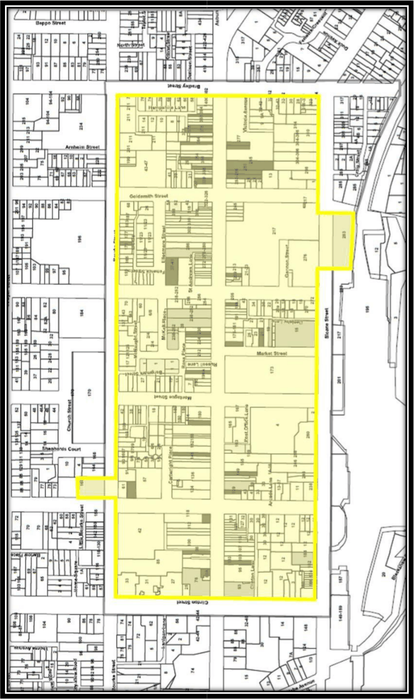
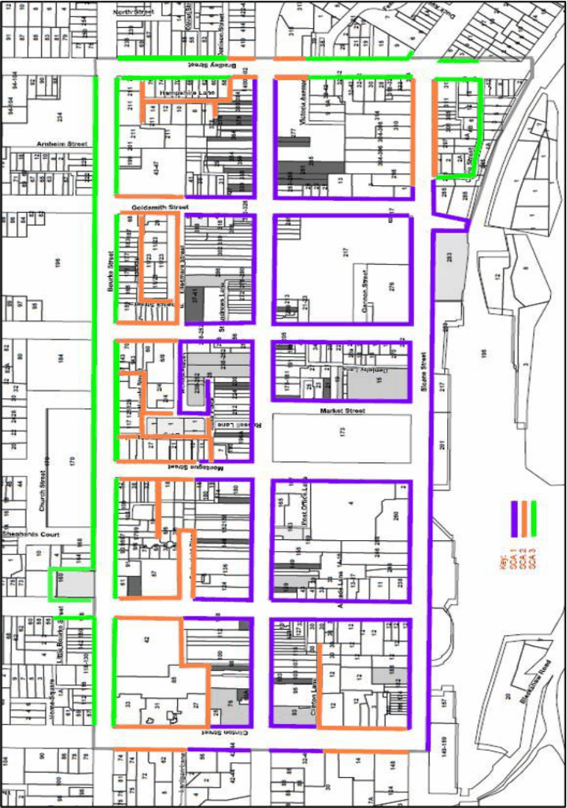
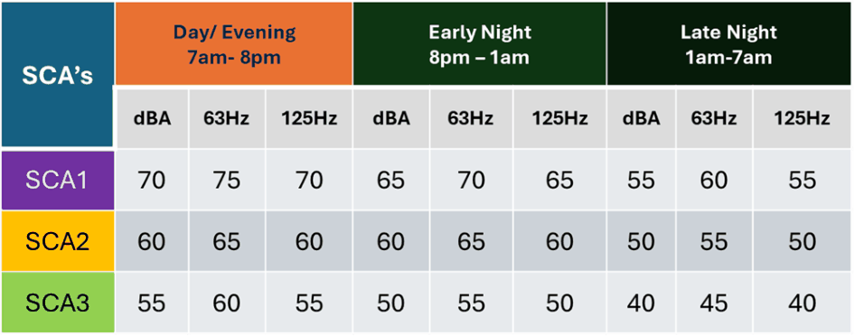
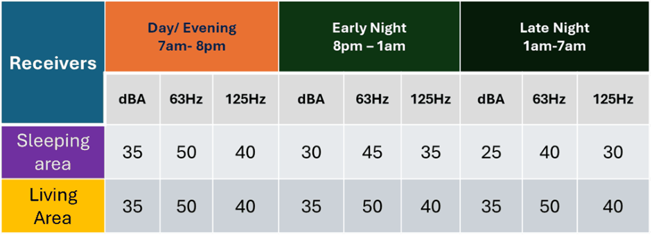
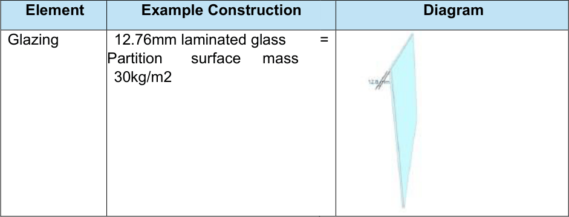
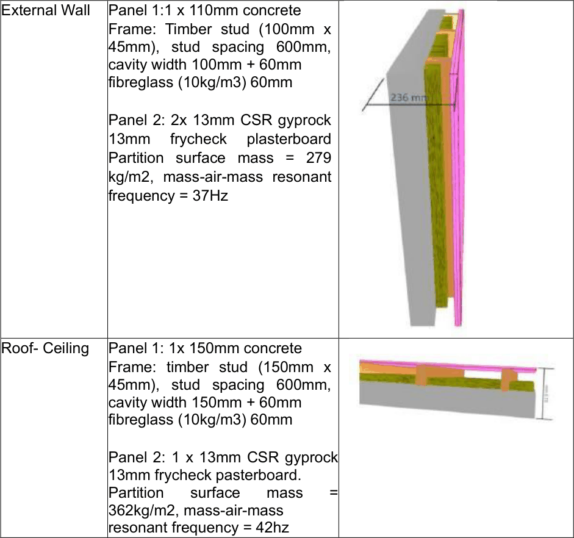

## 4. To ensure the role of stakeholders including businesses, residents, industry,

Council, Liquor and Gaming NSW and the Police are clear and committed to balance amenity and reasonable sound levels arising from the precinct.

#### Land to which this Policy applies

The Goulburn CBD Special Entertainment Precinct encompasses the area of Goulburn CBD known as the CBD Core which is denoted by the E2 Commercial Centre Land use zoning, whilst also including some peripheral areas within the MU1 Mixed Use land use zone.

The Special Entertainment Precinct includes:

• The north western boundary formed by Bourke Street which also includes the Hume Conservatorium at 160 Bourke Street

• The north eastern boundary formed by Bradley Street which extends eastward to include a small grouping of commercial and residential properties along Bradley Street

• The south eastern boundary formed by Sloane Street to the south inclusive of the Goulburn Railway Bowling Club at 283 Sloane St.

• The south western boundary formed by Clinton Street.

Figure 8-15-1 illustrates the extent of the Goulburn CBD Special Entertainment Precinct and the area to which this policy and the associated Precinct Management Plan apply.

Figure 8-15-1: The Goulburn CBD Special Entertainment Precinct Boundary Map

> [Picture on page 225: a picture, saved as a picture (images/part-08-site-specific-provisions-page-225-2.gif, 150 dpi).]

#### Sound Category Areas

Sound categories define the maximum external entertainment sound permitted within the Sound Category Area at a particular time of the day. Entertainment venues must ensure that sound generated by the premises does not exceed the maximum permissible sound limit, as measured externally from the property boundary.

New and existing entertainment venues must not exceed the sound limit prescribed for the relevant Sound Category Area in accordance with Figure 8-15-2 and Figure 8-15-3 and the Goulburn CBD Special Entertainment Precinct Management Plan. Sound Category Areas apply at the property boundary at a height of 1.5m above the finished floor level for each floor of the building.

Where a lot includes only one Sound Category Area boundary, this boundary applies to all lot boundaries.

Where a lot includes two different Sound Category Area boundaries, any undefined lot boundaries are to be assessed under the lower numbered SCA.

Figure 8-15-2: Sound Category Areas

> [Picture on page 227: a picture, saved as a picture (images/part-08-site-specific-provisions-page-227-2.gif, 150 dpi).]

Entertainment venues which exceed the sound emitter limit, prescribed in Figure 8-15-3, may be subject to compliance procedures in accordance with Chapter 12 of the Goulburn CBD Special Entertainment Precinct Management Plan.

#### Figure 8-15-3: Sound Management Criteria- Sound Emitters by time of day.

> [Picture on page 228: a picture, saved as a picture (images/part-08-site-specific-provisions-page-228-5.gif, 150 dpi).]

\* Note: There is an additional reduction on all of the above limits to account for the cumulative control of entertainment sound in the precinct- see below.

To ensure cumulative impacts of entertainment sound on sensitive receivers are appropriately considered in acoustic assessments, each individual venue must stay a few decibels below the relevant sound category area limit. These limits are measured at the boundary of the emitter.

When the venue shares a boundary with a sensitive receiver, the entertainment emitters sound limit should be 3dB below the applicable Sound Category Area limit. If the venue does not share a boundary with a sensitive receiver, the entertainment emitter sound limit should be 5dB below the applicable Sound Category Area limit to account for cumulative sound impacts from the range of venues in the precinct.

#### Sound Management- New and altered entertainment venues

Both proposed new entertainment venues and proposed altered entertainment venues, within the Precinct, must demonstrate their ability to contain sound within their premises to the extent that sound emitter criteria, as listed in Figure 8-15-3, are not likely to be exceeded.

#### Objective

To ensure proposed new and proposed altered entertainment venues do not unreasonably impact on the acoustic amenity of sensitive receivers.

#### Policy

Development applications for new entertainment venues (through change of use or new construction) or for alterations2 to the facade and/or extension of existing venues must submit the following:

#### • An acoustic assessment prepared by a suitably qualified and experienced

acoustic specialist3 which includes: o Identification of applicable Sound Category Areas  o Details of the physical sound attenuation measures, including vibration to be incorporated into the building design

#### o Demonstration that the physical sound attenuation measures proposed

can achieve sound levels which do not breach external sound criteria prescribed in Figure 8-15-3.

#### • A Plan of Management which includes:

#### o Details on the use of the site o Operational details of the site o Identify

all sources of sound, including amplified music and vibration o Detail on all sound management measures o Premises management measures  o Safety and security provisions, including an emergency evacuation procedure and mandatory venue signage

#### o Anticipated performance, creative or cultural events to be held on site

o Methods employed to implement harm minimisation and the responsible service of alcohol.

#### Sound Attenuation Sensitive Receivers

Sensitive receivers for the purposes of the Special Entertainment Precinct are defined in the Goulburn CBD Special Entertainment Precinct Management Plan. Sensitive receivers are defined as residential accommodation (including aged care), short stay visitor accommodation and other accommodation with overnight sleeping facilities.

2 Alterations to both entertainment venues and sensitive receivers includes any external modifications to the façade which create new door and/or window openings or changes existing external openings, and/or leads to an increase in habitable space and/or gross leasable floor area. 3 A suitably qualified acoustic specialist is defined as a consultant having a grade of Member (or higher) of the Australian Acoustic Society (AAS) or a consultant practicing as part of a member from the Association of Australasian Acoustical Consultants (AAAC).

Proposed new or proposed altered sensitive receiver development, which does not form part of a mixed-use development, must demonstrate that the material used in the building construction and the incorporation of wider attenuation measures ensures internal sound limits, as prescribed in Figure 8-15-4, are not exceeded within habitable rooms having regard to the maximum allowable external sound levels prescribed in Figure 8-15-3.

#### Objective

To ensure new and altered sensitive receivers mitigate for entertainment sound such that a reasonable level of acoustic amenity is maintained for occupants.

#### Policy

Development applications for new sensitive receiver development (through change of use or new construction) or for alterations to the facade and/or extension of the existing premises must submit the following:

#### • An acoustic assessment prepared by a suitably qualified acoustic specialist

which includes: o Identification of applicable Sound Category Areas o Details of the physical sound attenuation measures incorporated into the building design

#### o Demonstration that the physical sound attenuation measures proposed

can achieve sound levels which do not breach internal sound limits prescribed in Figure 8-15-44.

#### • Where sound attenuation measures impact upon the provision of natural

ventilation, alternative ventilation must be provided to ensure the proposal complies with National Construction Code.

#### • Sound impacts from road and rail sources must be assessed separately from

the provisions in this chapter.

4 The internal sound limit only applies to the new or modified components of the development.

#### Figure 8-15-4: Sensitive Receiver Sound limits by time of day.

> [Picture on page 231: a picture, saved as a picture (images/part-08-site-specific-provisions-page-231-2.gif, 150 dpi).]

Figure 8-15-5 presents potential materials currently available to attenuate the intrusion of external sound for sensitive receiver development based upon SCA1 criteria during the Day/Evening period when external sound levels will be at their highest. Figure 8-15-5 has regard to performance-based measures currently available in the market that would comply with the National Construction Code.

Figure 8-15-5: Indicative attenuation measures to achieve prescribed internal sound limits.

> [Picture on page 231: a picture, saved as a picture (images/part-08-site-specific-provisions-page-231-9.gif, 150 dpi).]

| Element | Example Construction | Diagram |
|---|---|---|
| Glazing | 12.76mm laminated glass Partition surface mass 30kg/m2 | = |

> [Picture on page 232: a picture, saved as a picture (images/part-08-site-specific-provisions-page-232-1.gif, 150 dpi).]

#### External Wall Panel 1:1 x 110mm concrete

Frame: Timber stud (100mm x 45mm), stud spacing 600mm,

#### cavity width 100mm + 60mm fibreglass (10kg/m3) 60mm

Panel 2: 2x 13mm CSR gyprock 13mm frycheck plasterboard Partition surface mass = 279 kg/m2, mass-air-mass resonant

#### frequency = 37Hz

#### Roof- Ceiling Panel 1: 1x 150mm concrete

Frame: timber stud (150mm x 45mm), stud spacing 600mm,

#### cavity width 150mm + 60mm fibreglass (10kg/m3) 60mm

Panel 2: 1 x 13mm CSR gyprock 13mm frycheck pasterboard. Partition surface mass = 362kg/m2, mass-air-mass

#### resonant frequency = 42hz

#### Sound Attenuation- Mixed Use Development

Proposed new mixed-use developments which include both space for entertainment venues and sensitive receivers within the same building must consider and provide adequate sound attenuation measures so not to exceed the external sound emitter limit or the internal sensitive receiver threshold.

Existing short stay visitor accommodation which falls within the same ownership and on the same site as an entertainment venue, such as pub with an on-site motel, are exempt from the application of sensitive receiver attenuation requirements. It must be noted however that a change of use application for either the emitter or receiver may result in the application of attenuation measures in accordance with the above policy requirements.

#### Objective

To ensure new mixed-use developments can adequately balance a reasonable level of amenity for sensitive receivers alongside the viable operation of sound generating entertainment venues within the same building.

#### Policy

Development applications for new mixed-use development inclusive of at least one sensitive receiver or for alterations to the facade and/or extension of the existing premises must submit the following:

#### • An acoustic assessment prepared by a suitably qualified acoustic specialist

which includes: o Identification of applicable Sound Category Areas o Demonstration that non-residential floor space within the building can be used as an entertainment venue whilst meeting applicable sound criteria.

#### o Details of the physical sound attenuation measures incorporated into

the building design

#### o Demonstration that the physical sound attenuation measures proposed

can achieve sound levels which do not breach sensitive receiver sound limits prescribed in Figure 8-15-4 or sound emitter limits prescribed in 8-15-3.

#### • Where sound attenuation measures impact upon the provision of natural

ventilation, alternative ventilation must be provided to ensure the proposal complies with National Construction Code.

#### • Sound impacts from road and rail sources must be assessed separately from

the provisions in this chapter.

#### Definitions

| Term | Definition |
|---|---|
| Entertainment Venues | A venue that hosts entertainment activities that generate sound from entertainment activity as defined under the Local Government Act 1993 |

| Entertainment Activity | An activity carried out for the purposes of entertaining members of the public, including: • live or recorded music; • other performances and activities such as karaoke, trivia, bingo and comedy; • private functions such as weddings, parties and ticketed events conducted by hospitality businesses; and • the provision of food and drink services. Also includes associated activities including: • Set up and pack down • Rehearsals and sound checks • Patrons entering and leaving the premises Sound generated by patrons and staff on the premises |
|---|---|
| Sound Emitter | A premises/venue that produces sound- referencing sound from entertainment activity. |
| Sensitive Receiver | Residential accommodation (including aged care), short stay tourist and visitor accommodation and other accommodation with overnight sleeping facilities |
| Sound Category Areas | The areas in which sound emitter and sensitive receiver sound controls apply |
| Precinct Management Plan | A document which outlines how sound, operations and amenity will be managed to support vibrant nightlife while minimising noise impacts on nearby sensitive receivers. |
