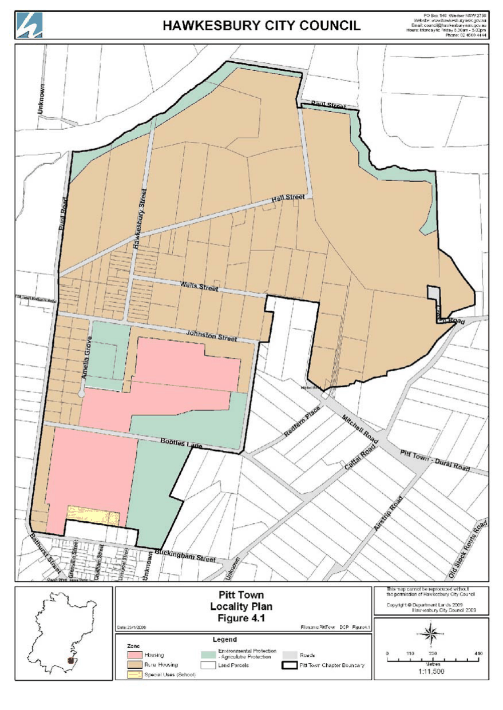

### 4.3 GENERAL PRINCIPLES

The general principles of the subdivision and development controls for Pitt Town set out within this chapter are to:

• to provide a clear planning document that outlines requirements for development which meets community expectations and addresses the key environmental planning issues of the city;

• provide a clear framework for subdivision and development;

• ensure development adopts sound urban design and environmental planning practices;

• ensure the orderly and proper development of the area;

• ensure that new development embraces water-sensitive urban design principles;

• ensure that new development contributes to the semi rural character;

• protect and enhance the important cultural heritage values;

• protect and enhance the important landscape and scenic values;

• conserve and manage areas of environmental significance;

• provide adequate physical and community infrastructure;

• protect the health and safety of existing and future residents; and,

• ensure development is consistent with Council's adopted sustainability principles.

Figure E4.1 Development Area

> [Picture on page 6: a picture, saved as a picture (images/ch-04-00-pitt-town-page-6-2.gif, 150 dpi).]

### Subdivision And Development Controls

The subdivision and development controls for the Pitt Town development area are set out below. The subdivision controls relate to the subdivision and use of land within the Pitt Town development area and to development within the public domain. The development controls relate to private development within lots.

### SUBDIVISION CONTROLS
