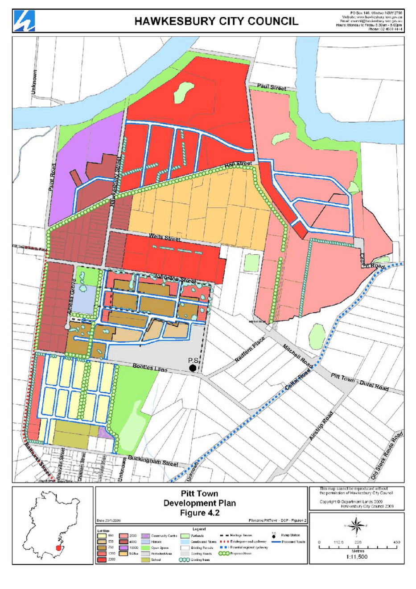
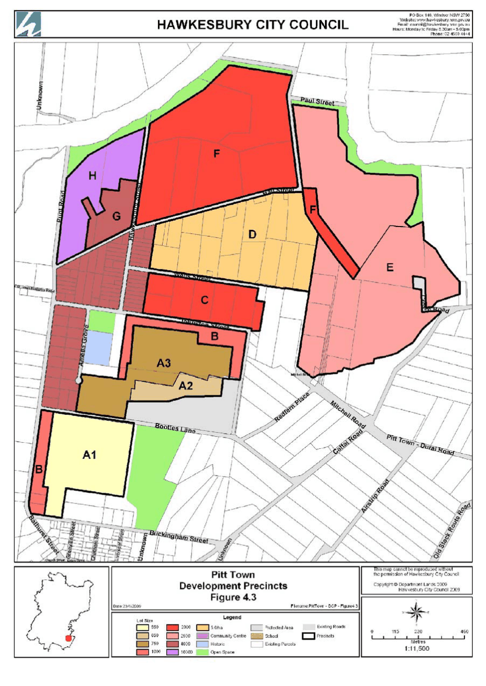

### 4.5 LOT DESIGN

#### 4.5.1 Aims

y There is a range of lot sizes available within Pitt Town to encourage a variety of housing forms. y Most lots are regular-shaped with the lot depth about twice the lot width. y Most lots are designed and orientated for good solar access. y Lot design considers special opportunities such as significant views. y Lots are large enough to protect special natural or cultural features within the lot. y Lot sizes are appropriate for the physical characteristics of a particular location. y Lot frontages along a street are approximately uniform and maintain a street rhythm.

Figure E4. 2: Development Plan

> [Picture on page 8: a picture, saved as a picture (images/ch-04-00-pitt-town-page-8-2.gif, 150 dpi).]

#### 4.5.2 Rules

a) Lot design is to generally comply with the Pitt Town Development Plan.

b) The “Statement of Commitments” and approval conditions attached to the Minister for Planning determination of the Pitt Town Concept Plan (MPA No. 07_0140), dated 10 July 2008, must be taken into consideration with all applications.

c) Lot design must, in Precincts A1, A2, A3, B, C and E, retain historic tree plantings and fence lines as shown in the Pitt Town Development Plan.

d) Lot sizes and frontages must meet the requirements set out in Table E4.1 below. The development precincts are shown on Figure E4.3.

Table E4. 1: Minimum Lot Sizes and Frontages

> [Picture on page 9: a picture, saved as a picture (images/ch-04-00-pitt-town-page-9-16.gif, 150 dpi).]

| Zone | Precinct | Minimum lot size area | Minimum lot frontage |
|---|---|---|---|
| Housing | A1 | 550m2 | 16m |
|  | A2 | 650m2 | 16m |
|  | A3 | 750m2 | 16m |
| Rural Housing | B C D E F G H | 1000m2 2000m2 5 lots/ha 2500m2 2000m2 4000m2 10000m2 | 18m 28m 25m 34m 25m 40m 35m or 10 for battleaxe lots |

#### 4.5.3 Development Precinct D - Rules

a) Lot design must comply with the 5 lots per hectare density control under the Hawkesbury Local Environmental Plan 1989.

b) Lots must be provided with suitable public street frontage and access.

c) Lot design should have due regard to established lot boundaries and development within the precinct.

d) Lot design should have due regard to existing significant vegetation within the precinct.

#### 4.5.4 Development Precinct E - Rules

a) Lots are to be contained within the Rural Housing zone boundary. No part of any lot is to extend beyond the zone boundary.

b) Lots must be provided with suitable public street frontage and access.

c) Lot design should have due regard to existing windbreak trees and other mature vegetation within the precinct.

Figure E4. 3: Development Precincts

> [Picture on page 11: a picture, saved as a picture (images/ch-04-00-pitt-town-page-11-2.gif, 150 dpi).]

#### 4.5.5 Development Precinct F - Rules

a) Lots are to be contained within the Rural Housing zone boundary.  No part of any lot is to extend beyond the zone boundary.

b) Lots must be provided with suitable public street frontage and access.

#### 4.5.6 Development Precinct G – Rules

a) Lots are to be contained within the Rural Housing zone boundary. No part of any lot is to extend beyond the zone boundary.

b) Lots must be provided with suitable public street frontage and access.

#### 4.5.7 Development Precinct H – Rules

a) Lots are to be contained within the Rural Housing zone boundary. No part of any lot is to extend beyond the zone boundary.

b) Lots must be provided with suitable public street frontage and access.

> [Picture on page 12: a picture, saved as a picture (images/ch-04-00-pitt-town-page-12-13.gif, 150 dpi).]
