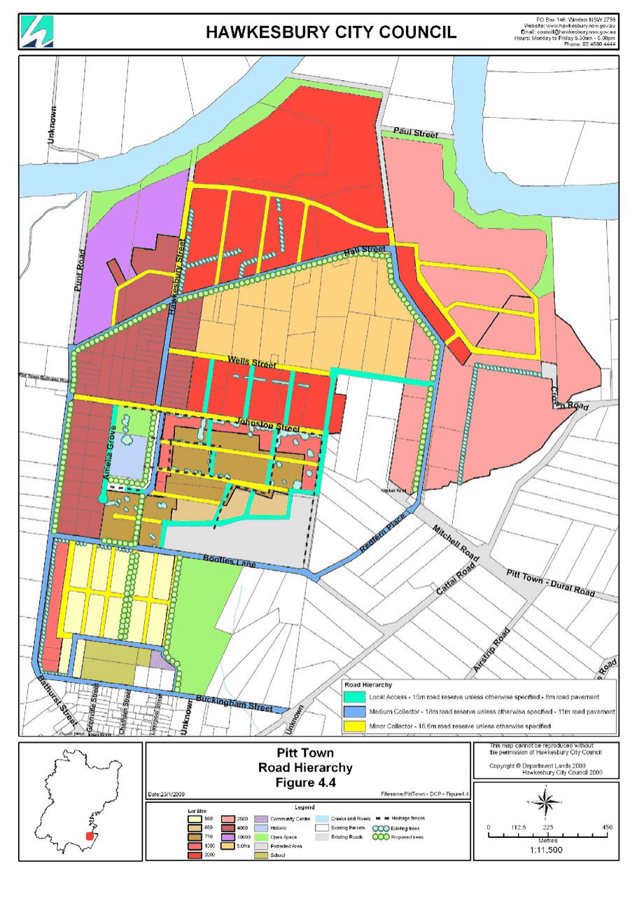
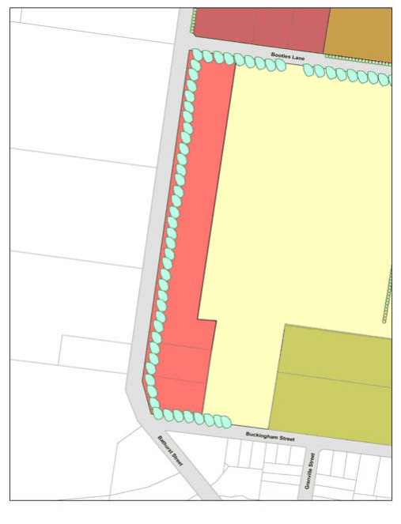
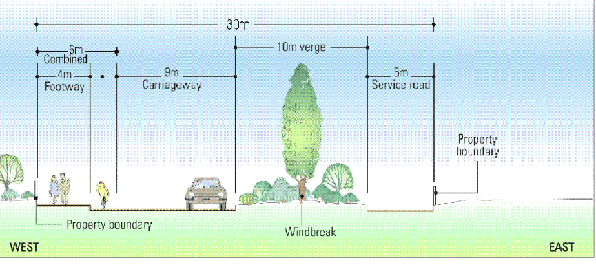
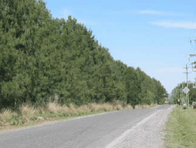
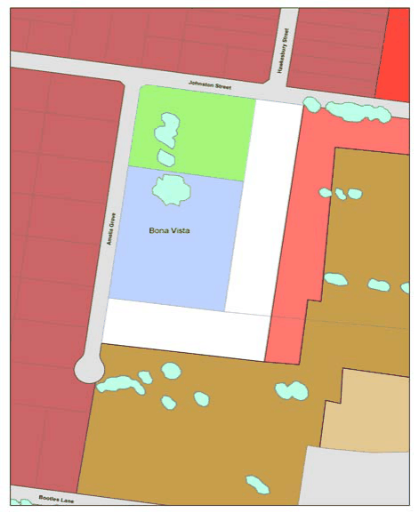
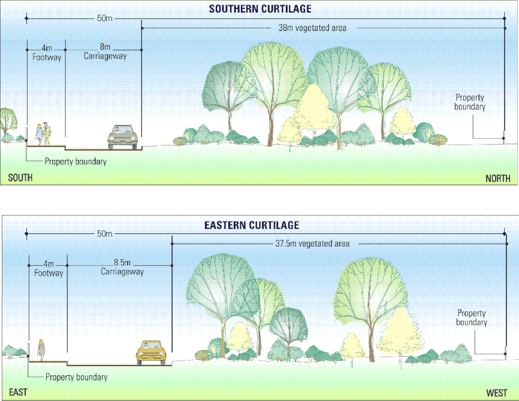
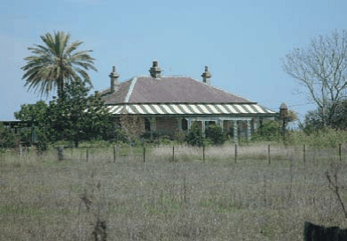
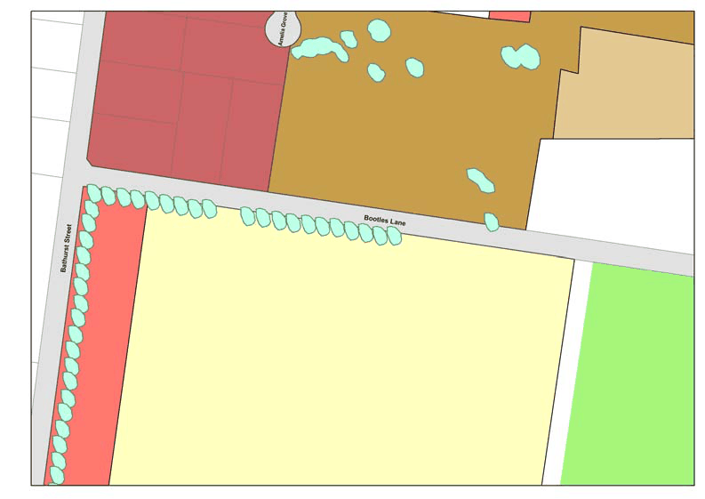
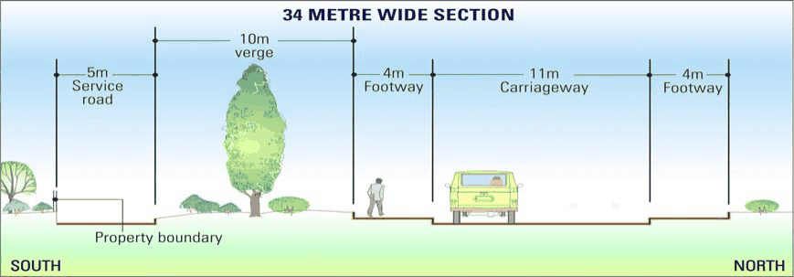
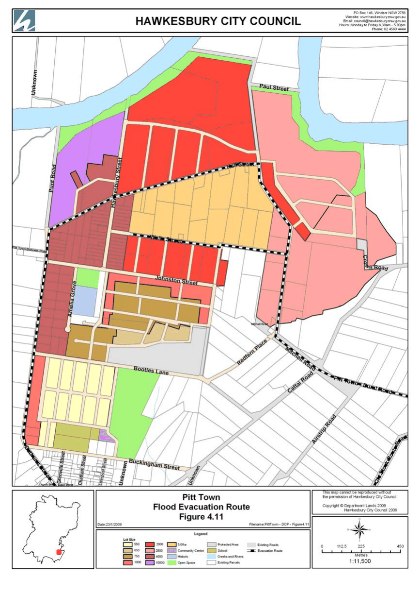

### 4.6 STREET DESIGN

#### 4.6.1 Aims

ƒ The street design creates a rectilinear urban structure consistent with the original crown land grants in the area. y The street design retains the boundaries of historic land grants and early subdivision. y The existing road alignments are retained and extended where feasible. y Significant vegetation and historic fence lines are retained within road reserves where appropriate. y The street scale and design is appropriate for its functional role. y An efficient and interconnected road system is established to service the area. y Road reserves provide for pedestrian and cyclist movement. y A safe and efficient flood evacuation route is available for Pitt Town residents.

#### 4.6.2 Rules

a) Street layout must be substantially in accordance with the Pitt Town Development Plan.

b) Significant trees on existing road verges are to be retained within the road reserve.

c) The road hierarchy throughout the development area must comply with Figure E4.4.

d) The design specifications for roads within the development area set out in Table

E4.2 below must be met unless the specific requirements set out below state otherwise.

Table E4. 2: Road Design Specifications

| Road type | Carriageway | Footway | Road reserve |
|---|---|---|---|
| Medium collector | 11.0m | 3.5m | 18.0m |
| Minor Collector | 9.6m | 3.5m | 16.6m |
| Local access road | 8.0m | 3.5m | 15.0m |

Note: As per Council’s Section 94 Contributions Plan, Buckingham Street from the corner of Bathurst Street to immediately east of the Pitt Town Public School only requires a 9.0m carriageway.

Figure E4. 4: Road Hierarchy

> [Picture on page 14: a picture, saved as a picture (images/ch-04-00-pitt-town-page-14-2.gif, 150 dpi).]

#### 4.6.3 Bathurst Street between Buckingham Street and

### Bootles Lane - Rules

a) The road reserve for this section of Bathurst Street is to be widened to 30 metres on its eastern side to incorporate the existing windbreak trees within a 10 metre verge.

b) Vehicle access to lots on the eastern side of Bathurst Street is to be provided either from the east or via a 5 metre wide service road between the lots and the

> [Picture on page 15: a picture, saved as a picture (images/ch-04-00-pitt-town-page-15-8.gif, 150 dpi).]

windbreak trees.

> [Picture on page 15: a picture, saved as a picture (images/ch-04-00-pitt-town-page-15-10.gif, 150 dpi).]

Figure E4. 5: Section of Bathurst Street to be Widened

Figure E4. 6: Bathurst Street Design Concept

> [Picture on page 16: a picture, saved as a picture (images/ch-04-00-pitt-town-page-16-1.gif, 150 dpi).]

Plate E4. 1: Windbreak Trees along Bathurst Street

#### 4.6.4 Bona Vista Homestead - Rules

a) The southern curtilage area is to incorporate a 50 metre road reserve that connects Amelia Grove to the southern extension of Hawkesbury Street. The road reserve is to include a 4 metre footway on the southern side containing the historic fence line and a 38 metre area of Cumberland Plain Woodland on the northern side.

b) A 50 metre road reserve is to be provided along the eastern boundary of the Bona Vista Homestead site. A 4 metre footway is to be provided on the eastern side of the road reserve. A 37.5 metre vegetated area is to be provided on the western side of the road reserve that incorporates Cumberland Plain Woodland.

c) Both the 38m and 37.5m wide strip will be acquired using funds from development contributions.

> [Picture on page 16: a picture, saved as a picture (images/ch-04-00-pitt-town-page-16-15.gif, 150 dpi).]

Figure E4. 7: Road Reserves around the Bona Vista Homestead Site

> [Picture on page 17: a picture, saved as a picture (images/ch-04-00-pitt-town-page-17-1.gif, 150 dpi).]

Figure E4. 8: Road Reserve Design Concepts

> [Picture on page 17: a picture, saved as a picture (images/ch-04-00-pitt-town-page-17-3.gif, 150 dpi).]

Plate E4. 2: Bona Vista Homestead

#### 4.6.5 Bootles Lane - Rule

The section of Bootles Lane fronting proposed new lots on one side is to be widened on the southern side to a 34 metre wide road reserve as shown on Figure E4.10.  The road reserve is to include a 4 metre footway on both sides of an 11 metre wide carriageway. A 10 metre verge is to be provided on the southern side of the road reserve that incorporates the existing windbreak trees and a 5 metre wide service road constructed to the south of the trees to provide street access and frontage to proposed lots where required to avoid tree removal for driveway crossovers.

> [Picture on page 18: a picture, saved as a picture (images/ch-04-00-pitt-town-page-18-1.gif, 150 dpi).]

Figure E4. 9: Section of Bootles Lane to be widened

> [Picture on page 18: a picture, saved as a picture (images/ch-04-00-pitt-town-page-18-3.gif, 150 dpi).]

Figure E4. 10 Bootles Lane Design Concept - 34m Wide SectionFigure

#### 4.6.6 Flood Evacuation Route - Rule

The flood evacuation route from Bathurst Street to Old Stock Route Road is to be at a minimum height of 17.3 metres AHD, the 1% AEP level. The route will be via Wells Street and/or Hall Street, Mitchell Place and Pitt Town Dural Road. Part of these works will be funded by way of development contributions.

Figure E4. 11: Flood Evacuation Route

> [Picture on page 19: a picture, saved as a picture (images/ch-04-00-pitt-town-page-19-2.gif, 150 dpi).]

#### 4.6.7 Development Precinct D - Rules

a) Any proposed east-west road connections through the precinct should have due regard to established lot boundaries and development.

#### 4.6.8 Development Precinct E - Rules

a) The road connections through the precinct must be provided substantially in accordance with the Pitt Town Development Plan.

b) The integrity of the existing windbreaks within the precinct is to be maintained.

c) The windbreak trees will be incorporated within road reserves where possible. A 4 metre footway or walking trail should extend alongside the windbreak. The walking trail should link into the road system through the precinct.

d) The Hall Street – Redfern Place link road is to be a landscaped boulevard incorporating appropriate street trees within the road reserve.

e) Internal access roads must connect to the Hall Street extension. No connections to Cattai Road will be permitted.

#### 4.6.9 Development Precinct F - Rules

a) The road connections through the precinct must be provided substantially in accordance with the Pitt Town Development Plan.

#### 4.6.10 Development Precinct G - Rules

a) The road connections through the precinct must be provided substantially in accordance with the Pitt Town Development Plan.
