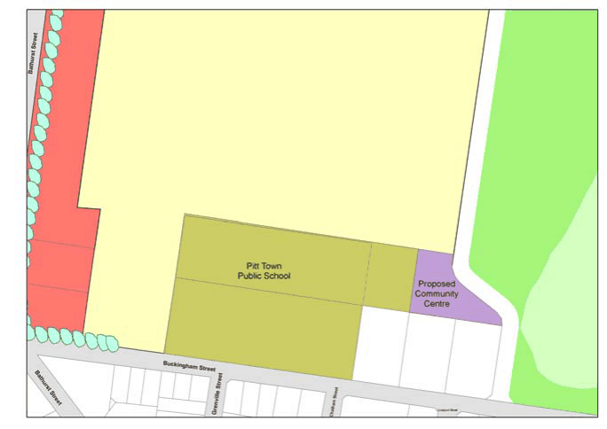
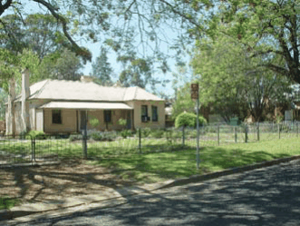

### 4.8 COMMUNITY FACILITIES

#### 4.8.1 Aims

y Pitt Town has adequate land and facilities provided for community facilities to meet the needs of existing and future residents.

#### 4.8.2 Rules

a) A community centre is to be provided on the approximately 4000 square metre site indicated on the Pitt Town Development Plan by way of development contributions. A development plan for the community centre site is to be prepared by Council to guide future development.

b) Pitt Town Public School is to be expanded as indicated on the Pitt Town Development Plan. A development plan for the school site is to be prepared to guide future development by the Department of Education and Training.  The Department is responsible for the acquisition of the site.

> [Picture on page 21: a picture, saved as a picture (images/ch-04-00-pitt-town-page-21-15.gif, 150 dpi).]

Figure E4. 12: Community Centre Site & School Site

> [Picture on page 21: a picture, saved as a picture (images/ch-04-00-pitt-town-page-21-17.gif, 150 dpi).]

Plate E4. 3: Pitt Town Public School
